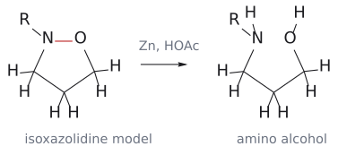

# 나이트론 고리화 첨가

> $\text{Nitrone}(\mathrm{R_2C{=}N^+R{-}O^-}) + \text{alkene} \longrightarrow \text{isoxazolidine}(\text{포화 5원 고리})$. N–O 결합을 끊으면 1,3-amino alcohol이 되므로, amino alcohol을 stereoselective하게 만드는 도구로 쓰인다.

## 개요

nitrone은 [1,3-dipole](../개념/1,3-쌍극자.md)의 하나로, O 쪽 끝은 nucleophilic(O⁻), C 쪽 끝은 electrophilic이다(공명 구조 ⁺CH2–NR–O⁻에서 C가 양전하를 띤다). 그런데 nitrone은 electrophilic과 nucleophilic 성질을 다 갖고 있으니, alkene의 어느 탄소와 어느 끝이 붙을지는 어떻게 정해질까? 답은 상대 alkene의 성격에 따라 nitrone이 역할을 바꾼다는 것이다. (출처: L15 p.13, p.15)

## 메커니즘

[1,3-dipolar cycloaddition](1,3-쌍극자%20고리화%20첨가.md)의 한 예로, 협동적 suprafacial–suprafacial [3+2] ($4\pi$ + $2\pi$ = 6전자)다. (출처: L15 p.14)

### nitrone 만들기

nitrone 자체는 간단히 만든다. aldehyde RCHO와 N-치환 hydroxylamine RNHOH를 축합시키면(imine 형성과 같은 원리, −H2O) R-CH=N⁺(R)-OH가 되고, 양성자가 빠지면 nitrone R-CH=N⁺(R)-O⁻가 된다(→ [imine](../개념/이민.md), [iminium ion](../개념/이미늄%20이온.md)). (출처: L15 p.16)

그림: 전자 풍부 alkene(파랑, HOMO)과 nitrone(빨간 C=N, LUMO)의 경우다. 세 화살표는 모두 같은 방향(시계 방향)으로 돈다. (1) nitrone O⁻의 비공유 전자쌍(파랑)이 alkene의 치환된 탄소(CHR)와 결합하고, (2) alkene의 $\pi$ 전자가 말단 $CH_2$ 에서 nitrone의 electrophilic 탄소와 결합하며, (3) C=N의 $\pi$ 전자가 N⁺로 돌아가 N이 중성이 된다. 초록 결합이 새로 생긴 C–O와 C–C 결합이므로 R은 O 옆 탄소(C5)에 놓인다. 전자 부족 alkene에서는 역할이 바뀌어 4-치환 생성물이 된다(본문 참고).

## 선택성

### Regioselectivity: 누가 HOMO를 쓰나

isoxazolidine 번호는 O1, N2, C3, C4, C5다.[^1] (출처: L15 p.15)

상대가 전자 풍부하거나 단순 alkyl 치환 alkene(R-CH=CH2, EDG)이면, alkene이 HOMO를 쓰고 nitrone이 LUMO를 쓴다. 그래서 nucleophilic한 alkene의 말단 CH2가 nitrone의 electrophilic 탄소를 공격하고, nitrone O⁻는 치환된 탄소와 결합한다. 생성물은 R이 O 옆 탄소에 있는 5-치환 isoxazolidine이다. (출처: L15 p.15)

반대로 상대가 전자 부족 alkene(R-CO-CH=CH2, EWG)이면 역할이 뒤바뀐다. 이번에는 nitrone이 HOMO, alkene이 LUMO를 쓴다. nitrone의 nucleophilic O⁻가 [conjugate addition](공액%20첨가.md)처럼 alkene의 electrophilic $\beta$-탄소(말단 CH2)를 공격하고, nitrone 탄소는 $\alpha$-탄소와 결합한다. 그래서 COR이 C4에 있는 4-acyl isoxazolidine이 생긴다(→ [frontier molecular orbital](../개념/프런티어%20분자%20오비탈.md)). (출처: L15 p.15)

| 상대 alkene | 오비탈 짝 | 결합 | 생성물 |
|---|---|---|---|
| 전자 풍부·alkyl(R–CH=CH2) | alkene HOMO + nitrone LUMO | $\begin{aligned} & \text{alkene}\ \mathrm{CH_2} \\ & \longrightarrow \text{nitrone}\ \mathrm{C},\ \text{nitrone}\ \mathrm{O} \\ & \longrightarrow \mathrm{CHR} \end{aligned}$ | **5-치환** (R이 O 옆) |
| 전자 부족(R–CO–CH=CH2) | nitrone HOMO + alkene LUMO | $\begin{aligned} & \text{nitrone}\ \mathrm{O^-} \\ & \longrightarrow \beta\ \mathrm{{-}CH_2},\ \text{nitrone}\ \mathrm{C} \\ & \longrightarrow \alpha\ \mathrm{{-}C} \end{aligned}$ | **4-acyl** |

### Stereoselectivity: exo

입체화학은 어떨까? Diels–Alder에서는 secondary orbital interaction 때문에 endo가 이겼지만, nitrone cycloaddition에서는 입체 장애가 가장 작은 **exo TS**가 선호된다. 보충: 왜 endo 규칙이 없을까? endo를 끌어당기던 것은 dienophile의 짝지음 기가 diene "뒤쪽"과 겹치는 2차 상호작용이었는데, nitrone과 단순 alkene에는 dipole이나 dipolarophile 뒤쪽에서 겹칠 짝지음 기가 없다. 그래서 입체 장애만 남고, 생성물도 더 안정한 exo가 된다(→ [endo rule](../개념/endo%20규칙.md)). (보충 근거: Clayden p.902) (출처: L15 p.16)

## amino alcohol 합성

고리형 nitrone(1-pyrroline N-oxide)과 R-CH=CH2를 반응시키면 R이 O 옆 탄소에 exo로 놓인 이환 isoxazolidine이 생긴다. 이것을 Zn/HOAc로 처리하면 약한 N–O 결합이 환원적으로 끊어져, 2-치환 pyrrolidine에 CH2-CH(OH)R가 붙은 1,3-amino alcohol이 된다. 분자 내 버전도 가능하다. 2-allyl-1-pyrroline N-oxide는 분자 내 1,3-dipolar cycloaddition으로 bridged 삼환 isoxazolidine을 만들고, Zn/HOAc로 N–H와 OH를 가진 이환 amino alcohol이 된다. 즉 nitrone cycloaddition은 "1,3-amino alcohol을 stereoselective하게 만드는 도구"로 쓰인다. (출처: L15 p.16)

보충: 1,3-dipolar cycloaddition의 가치는 헤테로고리 그 자체보다 그다음 변환에 있다. cycloaddition에서 만든 C–C와 C–O 결합은 남기고, 원래 dipole에 있던 약한 N–O 결합만 LiAlH4, Zn/HOAc, H2/Ni 같은 환원제로 끊으면 나머지 골격과 입체화학은 그대로 NH와 OH가 1,3 관계로 드러난다(→ [nitrile oxide cycloaddition](나이트릴%20옥사이드%20고리화%20첨가.md)). (보충 근거: Clayden p.902) (출처: L15 p.16)

## 예

- $\begin{aligned} & \mathrm{CH_2{=}N^+(Me){-}O^-} + \text{1-hexene} \\ & \longrightarrow \text{5-butyl-2-methylisoxazolidine}; + \text{methyl vinyl ketone} \\ & \longrightarrow \text{4-acetyl-2-methylisoxazolidine} \end{aligned}$ (출처: L15 p.15)
- $\begin{aligned} & \text{1-pyrroline N-oxide} + \mathrm{R{-}CH{=}CH_2} \\ & \longrightarrow (\text{R이 exo로}\ \mathrm{O}\ \text{옆에 놓인})\ \text{이환 isoxazolidine} \\ & \xrightarrow[\mathrm{HOAc}]{\mathrm{Zn}} \text{1,3-amino alcohol} \end{aligned}$ (출처: L15 p.16)
- 분자 내 판: $\begin{aligned} & \text{2-allyl-1-pyrroline N-oxide} \\ & \longrightarrow \text{다리걸친 삼환 isoxazolidine} \\ & \xrightarrow[\mathrm{HOAc}]{\mathrm{Zn}} \text{이환 amino alcohol} \end{aligned}$ (출처: L15 p.16)
- $\mathrm{RCHO} + \mathrm{RNHOH} \xrightarrow{\mathrm{{-}H_2O}} \text{nitrone}$ (출처: L15 p.16)

## 흔한 오해

- **"nitrone은 항상 같은 방향으로 붙는다"고 생각하기 쉽지만 사실은** EDG alkene과는 5-치환, EWG alkene과는 4-치환 생성물을 준다(슬라이드 기준). 상대에 따라 HOMO/LUMO 역할이 바뀌기 때문이다. (출처: L15 p.15)
- **"cycloaddition은 다 endo를 선호한다"고 생각하기 쉽지만 사실은** nitrone cycloaddition은 입체 장애가 작은 exo를 선호한다. endo 규칙은 [4+2]의 이야기다. (출처: L15 p.16)
- **"isoxazolidine = isoxazoline"이라고 생각하기 쉽지만 사실은** nitrone + alkene은 완전 포화한 isoxazolidine, nitrile oxide + alkene은 이중결합이 하나 있는 isoxazoline이다(→ [nitrile oxide cycloaddition](나이트릴%20옥사이드%20고리화%20첨가.md)). (출처: L15 p.15–19)

## cycloaddition에서 만든 골격을 다음 단계까지 추적한다

nitrone의 O와 N은 생성물에서 이웃해 있으므로 N–O 결합을 환원적으로 끊으면 alcohol과 amine이 드러난다. 이때 새로 만든 두 C–C/C–O 연결이 모두 사라지는 것은 아니다. Zn/HOAc 단계는 만들어진 고리를 풀어 주는 도구이고, 후속 MnO2는 남은 allylic alcohol을 carbonyl로 바꾸는 별도의 변환이다. (출처: L15 p.16; Tutorial Questions 5 p.2)

Tutorial 5의 phenyl diene은 두 C=C를 가진다. 어떤 C=C를 썼는지 먼저 표시하고 남은 C=C를 생성물에 반드시 남겨야 한다. 그다음 nitrone O가 붙은 탄소가 환원 후 OH를 갖는 탄소임을 추적한다. 이 OH가 남은 alkene 옆이라면 후속 MnO2 산화와 자연스럽게 연결된다. 최종 구조를 먼저 외우기보다 O의 이동 경로를 따라가면 세 단계를 한 번에 검산할 수 있다. (출처: Tutorial Questions 5 p.2; L15 p.16)

## 그림으로 확인하기

그림: N–O 결합의 환원으로 amino alcohol이 되는 일반 고리 모형이다. 원본의 치환·입체배치나 Tutorial 5의 bicyclic 정답을 확정한 그림은 아니다. (원본 대조: L15_cycloaddition part 3.pdf p.16)

[원본 자료에서 세부 구조·입체배치 확인: L15_cycloaddition part 3.pdf p.16](../../figures/L15/source/L15_p16.png)

## 관련 문서

- 반응: [1,3-dipolar cycloaddition](1,3-쌍극자%20고리화%20첨가.md), [nitrile oxide cycloaddition](나이트릴%20옥사이드%20고리화%20첨가.md), [conjugate addition](공액%20첨가.md)
- 개념: [1,3-dipole](../개념/1,3-쌍극자.md), [frontier molecular orbital](../개념/프런티어%20분자%20오비탈.md), [endo rule](../개념/endo%20규칙.md), [imine](../개념/이민.md), [iminium ion](../개념/이미늄%20이온.md)

## 출처

- [L15 cycloaddition 3부](../../notes/L15_Cycloaddition_Part3.md) 15절 (p.13–16)

[^1]: 보충: 실제 계에서는 치환기에 따라 regioselectivity가 섞여 나오기도 하지만, 시험에서는 슬라이드 규칙(EDG → 5-치환, EWG → 4-치환)을 따르면 된다. (출처: L15 p.15)
