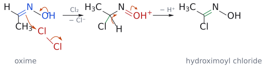
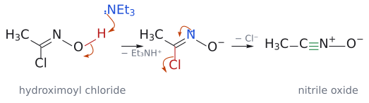
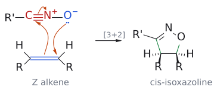

# 나이트릴 옥사이드 고리화 첨가

> Nitrile oxide(R–C≡N⁺–O⁻) + alkene → isoxazoline, + alkyne → isoxazole. alkene의 Z/E 정보가 고리의 cis/trans를 거쳐 aldol의 syn/anti로 이어진다.

## 개요

nitrile oxide는 삼중결합형 [1,3-dipole](../개념/1,3-쌍극자.md)이라, cycloaddition 뒤 고리 안에 C=N 이중결합이 하나 남는다(→ [1,3-dipolar cycloaddition](1,3-쌍극자%20고리화%20첨가.md)). 이렇게 만든 isoxazoline은 그 자체보다 **"다른 것으로 바뀌는 능력"**이 더 쓸모 있다. N–O 결합을 끊어 1,3-amino alcohol이나 β-hydroxy ketone([aldol](알돌%20반응.md) 생성물)을 얻는다. (출처: L15 p.14, p.20)

## nitrile oxide는 어떻게 만드나?

nitrile oxide도 반응계 안에서 만든다.[^1] acetaldehyde를 예로 들면 전체 반응은 MeCHO --[1. H2N-OH; 2. Cl2; 3. NEt3]--> Me-C≡N⁺-O⁻이며, 과정은 다음과 같다. (출처: L15 p.17)

1. acetaldehyde와 hydroxylamine이 축합해 oxime MeCH=N-OH가 된다(→ [imine](../개념/이민.md)).
2. OH 산소의 비공유 전자쌍이 밀어 주는 힘으로 C=N의 탄소가 Cl–Cl을 공격하고(Cl⁻ 이탈), Me-CH(Cl)-N=O⁺H가 된다.
3. C–H 양성자가 빠지면서 C=N이 다시 생겨 hydroximoyl chloride MeC(Cl)=N-OH가 된다.
4. NEt3가 O–H 양성자를 떼어 MeC(Cl)=N-O⁻를 만든다.
5. N의 비공유 전자쌍이 C=N 쪽으로 들어가 C≡N 삼중 결합을 만들면서 Cl⁻가 떨어져 나가고, Me-C≡N⁺-O⁻가 완성된다(O⁻는 그대로 남는다). (출처: L15 p.17)

보충: 4–5단계는 이어진 굽은 화살표 하나로 그릴 수 없어서 "O–H deprotonation → Cl⁻ 이탈"의 두 단계로 나누어 그린다. 떨어지는 H(O 위)와 Cl(C 위)이 1,3 관계라서 흔한 β-제거가 아니라 γ-제거에 해당한다. 2단계에서 oxime의 탄소가 Cl2를 공격할 수 있는 것은 oxime이 enol과 비슷하게 N–OH 쪽 전자를 밀어 주기 때문이다. (보충 근거: Clayden p.902–903) (출처: L15 p.17)

*그림: 2–3단계. 1단계에서 파란 OH 산소의 비공유 전자쌍이 N–O 사이로 밀려 들어가 N=O⁺를 만들고, 그 힘으로 파란 C=N의 π 전자가 빨간 Cl–Cl의 Cl 하나를 공격하며, Cl–Cl 결합 전자는 Cl⁻로 떨어져 나간다. 2단계에서는 C–H 결합 전자가 C–N 사이로 들어가 C=N을 다시 만들고(H⁺ 이탈), 빨간 N=O⁺의 π 전자가 산소로 돌아가 OH가 된다. 초록 결합이 새로 생긴 C–Cl과 C=N이다.*

*그림: 4–5단계. 1단계에서 파란 NEt3의 전자쌍이 빨간 O–H의 H를 떼고, O–H 결합 전자는 산소에 남아 O⁻가 된다. 2단계는 슬라이드 그림대로 파란 N의 비공유 전자쌍이 C=N 사이로 들어가 C≡N⁺를 만들고, 빨간 C–Cl 결합 전자가 Cl⁻로 떨어져 나간다. O⁻는 그대로 남으므로 생성물은 Me–C≡N⁺–O⁻다. 초록 결합이 새로 생긴 삼중 결합이다.*

## 선택성

슬라이드 p.18은 생성물 칸을 비워 둔 퀴즈이고, p.19가 정답이다. (출처: L15 p.18–19)

- **Stereospecificity:** 협동적 supra-supra 반응이므로 alkene의 기하는 그대로 보존된다. 그래서 R'-C≡N⁺-O⁻가 (Z)-RCH=CHR와 만나면 4,5-cis-이치환 isoxazoline(4,5-dihydroisoxazole, C3에 R')이, (E)-RCH=CHR와 만나면 4,5-trans-이치환 isoxazoline이 생긴다(→ [stereospecificity and stereoselectivity](../개념/입체특이성과%20입체선택성.md), [suprafacial and antarafacial](../개념/초면과%20대면.md)).
- **alkyne과 regioselectivity:** alkyne과 만나면 이야기가 조금 달라지는데, 고리에 이중결합이 두 개가 되어 방향족 isoxazole이 된다. 말단 alkyne HC≡C-R에서는 치환된 탄소가 O와 결합하므로 R이 C5(O 옆)에 오는 3,5-이치환 isoxazole이 생긴다.

*그림: nitrile oxide와 (Z)-alkene의 협동적 [3+2]. 빨간 C≡N⁺이 LUMO 쪽(electrophilic 탄소), 파란 C=C와 O⁻가 전자를 주는 쪽이다. 세 화살표는 모두 같은 방향(시계 방향)으로 돈다. (1) O⁻의 비공유 전자쌍이 alkene 오른쪽 탄소와 결합하고, (2) alkene의 π 전자가 nitrile oxide의 탄소와 결합하며, (3) C≡N의 π 결합 하나가 N⁺로 돌아가 N이 중성이 된다. 초록 결합이 새로 생긴 C–C와 C–O 결합이고, 고리 안에는 C=N이 하나 남는다. alkene에서 같은 쪽에 있던 두 R은 생성물에서도 같은 쪽(둘 다 쐐기)이므로 4,5-cis isoxazoline이 된다.*

보충: 이 regioselectivity는 nitrone과 같은 논리다(→ [nitrone cycloaddition](나이트론%20고리화%20첨가.md)). nitrile oxide cycloaddition을 주도하는 것은 alkene(또는 alkyne)의 HOMO와 nitrile oxide의 LUMO다. nucleophilic한 말단 CH2(CH) 탄소가 nitrile oxide의 electrophilic 탄소와 결합하므로, 남은 치환된 탄소가 O와 결합해 R이 C5에 놓인다. isoxazole이 특히 안정한 것은 고리의 C=C, C=N π 전자 4개에 O의 비공유 전자쌍 2개가 더해진 6π 방향족 고리이기 때문이다(→ [aromaticity](../개념/방향족성.md)). (보충 근거: Clayden p.903) (출처: L15 p.18–19)

## isoxazoline은 무엇으로 바뀌나?

LiAlH4로 환원하면 C=N이 환원되고 N–O가 끊어져 1,3-amino alcohol R-CH(NH2)-CH2-CH(OH)-R가 된다(→ [LiAlH4](../시약/LiAlH4.md)). 한편 H2/Ni와 물로 처리하면 N–O 결합이 수소화 분해되어 β-hydroxy imine이 되고, 이것이 물에 가수분해되어 β-hydroxy ketone, 즉 aldol 생성물이 된다(→ [catalytic hydrogenation](촉매%20수소화.md)). 여기서 놀라운 점은 입체 정보의 전달이다. **cis-isoxazoline은 syn-aldol을, trans-isoxazoline은 anti-aldol을 준다.** 즉 alkene의 Z/E 기하가 고리의 cis/trans를 거쳐 aldol의 syn/anti로 이어진다(→ [aldol reaction](알돌%20반응.md)). (출처: L15 p.20)

## 예

- MeCHO --[1. NH2OH 2. Cl2 3. NEt3]--> Me–C≡N⁺–O⁻ (hydroximoyl chloride 경유) (출처: L15 p.17)
- R'–C≡N⁺–O⁻ + (Z)-RCH=CHR → 3-R'-4,5-*cis*-diR-isoxazoline; + (E) → 4,5-*trans* (출처: L15 p.19)
- R'–C≡N⁺–O⁻ + HC≡C–R → 3-R'-5-R-isoxazole (출처: L15 p.19)
- isoxazoline --[LiAlH4]--> 1,3-amino alcohol (출처: L15 p.20)
- isoxazoline --[H2/Ni, H2O]--> β-hydroxy ketone (cis → syn, trans → anti) (출처: L15 p.20)

## 흔한 오해

- **"isoxazole, isoxazoline, isoxazolidine은 같다"고 생각하기 쉽지만 사실은** 각각 방향족(nitrile oxide + alkyne), 이중결합 하나(nitrile oxide + alkene), 완전 포화([nitrone](나이트론%20고리화%20첨가.md) + alkene)로 다르다. (출처: L15 p.15–19)
- **"isoxazoline을 환원하면 항상 amino alcohol이 된다"고 생각하기 쉽지만 사실은** LiAlH4는 amino alcohol을, H2/Ni + H2O는 질소가 가수분해로 빠진 β-hydroxy ketone(aldol 생성물)을 준다. cis → syn, trans → anti다. (출처: L15 p.20)

## 관련 문서

- 반응: [1,3-dipolar cycloaddition](1,3-쌍극자%20고리화%20첨가.md), [nitrone cycloaddition](나이트론%20고리화%20첨가.md), [aldol reaction](알돌%20반응.md), [catalytic hydrogenation](촉매%20수소화.md)
- 개념: [1,3-dipole](../개념/1,3-쌍극자.md), [stereospecificity and stereoselectivity](../개념/입체특이성과%20입체선택성.md), [imine](../개념/이민.md), [aromaticity](../개념/방향족성.md), [pericyclic reaction](../개념/페리고리%20반응.md)
- 시약: [LiAlH4](../시약/LiAlH4.md)

## 출처

- [L15 cycloaddition 3부](../../notes/L15_Cycloaddition_Part3.md) 15절 (p.17–20)

[^1]: 보충: nitrile oxide는 불안정해서 쉽게 이량체화하므로, 보통 반응계 내(in situ)에서 생성하여 곧바로 dipolarophile과 반응시킨다. (출처: L15 p.17)
