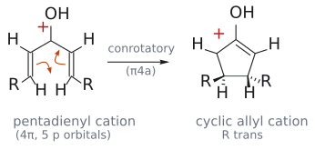

# 나자로프 고리화

> **강의 자료 반영:** 공개된 L16·L17 강의와 대조했다. 소절의 L# p.N은 강의 PDF 쪽수이며, Clayden/Wade만 인용한 설명은 교재 보충이다.

> divinyl ketone($\alpha,\beta$-unsaturated가 양쪽에 있는 ketone)이 산 촉매로 cyclopentenone이 되는 반응. 핵심 단계는 protonation으로 생긴 **pentadienyl cation(5오비탈, $4\pi$)의 [electrocyclic reaction](전자고리화%20반응.md)**이라, 열적으로는 conrotatory, 빛으로는 disrotatory다.

## 개요

양쪽으로 $\alpha,\beta$-unsaturated된 ketone(divinyl ketone)이 고리가 닫혀 cyclopentenone이 되는 반응이 Nazarov cyclization이다. 러시아 화학자 Nazarov의 이름을 땄다. 열과 빛에서 입체화학이 뒤집힌다는 사실이 이 반응이 electrocyclic reaction이라는 증거다. (출처: Clayden p.927)

## 메커니즘

1. 산이 ketone 산소를 protonation한다. 공명으로 양전하가 양쪽 $\beta$-탄소까지 퍼져, **p 오비탈 다섯 개에 $\pi$ 전자 4개**인 pentadienyl cation이 된다(→ [carbocation](../개념/탄소%20양이온.md)).
2. 다섯 오비탈 가운데 하나가 비어 있으므로 이것은 **$4\pi$ electrocyclic reaction**이다. 열적이므로 새 $\sigma$ 결합을 만드는 오비탈은 **antarafacial($\pi4\mathrm{a}$)**, 즉 **conrotatory**로 만난다(→ [conrotation and disrotation](../개념/콘로테이션과%20디스로테이션.md)).
3. 고리가 닫혀 생긴 cation(OH가 붙은 고리 속 [allyl cation](../개념/알릴%20양이온.md))에서 양성자가 빠지고 tautomerize하여 cyclopentenone이 된다(→ [keto–enol tautomerization](케토-엔올%20토토머화.md)).

전자 수를 셀 때 **오비탈 수(5)가 아니라 전자 수(4)**로 센다는 점이 핵심이다. 대괄호 숫자가 원자 수였던 cycloaddition의 함정과 같은 종류다. (출처: Clayden p.927)

그림: protonate된 divinyl ketone의 공명 구조 가운데 양전하(빨강 +)가 OH 탄소에 있는 형태로 그렸다(Clayden과 같은 그림). 왼쪽 주황 화살표는 C=C $\pi$ 전자가 양 끝 탄소 사이에 새 $\sigma$ 결합(초록)을 만드는 것, 오른쪽 화살표는 다른 C=C $\pi$ 전자가 OH 탄소 쪽으로 옮겨 가 양전하를 채우는 것이다. 결과는 OH가 가운데 붙은 고리 속 allyl cation이다. p 오비탈 5개에 $\pi$ 전자 4개이므로 열적 반응은 conrotatory($\pi4\mathrm{a}$)다. 보충: R을 바깥쪽에 둔 (E,E)-출발물이 conrotatory로 닫히면 두 R은 trans(하나는 쐐기, 하나는 점선)가 된다. Clayden의 이 그림은 R의 입체화학을 표시하지 않으며, trans는 같은 쪽 고리 접합 H 예(산 촉매 → trans)와 같은 논리로 그린 것이다. 이후 양성자가 빠지고 tautomerize하여 cyclopentenone이 된다. (근거: Clayden p.927–928)

## 선택성: 열과 빛이 반대 입체화학을 준다

di(cyclohexenyl) ketone으로 확인할 수 있다. (출처: Clayden p.927–928)

| 조건 | 회전 | 고리 접합 두 H |
|---|---|---|
| H3PO4, AcOH (열적, 산 촉매) | conrotatory ($\pi4\mathrm{a}$) | **trans**인 tricyclic cyclopentenone |
| $h\nu$, benzene (광화학) | disrotatory ($\pi4\mathrm{s}$) | **cis**인 생성물 |

같은 출발물에서 조건에 따라 입체화학이 뒤집힌다는 것이 이 반응이 electrocyclic reaction이라는 강한 증거다.[^1]

## 흔한 오해

- "Nazarov는 탄소 다섯 개니까 5전자, 또는 $6\pi$ 반응": pentadienyl **cation**은 p 오비탈 5개에 전자 4개, 즉 $4\pi$라 열적 conrotation이다. 같은 5오비탈이라도 dienyl **anion**은 $6\pi$라 disrotation이다(→ [electrocyclic reaction](전자고리화%20반응.md)). (출처: Clayden p.927–928)
- "극성 반응이라 stereospecificity가 없다": 고리 닫힘 단계는 협동적 electrocyclic reaction이라 열/빛에 따라 정해진 입체화학을 준다. (출처: Clayden p.927–928)

## 관련 문서

- 반응: [electrocyclic reaction](전자고리화%20반응.md), [keto–enol tautomerization](케토-엔올%20토토머화.md)
- 개념: [conrotation and disrotation](../개념/콘로테이션과%20디스로테이션.md), [allyl cation](../개념/알릴%20양이온.md), [Woodward–Hoffmann rules](../개념/우드워드-호프만%20규칙.md), [carbocation](../개념/탄소%20양이온.md)

## 출처

- [L17 Electrocyclic Reactions (교재 보충)](../../notes/L17_Electrocyclic_Reactions.md) 7절, 흔한 오해 (Clayden 35장 기반)

[^1]: Clayden은 이 비교를 근거로 "열적으로는 conrotatory, 광화학적으로는 disrotatory"를 확인한다고 쓴다. 광화학 반응 쪽도 protonate된 $\pi4$ cation으로 그려져 있다. (출처: Clayden p.928)
