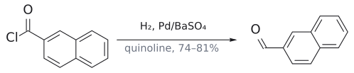

# 로젠문트 환원

> acid chloride --[H₂, Pd/BaSO₄, quinoline]--> aldehyde. [catalytic hydrogenation](촉매%20수소화.md)에서 **가장 쉬운** 작용기가 acid chloride라는 점을 이용해 C–Cl만 끊는다.

## 개요

carboxylic acid는 metal hydride로 환원하면 alcohol까지 가 버린다. aldehyde에서 멈추고 싶다면 산을 acid chloride로 바꾼 뒤 이 반응을 쓴다. acid chloride가 hydrogenation에서 가장 쉽다는 점을 이용하면, "carboxylic acid → acid chloride → aldehyde"라는 경로가 생긴다. (출처: L5 p.17, p.33)

## 원리

슬라이드는 catalytic hydrogenation이 쉬운 순서를 다음처럼 줄 세운다(자세한 내용은 [catalytic hydrogenation](촉매%20수소화.md)). (출처: L5 p.33)

1. RCOCl → RCHO
2. ArNO₂ → ArNH₂
3. RC≡CR → *cis*-RCH=CHR
4. R₂C=NR → R₂CH–NHR
5. RCH=CHR → RCH₂CH₂R
6. RX–CH₂Ph → RXH + PhCH₃ (X = O, NH; benzyl group 제거, → [hydrogenolysis](수소화분해.md))
7. RCN → RCH₂NH₂
8. benzene 고리 → cyclohexane 고리

acid chloride가 맨 앞이므로, 촉매를 순하게 해 두면 C–Cl만 환원되고 생긴 aldehyde와 aromatic ring은 남는다. BaSO₄는 촉매 담체이고, quinoline은 첨가제다.[^1] (출처: L5 p.33)

## 예

$$
\text{2-naphthoyl chloride} \xrightarrow[\text{quinoline}]{\ \mathrm{H_2},\ \mathrm{Pd/BaSO_4}\ \mathstrut} \text{2-naphthaldehyde}
$$

(수율 74–81%)

(L5)

여기서는 C–Cl 결합만 환원되고, 생긴 aldehyde와 naphthalene 고리는 환원되지 않는다. (출처: L5 p.33)

ester를 aldehyde로 바꾸는 우회로(ester 가수분해 → carboxylic acid → SOCl₂ → acid chloride → Rosenmund)로도 쓴다([L5 연습 문제](../../practice/L05_Exercises.md) 7번, → [partial reduction of esters](에스터%20부분%20환원.md)). (출처: L5 p.17, p.33)

그림: Rosenmund 환원. 독성화한 촉매라 aldehyde에서 멈춘다.

## 흔한 오해

- **"H₂/Pd니까 aromatic ring이나 aldehyde도 같이 환원된다"**: acid chloride는 hydrogenation 서열의 맨 앞, benzene 고리는 맨 끝이다. 순한 촉매에서는 C–Cl만 끊긴다. (출처: L5 p.33)

## 관련 문서

- 반응: [catalytic hydrogenation](촉매%20수소화.md), [Lindlar reduction](린들라%20환원.md), [partial reduction of esters](에스터%20부분%20환원.md), [hydrogenolysis](수소화분해.md)
- 시약: [Pd/C](../시약/Pd-C.md), [Lindlar catalyst](../시약/린들라%20촉매.md), [DIBAL-H](../시약/DIBAL-H.md)
- 개념: [metal hydride의 반응성](../개념/금속%20수소화물의%20반응성.md)

## 출처

- [L5 환원](../../notes/L05_Reduction.md) 2절, 3절 (슬라이드 p.17, p.33)
- [L5 연습 문제](../../practice/L05_Exercises.md) 7번

[^1]: 보충: quinoline은 Pd 촉매를 일부러 부분 피독시켜(활성을 낮춰) 생성된 aldehyde가 더 환원되지 않게 하는 역할을 한다. 담체를 탄소 대신 BaSO₄(또는 CaCO₃)로 쓰는 것도 같은 목적이다. 생성물이 촉매 표면에서 빨리 떨어져 나가게 해 과잉 환원을 줄인다. 6강의 Lindlar catalyst(Pd/CaCO₃/Pb, → [Lindlar reduction](린들라%20환원.md))도 같은 발상이다. (보충 근거: Clayden p.537–538)
