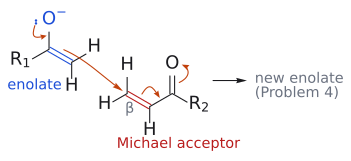
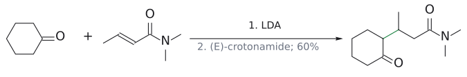
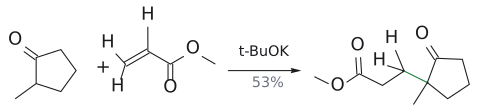
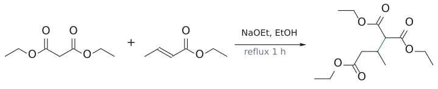
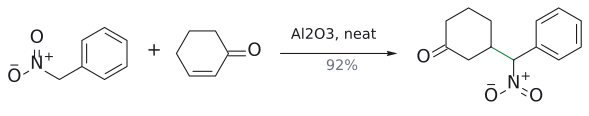
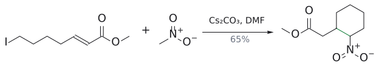

# 마이클 반응

> enolate나 enamine 같은 탄소 nucleophile이 $\alpha,\beta$-unsaturated carbonyl(Michael acceptor)의 $\beta$-탄소에 붙어 **1,5-dicarbonyl 화합물**을 만드는 [conjugate addition](공액%20첨가.md)이다.

## 개요

슬라이드는 conjugate addition 전체를 "Michael addition"이라고도 부른다. 그중 합성에서 가장 쓸모 있는 것은 enolate가 받개를 공격해 새 C–C 결합을 만드는 경우다. L7([enolate alkylation](엔올레이트%20알킬화.md)), L8([aldol](알돌%20반응.md)), L10([enol](../개념/엔올과%20엔올레이트.md)과 [enamine](../개념/엔아민.md))에서 만든 nucleophile들을 다시 꺼내 1,5-dicarbonyl 화합물을 만든다. 두 carbonyl이 1,5 관계로 놓이므로, 이어서 [intramolecular aldol](분자내%20알돌%20반응.md)을 일으키면 6원 고리를 닫을 수 있다(→ [Robinson annulation](로빈슨%20고리%20형성.md)). (출처: L11 p.4, p.14)

Michael addition은 L8에서 이미 예고되었다. L8 p.33은 enolate가 만나는 세 electrophile을 정리하며 세 번째로 conjugate addition을 든다: enolate + $\alpha,\beta$-unsaturated carbonyl(CH2=CHCOR') ⇌ 1,5-dicarbonyl RCOCH2CH2CH2COR'(→ [enolate chemistry (overview)](../개념/엔올레이트%20화학%20개관.md)).[^1] (출처: L8 p.33)

## 메커니즘

ketone에 염기를 넣어 만든 enolate(→ [enolate alkylation](엔올레이트%20알킬화.md))는 탄소 nucleophile로서 Michael acceptor의 $\beta$-탄소를 공격한다.

$$
\begin{aligned}\mathrm{R_1COCH_3}&\xrightarrow{\text{base}}\text{enolate}\\\text{enolate}&\xrightarrow{\mathrm{CH_2{=}CHCOR_2}}\mathrm{R_1COCH_2CH_2CH_2COR_2}\end{aligned}
$$

1. 염기가 $\alpha$-H를 떼어 enolate를 만든다(→ [enol and enolate](../개념/엔올과%20엔올레이트.md)).
2. enolate의 $\alpha$-탄소(nucleophile)가 Michael acceptor의 $\beta$-탄소(electrophile)를 공격해서 새 C–C 결합이 생긴다. 받개 쪽의 $\pi$ 전자는 산소로 밀려 **새 enolate**가 된다.
3. 이 enolate가 protonate되면 **1,5-dicarbonyl 화합물**이 된다.

그림: 2단계의 전자 이동만 그렸다(생성물은 [L11 연습 문제](../../practice/L11_Exercises.md) 문제 4로 남겨 두었다). 화살표는 넷이다. (1) O⁻의 비공유 전자쌍이 내려와 C=O를 다시 만들고, (2) enolate의 C=C $\pi$ 전자(파랑, nucleophile)가 받개의 $\beta$-탄소(빨강, electrophile)와 새 C–C 결합을 만든다. (3) 받개의 C=C $\pi$ 전자는 carbonyl 쪽 C–C 자리로, (4) 받개의 C=O $\pi$ 전자는 산소로 간다.

슬라이드 p.14의 빈칸은 2단계 생성물을 묻는다(연습 문제 4). 그 밖의 Michael acceptor 예로는 methyl cinnamate(Ph-CH=CH-CO2Me), acrylonitrile(CH2=CH-CN), ethyl vinyl ketone(CH2=CH-CO-CH2CH3)이 있다. nitrile도 EWG라서 받개가 된다. (출처: L11 p.14)

보충: nitrile 받개가 특히 깔끔한 이유는, nitrile 탄소는 electrophile 자리로서 반응성이 낮아 nucleophile이 C≡N에 직접 붙는 경쟁(carbonyl의 1,2-첨가에 해당)이 거의 없기 때문이다. 그러면서도 음전하는 carbonyl처럼 잘 안정화한다. 그래서 acrylonitrile은 enolate에 대해 가장 좋은 Michael acceptor 중 하나다. (보충 근거: Clayden p.510)

보충: 역합성에서 거꾸로 쓰는 요령도 기억해 두자. [Claisen condensation](클라이젠%20축합.md)은 두 carbonyl 사이에 포화 탄소가 하나인 1,3-dicarbonyl을, Michael addition은 포화 탄소가 셋인 **1,5-dicarbonyl**을 준다. 표적에 1,5 관계가 보이면 한쪽 carbonyl 기준 $\beta,\gamma$ 결합을 끊어 보자. $\beta$ 쪽 조각은 $\alpha,\beta$-unsaturated 받개, 다른 조각은 enolate(필요하면 ester를 덧붙인 안정한 enolate) 공여체가 된다. (보충 근거: Wade p.1087–1088)

## 선택성

### conjugate addition과 aldol의 경쟁

그런데 enolate는 carbonyl을 직접 칠 수도 있다. 그것이 바로 [aldol reaction](알돌%20반응.md)이다. enolate와 enone을 섞으면 두 갈래가 생긴다.
- **conjugate addition(촉진해야 할 것)**: 1,5-dicarbonyl로 간다.
- **직접 첨가 = aldol(피해야 할 것)**: alkoxide를 거쳐 $\beta$-hydroxy carbonyl이 된다(ketone 받개이면 OH 탄소가 3차, aldehyde 받개이면 2차). 이 단원의 경쟁 반응에서 aldol 단계는 **가역적**이다.

aldol이 가역이라는 점이 중요하다. 이 조건에서 aldol이 되었다가 되돌아오면, 상대적으로 되돌아가기 어렵고 thermodynamic으로 유리한 conjugate addition 생성물이 축적될 수 있다(MVK + CN⁻의 [kinetic/thermodynamic](../개념/속도론적%20지배와%20열역학적%20지배.md) 논리와 같다, → [1,2-addition vs 1,4-addition](../개념/1,2-첨가와%201,4-첨가.md)). (출처: L11 p.15)

보충: 따라서 conjugate addition을 돕는 전략은 모두 "aldol을 더 쉽게 되돌리는" 방향이다. (1) enolate를 더 안정하게 만들면(예: malonic ester처럼 EWG 두 개) aldol 생성물에서 그 안정한 anion이 다시 떨어져 나가기 쉬워지고, 덤으로 aldol 생성물이 더 붐벼서 불안정해진다. (2) 받개를 ester·amide처럼 carbonyl이 덜 electrophilic한 화합물로 고르면 aldol 자체가 덜 일어나고 더 잘 되돌려진다. 아래 counterion·안정한 enolate의 예들은 모두 이 두 전략의 응용이다. (보충 근거: Clayden p.605–606)

받개의 carbonyl 치환기 R이 바뀌면 conjugate addition 경향은 다음 순서로 커진다.

**R = H < alkyl < OR < NR2**

이 순서는 직접 첨가 비율 순서(acyl chloride > enal > enone > ester > amide, → [1,2-addition vs 1,4-addition](../개념/1,2-첨가와%201,4-첨가.md))를 뒤집은 것과 같다. amide는 carbonyl이 가장 덜 electrophilic해서 conjugate addition을 가장 잘 받는다. 예:

$$
\begin{aligned}\text{cyclohexanone}&\xrightarrow{\mathrm{LDA}}\text{Li enolate}\\\text{Li enolate}&\xrightarrow{\mathrm{(E){-}CH_3CH{=}CHCONMe_2}}\begin{gathered}\text{2-}(\mathrm{CH(CH_3)CH_2CONMe_2})\\\text{cyclohexanone}\end{gathered}\end{aligned}
$$

(수율 60%)

생성물은 cyclohexanone의 $\alpha$-탄소에 amide 받개의 $\beta$-탄소가 붙은 1,5-dicarbonyl이다. (출처: L11 p.15)

### counterion과 enolate 종류

**Li⁺는 1,2(aldol)를 돕는다.**

$$
\begin{aligned}\mathrm{(CH_3)_2CHCO_2Et}&\xrightarrow[{-78}\,^\circ\mathrm C,\ \mathrm{THF}]{\mathrm{LDA}}\text{Li enolate}\\\text{Li enolate}&\xrightarrow{\mathrm{(CH_3)_2C{=}CHCHO}}\mathrm{(CH_3)_2C{=}CHCH(OH)C(CH_3)_2CO_2Et}\end{aligned}
$$

(수율 72%)

이번에는 enal을 받개로 썼는데 conjugate addition이 아니라 **aldol(1,2) 생성물**이 나왔다. 왜일까? lithium 이온이 aldehyde 산소에 배위하면서 enolate 산소와 함께 고리형 transition state(cyclic mechanism)를 만든다. 그래서 enolate 탄소가 바로 옆의 carbonyl 탄소를 공격하게 된다. 게다가 aldehyde는 원래 직접 첨가 비율이 높은 받개다. (출처: L11 p.16)

**thermodynamic enolate로 4차 탄소 만들기.**

$$
\text{2-methylcyclopentanone} \xrightarrow{\substack{\mathrm{CH_2{=}CHCO_2Me}\\\mathrm{t\!{-}BuOK}}} \begin{gathered}\text{2-methyl-2-}(\mathrm{CH_2CH_2CO_2Me})\\\text{cyclopentanone}\end{gathered}
$$

(수율 53%)

1. t-BuOK는 2-methylcyclopentanone의 양쪽 $\alpha$-H를 가역적으로 떼어 낸다. 그래서 두 enolate가 평형을 이룬다.
2. 평형에서는 더 치환된(C=C에 Me가 붙은) **thermodynamic enolate**가 우세하다(→ [kinetic vs thermodynamic enolate](../개념/속도론적%20엔올레이트와%20열역학적%20엔올레이트.md)).
3. 이 enolate의 Me가 붙은 $\alpha$-탄소가 methyl acrylate의 $\beta$-탄소를 공격해서 4차 탄소가 생긴다. 생긴 ester enolate가 protonate되면 반응이 끝난다.

(출처: L11 p.16)

보충: 위의 두 예를 나란히 놓으면 counterion의 역할이 보인다. Li⁺는 산소에 강하게 결합해 aldol 생성물(lithium alkoxide)을 안정화하므로, lithium enolate는 thermodynamic control이 필요한 conjugate addition에 불리하다. Na⁺나 K⁺ enolate는 더 해리되어 있어 aldol이 되돌아가기 쉽고, 그래서 conjugate addition이 유리하다. t-BuOK를 고른 데도 이유가 있다. 부피가 커서 methyl acrylate의 ester carbonyl을 공격하지 않으면서, ketone을 가역적으로 일부 deprotonation할 만큼은 염기성이 있다(→ [alkoxide base](../시약/알콕사이드%20염기.md)). 예외적으로 3차 amide 받개는 carbonyl이 워낙 둔해서 lithium enolate로도 conjugate addition이 된다(위의 LDA 예). (보충 근거: Clayden p.607, p.610)

### 안정한 enolate: 1,3-dicarbonyl과 nitroalkane

양쪽에서 EWG가 안정화하는 "안정한 enolate(stable enolate)"는 무른 nucleophile이라서 conjugate addition을 잘 한다(→ [hard and soft acids and bases (HSAB)](../개념/하드-소프트%20산염기.md)).

**1,3-dicarbonyl 화합물**:

$$
\mathrm{CH_2(CO_2Et)_2} + \mathrm{CH_3CH{=}CH{-}CO_2Et} \xrightarrow[\mathrm{EtOH},\ \text{reflux}\ 1\ \text{h}]{\mathrm{NaOEt}} \mathrm{(EtO_2C)_2CHCH(CH_3)CH_2CO_2Et}
$$

diethyl malonate enolate가 ethyl crotonate의 $\beta$-탄소(CH3가 붙은 탄소)를 공격한다(→ [malonic ester synthesis](말론산%20에스터%20합성.md)). (출처: L11 p.17)

**nitroalkane**: nitro group $\alpha$-H는 산성이 커서 약한 염기로도 nitronate anion이 생긴다.
$$
\mathrm{PhCH_2NO_2} + \text{2-cyclohexenone} \xrightarrow[0\text{–}25\thinspace{}^\circ\mathrm{C},\ \text{neat}]{\ \mathrm{Al_2O_3}\ \mathstrut} \text{3-}(\mathrm{CH(Ph)NO_2})\text{cyclohexanone}
$$

(수율 92%)
$$
\mathrm{I(CH_2)_4CH{=}CHCO_2Me} + \mathrm{CH_3NO_2} \xrightarrow{\mathrm{Cs_2CO_3}} \begin{gathered}\mathrm{I(CH_2)_4CH(CH_2NO_2)}\\\mathrm{{-}CH_2CO_2Me}\end{gathered}
$$

DMF, 20 °C. Michael 첨가 뒤의 사슬을 다음 단계에 그대로 이어 쓴다.

$$
\begin{gathered}\mathrm{I(CH_2)_4CH(CH_2NO_2)}\\\mathrm{{-}CH_2CO_2Me}\end{gathered}\xrightarrow[\text{intramolecular SN2}]{\mathrm{Cs_2CO_3}}\begin{gathered}\text{methyl 2-(2-nitrocyclohexyl)}\\\text{acetate}\end{gathered}
$$

(수율 65%)
  1. nitromethane의 anion이 enoate의 $\beta$-탄소에 conjugate addition한다(분자 간).
  2. 생성물의 CH2NO2는 여전히 산성 $\alpha$-H를 갖는다. 그래서 다시 deprotonate된 nitronate 탄소가 같은 분자의 C–I를 [SN2](SN2%20반응.md)로 공격해 고리를 닫는다(분자 내 alkylation).
  3. 결과는 NO2와 CH2CO2Me가 이웃한 탄소에 붙은 cyclohexane이다. conjugate addition과 alkylation이 연달아 일어난 셈이다.

(출처: L11 p.17)

보충: nitro group은 pKa 기준으로 carbonyl 두 개에 맞먹는 EWG다(nitroalkane $\alpha$-H의 pKa 약 10, → [alpha-hydrogen acidity](../개념/α-수소의%20산도.md)). 그래서 Al2O3, K2CO3, amine 같은 아주 약한 염기로도 nitronate가 생기고, ketone·ester 쪽의 자기 축합 같은 부반응을 피할 수 있다. 또 반응은 **염기 촉매**로 돈다. 첨가 직후 생긴 enolate(conjugate acid pKa 약 20–25)가 nitronate보다 훨씬 강한 염기라서, 다음 nitroalkane 분자에서 양성자를 떼어 새 nucleophile을 만들어 주기 때문이다. 위 고리화 예에서 Cs2CO3를 쓴 것은 큰 Cs⁺가 완전히 이온성인 염을 만들어 carbonate ion이 염기성을 온전히 발휘하게 하기 때문이다. (보충 근거: Clayden p.611–612)

### enamine: 중성이면서 무른 nucleophile

enamine(→ [enamine](../개념/엔아민.md))은 **전하가 없고 무른 nucleophile**이다. 그래서 conjugate addition에 믿고 쓸 수 있다. 반응 뒤 H2O로 iminium/enamine을 가수분해하면 ketone이 돌아온다(→ [Stork enamine reaction](스토크%20엔아민%20반응.md)).
$$
\begin{gathered}\text{pyrrolidine}\\\text{enamine}\end{gathered}\xrightarrow[\mathrm{2.\ H_2O}]{\mathrm{1.\ CH_2{=}C(SMe)CO_2Me}}\begin{gathered}\text{2-}(\mathrm{CH_2CH(SMe)CO_2Me})\\\text{cyclohexanone}\end{gathered}
$$

cyclohexanone 유래 pyrrolidine enamine을 사용한다. 조건: MeCN에서 첨가 후 H₂O 처리. (출처: L11 p.19)

(수율 95%)
$$
\begin{gathered}\text{morpholine}\\\text{enamine}\end{gathered}\xrightarrow[\mathrm{2.\ H_2O}]{\mathrm{1.\ CH_2{=}C(SO_2Ph)COCH_3}}\begin{gathered}\text{2-}(\mathrm{CH_2CH(SO_2Ph)COCH_3})\\\text{cyclohexanone}\end{gathered}
$$

cyclohexanone 유래 morpholine enamine을 사용한다. 조건: SiO₂/THF, 0–20 °C, 2 h 반응 후 H₂O 처리. (출처: L11 p.19)

(수율 75%)

두 경우 모두 enamine 탄소는 받개의 말단 CH2($\beta$-탄소)에 붙는다. 생성물은 1,5-dicarbonyl 관계다. 세 번째 예(morpholine enamine + EtO2C-CH=CH-NO2)는 빈칸이라서 [L11 연습 문제](../../practice/L11_Exercises.md) 문제 6으로 옮겼다. (출처: L11 p.19)

보충: enamine이 enol보다 나은 이유는 두 가지다. 질소가 산소보다 전자를 더 잘 밀어 주어 친핵성이 크고, 미리 정량적으로 만들어 둘 수 있다. 첨가 직후에는 enolate–iminium zwitterion이 생기는데, 빠른 양성자 이동으로 더 안정한 "carbonyl + enamine" tautomer가 된다. 이 enamine은 반응이 끝날 때까지 그대로 있다가 산성 수용액 후처리에서 iminium을 거쳐 가수분해되고, 2차 amine은 염산염으로 씻겨 나간다. 그래서 가수분해는 별도 단계라기보다 후처리의 일부다. (보충 근거: Clayden p.608)

## 예

### 합성 응용: dopamine antagonist

conjugate addition은 의약품 합성에도 쓰인다. 슬라이드의 예는 dopamine antagonist인 1-propyl-3-(2,5-dimethoxyphenyl)piperidine의 합성이다.[^2] (L11)

$$
\begin{aligned}\mathrm{ArCH_2CO_2Et}&\xrightarrow[\text{Triton B}]{\mathrm{CH_2{=}CHCN}}\boxed{\text{빈칸 1}}\\\boxed{\text{빈칸 1}}&\xrightarrow{\mathrm{H_2/Pd/C}}\boxed{\text{빈칸 2}}\\\boxed{\text{빈칸 2}}&\xrightarrow{\text{alkylation, reduction}}\text{생성물}\end{aligned}
$$

여기서 Ar은 2,5-dimethoxyphenyl이다.

Triton B는 benzyltrimethylammonium hydroxide이고, ester $\alpha$-H를 떼는 염기 역할을 한다. 빈칸은 [L11 연습 문제](../../practice/L11_Exercises.md) 문제 7로 옮겼다. (출처: L11 p.20)

보충: Triton B 같은 4차 암모늄 수산화물을 쓰는 이유는, 유기 cation 덕분에 수산화 이온이 유기 용매에 녹기 때문이다. Clayden은 같은 경로를 "enolate의 acrylonitrile conjugate addition → nitrile의 1차 amine 환원 → (저절로 일어나는) lactam 고리화 → alkylation과 amide 환원"으로 소개한다. 즉 H2/Pd/C 단계 뒤의 lactam 형성은 따로 시약이 필요 없는 자발적 반응이다(→ [Pd/C](../시약/Pd-C.md)). (보충 근거: Clayden p.612)

그림: enolate(파랑)가 $\beta$-탄소(빨강)에 1,4-첨가.

그림: 더 치환된 enolate(파랑)가 $\beta$-탄소(빨강)를 공격.

그림: malonate anion(파랑) → $\beta$-탄소(빨강).

그림: nitronate(파랑)가 $\beta$-탄소(빨강)에 첨가.

그림: Michael 첨가 뒤 nitronate가 C–I를 SN2로 닫아 고리(초록).

## 흔한 오해

- **"lithium enolate + enal이면 Michael addition"이라고 생각하기 쉽지만, 사실은** Li⁺가 aldehyde 산소에 배위해서 고리형 transition state를 만들기 때문에 aldol(1,2) 생성물이 나온다(72%). conjugate addition을 원하면 amide·ester처럼 덜 electrophilic한 받개나 안정한 enolate, enamine을 쓴다. (출처: L11 p.15, p.16)
- **"lithium enolate도 염기 조건이니 Michael addition에 그냥 쓰면 된다"고 생각하기 쉽지만, 사실은** Li⁺가 alkoxide 산소를 강하게 붙잡아 aldol 생성물을 안정화하므로 thermodynamic control이 필요한 conjugate addition에는 불리하다. Na/K enolate(예: t-BuOK), 안정한 enolate, enamine이 더 믿을 만하다. 예외는 3차 amide처럼 아주 둔한 받개다. (보충 근거: Clayden p.607, p.610)
- **"4차 탄소는 입체 장애 때문에 못 만든다"고 생각하기 쉽지만, 사실은** t-BuOK 조건의 thermodynamic enolate로 더 치환된 탄소에 결합을 만들 수 있다. (출처: L11 p.16)

## 1,5-dicarbonyl을 거꾸로 읽는 법

왜 Michael product가 1,5-dicarbonyl인가? donor의 carbonyl을 1번으로 놓으면 donor의 $\alpha$-탄소가 2번이다. 여기에서 acceptor의 $\beta$-탄소(3번)와 새 결합을 만들고, acceptor의 $\alpha$-탄소(4번)를 지나 acceptor carbonyl(5번)에 도달한다. 따라서 새로 만든 결합은 carbonyl끼리의 결합도, 두 $\alpha$-탄소 사이의 결합도 아니다. 문제에서 1,5 관계를 발견하면 2–3 결합을 끊어 enolate donor와 conjugated acceptor를 복원한다. (출처: L11 p.14–17,24)

Li enolate와 enamine은 같은 탄소 골격을 만들 수 있어도 조건의 의미는 다르다. Li 이온은 aldehyde 산소에 배위해 직접 aldol 경로를 도울 수 있다. 반면 enamine은 중성이고 soft한 탄소 nucleophile이어서 conjugate addition에 쓰기 좋다. enamine을 그린 뒤 hydrolysis를 빼먹으면 최종 carbonyl 대신 질소가 남은 intermediate를 답으로 쓰게 된다. (출처: L11 p.16,18–19)

**흔한 오해:** “안정한 enolate는 반응하지 않는다”가 아니다. 1,3-dicarbonyl이나 nitroalkane에서 얻은 안정한 anion도 Michael donor가 된다. 이때 중요한 것은 반응성이 0이라는 뜻이 아니라, 직접 첨가와 경쟁하는 경로의 상대적 유불리가 달라진다는 점이다. (출처: L11 p.17)

## 그림으로 확인하기

그림: Li enolate의 1,2 첨가와 t-BuOK 조건의 Michael 반응을 별도 반응식으로 비교한다. (원본 대조: L11_Conjugate addition.pdf p.16)

[원본 자료에서 세부 구조·입체배치 확인: L11_Conjugate addition.pdf p.16](../../figures/L11/source/L11_p16.png)

## L11을 읽으며 원자와 전자를 추적하기

### donor와 acceptor의 탄소를 서로 다른 이름으로 추적한다

Michael donor는 enolate를 만드는 쪽, acceptor는 conjugated EWG를 가진 쪽이다. donor의 $\alpha$-탄소를 $C_{\mathrm D}$, acceptor의 $\beta$-탄소를 $C_{\beta,\mathrm A}$라고 하면 새 결합은 항상 이 둘 사이에 만든다. acceptor의 $\alpha$-탄소를 donor가 공격하는 것으로 바꾸거나, donor의 O를 새 C–C 결합의 출발 원자로 그리면 다른 연결 구조가 된다. (출처: L11 p.14)

생성물의 1,5 관계는 다음처럼 **carbonyl 탄소도 포함하여** 센다.

$$
\underbrace{\mathrm{C(=O)}}_{1,\ \mathrm{donor}}
{-}\underbrace{\mathrm{C}}_{2,\ \mathrm{donor}\ \alpha}
{-}\underbrace{\mathrm{C}}_{3,\ \mathrm{acceptor}\ \beta}
{-}\underbrace{\mathrm{C}}_{4,\ \mathrm{acceptor}\ \alpha}
{-}\underbrace{\mathrm{C(=O)}}_{5,\ \mathrm{acceptor}}
$$

따라서 두 carbonyl 탄소 **사이에 있는 포화 탄소는 셋**이다. donor의 carbonyl은 enolate가 반응할 때 회복되고, acceptor의 carbonyl은 새 enolate의 protonation·tautomerization으로 회복된다. 두 carbonyl이 같은 시점에 같은 역할을 하는 것이 아님을 그림의 화살표와 연결해서 읽는다. (출처: L11 p.14,24)

### aldol과 Michael을 구별하는 실제 결합

두 경로에서 donor의 공격 원자는 같은 $\alpha$-탄소다. **aldol에서는 acceptor의 carbonyl 탄소**, **Michael에서는 acceptor의 $\beta$-탄소**가 상대 원자다. aldol 후처리 생성물에서는 공격받은 acceptor C=O가 OH로 바뀌지만, Michael 후처리 생성물에서는 그 C=O가 남는다. 따라서 “enolate를 썼다”는 사실만으로 Michael이라고 이름 붙이지 않는다. (출처: L11 p.14–16)

강의 p.15의 3차 amide 받개는 N의 전자 주개 효과로 carbonyl 직접 공격이 상대적으로 불리하다. 이때 **carbonyl이 덜 electrophilic하다는 것과 conjugated alkene이 반응하지 않는다는 것은 다르다**. 바로 그 차이가 carbonyl 직접 첨가를 억제하면서 $\beta$ 첨가를 이용하는 설계다. 다만 모든 Michael 반응이 절대 비가역적이라는 뜻은 아니며, 여기서는 경쟁하는 aldol이 되돌아갈 수 있는 조건에서 원하는 생성물이 축적되는 흐름을 읽는다. (출처: L11 p.15) (보충 근거: Clayden p.605–606,610)

### 서로 다른 두 선택성을 구분한다

p.16의 두 예에는 서로 다른 질문이 들어 있다. Li enolate/enal 예의 질문은 **acceptor의 carbonyl과 $\beta$ 중 어디를 공격하느냐**다. t-BuOK/2-methylcyclopentanone 예의 질문은 **donor의 두 $\alpha$ 위치 중 어느 쪽을 enolate로 사용하느냐**다. 첫 예의 1,2/1,4 선택성과 둘째 예의 donor regioselectivity를 한 가지 규칙으로 섞으면 안 된다. (출처: L11 p.16)

둘째 예에서 methyl이 붙은 donor $\alpha$-탄소는 처음에는 H 하나와 세 C–C 결합을 가진다. 그 H를 잃고 enolate가 된 뒤 새 C–C 결합을 만들면, H가 사라진 자리에 acceptor 조각이 들어가 **네 탄소와 결합한 quaternary carbon**이 된다. 여기서 “thermodynamic”은 두 donor enolate 사이의 평형을 말한다. p.13의 1,2/1,4 최종 생성물 안정성 비교와는 무엇을 비교하는지가 다르다. (출처: L11 p.13,16)

Li⁺의 효과도 “Li가 보이면 Michael 금지”로 외우지 않는다. 바로 앞 p.15에는 LDA로 만든 Li enolate가 3차 amide 받개에 conjugate addition하는 예가 있다. counterion 효과는 받개 carbonyl의 반응성 및 배위 가능성과 함께 읽어야 한다. (출처: L11 p.15–16)

### 안정화된 anion과 연속 고리화를 읽는 순서

“안정한 enolate”는 반응성이 없다는 뜻이 아니라, 음전하를 여러 EWG에 분산할 수 있다는 뜻이다. malonate는 두 ester 사이의 탄소에서 H를 잃고, nitroalkane은 nitro group 옆 탄소에서 H를 잃어 nitronate가 된다. **nitronate는 carbonyl enolate와 같은 물질은 아니지만**, 탄소에서 결합을 만들 수 있는 안정화된 anion이라는 점에서 같은 Michael donor 전략에 들어간다. (출처: L11 p.17) (보충 근거: Clayden p.605–606,611)

nitromethane의 연속 반응에서는 먼저 분자 사이 Michael addition으로 탄소 사슬을 연결한다. 이어 처음 nitromethane에서 온 탄소가 다시 H를 잃고, 같은 분자 안의 C–I 탄소를 공격한다. 새로 닫힐 고리는 **nitromethane의 탄소 하나 + acceptor의 원래 $\beta$-탄소 하나 + 그 뒤의 CH₂ 넷 = 여섯 원자**다. ester carbonyl이나 nitro의 N을 고리 원자 수에 포함시키지 않는다. 두 번째 단계는 alkyl iodide의 SN2이므로 C–I 결합이 끊기며 I⁻가 나가고, 첫 단계에서 생긴 C–C 결합은 유지된다. (출처: L11 p.17; 골격 추적)

### enamine Michael을 끝까지 그리는 순서

p.19의 첫 받개 $\mathrm{CH_2{=}C(SMe)CO_2Me}$에서는 CO₂Me에 바로 붙은 탄소가 $\alpha$, 말단 CH₂가 $\beta$다. SMe가 달린 탄소를 새 결합의 위치로 고르는 것이 아니다. donor의 반응 탄소를 말단 CH₂에 붙인 뒤, acceptor 쪽의 원래 $\alpha$-탄소에 H가 들어가면 **donor–CH₂–CH(SMe)–CO₂Me** 연결이 된다. SMe와 ester는 원래 같은 탄소에 연결된 상태를 유지한다. (출처: L11 p.19)

첨가 직후 iminium⁺와 enolate⁻를 그렸다면 아직 후처리 전이다. proton transfer로 받개의 carbonyl이 돌아오고, 가수분해로 donor의 carbonyl도 돌아온 뒤 최종 구조를 읽는다. 그러면 donor ketone–donor $\alpha$–acceptor $\beta$–acceptor $\alpha$–acceptor ester의 1,5 관계를 확인할 수 있다. **물 처리는 새 C–C 결합을 만드는 단계가 아니라 carbonyl을 드러내는 마무리**다. (출처: L11 p.19) (보충 근거: Clayden p.608)

### 합성 경로에서 탄소 사슬과 고리 크기 추적하기

보충: Ar을 2,5-dimethoxyphenyl로 두면 첫 Michael 생성물은 $\mathrm{Ar{-}CH(CO_2Et){-}CH_2{-}CH_2{-}CN}$이다. 출발 ester의 $\alpha$-탄소와 acrylonitrile의 말단 탄소 사이에 결합이 생긴 것이며, CN은 제거되지 않고 사슬 끝에 남는다. nitrile 환원 뒤에는 **CN의 탄소가 CH₂가 되고 N이 NH₂가 되므로**, $\mathrm{Ar{-}CH(CO_2Et){-}CH_2{-}CH_2{-}CH_2NH_2}$가 된다. 환원을 탄소 하나를 추가하는 반응으로 그리지 않는다. (출처: L11 p.20) (보충 근거: Clayden p.612)

보충: 그 NH₂가 같은 분자의 ester carbonyl을 공격하면, N–CH₂–CH₂–CH₂–CH(Ar)–C(=O)의 여섯 원자로 lactam 고리가 닫히고 ester의 EtO 부분은 ethanol로 빠진다. 마지막 amide 환원은 고리의 C=O를 CH₂로 바꾸며, N-propyl alkylation은 고리 N의 치환기를 정한다. **고리 골격을 만드는 단계, N 치환기를 넣는 단계, carbonyl을 없애는 단계를 구분**하면 긴 합성식도 한 번에 외울 필요가 없다. (출처: L11 p.20) (보충 근거: Clayden p.612)

## 관련 문서

- 반응: [conjugate addition](공액%20첨가.md), [iminium-catalysed conjugate addition](이미늄%20촉매%20공액%20첨가.md), [aldol reaction](알돌%20반응.md), [intramolecular aldol reaction](분자내%20알돌%20반응.md), [Robinson annulation](로빈슨%20고리%20형성.md), [Stork enamine reaction](스토크%20엔아민%20반응.md), [malonic ester synthesis](말론산%20에스터%20합성.md), [enolate alkylation](엔올레이트%20알킬화.md), [Claisen condensation](클라이젠%20축합.md)
- 시약: [LDA](../시약/LDA.md), [alkoxide base](../시약/알콕사이드%20염기.md), [pyrrolidine](../시약/피롤리딘.md), [Pd/C](../시약/Pd-C.md)
- 개념: [enol and enolate](../개념/엔올과%20엔올레이트.md), [enamine](../개념/엔아민.md), [1,2-addition vs 1,4-addition](../개념/1,2-첨가와%201,4-첨가.md), [kinetic vs thermodynamic enolate](../개념/속도론적%20엔올레이트와%20열역학적%20엔올레이트.md), [hard and soft acids and bases (HSAB)](../개념/하드-소프트%20산염기.md), [alpha-hydrogen acidity](../개념/α-수소의%20산도.md)

## 출처

- [L8 aldol reaction](../../notes/L08_Aldol_Reactions.md) (p.33)
- [L11 conjugate addition](../../notes/L11_Conjugate_Addition.md) 4절, 5절 (L11 p.14–17, p.19–20)

[^1]: 슬라이드 p.33의 Michael 생성물은 양 끝이 모두 R로 적혀 있지만, 반응물이 CH2=CHCOR'이므로 한쪽은 R'이어야 맞다. (출처: L8 p.33)
[^2]: 슬라이드에 따르면 dopamine antagonist는 조현병, 양극성 장애, 자극제 유발 정신병 치료에 쓰여 왔다. (출처: L11 p.20)
