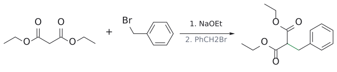
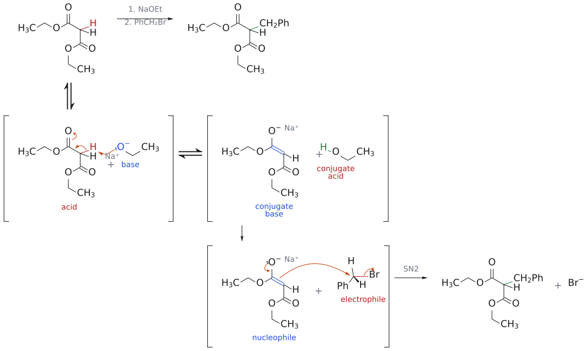
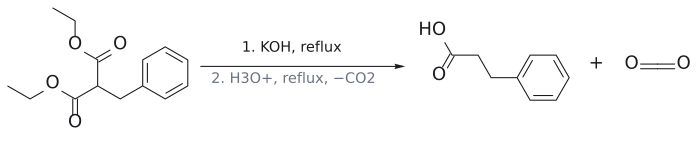

# 말론산 에스터 합성

> diethyl malonate --[NaOEt; R–X]--> --[KOH 환류; H₂SO₄ 환류(−CO₂)]--> carboxylic acid RCH₂COOH. 결과적으로 R–X에 –CH₂COOH를 붙인 셈이다.

## 개요

[acetoacetic ester synthesis](아세토아세트산%20에스터%20합성.md)의 carboxylic acid판이다. diethyl malonate CH₂(CO₂Et)₂[^1]의 가운데 CH₂는 두 ester 사이에 있어 pKa가 약 13이다. EtOH(16)보다 산성이므로 NaOEt로 충분히 enolate가 되고, alkylation한 뒤 ester 하나를 CO₂로 날려 보낸다. (출처: L7 p.4, p.15, p.19)

## 메커니즘

1. NaOEt로 enolate를 만들고 R–X와 SN2 반응시켜 RCH(CO₂Et)₂를 얻는다. (출처: L7 p.19)
2. 50% KOH로 환류해 두 ester를 모두 가수분해한다(→ [ester hydrolysis](에스터%20가수분해.md)). (출처: L7 p.19)
3. dil. H₂SO₄로 환류하면 산성화와 동시에 [decarboxylation](탈카복실화.md)이 일어난다. 이번 decarboxylation의 주인공은 치환 malonic acid HO₂C–CH(R)–CO₂H다. 한쪽 carboxyl기의 수소가 다른 쪽 C=O 산소로 넘어가는 six-membered cyclic transition state를 거쳐 CO₂가 빠지고, 생긴 enol이 carboxylic acid RCH₂COOH로 정리된다. (출처: L7 p.19–20)

그래서 diethyl malonate는 R–X에 –CH₂COOH를 붙이는 도구라고 요약된다. (출처: L7 p.19, p.29)

## 역합성 요령

목표 carboxylic acid에서 –CH₂COOH를 떼어 내면 남는 조각이 R이고, 그 R–X(1차가 좋다)를 쓰면 된다. 3-phenylpropanoic acid이면 R = benzyl이므로 BnBr을 쓴다([L7 연습 문제](../../practice/L07_Exercises.md) 6). (출처: L7 p.19, p.29)

## 예

- diethyl malonate --[(1) NaOEt; (2) 1-bromobutane]--> diethyl butylmalonate (80–90%) --[(1) 50% KOH, 환류; (2) dil. H₂SO₄, 환류]--> hexanoic acid CH₃(CH₂)₄COOH (75%) (출처: L7 p.19)
- 사슬 늘리기: BrCH₂CH₂CO₂Et + CH₂(CO₂Et)₂ --[NaOEt]--> triester --[NaOH, 물; HCl; 가열]--> glutaric acid. C3 조각 두 개로 C5 diacid를 만든다(L10 연습문제 2).

그림: malonate anion(파랑)이 benzyl bromide(빨강)와 새 C–C(초록).

그림: 위 반응식의 메커니즘이다. 위 줄이 전체 반응이고 아래 두 줄은 단계별 풀이다(대괄호는 중간체, ⇌는 평형). 1단계: $\mathrm{EtO}^-$ (파랑, base)가 두 ester 사이의 α-H(빨강, acid, pKa 약 13)를 떼어 enolate(conjugate base)와 EtOH(conjugate acid)가 된다. 음전하는 두 C=O로 퍼지는데(공명), 그림에는 한 가지만 그렸다. 2단계: enolate의 α-C(파랑, nucleophile)가 benzyl bromide의 탄소(빨강, electrophile)를 Br의 반대편에서 SN2로 공격해 새 C–C 결합(초록)이 생기고 $\mathrm{Br}^-$ 가 떠난다. $\mathrm{Na}^+$ 는 짝이온으로 적었다. 보충: 곡선 화살표는 표준 산-염기·SN2 메커니즘으로 그린 것이다. (보충 근거: Clayden p.596) (출처: L7 p.19)

그림: 가수분해 뒤 탈카복실화.

(탈카복실화의 메커니즘은 [decarboxylation](탈카복실화.md) 문서의 종합 그림과 같은 6원자 고리형 transition state이고, 치환 malonic acid에서는 ketone C=O 자리에 다른 쪽 carboxyl의 C=O가 온다.)

## 다른 제조법

치환 malonic ester는 [crossed Claisen condensation](교차%20클라이젠%20축합.md)으로도 만든다. ethyl phenylacetate + diethyl carbonate --[NaOEt]--> PhCH(CO₂Et)₂ (86%). (출처: L9 p.9)

보충: diethyl phenylmalonate를 malonic ester alkylation(malonate + PhBr)으로는 만들 수 없다는 점도 이 반응의 쓸모다. bromobenzene 같은 aryl halide는 SN2를 하지 않기 때문이다. (보충 근거: Clayden p.645) (출처: L9 p.9)

## 흔한 오해

- "가열하면 두 COOH가 모두 빠진다": 같은 탄소에 붙은 두 COOH 중 하나만 빠진다. six-membered cyclic transition state에서 다른 쪽 C=O가 H를 받아 줘야 하기 때문이다. (출처: L7 p.19–20)
- "생성물이 methyl ketone이다": methyl ketone은 acetoacetic ester synthesis의 생성물이다. (출처: L7 p.29)

## 관련 문서

- 반응: [acetoacetic ester synthesis](아세토아세트산%20에스터%20합성.md), [decarboxylation](탈카복실화.md), [enolate alkylation](엔올레이트%20알킬화.md), [crossed Claisen condensation](교차%20클라이젠%20축합.md), [ester hydrolysis](에스터%20가수분해.md), [Knoevenagel condensation](크뇌베나겔%20축합.md)
- 시약: [alkoxide base](../시약/알콕사이드%20염기.md)
- 개념: [enolate chemistry (overview)](../개념/엔올레이트%20화학%20개관.md), [alpha-hydrogen acidity](../개념/α-수소의%20산도.md), [enol and enolate](../개념/엔올과%20엔올레이트.md)

## 출처

- [L7 enolate와 α-alkylation](../../notes/L07_Enolate_Alkylation.md) III절(p.15, p.19–20), 정리(p.29)
- [L9 Claisen condensation](../../notes/L09_Claisen_Condensation.md) 4절
- [L10 연습문제](../../practice/L10_Practice.md) 문제 2

[^1]: 슬라이드는 diethyl malonate 옆에 "(diethyl 1,3-propanedicarboxylic acid)"라는 이름을 붙였는데, 이는 부정확하다. malonic acid는 propanedioic acid이므로 체계명은 diethyl propanedioate이고, "1,3-propanedicarboxylic acid"는 탄소 5개짜리 glutaric acid(pentanedioic acid)를 가리키는 이름이다. (출처: L7 p.15)
