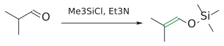
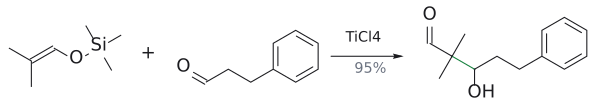
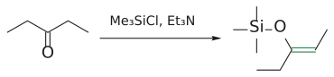
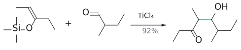
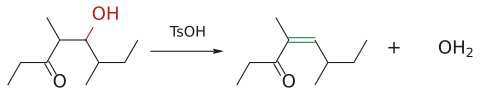

# 무카이야마 알돌 반응

> $\begin{aligned} & \text{silyl enol ether} + \text{aldehyde} \\ & \xrightarrow{\mathrm{TiCl_4}} \text{aldol의 silyl ether} \\ & \xrightarrow{\mathrm{H_2O}} \beta\ \text{-hydroxy carbonyl} \end{aligned}$ (관련: [silyl enol ether](../시약/실릴%20엔올%20에터.md)). 위치가 고정된 중성 enol 등가체로 하는 [crossed aldol](교차%20알돌%20반응.md)이다.

## 개요

lithium enolate는 반응성이 너무 좋아 보관이 안 되고, aldehyde enolate는 self-aldol 때문에 LDA 방법이 잘 안 된다. silyl enol ether는 O–Si 결합이 공유결합에 가까워 안정하므로 정제해 둘 수 있다. 대신 얌전한 만큼 혼자서는 aldehyde를 잘 공격하지 못한다. 그래서 [Lewis acid](../시약/루이스%20산%20촉매.md), 흔히 Ti(IV)([TiCl₄](../시약/TiCl4.md))로 상대 carbonyl을 활성화해 준다. (출처: L8 p.22, p.25)

$$
\begin{aligned}
& \mathrm{RC(OSiMe_3){=}CH_2} \\
& \qquad \xrightarrow{\ \mathrm{PhCHO},\ \mathrm{TiCl_4}\ \mathstrut} \mathrm{RCOCH_2CH(OSiMe_3)Ph}\ (\text{aldol의 silyl ether}) \\
& \qquad \xrightarrow{\ \mathrm{H_2O}\ \text{후처리}\ \mathstrut} \mathrm{RCOCH_2CH(OH)Ph}
\end{aligned}
$$

## 메커니즘

슬라이드가 제시한 "가능한 메커니즘"은 다음과 같다. (출처: L8 p.25)

1. TiCl₄가 PhCHO의 carbonyl O에 배위해 carbonyl 탄소를 더 electrophilic하게 만든다.
2. **aldol addition.** silyl enol ether의 C=C(nucleophile, O의 전자쌍이 밀어 줌)가 활성화된 carbonyl 탄소를 공격한다. 새 C–C 결합이 생기고, 한쪽은 silyl oxocarbenium(Me₃Si–O⁺=C), 다른 쪽은 titanium alkoxide(–O–TiCl₃)가 된다.
3. Cl⁻가 Si를 공격해 Me₃Si 기를 떼어 낸다(Me₃SiCl). ketone이 드러난다.
4. titanium alkoxide가 Me₃Si 기를 다시 붙잡아 aldol의 silyl ether가 되고, TiCl₄가 재생된다.
5. 물로 후처리하면 Si–O가 끊어져 aldol이 된다.

그림: 위 2단계(aldol addition)를 그린 것이다. 슬라이드처럼 TiCl₄가 배위한 aldehyde를 O⁺–TiCl₃로 나타냈다. 파란색은 nucleophile인 silyl enol ether(C=C와 O), 빨간색은 활성화된 carbonyl(C=O⁺)이다. 화살표 셋은 (1) enol ether 산소의 비공유 전자쌍이 밀어 주어 silyl oxocarbenium(C=O⁺–SiMe₃)이 생기고, (2) C=C $\pi$ 전자가 carbonyl 탄소를 공격하며, (3) C=O⁺ $\pi$ 전자가 산소로 가서 titanium alkoxide(O–TiCl₃)가 되는 과정이다. 초록 결합이 새 C–C 결합이다. 이후 Cl⁻가 Me₃Si를 떼어 내고 titanium alkoxide가 다시 받아 오는 과정(3, 4단계)은 그리지 않았다. (출처: L8 p.25)

## 선택성

반응 위치는 silyl enol ether의 C=C 위치로 정해지므로, enol ether를 어떻게 만드느냐가 곧 regioselectivity다. TMSCl/Et₃N은 더 치환된 thermodynamic enol ether(88 : 12)를, LDA 후 TMSCl은 덜 치환된 kinetic enol ether(1 : 99)를 준다(→ [silyl enol ether](../시약/실릴%20엔올%20에터.md), [kinetic vs thermodynamic enolate](../개념/속도론적%20엔올레이트와%20열역학적%20엔올레이트.md)). (출처: L8 p.23–24)

## 예

LDA 방법에서는 aldehyde enolate가 곤란했다. 그런데 silyl enol ether로는 aldehyde끼리의 crossed aldol도 깔끔하게 된다. (출처: L8 p.26)

- **aldehyde + aldehyde:** $\begin{aligned} & \mathrm{(CH_3)_2CHCHO} \\ & \xrightarrow{\mathrm{Me_3SiCl},\ \mathrm{Et_3N}} \mathrm{(CH_3)_2C{=}CH{-}OSiMe_3}\ (\text{안정한 silyl enol ether}) \\ & \xrightarrow{\mathrm{PhCH_2CH_2CHO},\ \mathrm{TiCl_4}} \mathrm{PhCH_2CH_2{-}CH(OH){-}C(CH_3)_2{-}CHO}\ (95\%\ \text{분리}) \end{aligned}$. (출처: L8 p.26)
- **ketone + aldehyde, 이어서 탈수:** $\begin{aligned} & \mathrm{CH_3CH_2COCH_2CH_3} \\ & \xrightarrow{\mathrm{Me_3SiCl},\ \mathrm{Et_3N}} \mathrm{CH_3CH{=}C(OSiMe_3)CH_2CH_3} \\ & \xrightarrow{\mathrm{CH_3CH_2CH(CH_3)CHO},\ \mathrm{TiCl_4}} \mathrm{CH_3CH_2CH(CH_3){-}CH(OH){-}CH(CH_3){-}COCH_2CH_3}\ (92\%) \\ & \xrightarrow{\mathrm{TsOH}} \\ & \mathrm{CH_3CH_2CH(CH_3){-}CH{=}C(CH_3){-}COCH_2CH_3}\ (\text{manicone},\  \\ & \text{4,6-dimethyloct-4-en-3-one},\ 83\%;\  \\ & \text{E-alkene으로 그려짐}) \end{aligned}$. 마지막 탈수는 산(TsOH) 촉매다. (출처: L8 p.26)
- **ketone의 thermodynamic enol ether:** $\begin{aligned} & \mathrm{PhCH_2COCH_3}\ \text{(1-phenylpropan-2-one)} \\ & \xrightarrow{\mathrm{Me_3SiCl},\ \mathrm{Et_3N}} \mathrm{CH_3C(OSiMe_3){=}CHPh} \end{aligned}$. C=C가 phenyl과 공액되는 더 치환된 쪽에 생긴다. 이것을 PhCOCHO, TiCl₄와 반응시키는 빈 칸은 [L8 연습 문제](../../practice/L08_Exercises.md) 7에 있다. (출처: L8 p.27)
- **시험 예:**$\begin{aligned} & \text{2-methylcyclohexanone} \\ & \xrightarrow{\mathrm{TMSCl},\ \mathrm{Et_3N}} \text{thermodynamic silyl enol ether} \\ & \xrightarrow{\mathrm{CH_3CH_2CHO},\ \mathrm{TiCl_4}} \text{2-(1-hydroxypropyl)-2-methylcyclohexan-1-one} \end{aligned}$. LDA 경로(C6에서 반응)와 constitutional isomer가 된다(Test 1(2025) 문제 2).

그림: aldehyde의 silyl enol ether(초록 C=C).

그림: $TiCl_4$ 가 C=O를 활성화해 enol ether(파랑)가 공격한다.

그림: silyl enol ether 형성.

그림: 새 C–C(초록).

그림: OH(빨강)가 빠지며 공액 C=C(초록).

## 흔한 오해

- "silyl enol ether는 lithium enolate처럼 바로 aldehyde와 반응한다": 반응성이 낮아 Lewis acid가 필요하다. 생성물도 일단 aldol의 silyl ether이고, 물 후처리로 aldol이 된다. (출처: L8 p.22, p.25)
- "silyl group이 탄소에 붙을 수도 있다": Si–O(452 kJ/mol)가 Si–C(318 kJ/mol)보다 훨씬 강해 산소에 붙는다. (출처: L8 p.22)
- "TMSCl/Et₃N과 LDA 후 TMSCl은 같은 enol ether를 준다": 전자는 thermodynamic, 후자는 kinetic isomer를 준다. (출처: L8 p.24)
- "aldehyde끼리의 crossed aldol은 불가능하다": LDA로는 어렵지만 Mukaiyama aldol로는 된다. (출처: L8 p.18, p.26)

## 관련 문서

- 시약: [silyl enol ether](../시약/실릴%20엔올%20에터.md), [TiCl4](../시약/TiCl4.md), [Lewis acid catalyst](../시약/루이스%20산%20촉매.md), [LDA](../시약/LDA.md)
- 반응: [crossed aldol reaction](교차%20알돌%20반응.md), [aldol reaction](알돌%20반응.md), [$\alpha$-halogenation](α-할로젠화.md)
- 개념: [kinetic vs thermodynamic enolate](../개념/속도론적%20엔올레이트와%20열역학적%20엔올레이트.md), [enolate chemistry (overview)](../개념/엔올레이트%20화학%20개관.md)

## 출처

- [L8 aldol reaction](../../notes/L08_Aldol_Reactions.md) 5절(p.22–27)
- [Test 1 (2025)](../../practice/Test1_2025.md) 문제 2
