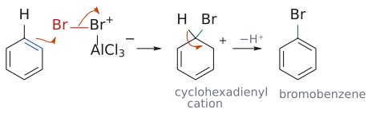
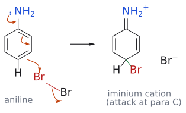
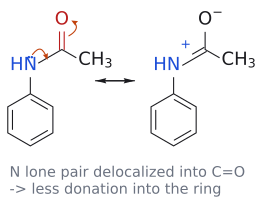
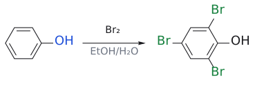
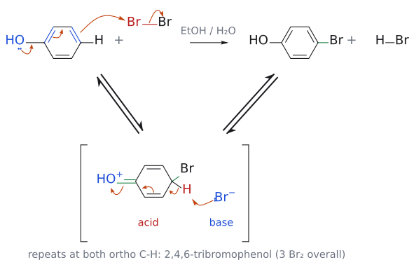
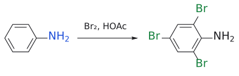
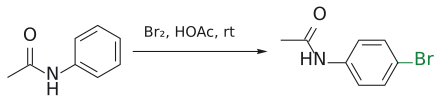
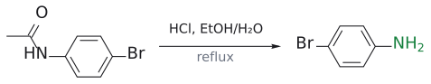
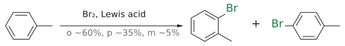
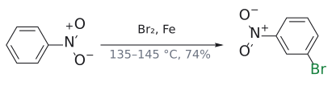

# 방향족 할로젠화

> benzene + X₂ + Lewis acid(AlX₃, FeX₃) → halobenzene. phenol과 aniline처럼 강하게 activated된 고리는 촉매 없이도 여러 번 halogenate된다.

## 개요

alkene은 Br₂만 있으면 [bromonium ion](../개념/브로모늄%20이온.md)을 거쳐 바로 [addition](할로젠%20첨가.md)되지만, benzene은 Br₂와 반응하지 않는다. [Lewis acid](../시약/루이스%20산%20촉매.md)가 Br₂를 분극시켜 훨씬 강한 electrophile로 만들어야 비로소 반응하고, 그 결과는 addition이 아니라 **substitution**이다. 이것이 [electrophilic aromatic substitution](친전자성%20방향족%20치환.md)의 기본형이다. (출처: L3 p.9–10)

## 메커니즘

### Lewis acid로 활성화한 Br₂

1. AlCl₃(또는 FeCl₃)가 Br₂의 한쪽 Br에 배위해 Br–Br⁺–AlCl₃⁻ 착물을 만든다.
2. benzene의 π 전자가 바깥쪽 Br을 공격하고, Br–Br 결합 전자는 AlCl₃ 쪽으로 넘어간다(AlCl₃Br⁻). [cyclohexadienyl cation](../개념/아레늄%20이온.md)이 rate-determining step.
3. H⁺가 빠져 aromaticity가 회복되고 bromobenzene이 된다.

(출처: L3 p.10–11)

그림: 1단계(속도 결정): benzene의 π 결합(파랑)이 AlCl₃와 착물을 이룬 Br–Br⁺의 바깥쪽 Br(빨강)을 공격한다. 두 번째 화살표는 Br–Br 결합 전자가 AlCl₃ 쪽 Br로 넘어가는 것을 나타낸다(AlCl₃Br⁻가 된다). 새로 생긴 C–Br 결합은 초록색이다. 2단계(빠름): sp³ 탄소의 C–H 결합 전자가 고리 안으로 들어가 양전하를 지우고(−H⁺), aromaticity가 회복된다. 그림 속 cation은 공명 구조 셋 중 하나(양전하가 ortho 탄소에 있는 것)만 그렸다.

### 활성화된 고리: phenol은 촉매 없이 세 번 brominate된다

benzene은 Lewis acid 없이는 bromine과 반응하지 않는다. 그런데 phenol은 완전히 다르게 반응한다. (출처: L3 p.23)
- **Lewis acid가 필요 없다.**
- 반응이 **매우 빠르다**.
- 생성물에는 **특정 위치에 bromine 원자 세 개**가 붙는다. 두 ortho 위치와 para 위치다.

$$
\text{phenol} \xrightarrow[\mathrm{EtOH/H_2O}]{\mathrm{Br_2}} \text{2,4,6-트라이브로모페놀}
$$

(출처: L3 p.23)

> 검토 의견: 슬라이드에는 "Phenol reacts three times as rapidly"라고 적혀 있다. 그러나 문맥상 이는 "세 번이나, 빠르게(촉매 없이 실온에서) 반응한다"는 뜻으로 읽는 것이 자연스럽다. L4 p.21의 데이터를 보면 OMe 치환 benzene(anisole)의 bromination이 benzene보다 **10⁹배** 빠르므로, "3배 빠르다"는 해석은 맞지 않는다.[^1] (출처: L3 p.23, L4 p.21)

이유는 산소의 비공유 전자쌍이 HOMO 에너지를 끌어올렸기 때문이다(자세한 설명은 [substituent effect](../개념/치환기%20효과.md)의 "conjugation에 의한 공여" 절). 화살표는 **OH의 비공유 전자쌍에서 출발**해 고리를 통과한 뒤 Br–Br을 공격하도록 그린다. benzene 고리가 **conductor** 처럼 OH의 전자를 bromine 분자까지 흘려보내는 셈이다. (출처: L3 p.25)

(이 단계의 메커니즘 그림은 아래 "예" 절의 phenol 종합 그림에 합쳤다. 화살표 넷의 의미는 그 그림 설명을 본다.)

1. para 위치 공격 → oxonium cation intermediate → HBr이 빠짐 → *p*-bromophenol
2. 같은 방식으로 ortho 위치 공격 → 2,4-dibromophenol → 한 번 더 → 2,4,6-tribromophenol

이처럼 OH기는 electrophile에 대해 **ortho, para-directing**이다. (출처: L3 p.25)

### aniline: 더 활성화되어 있다

aniline(phenylamine)은 phenol, phenyl ether, 심지어 phenoxide 이온보다도 반응성이 크다(이유는 [substituent effect](../개념/치환기%20효과.md)). (출처: L4 p.4)

-
  $$
  \text{aniline} \xrightarrow[\mathrm{HOAc}]{\mathrm{Br_2}} \text{2,4,6-트라이브로모아닐린}
  $$
- 메커니즘은 phenol과 같다. N의 비공유 전자쌍에서 출발한 화살표가 고리를 통과해 Br–Br을 공격한다. intermediate는 iminium(C=N⁺H₂) 구조이고, HBr이 빠지면 aromaticity가 회복된다. NH₂는 **ortho, para-directing**이다.

(출처: L4 p.4)

그림: 파란색은 전자를 주는 쪽(NH₂의 질소), 빨간색은 electrophile 쪽(Br–Br), 초록색은 새로 생긴 C–Br 결합이다. 주황색 화살표 넷은 (1) N의 비공유 전자쌍이 C–N 결합으로 들어가 C=N을 만들고, (2) 그 때문에 C1=C2 π 전자가 C2–C3로 밀려나며, (3) C3=C4 π 전자가 para 탄소(C4)에서 Br을 공격하고, (4) Br–Br 결합 전자가 먼 Br로 가서 Br⁻로 떠나는 과정을 나타낸다. 생긴 iminium형 cation에서 C4의 H가 빠지면(HBr) aromaticity가 회복된다(슬라이드와 같은 흐름). 실제로는 ortho 위치에서도 같은 일이 일어나 2,4,6-tribromoaniline까지 간다.

## 선택성

### Br 하나만 넣고 싶다면?

- **phenol**: 이황화탄소(CS₂) 용액에 Br₂를 천천히 넣고 온도를 5 °C 아래로 유지하면 주생성물이 ***p*-bromophenol**이다.
- **aniline**: 같은 조건(CS₂, <5 °C)에서도 **2,4,6-tribromoaniline**이 생긴다. aniline은 너무 activated되어 있어서 조건만으로는 멈추게 할 수 없다.

(출처: L4 p.4)

### 해결책: acetylation으로 질소의 힘을 줄이기

amide의 N은 일반 amine보다 염기성이 훨씬 약하다. N의 비공유 전자쌍이 carbonyl기와 conjugate되어 있기 때문이다. 이 성질을 이용한다(→ [protecting group](../개념/보호기.md)의 생각).
1. aniline --[Ac₂O]--> acetanilide(PhNHCOCH₃)
2. --[Br₂, HOAc, 실온]--> *p*-bromoacetanilide
3. --[HCl, EtOH/H₂O, 가열 환류]--> *p*-bromoaniline

amide N의 비공유 전자쌍은 C=O와 conjugate되어 있으면서도, amine보다는 약하게 benzene 고리로도 delocalization된다. 그래서 반응은 여전히 **ortho, para 위치**에서 일어나지만(주로 para) **한 번만** 일어난다. 일반적으로 첫 번째 electrophilic substitution은 steric hindrance 때문에 para 위치에서 일어난다. (출처: L4 p.5)

그림: 파란색 N의 비공유 전자쌍이 N–C 결합으로 들어가 C=N을 만들고(첫 번째 화살표), C=O의 π 전자(빨강)는 산소로 올라가 O⁻가 된다(두 번째 화살표). 오른쪽 공명 구조처럼 N의 전자쌍 일부가 carbonyl 쪽에 묶이므로 고리로 내줄 수 있는 몫이 amine보다 줄어든다. 그래서 acetanilide는 여전히 ortho/para-directing이지만 한 번만 brominate된다.

이 "보호 → 반응 → 탈보호" 흐름은 L12에서 [protecting group](../개념/보호기.md)로 일반화된다. ortho 대 para 비율을 정하는 steric 효과는 [substituent effect](../개념/치환기%20효과.md)에 정리했다.

### 다른 치환기

위치는 고리의 기존 치환기가 정한다(→ [substituent effect](../개념/치환기%20효과.md)). (출처: L4 p.7, p.16)

- toluene --[Br₂, Lewis acid]--> ortho 약 60%, para 약 35%, meta 약 5%
- nitrobenzene --[Br₂, Fe 가루, 135–145 °C]--> *m*-bromonitrobenzene(74%). 강하게 deactivated된 고리라 가혹한 조건이 필요하다.

## 예

- **phenoxyacetic acid의 chlorination**: 첫 번째 chlorination은 steric hindrance 때문에 para 위치에서 일어나 4-chlorophenoxyacetic acid이 된다. 두 번째는 ortho 위치에서 일어나 제초제 **2,4-D(2,4-dichlorophenoxyacetic acid)** 가 된다. (출처: L3 p.26)
- 4-hydroxybenzaldehyde --[X₂]--> 3,5-다이할로-4-hydroxybenzaldehyde. OH(ortho)와 CHO(meta)가 같은 자리를 가리킨다. (출처: L4 p.17–18)
- 4-methylacetanilide + Br₂: NHAc의 ortho로 들어간다([substituent effect](../개념/치환기%20효과.md)의 "치환기가 둘 이상" 절). (출처: L4 p.19)

그림: OH(파랑)가 고리를 강하게 활성화해 두 ortho와 para 자리에 Br(초록) 세 개가 붙는다.

그림: 위 반응식의 메커니즘이다. 첫 번째 치환(para 위치)만 그렸고, 두 ortho 위치에서도 같은 두 단계가 되풀이되어 2,4,6-tribromophenol이 된다. 위 줄이 전체 반응이고 아래 대괄호는 중간체다. 1단계: 화살표 넷이 한꺼번에 움직인다. OH 산소의 비공유 전자쌍(파랑)이 C–O 결합으로 들어가 C=O⁺(초록)를 만들고, 고리의 π 전자가 차례로 밀려 para 탄소의 π 결합(파랑)이 $Br_2$ 의 Br(빨강)을 공격하며, Br–Br 결합 전자는 바깥쪽 Br로 가서 $Br^-$ 가 된다. 새 C–Br 결합은 초록색이다. 2단계: 중간체 oxonium cation(산, 빨강)의 sp³ 탄소에 붙은 H(빨강)를 $Br^-$ (염기, 파랑)가 가져가고, C–H 결합 전자가 고리로 돌아와 방향족성이 회복된다(−HBr). 보충: 2단계의 화살표는 슬라이드에 없는 보충이다. (보충 근거: Clayden p.474, p.479)

그림: $NH_2$ (파랑)가 고리를 강하게 활성화해 두 ortho와 para 자리 모두에 Br(초록)이 붙는다.

그림: 2단계: 부피 큰 NHAc 때문에 para 자리(파랑)에 Br(초록) 하나만 붙는다.

그림: 3단계: amide를 가수분해해 보호기(빨강 C=O 쪽)를 떼면 p-bromoaniline이 된다.

그림: methyl은 ortho/para 지향기다. 생성물은 ortho 약 60%, para 약 35%(초록 = 새로 붙은 Br).

그림: 비활성화된 고리라 가열이 필요하고, Br(초록)은 meta로 들어간다.

## 흔한 오해

- **"benzene도 이중결합이 있으니 Br₂와 addition 반응한다"**: Br₂만으로는 반응하지 않고, Lewis acid가 있을 때 substitution한다. (출처: L3 p.9–10)
- **"phenol이 benzene보다 세 배 빠르다"**: 위 검토 의견처럼 "세 번, 빠르게"로 읽어야 한다. anisole의 bromination은 benzene보다 10⁹배 빠르다. (출처: L3 p.23, L4 p.21)
- **"aniline도 저온에서 Br₂를 천천히 넣으면 한 번만 brominate된다"**: phenol은 그렇지만 aniline은 CS₂, <5 °C에서도 2,4,6-tribromo 생성물을 준다. acetylation으로 활성을 낮춰야 한다. (출처: L4 p.4–5)

## 관련 문서

- 반응: [electrophilic aromatic substitution](친전자성%20방향족%20치환.md), [halogen addition](할로젠%20첨가.md), [nitration](나이트로화.md)
- 시약: [Lewis acid catalyst](../시약/루이스%20산%20촉매.md)
- 개념: [arenium ion](../개념/아레늄%20이온.md), [substituent effect](../개념/치환기%20효과.md), [aromaticity](../개념/방향족성.md), [protecting group](../개념/보호기.md), [bromonium ion](../개념/브로모늄%20이온.md)

## 출처

- [L3 electrophilic aromatic substitution 1부](../../notes/L03_Electrophilic_Aromatic_Substitution_Part1.md) 1절, 7절 (슬라이드 p.9–11, p.23–26)
- [L4 electrophilic aromatic substitution 2부](../../notes/L04_Electrophilic_Aromatic_Substitution_Part2.md) 1절, 2절, 5절, 6절 (슬라이드 p.4–5, p.7, p.16–19)

[^1]: 슬라이드 원문은 "Phenol reacts three times as rapidly without catalyst at room temperature."이다. 이 문장은 "세 번 빠르게 반응한다"로도, "세 배 빠르게 반응한다"로도 읽힐 수 있다. 여기서는 앞뒤 문맥(세 개의 Br 도입)과 L4 p.21의 속도 데이터에 맞춰 "세 번, 빠르게"로 해석했다. 원문이 모호하므로 강의 담당 교수님께 확인해 보는 것도 좋다.
