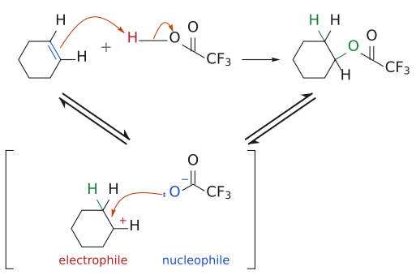
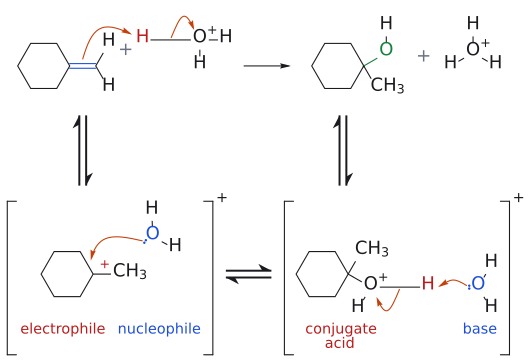
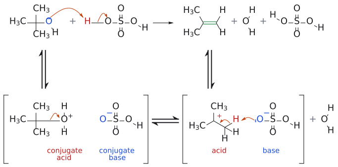

# 산 촉매 수화

> alkene + H₂O, H⁺ → alcohol. OH가 **더 치환된 탄소**에 붙는 Markovnikov 첨가다. 다만 E1 dehydration의 역반응이라 **평형**이고, 안정한 3차 carbocation이 생길 때만 잘 된다.

## 개요

$\text{alcohol} \xrightarrow{\text{acid}} \text{alkene}$은 E1 elimination(dehydration)이다. 그 역반응이 hydration이다. 하지만 hydration은 **alkene이 protonate되어 안정한 3차 cation을 만들 수 있을 때만** 잘 된다. 그 cation을 물(용매)이 붙잡는다. 조건을 잘 고르지 않으면 반응이 양쪽으로 다 가므로, 이 평형 문제를 피하는 방법이 [TFA](../시약/TFA.md)를 거치는 단계적 수화다. OH를 반대쪽 탄소에 붙이고 싶으면 [hydroboration-oxidation](수소붕소화-산화.md)을 쓴다. (출처: L2 p.19–20)

## 메커니즘

1. alkene이 protonate되어 더 안정한 [carbocation](../개념/탄소%20양이온.md)(3차)이 생긴다.
2. 용매인 물이 cation을 붙잡는다.
3. deprotonation으로 alcohol이 된다. (출처: L2 p.19)

이 반응은 **평형**이다. 같은 조건에서 역반응도 일어난다. 예를 들어 $\mathrm{\mathit{t}\text{-}BuOH} \xrightarrow{\mathrm{H_2SO_4}} \text{isobutene}$(E1)에서는 HSO₄⁻가 염기로 작용해 β-H를 떼어 낸다. (출처: L2 p.19)

단계별 메커니즘 그림은 아래 "예"의 반응식 바로 밑에 반응마다 하나로 합쳐 두었다(수화, TFA 첨가, *t*-BuOH E1).

## 선택성

- **regioselectivity:** [Markovnikov](../개념/마르코프니코프%20규칙.md)를 따른다. δ⁺인 H는 CH₂에, δ⁻인 OH는 3차 탄소에 붙는다. (출처: L2 p.19)
- 보충: carbocation을 거치므로 [rearrangement](../개념/탄소%20양이온%20자리옮김.md)이 일어날 수 있다는 점은 [hydrohalogenation](할로젠화수소%20첨가.md)과 같다(표준 교재 내용). (보충 근거: Wade p.339)

## TFA를 거치는 단계적 수화

평형 문제를 피하는 방법으로 **trifluoroacetic acid(TFA, CF₃CO₂H)**를 쓴다. (출처: L2 p.20)
1. $\text{cyclohexene} + \mathrm{TFA} \longrightarrow \text{cyclohexyl trifluoroacetate}$

   TFA는 강산이라 alkene을 protonate하고(δ⁺인 H), 그 짝염기가 cation을 붙잡는다(δ⁻인 O).
2. $\text{ester} \xrightarrow{\text{염기},\ \mathrm{H_2O}} \text{cyclohexanol} + \text{trifluoroacetate 음이온}$

### 공정 화학 예

슬라이드 p.21은 실제 의약품 합성 사례를 보여 준다. carbazole 골격의 alkene(isopropenyl기) **12**를 TFA/DCM으로 처리하면 3차 TFA ester **13**이 생긴다. 이것을 NH₄OH/MeOH로 가수분해하면 3차 alcohol **5**를 얻는다(85% 수율, >99.5% ee). 학교에서 배운 반응이 공정 화학에 그대로 쓰인다는 예다.[^1] (출처: L2 p.21)

## 예

- $\text{methylenecyclohexane} \xrightarrow{\mathrm{H_2O},\ \mathrm{H^+}} \text{1-methylcyclohexanol}$

  (L2, 출처: L2 p.19)
- $\mathrm{\mathit{t}\text{-}BuOH} \xrightarrow{\mathrm{H_2SO_4}} \text{isobutene}$

  (역반응, E1) (L2, 출처: L2 p.19)
- $\text{cyclohexene} \xrightarrow{\mathrm{TFA}} \text{cyclohexyl trifluoroacetate} \xrightarrow{\text{염기},\ \mathrm{H_2O}} \text{cyclohexanol}$

  (L2, 출처: L2 p.20)
- $12 \xrightarrow[\mathrm{DCM}]{\mathrm{TFA}} 13 \xrightarrow[\mathrm{MeOH}]{\mathrm{NH_4OH}} 5$

  (85%, >99.5% ee) (L2, 출처: L2 p.21)
- 2-methyl-1-butene → 2-methyl-2-butanol: H₂O/H⁺ 또는 TFA addition 후 가수분해(→ [L2 연습 문제](../../practice/L02_Exercises.md) 7번). (출처: L2 p.19–20)

그림: 1단계: TFA의 H(빨강 OH 쪽)가 C=C(파랑)를 protonate하고, 짝염기 $CF_3CO_2^-$ 의 O가 cation을 붙잡아 ester(초록)가 된다.

그림: TFA 첨가의 전체 메커니즘. 위 줄이 전체 반응이고, 아래 대괄호는 중간체다. 1단계(protonation): 파랑 C=C π 전자가 빨강 H를 공격하고(주황 화살표), O–H 결합 전자는 O로 가서 $CF_3CO_2^-$ 가 떠나며 cyclohexyl cation(electrophile, 빨강)과 새 C–H 결합(초록)이 생긴다. 2단계: 짝염기 $CF_3CO_2^-$ (nucleophile, 파랑)의 O 전자쌍이 cation 탄소를 공격해 새 C–O 결합(초록)이 생기고 ester가 된다. 중간체가 하나뿐이라 ⇌를 V자로 배치했다.

그림: 2단계: ester를 염기로 가수분해하면 cyclohexanol(초록 OH)과 trifluoroacetate anion이 생긴다.

그림: Markovnikov 수화. H는 $CH_2$ 에, OH(초록)는 3차 탄소에 붙는다. 파랑 = 반응하는 C=C.

그림: 산 촉매 수화의 전체 메커니즘. 위 줄이 전체 반응이고, 아래 줄은 이것을 단계별로 풀어 쓴 것이다(대괄호는 중간체, ⇌는 평형). 1단계: 파랑 C=C π 전자가 빨강 H를 공격하고(주황 화살표), O–H 결합 전자는 O로 가서 $H_3O^+$ 가 물(nucleophile, 파랑)이 되며, 3차 탄소에는 cation(electrophile, 빨강)이 생긴다(Markovnikov). 2단계: 물의 O 전자쌍이 cation 탄소를 공격해 새 C–O 결합(초록)을 만들고 oxonium ion(conjugate acid, 빨강)이 된다. 3단계: 다른 물(base, 파랑)이 oxonium ion의 H를 가져가고 O–H 결합 전자는 양전하 O로 가서 중성 alcohol(초록 OH)과 $H_3O^+$ 가 생긴다.

그림: 같은 조건에서 일어나는 역반응(E1 탈수). 떠나는 OH(빨강, protonate된 뒤 물로 떠난다)와 새 C=C(초록).

그림: t-BuOH의 산 촉매 E1 탈수 전체 메커니즘(수화의 역반응). 위 줄이 전체 반응이고, 아래 줄은 단계별 풀이다. 1단계: OH의 전자쌍(파랑)이 $H_2SO_4$ 의 H(빨강)를 가져가 protonated alcohol(conjugate acid, 빨강)과 $HSO_4^-$ (conjugate base, 파랑)가 된다. 2단계: C–O 결합 전자가 O로 가서 물이 떠나고 3차 cation이 생긴다. 3단계: $HSO_4^-$ (base, 파랑)의 전자쌍이 β-H(빨강)를 가져가고 C–H 결합 전자가 새 C=C(초록)를 만들어 isobutene과 $H_2SO_4$ 가 재생된다.

## 흔한 오해

- "어떤 alkene이든 H₂O/H⁺로 수화된다": 안정한 3차 cation을 만들 수 있을 때만 잘 된다. (출처: L2 p.19)
- "수화는 한쪽으로만 가는 반응이다": E1 dehydration과 평형이다. 그래서 TFA 경유 방법이 쓰인다. (출처: L2 p.19–20)

## 관련 문서

- 개념: [carbocation](../개념/탄소%20양이온.md), [Markovnikov's rule](../개념/마르코프니코프%20규칙.md), [carbocation rearrangement](../개념/탄소%20양이온%20자리옮김.md)
- 반응: [hydrohalogenation](할로젠화수소%20첨가.md), [hydroboration-oxidation](수소붕소화-산화.md), [epoxide ring opening](에폭사이드%20고리%20열기.md)
- 시약: [TFA](../시약/TFA.md)

## 출처

- [L2 Electrophilic Addition to Alkenes, Part 2](../../notes/L02_Electrophilic_Addition_to_Alkenes_Part2.md): 슬라이드 L2 p.19–21

[^1]: 슬라이드 p.21의 반응식에는 Rh catalyst 비대칭 conjugate addition(isopropenyl BPin, (S)-DTBM-SEGPHOS), Fischer indole synthesis(ZnCl₂), CDI/NH₄OH amide화 등이 함께 나온다. 이 강의의 핵심은 **12 → 13 → 5** 구간(TFA addition 후 가수분해)이다.
