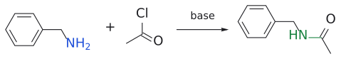
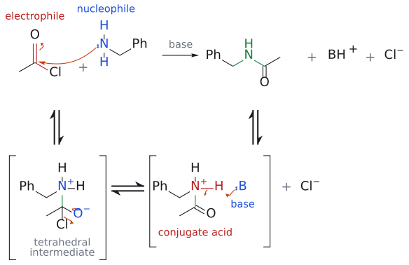
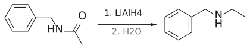
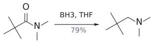
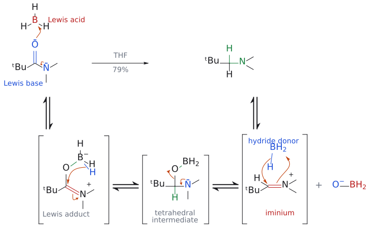
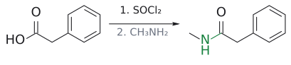
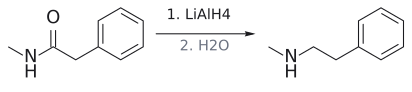

# 아마이드 환원

> amide RCONR′₂ --[LiAlH₄ 또는 BH₃]--> amine RCH₂NR′₂([LiAlH4](../시약/LiAlH4.md), [borane](../시약/보레인.md)). C=O가 통째로 CH₂가 되며, alcohol이 아니라 **amine**이 나온다. 갈림길은 [tetrahedral intermediate](../개념/사면체%20중간체.md)에서 O가 떨어지고 N이 남는 데 있다.

## 개요

azide·nitrile 경로는 1차 amine만 준다. 2차·3차 amine이 필요하면 어떻게 할까? 여기서 amide가 나선다. amide는 LiAlH₄ 또는 BH₃로 환원하면 C=O가 통째로 CH₂가 되어 amine이 된다. amide의 N에 무엇이 붙어 있느냐에 따라 1차, 2차, 3차 amine을 모두 만들 수 있다. (출처: L5 p.9)

$$
\mathrm{RCOOH} \xrightarrow{\ 1.\ \mathrm{SOCl_2};\ 2.\ \mathrm{NH_3}\ \mathstrut} \mathrm{RCONH_2} \xrightarrow[2.\ \mathrm{H_2O}\ (\text{또는}\ \mathrm{BH_3})]{\ 1.\ \mathrm{LiAlH_4},\ \text{ether}\ \mathstrut} \mathrm{RCH_2NH_2}
$$

### 왜 "acylation 후 reduction"인가

$$
\begin{aligned} &\text{benzylamine}\ \mathrm{PhCH_2NH_2} \xrightarrow{\ \mathrm{CH_3COCl},\ \text{base}\ \mathstrut} \mathrm{PhCH_2NHCOCH_3} \cr &\qquad \xrightarrow{\ (1)\ \mathrm{LiAlH_4};\ (2)\ \mathrm{H_2O}\ \mathstrut} \text{N-benzylethylamine}\ \mathrm{PhCH_2NHCH_2CH_3} \end{aligned}
$$

이 두 단계를 합쳐 보면 결국 benzylamine의 N에 ethyl group을 하나 붙인 셈이다. 그런데 왜 ethyl bromide로 직접 alkylate하지 않을까? 직접 alkylation은 over-alkylation이 일어나지만(→ [amine synthesis (overview)](../개념/아민%20합성%20개관.md)), acylation은 생성물인 amide가 nucleophilicity가 약하므로 딱 한 번에서 멈춘다. 즉 "acylation 후 reduction"은 깔끔한 N-alkylation의 우회로다. (출처: L5 p.4, p.6, p.9)

## 메커니즘

### 왜 ester는 alcohol이 되는데 amide는 amine이 될까

보충: LiAlH₄의 첫 hydride가 붙어 tetrahedral intermediate가 생기는 데까지는 둘이 같다. 갈림길은 그다음이다. ester의 intermediate는 alkoxide(OR⁻)를 내보내 aldehyde가 되고, 이것이 다시 환원되어 alcohol이 된다. amide의 intermediate에서는 R₂N⁻가 너무 나쁜 leaving group이라 떨어지지 못하고, 대신 Al에 배위해 이탈 능력이 커진 산소가 떨어지면서 N의 lone pair가 C=N⁺를 만든다. 이 [iminium ion](../개념/이미늄%20이온.md)이 두 번째 hydride를 받아 amine이 된다. 아래 BH₃ 메커니즘도 같은 줄거리다. (보충 근거: Clayden p.531, p.236)

### BH₃ 메커니즘 (슬라이드)

*N*,*N*-dimethylpivalamide(79%)를 예로 단계를 따라가 보자.

1. amide carbonyl O의 lone pair가 BH₃의 빈 p orbital로 들어가 Lewis acid–base 착물을 만든다. 이때 N의 lone pair가 공명으로 밀어 주어 C=N⁺ 성격이 생긴다.
2. 붙어 있는 B–H의 hydride가 분자 내에서 carbonyl 탄소로 옮겨 간다. 그 결과 같은 탄소에 O–BH₂와 NMe₂가 붙은 [tetrahedral intermediate](../개념/사면체%20중간체.md)가 생긴다.
3. tetrahedral intermediate가 무너진다. N의 lone pair가 C=N⁺를 만들며 O–BH₂를 밀어내 iminium ion이 된다.
4. 또 다른 BH₃의 hydride가 iminium 탄소에 붙어 amine–borane 착물(N–B 결합)이 된다.
5. H₂O로 quench하면 유리 3차 amine RCH₂NMe₂가 나온다.

(출처: L5 p.28)

(이 단계의 메커니즘 그림은 아래 "예"의 *N*,*N*-dimethylpivalamide 반응식 바로 아래 종합 그림에 합쳤다. 화살표의 의미는 그 그림 설명을 본다.)

3번 단계가 핵심이다. ester라면 tetrahedral intermediate에서 OR이 떨어져 나가지만, amide는 O(붕소에 붙어 좋은 leaving group이 된)가 떨어지고 N이 남는다. 그래서 alcohol이 아니라 amine이 된다. carboxylic acid를 BH₃로 환원하는 경우는 [borane](../시약/보레인.md) 문서에 있다. (출처: L5 p.28)

## 선택성

- **BH₃**는 Lewis acid라 Lewis 염기성이 큰 amide·carboxylic acid를 빠르게 환원하고 ester·ketone은 느리다. 그래서 lactam C=O만 CH₂로 바꾸고 ester는 남길 수 있다(→ [metal hydride의 반응성](../개념/금속%20수소화물의%20반응성.md)). (출처: L5 p.27)
- **LiAlH₄**는 거의 비선택적이다. 같은 분자의 ester, ketone도 함께 환원된다. (출처: L5 p.17, p.23)
- 슬라이드 p.17은 amide에서 aldehyde로 멈추고 싶을 때는 LiAlH₄를 0 °C에서 쓴다고만 적는다. (출처: L5 p.17)

## 예

- $\text{benzylamine} \xrightarrow{\ \mathrm{CH_3COCl},\ \text{base}\ \mathstrut} \mathrm{PhCH_2NHCOCH_3}$ $\xrightarrow{\ (1)\ \mathrm{LiAlH_4};\ (2)\ \mathrm{H_2O}\ \mathstrut} \text{N-benzylethylamine}$

  (L5) (출처: L5 p.9)
- $\text{N,N-dimethylpivalamide}\ \mathrm{(CH_3)_3CCONMe_2}$ $\xrightarrow[\mathrm{THF}]{\ \mathrm{BH_3}\ \mathstrut} \mathrm{(CH_3)_3CCH_2NMe_2}$ (수율 79%)

  (L5) (출처: L5 p.27)
- $\text{methyl 1-benzyl-5-oxopyrrolidine-3-carboxylate}$ $\xrightarrow[\mathrm{THF}]{\ \mathrm{BH_3}\ \mathstrut} \text{methyl 1-benzylpyrrolidine-3-carboxylate}$

  (lactam C=O → CH₂, ester 유지) (L5) (출처: L5 p.27)
- lactam·enone을 가진 다고리 화합물을 LiAlH₄로 처리하면 lactam이 고리형 3차 amine이 된다([L5 연습 문제](../../practice/L05_Exercises.md) 6번). (출처: L5 p.26)

그림: amine N(파랑)이 acyl chloride C(빨강)를 공격해 amide(초록)가 된다.

그림: 위 반응식의 메커니즘이다. 위 줄이 전체 반응이고 아래 줄은 단계별 풀이다(대괄호는 중간체, ⇌는 평형). nucleophilic acyl substitution이다. 1단계(위 줄의 화살표): amine N의 비공유 전자쌍(파랑, nucleophile)이 acyl chloride의 carbonyl 탄소(빨강, electrophile)를 공격해 새 N–C 결합(초록)을 만들고, C=O의 π 전자는 산소로 올라가 $\mathrm{O}^-$ 가 되어 tetrahedral intermediate(zwitterion)가 된다. 2단계: $\mathrm{O}^-$ 의 비공유 전자쌍이 C=O를 다시 만들고 C–Cl 결합 전자는 Cl로 가서 $\mathrm{Cl}^-$ 가 이탈한다. 그 결과 protonated amide(conjugate acid, 빨강)가 생긴다. 3단계: 염기 B:(파랑)가 $\mathrm{N}^+$–H의 H를 가져가고 N–H 결합 전자가 N의 비공유 전자쌍이 되어 amide와 $\mathrm{BH}^+$ 가 된다. 위 줄의 $\mathrm{BH}^+\mathrm{Cl}^-$ 는 염기가 HCl을 붙잡은 염이다. 생성물 amide는 N의 비공유 전자쌍이 C=O와 공명해 nucleophile이 약하므로 반응이 한 번에서 멈춘다. 보충: 곡선 화살표와 염기 B:는 표준 addition–elimination 메커니즘을 그린 것이다. (보충 근거: Clayden p.177, p.202–203)

그림: amide C=O(빨강)가 $CH_2$ (초록)로 환원된다.

그림: amide C=O(빨강)가 $CH_2$ (초록)로 환원된다.

그림: 위 반응식의 메커니즘이다. 위 줄이 전체 반응이고 아래 줄은 단계별 풀이다(대괄호는 중간체, ⇌는 평형). 1단계(위 줄의 화살표): carbonyl O의 비공유 전자쌍(파랑, Lewis base)이 $\mathrm{BH}_3$ 의 빈 p orbital(빨강, Lewis acid)로 들어가 Lewis acid–base 착물(새 O–B 결합은 초록)을 만들고, N의 비공유 전자쌍이 C–N 쪽으로 밀어 $\mathrm{C{=}N}^+$ 성격이 생긴다. 2단계: 붙어 있는 B–H 결합(파랑)의 hydride가 분자 내에서 $\mathrm{C{=}N}^+$ 탄소(빨강)로 옮겨 가고 C=N π 전자는 N으로 돌아가 tetrahedral intermediate(새 C–H는 초록)가 된다. 3단계: N의 비공유 전자쌍이 C–N 결합 쪽으로 내려와 $\mathrm{C{=}N}^+$ 를 만들고 C–O 결합 전자는 O로 가서 $\mathrm{H_2B{-}O^-}$ 가 떨어지며 iminium ion이 된다. 4단계: 또 하나의 $\mathrm{BH}_3$ 의 B–H(파랑)가 iminium 탄소(빨강)에 hydride를 주고 C=N π 전자는 B와 결합해 amine–borane 착물이 된다(착물은 그리지 않았다). 마지막으로 $\mathrm{H}_2\mathrm{O}$ 퀜치(위 줄의 생성물로 가는 화살표)로 3차 amine이 나온다. 슬라이드는 4단계를 N 근처에서 고리 모양으로 도는 화살표로 그렸고, 여기서는 C=N 결합에서 B로 가는 화살표 하나로 줄였다. 검토 의견: 전자 수를 맞추면 C=N π 전자는 먼저 N의 비공유 전자쌍이 되고 그것이 B에 배위해 N–B 결합을 만드는 것이며, hydride를 내놓은 $\mathrm{BH}_3$ 는 $\mathrm{BH}_2^+$ 꼴이 되므로 실제로는 $\mathrm{H_2B{-}O^-}$ 와 짝을 이룬 B–H 종이 hydride를 주는 편이 자연스럽다. 슬라이드의 단순화를 그대로 따랐다. 보충: 3단계의 이탈기를 $\mathrm{H_2B{-}O^-}$ 로 그린 것은 보충이다. (보충 근거: Clayden p.531–532)

그림: 경로 A 1단계: amide 형성.

그림: 경로 A 2단계: amide C=O(빨강) → $CH_2$ (초록).

## 흔한 오해

- **"amide를 LiAlH₄로 환원하면 alcohol이 된다"고 생각하기 쉽지만 사실은** C=O가 CH₂가 되어 **amine**이 된다. alcohol 두 개가 나오는 것은 ester다. (출처: L5 p.9, p.23)
- **"amide는 가장 환원하기 어려운 축이니 BH₃로도 느리다"**: BH₃에서는 서열이 뒤집힌다. amide가 ester보다 빠르다. (출처: L5 p.27)

## 관련 문서

- 시약: [LiAlH4](../시약/LiAlH4.md), [borane](../시약/보레인.md)
- 반응: [reductive amination](환원성%20아미노화.md), [amine synthesis via azide and nitrile](아자이드·나이트릴을%20거친%20아민%20합성.md), [partial reduction of esters](에스터%20부분%20환원.md), [Eschweiler–Clarke reaction](에슈바일러-클라크%20반응.md)
- 개념: [amine synthesis (overview)](../개념/아민%20합성%20개관.md), [metal hydride의 반응성](../개념/금속%20수소화물의%20반응성.md), [iminium ion](../개념/이미늄%20이온.md), [tetrahedral intermediate](../개념/사면체%20중간체.md)

## 출처

- [L5 환원](../../notes/L05_Reduction.md) 1절, 2절 (슬라이드 p.9, p.17, p.23, p.26–28)
- [L5 연습 문제](../../practice/L05_Exercises.md) 1번, 6번
