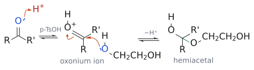
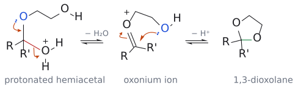

# 아세탈 형성

> aldehyde·ketone + ethylene glycol --[p-TsOH]--> 고리형 acetal(1,3-dioxolane) + H₂O. **평형** 반응이라 물을 빼면 보호, 물을 넣으면 탈보호가 된다.

## 개요

L12에서 acetal은 aldehyde·ketone의 [protecting group](../개념/보호기.md)로 등장한다. carbonyl은 ethylene glycol과 p-TsOH로 고리형 acetal(1,3-dioxolane)을 만들어 보호한다. acetal의 성격은 분명하다. 염기와 nucleophile에는 안정하지만, 산성 조건에서는 불안정하다. [Grignard reagent](../시약/그리냐르%20시약.md)나 hydride 같은 nucleophile을 써야 하는 반응에서 carbonyl을 가려 두기에 딱 맞는 이유다. (출처: L12 p.5, p.13)

## 원리: 같은 반응을 앞뒤로 돌린다

`RC(=O)R' + HOCH2CH2OH ⇌[p-TsOH] 2,2-disubstituted 1,3-dioxolane + H2O`

화살표가 양방향인 데 주목하자. 이 반응은 평형이다. 그래서 보호할 때는 물을 빼 주어 평형을 acetal 쪽으로 밀고[^1], 벗길 때는 반대로 물과 산(H2O, p-TsOH)을 넣어 원래 carbonyl로 되돌린다. 같은 산 촉매 반응을 물의 유무로 앞뒤로 돌리는 셈이다. (출처: L12 p.13)

## 메커니즘

슬라이드(L12 p.13)는 전체 반응식(ketone/aldehyde + ethylene glycol, p-TsOH, ⇌, + H₂O)과 조건만 보여 준다. (출처: L12 p.13)

보충: 형성 메커니즘을 요약하면 다음과 같다. 모든 단계가 가역이므로, 탈보호는 이 순서를 거꾸로 밟는다.

1. carbonyl O가 protonation되어 탄소가 더 electrophilic해진다.
2. glycol OH 하나가 공격해 hemiacetal이 된다(→ [tetrahedral intermediate](../개념/사면체%20중간체.md)).
3. hemiacetal의 OH가 protonation되어 물로 떨어져 나가 oxocarbenium ion이 생긴다.
4. 같은 분자의 두 번째 OH가 고리를 닫고, 양성자를 잃어 acetal이 된다.

(보충 근거: Clayden p.225, p.228)

*그림: 보충(슬라이드는 전체 반응식만 보여 준다). 왼쪽: carbonyl 산소(파랑)의 전자쌍이 p-TsOH의 H⁺(빨강)를 잡는다. 가운데: protonation된 carbonyl(oxonium ion)의 탄소(빨강)를 ethylene glycol의 O(파랑)가 공격하고, C=O π 전자는 O⁺로 돌아간다. 오른쪽: 양성자를 잃으면 hemiacetal이 된다(초록이 새 C–O). 모든 단계가 평형이다. (보충 근거: Clayden p.226, p.228)*

*그림: 보충. 왼쪽: hemiacetal의 OH가 protonation된 뒤, 이웃 산소(파랑)의 전자쌍이 내려와 C=O⁺를 만들면서 C–OH₂⁺ 결합(빨강)의 전자를 가지고 물이 떨어져 나간다. 가운데: oxonium ion의 탄소(빨강)를 같은 분자의 두 번째 OH(파랑)가 공격해 5원 고리를 닫는다. 오른쪽: 양성자를 잃어 1,3-dioxolane이 된다(초록이 새 C–O). 탈보호(가수분해)는 이 과정을 거꾸로 밟는다. (보충 근거: Clayden p.228)*

## 예: L12 p.3의 두 문제를 이렇게 푼다

[protecting group](../개념/보호기.md) 문서의 "언제 쓰나"에서 막혔던 두 문제로 돌아가 보자.

**예 1 (덜 반응성인 ester만 반응시키기).** ethyl acetoacetate의 ketone을 먼저 acetal로 가린다. 그러면 PhMgBr 2당량은 남은 ester를 공격할 수밖에 없다. 첫 번째 첨가 후 EtO⁻가 떨어져 ketone이 되고, 이 ketone에 두 번째 PhMgBr이 붙어 3차 alcohol이 된다. 마지막에 산성 수용액으로 처리하면 acetal이 벗겨진다. (L12)

`CH3COCH2CO2Et --[HOCH2CH2OH, H+]--> ketone만 acetal화 --[2 × PhMgBr]--> acetal-CH2C(OH)Ph2 --[H+, H2O]--> CH3COCH2C(OH)Ph2`

(출처: L12 p.3, p.14)

**예 2 ("impossible Grignard reagent" 만들기).** ketone이 있으면 Grignard reagent를 만들 수 없었다. 그렇다면 ketone을 가리면 된다. (L12)

1. `CH3CO(CH2)3Br --[HOCH2CH2OH, H+ 촉매]--> acetal-(CH2)3Br`
2. `--[Mg, Et2O]--> acetal-(CH2)3MgBr` : ketone이 가려져 있으니 이제 Grignard reagent가 안정하게 존재할 수 있다.
3. `--[HCO2Et]--> (acetal-(CH2)3)2CHOH` : ethyl formate에 Grignard reagent 2당량이 붙어 2차 alcohol이 된다.[^2]
4. `--[H+, H2O]--> (CH3CO(CH2)3)2CHOH` (6-hydroxyundecane-2,10-dione) : 두 acetal이 한꺼번에 벗겨진다.

(출처: L12 p.14, p.3)

## 흔한 오해

- **"acetal은 산이 있으면 생기니까 산 조건에서 안전하다"고 생각하기 쉽지만 사실은** acetal 형성은 평형이라, 물이 있는 산성 조건에서는 오히려 원래 carbonyl로 되돌아간다. acetal은 염기·nucleophile에 안정하고 산에는 불안정하다. (출처: L12 p.13)
- **"산에 약한 protecting group끼리는 조심하면 구분해 벗길 수 있다"고 생각하기 쉽지만 사실은** acetal, [Boc](../시약/Boc%20보호기.md), [silyl ether](../시약/실릴%20에터%20보호기.md), THP는 모두 산에 약해 산 조건에서는 서로 [orthogonal](../개념/직교%20보호.md)하지 않는다. 보충: [THP](../시약/THP%20보호기.md) 자체도 acetal이다. (보충 근거: Clayden p.550) (출처: L12 p.5)

## 관련 문서

- 개념: [보호기](../개념/보호기.md), [직교 보호](../개념/직교%20보호.md), [사면체 중간체](../개념/사면체%20중간체.md)
- 시약: [그리냐르 시약](../시약/그리냐르%20시약.md), [실릴 에터 보호기](../시약/실릴%20에터%20보호기.md), [Boc 보호기](../시약/Boc%20보호기.md), [THP 보호기](../시약/THP%20보호기.md)

## 출처

- [L12 보호기](../../notes/L12_Protecting_Groups.md) 8절, 2절 (L12 p.3, p.5, p.13–14)

[^1]: 보충: 물 제거에는 흔히 Dean–Stark 장치를 쓴다. 슬라이드는 평형 화살표와 생성물 "water"만 보여 준다. (보충 근거: Clayden p.228)
[^2]: 보충: 첫 번째 RMgBr 첨가 후 EtO⁻가 떨어져 aldehyde(RCHO)가 생기고, 이 aldehyde가 두 번째 RMgBr과 반응해 R2CH-O⁻가 된다. 산 처리 단계에서 alcohol이 되면서 acetal도 함께 가수분해된다. (보충 근거: Clayden p.549)
