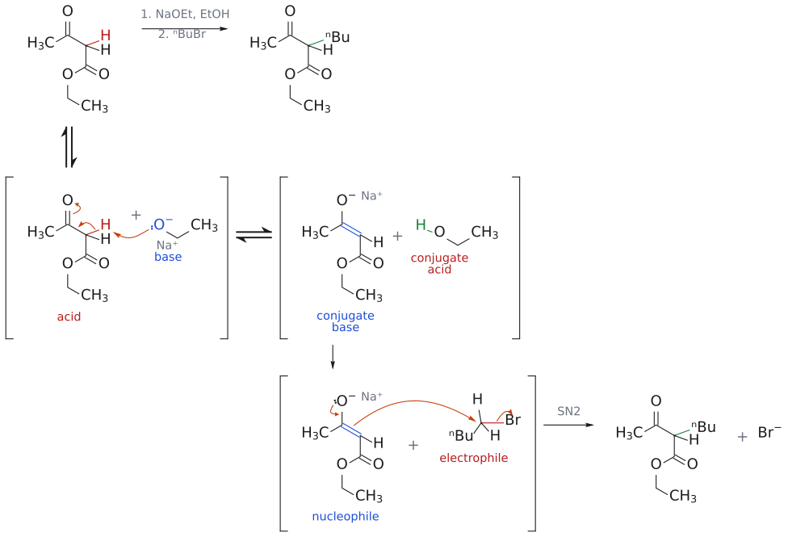

# 아세토아세트산 에스터 합성

> ethyl acetoacetate --[NaOEt; R–X]--> --[aq. NaOH; H₃O⁺, 가열(−CO₂)]--> methyl ketone CH₃COCH₂R. 결과적으로 R–X에 –CH₂COCH₃를 붙인 셈이다.

## 개요

단순 ketone을 alkylate하려면 LDA 같은 강염기가 필요하다(→ [enolate alkylation](엔올레이트%20알킬화.md)). 그런데 두 carbonyl 사이에 낀 CH₂는 pKa가 약 11이라 alkoxide로도 완전히 enolate가 된다(→ [alpha-hydrogen acidity](../개념/α-수소의%20산도.md)). 이 성질 덕분에 합성에서 특히 널리 쓰이는 두 화합물이 ethyl acetoacetate(ethyl 3-oxobutanoate, CH₃COCH₂CO₂Et)와 diethyl malonate(CH₂(CO₂Et)₂)다(후자는 → [malonic ester synthesis](말론산%20에스터%20합성.md)). (출처: L7 p.15)

ethyl acetoacetate는 sodium ethoxide로 쉽게 enolate(소듐 염)가 되고, 이 enolate가 R–X와 SN2를 하면 monoalkylation ethyl acetoacetate CH₃COCH(R)CO₂Et가 생긴다. 그런데 여기서 끝나면 쓸모가 제한적이다. 이 화합물의 진가는 ester 부분을 "지울" 수 있다는 데 있다. ester는 enolate를 만들기 쉽게 해 주는 임시 활성화기인 셈이다. (출처: L7 p.16)

## 메커니즘

1. **enolate 형성:** NaOEt가 두 carbonyl 사이의 H를 뗀다. ethyl ester에 NaOEt를 쓰는 것은 transesterification이 일어나도 같은 ethyl ester로 돌아오기 때문이다(→ [alkoxide base](../시약/알콕사이드%20염기.md)). (출처: L7 p.15–16)
2. **alkylation:** enolate가 R–X를 SN2로 공격해 CH₃COCH(R)CO₂Et가 된다. 남은 $\alpha$-H를 한 번 더 떼면 두 번째 R을 넣을 수 있다. (출처: L7 p.16, p.20)
3. **가수분해:** aq. NaOH로 가열해 ester를 염기성 가수분해하면 carboxylate CH₃COCH(R)CO₂⁻ Na⁺가 되고, H₃O⁺로 산성화하면 $\beta$-keto acid CH₃COCH(R)CO₂H가 된다(→ [ester hydrolysis](에스터%20가수분해.md)). (출처: L7 p.16)
4. **[decarboxylation](탈카복실화.md):** $\beta$-keto acid을 가열하면 carboxyl group의 O–H 수소가 ketone 산소로 옮겨 가는 6원자 고리형 transition state를 거치며 C–CO₂ 결합이 끊어지고 CO₂가 빠져나가 enol이 생긴다. enol이 tautomerize해 최종 생성물인 methyl ketone CH₃COCH₂R이 된다. 화살표와 그림은 [decarboxylation](탈카복실화.md)에 있다. (출처: L7 p.16)

즉 ethyl acetoacetate를 쓰면 R–X에 –CH₂COCH₃를 붙인 것과 같은 결과를 얻는다. (출처: L7 p.16, p.29)

그림: 보충: ethyl acetoacetate의 두 carbonyl 사이 C–H를 NaOEt로 떼어 EtBr로 alkylation하고, ester를 가수분해한 $\beta$-keto acid를 가열하면 $CO_2$ 가 빠져 2-pentanone이 된다.

(위 세 반응식의 메커니즘은 따로 그리지 않고 같은 단계의 종합 그림을 쓴다. 1/3의 $\mathrm{NaOEt}$ 탈양성자화와 alkyl halide와의 SN2는 아래 예(ethyl acetoacetate의 butyl화)의 acetoacetic ester alkylation 종합 그림과 같고(거기서는 n-BuBr, 여기서는 EtBr), 3/3의 탈카복실화는 [decarboxylation](탈카복실화.md) 문서의 종합 그림이 바로 이 기질(2-ethyl-3-oxobutanoic acid → 2-pentanone)이다. 2/3의 ester 가수분해에는 슬라이드의 화살표가 없다.)

## 역합성: 2-pentanone

목표 분자가 주어졌을 때 어떻게 거꾸로 짚어 갈까? 2-pentanone CH₃COCH₂CH₂CH₃를 보자. methyl ketone CH₃CO–CH₂–R에서 C=O 옆 CH₂와 R 사이를 끊는다고 생각하면, CH₃COCH₂– 부분은 acetoacetic ester가, R(여기서는 ethyl)은 alkyl halide(1차가 좋다)이 공급한다. 즉 $\text{2-펜타논} + \mathrm{CO_2} \Longrightarrow \text{2-에틸-3-옥소뷰탄산} \Longrightarrow \text{2-에틸아세토아세트산 에틸} \Longrightarrow \text{아세토아세트산 에틸}$ 순으로 거슬러 올라간다. (출처: L7 p.18)

실제 합성은 그 반대 순서다:

$$
\begin{aligned} &\text{아세토아세트산 에틸} \cr &\qquad \xrightarrow[(2)\ \mathrm{CH_3CH_2Br}]{(1)\ \mathrm{NaOEt}} \text{2-에틸아세토아세트산 에틸} \cr &\qquad \xrightarrow[(2)\ \mathrm{H_3O^+}]{(1)\ \text{dil.}\ \mathrm{NaOH},\ \text{heat}} \text{2-에틸-3-옥소뷰탄산} \xrightarrow{\text{heat}} \text{2-펜타논} + \mathrm{CO_2} \end{aligned}
$$

(출처: L7 p.18)

## 예

- ethyl acetoacetate --[(1) NaOEt/EtOH; (2) 1-bromobutane]--> 2-butylacetoacetic ethyl (69–72%) --[(1) aq. NaOH; (2) H₃O⁺, 가열(−CO₂)]--> 2-heptanone (ethyl acetoacetate 기준 전체 52–61%) (출처: L7 p.17)
- 이중 alkylation: ethyl acetoacetate로 3-butyl-2-heptanone을 만드는 문제는 [L7 연습 문제](../../practice/L07_Exercises.md) 4에 있다. (출처: L7 p.20)
- 고리 만들기: ethyl acetoacetate --[NaOEt; Br(CH₂)₄Br; 다시 NaOEt]--> 1-acetylcyclopentanecarboxylic acid ethyl --[NaOH, 물; H⁺, $\Delta$]--> cyclopentyl methyl ketone. 1,4-dibromobutane으로 두 번 alkylate해 5원 고리가 닫힌다(Test 1(2025) 문제 4(3)).

그림: 1단계: 활성 $\alpha$-C(파랑)를 butyl화(초록).

그림: 위 반응식(1단계 monoalkylation)의 메커니즘이다. 위 줄이 전체 반응이고 아래 두 줄은 단계별 풀이다(대괄호는 중간체, ⇌는 평형). 1단계: $\mathrm{EtO}^-$ (파랑, base)가 두 carbonyl 사이의 $\alpha$-H(빨강, acid)를 떼어 enolate(conjugate base)와 EtOH(conjugate acid)가 된다. 이 $\alpha$-H는 pKa가 약 11이라 alkoxide로 충분하다. 음전하는 ketone 쪽과 ester 쪽 두 C=O로 퍼지는데(공명), 그림에는 ketone 쪽 한 가지만 그렸다. 2단계: enolate의 $\alpha$-C(파랑, nucleophile)가 n-BuBr의 탄소(빨강, electrophile)를 Br의 반대편에서 SN2로 공격해 새 C–C 결합(초록)이 생기고 $\mathrm{Br}^-$ 가 떠난다. $\mathrm{Na}^+$ 는 짝이온으로 적었다. 보충: 곡선 화살표는 표준 산-염기·SN2 메커니즘으로 그린 것이다. (보충 근거: Clayden p.596) (출처: L7 p.16, p.17)

그림: 2단계: 남은 $\alpha$-H를 떼고 한 번 더 butyl화.

(2단계도 위 종합 그림과 같은 메커니즘이다. 남은 $\alpha$-H를 $\mathrm{NaOEt}$ 로 한 번 더 떼고 n-BuBr로 SN2 alkylation한다.)

그림: 3단계: ester(빨강)를 가수분해해 $\beta$-keto acid(초록).

그림: 4단계: 탈카복실화로 $CO_2$ 가 빠진다.

(이 탈카복실화의 메커니즘은 [decarboxylation](탈카복실화.md) 문서의 종합 그림과 같다. $\alpha$ 자리에 butyl group 둘이 있을 뿐이다.)

## Claisen 축합과의 관계

ethyl acetoacetate 자체가 ethyl acetate의 [Claisen condensation](클라이젠%20축합.md) 생성물이다(76%). (출처: L9 p.5)

슬라이드는 두 반응을 나란히 놓는다. Claisen 자기 축합 R–CH2–CO2Et --[EtO⁻, EtOH]--> R–CH2–CO–CH(R)–CO2Et, 그리고 ethyl acetoacetate --[EtO⁻, EtOH]--> enolate CH3–C(O⁻)=CH–CO2Et --[RBr]--> CH3–CO–CH(R)–CO2Et. 왜 이 둘을 비교할까?

두 반응 모두 $\alpha$-치환 $\beta$-keto ester를 만들고, 무엇보다 같은 종류의 anion, 즉 두 carbonyl 사이의 비편재화된 $\beta$-keto ester enolate가 EtO⁻/EtOH 조건에서 쉽게 생긴다. 다만 역할이 정반대다. Claisen에서 이 anion은 반응이 흘러 들어가 멈추는 "종착점(원동력)"이고, alkylation에서는 RBr을 공격하는 "출발점(nucleophile)"이다. 또 Claisen은 acyl 부분(R–CH2–CO–)이 출발 ester에서 정해지는 반면, alkylation은 acetyl group을 고정한 채 $\alpha$-위치에 원하는 R을 골라 넣을 수 있다. 그리고 acetoacetate는 산성이 충분히 커서 EtO⁻만으로도 완전히 enolate가 되므로, 단순 ketone alkylation처럼 LDA 같은 강염기가 필요 없다. (출처: L9 p.7)

## 흔한 오해

- "malonic ester 합성과 생성물이 같다": acetoacetic ester는 methyl ketone(RCH₂COCH₃)을, [malonic ester](말론산%20에스터%20합성.md)는 carboxylic acid(RCH₂COOH)을 준다. (출처: L7 p.29)
- "가수분해만 하면 ketone이 나온다": 가수분해 후 생기는 것은 $\beta$-keto acid이고, 가열해 CO₂를 빼야 ketone이 된다. (출처: L7 p.16)
- "NaOEt로 이 CH₂를 떼는 것처럼 단순 ketone도 뗄 수 있다": 두 C=O 사이 H(pKa 약 11)라서 가능한 것이다. 단순 ketone(19)은 NaOEt로 소량만 enolate가 된다. (출처: L7 p.5, p.15)

## 관련 문서

- 반응: [malonic ester synthesis](말론산%20에스터%20합성.md), [decarboxylation](탈카복실화.md), [enolate alkylation](엔올레이트%20알킬화.md), [Claisen condensation](클라이젠%20축합.md), [Dieckmann condensation](디크만%20축합.md), [ester hydrolysis](에스터%20가수분해.md)
- 시약: [alkoxide base](../시약/알콕사이드%20염기.md)
- 개념: [enolate chemistry (overview)](../개념/엔올레이트%20화학%20개관.md), [alpha-hydrogen acidity](../개념/α-수소의%20산도.md), [keto-enol tautomerization](케토-엔올%20토토머화.md)

## 출처

- [L7 enolate와 $\alpha$-alkylation](../../notes/L07_Enolate_Alkylation.md) III절(p.15–18), 정리(p.29)
- [L9 Claisen condensation](../../notes/L09_Claisen_Condensation.md) (p.5, p.7; 전문은 [Claisen condensation](클라이젠%20축합.md))
- [Test 1 (2025)](../../practice/Test1_2025.md) 문제 4(3)
