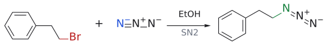
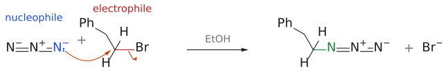
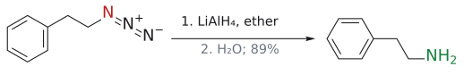

# 아자이드·나이트릴을 거친 아민 합성

> R–X에 N₃⁻나 CN⁻를 SN2로 **한 번만** 붙인 뒤 reduction해 1차 amine을 얻는다. nitrile 경로는 탄소가 하나 늘어난다.

## 개요

NH₃로 alkyl halide를 직접 치환하면 생성된 RNH₂가 NH₃보다 더 좋은 nucleophile이라서 2차·3차 amine과 4차 염이 섞인다(over-alkylation, → [amine synthesis (overview)](../개념/아민%20합성%20개관.md)). over-alkylation을 막으려면 어떻게 해야 할까? 한 가지 답은 nucleophile을 바꾸는 것이다. N₃⁻나 CN⁻를 붙인 생성물은 더 이상 nucleophile로 행동하지 않으므로 반응이 정확히 한 번에서 멈추고, 그다음 reduction으로 amine을 드러낸다. (출처: L5 p.5–8)

## azide 경로

azide ion은 좋은 nucleophile이라 [SN2](SN2%20반응.md)가 잘 되지만, 생성물인 alkyl azide R–N₃는 더 이상 nucleophilicity가 없다. 그래서 반응이 정확히 한 번에서 멈추고, 그다음 환원하면 1차 amine만 얻는다.

$$
\mathrm{R{-}X} + \mathrm{N_3^-} \xrightarrow{\ \mathrm{S_{\mathrm{N}}2},\ \mathrm{{-}X^-}\ \mathstrut} \mathrm{R{-}N_3} \xrightarrow{\ \mathrm{LiAlH_4}\ \text{또는}\ \mathrm{H_2/Pd}\ \text{또는}\ \mathrm{PPh_3}\ \mathstrut} \mathrm{RNH_2}
$$

환원 시약으로 [LiAlH4](../시약/LiAlH4.md), H₂/[Pd/C](../시약/Pd-C.md)와 나란히 PPh₃도 쓸 수 있다는 점이 흥미롭다. PPh₃를 쓰는 경우가 [Staudinger reduction](스타우딩거%20환원.md)이다. azide와 PPh₃가 N₂를 내놓고 iminophosphorane(R–N=PPh₃)을 만든 뒤, 물로 가수분해해야 RNH₂와 Ph₃P=O가 된다. 슬라이드에는 이 가수분해 단계가 생략되어 있다(보충 근거: Clayden p.1176). (출처: L5 p.7)

## nitrile 경로

비슷한 발상으로 cyanide ion을 쓸 수도 있다. 다만 이번에는 탄소 nucleophile이므로, 결과적으로 **탄소가 하나 늘어난** 1차 amine이 된다는 점이 다르다. CN의 탄소가 그대로 CH₂NH₂의 CH₂가 되기 때문이다.

$$
\begin{aligned} &\mathrm{RCH_2X} \xrightarrow{\mathrm{NaCN}} \mathrm{RCH_2C{\equiv}N} \cr &\qquad \xrightarrow[2.\ \mathrm{H_2O}\ \text{또는}\ \mathrm{H_2/Pd}]{\ 1.\ \mathrm{LiAlH_4},\ \text{ether}\ \mathstrut} \mathrm{RCH_2CH_2NH_2}\ (\text{1차 amine}) \end{aligned}
$$

(출처: L5 p.8)

nitrile hydrogenation은 [catalytic hydrogenation](촉매%20수소화.md)의 쉬운 순서에서 뒤쪽(7번, benzene 고리 바로 앞)이라 비교적 어렵다. (출처: L5 p.33)

## 선택성

- 두 경로 모두 1차 amine만 준다. 2차·3차 amine이 필요하면 [amide reduction](아마이드%20환원.md)이나 [reductive amination](환원성%20아미노화.md)를 쓴다. (출처: L5 p.9)
- 두 경로 모두 SN2 단계이므로 X가 붙은 탄소의 배치가 반전된다. (출처: L5 p.7–8)

## 예

- $\text{1-bromo-2-phenylethane}\ \mathrm{PhCH_2CH_2Br}$ $\xrightarrow[\mathrm{EtOH}]{\ \mathrm{NaN_3}\ \mathstrut} \text{2-phenylethyl azide}\ \mathrm{PhCH_2CH_2N_3}$ $\xrightarrow[2.\ \mathrm{H_2O}]{\ 1.\ \mathrm{LiAlH_4},\ \text{ether}\ \mathstrut} \text{2-phenylethylamine}\ \mathrm{PhCH_2CH_2NH_2}$ (수율 89%)

  (L5) (출처: L5 p.7)
- venlafaxine 합성:

  $\text{1-[사이아노(4-methoxyphenyl)methyl]cyclohexanol}$ $\xrightarrow{\ \mathrm{H_2},\ \mathrm{Rh/Al_2O_3}\ \mathstrut} \text{1-[2-amino-1-(4-methoxyphenyl)ethyl]cyclohexanol}$ (수율 57%; 5% $\mathrm{Rh/Al_2O_3}$)

  이어서 [Eschweiler–Clarke reaction](에슈바일러-클라크%20반응.md). 전체 흐름은 [amine synthesis (overview)](../개념/아민%20합성%20개관.md)에 있다. (L5) (출처: L5 p.16)

그림: azide(파랑)가 C–Br(빨강)을 SN2로 치환한다.

그림: 위 반응식의 메커니즘이다. 한 단계 SN2이므로 중간체가 없고, 곡선 화살표를 위 줄의 반응물에 바로 그렸다. $\mathrm{N}_3^-$ 의 끝 질소 비공유 전자쌍(파랑, nucleophile)이 C–Br 탄소(빨강, electrophile)를 Br의 반대쪽에서 공격해 새 C–N 결합(초록)이 생기고, C–Br 결합 전자는 Br로 가서 $\mathrm{Br}^-$ 가 떠난다. 생성물 alkyl azide $\mathrm{R{-}N{=}N^+{=}N^-}$ 는 더 이상 nucleophile이 아니라서 반응이 한 번에서 멈춘다. $\mathrm{Na}^+$ 는 그리지 않았다. 보충: 곡선 화살표는 표준 SN2 메커니즘을 그린 것이다. (보충 근거: Clayden p.353–354)

그림: azide를 환원하면 $N_2$ 가 빠지고 1차 amine(초록)이 된다(89%).

## 흔한 오해

- **"NH₃와 RX면 1차 amine이 생긴다"**: over-alkylation으로 혼합물이 된다. 2-bromopropanoic acid에서 alanine을 얻을 때처럼 NH₃를 70 mol이나 넣어야 겨우 1차 amine이 우세해진다. (출처: L5 p.5–6)
- **"nitrile 환원은 원래 탄소 수의 amine을 준다"고 생각하기 쉽지만 사실은** RX에 CN을 붙이는 순간 탄소가 하나 늘어나므로 RCH₂X에서 RCH₂CH₂NH₂가 된다. 반대로 azide 경로는 R–X의 탄소 수 그대로다. (출처: L5 p.7–8)

## 관련 문서

- 반응: [reductive amination](환원성%20아미노화.md), [amide reduction](아마이드%20환원.md), [Eschweiler–Clarke reaction](에슈바일러-클라크%20반응.md), [catalytic hydrogenation](촉매%20수소화.md), [Staudinger reduction](스타우딩거%20환원.md), [SN2 reaction](SN2%20반응.md)
- 시약: [LiAlH4](../시약/LiAlH4.md), [Pd/C](../시약/Pd-C.md)
- 개념: [amine synthesis (overview)](../개념/아민%20합성%20개관.md), [electrophile과 nucleophile](../개념/친전자체와%20친핵체.md), [metal hydride의 반응성](../개념/금속%20수소화물의%20반응성.md)

## 출처

- [L5 환원](../../notes/L05_Reduction.md) 1절 (슬라이드 p.7–8, p.16, p.33)
