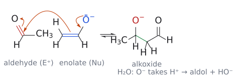
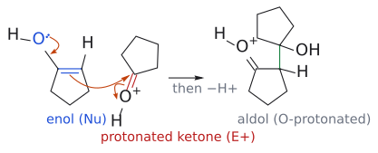

# 알돌 반응

> enolate(또는 enol) + 알데하이드/케톤 ⇌ β-하이드록시 카보닐 → (탈수) α,β-불포화 카보닐. 한 번에 C–C 결합, 산소 작용기, 필요하면 알켄까지 얻는다.

## 개요

aldol reaction은 [enolate 또는 enol](../개념/엔올과%20엔올레이트.md)이 알데하이드나 케톤의 카보닐 탄소를 공격해 β-hydroxy carbonyl 화합물을 만드는 반응이다. [엔올레이트 알킬화](엔올레이트%20알킬화.md)에서 enolate의 상대가 할로젠화 알킬이었다면, 이번에는 그 상대를 카보닐 화합물로 바꾼 셈이다. 생성물을 탈수하면 α,β-unsaturated carbonyl 화합물이 되므로, aldol 하나로 "C–C 결합 + 산소 작용기 + (필요하면) 알켄"을 한꺼번에 얻을 수 있다. 다만 아무 카보닐 두 개를 염기와 섞으면 생성물이 뒤죽박죽이 되기 때문에, L8의 절반은 "원하는 crossed aldol 생성물 하나만 얻는 법"에 할애된다(→ [교차 알돌 반응](교차%20알돌%20반응.md)). (출처: L8 p.1, p.2, p.7, p.34)

한 문장으로 정의하면 "enolate(또는 enol)와 카보닐 화합물(알데하이드 또는 케톤) 사이의 반응"이다.

`RC(O⁻)=CH₂ + R'COR'' ⇌ RCOCH₂C(OH)R'R'' (aldol addition) --> RCOCH=CR'R'' + H₂O (탈수)`

첫 단계에 평형 화살표가 붙어 있다는 점을 눈여겨봐야 한다. aldol addition은 가역이고, 이 사실이 [retro-aldol](역알돌%20반응.md)과 [intramolecular aldol](분자내%20알돌%20반응.md)의 선택성을 설명하는 열쇠가 된다. L8은 I. 기본 aldol(염기성/산성), II. crossed aldol(lithium enolate, silyl enol ether, 약염기), III. intramolecular aldol, IV. enolate와 여러 electrophile 순서로 진행된다. (출처: L8 p.7)

## 왜 중요한가: 천연물과 polyketide

왜 aldol을 배우기 전에 천연물부터 보여 줄까? 슬라이드가 고른 분자들이 모두 aldol로 만들기 좋은 구조를 갖고 있기 때문이다. erythromycin은 여러 세균 감염 치료에 쓰는 항생제이고, (+)-discodermolide는 여러 다제내성(MDR) 암세포주에서 종양세포 성장을 강하게 억제한다. roflamycoin은 1981년 *Streptomyces roseoflavus*에서 분리된 항진균제로, 폴리엔 마크롤라이드 항생제 가운데 유일하게 잘 정의된 이온 채널을 형성하는 옥소폴리엔 마크롤라이드다. 세 분자 모두 탄소 사슬에 OH와 메틸이 하나 걸러 하나씩 붙은 패턴, 즉 1,3-산소 패턴을 보인다. (출처: L8 p.2, p.3)

그렇다면 자연은 이 패턴을 어떻게 만들까? roflamycoin의 제안된 생합성 경로를 보면, 효소(polyketide synthase)에 매달린 말로닐 단위가 CO₂를 잃으며 enolate 등가체가 되고, 이것이 KS(ketosynthase)에 결합된 아실 싸이오에스터를 공격해 사슬을 두 탄소씩 늘린다. 이어 KR(ketoreductase)이 케톤을 OH로, DH(dehydratase)가 탈수로 알켄을, ER(enoyl reductase)이 알켄을 CH₂로 바꾸는데, 어떤 효소가 작동하느냐에 따라 각 위치의 작용기가 결정된다.[^1] 즉 자연은 "enolate + 카보닐"을 반복해서 사슬을 짓는다. 실험실에서 이 일을 맡는 것이 aldol 반응이다. (출처: L8 p.4)

## HWE와의 관계

슬라이드는 aldol에 앞서 L6의 Wittig/HWE를 다시 꺼낸다(→ [HWE 반응](HWE%20반응.md), [위티그 반응](위티그%20반응.md)). HWE 메커니즘의 두 번째 단계가 바로 "안정화된 carbanion이 알데하이드를 공격해 alkoxide를 만드는" 단계, 즉 aldol addition과 똑같은 모양이기 때문이다. (출처: L8 p.5, p.6)

- stabilized ylide: BrCH₂CO₂R --[PPh₃]--> Ph₃P⁺CH₂CO₂R --[Na₂CO₃]--> Ph₃P⁺–CH⁻–CO₂R. 음전하가 C=O와 공명해 enolate처럼 퍼지므로 Na₂CO₃ 같은 약염기로도 만들 수 있다(R = H, OR, alkyl; → [엔올과 엔올레이트](../개념/엔올과%20엔올레이트.md)).
- HWE: (EtO)₂P(O)CH₂COR --[EtO⁻ 또는 NaH]--> phosphonate 안정화 enolate.

HWE 메커니즘(예: (EtO)₂P(O)CH₂CO₂Et + PhCHO)은 다음과 같다. (출처: L8 p.6)

1. EtO⁻가 P와 C=O 사이의 산성 CH₂ 양성자를 떼어 enolate를 만든다.
2. enolate의 α-탄소(nucleophile)가 PhCHO의 카보닐 탄소(electrophile)를 공격해 alkoxide가 생긴다. 슬라이드에서 박스로 강조된 이 단계가 aldol addition과 같은 형태다.
3. alkoxide O⁻가 인을 공격해 4원 고리 중간체([옥사포스페테인](../개념/옥사포스페테인.md)형)를 만든다.
4. C–P, O–P 결합이 재배열되며 (EtO)₂PO₂⁻가 떨어지고 C=C가 생겨 (E)-EtO₂C–CH=CH–Ph가 된다.

일반식은 R¹COR² + R³O₂C–CH(R⁴)–P(O)(OR⁵)₂ --[Base]--> R³O₂C–C(R⁴)=CR¹R² 이다. HWE에서는 alkoxide가 인에 붙잡혀 알켄으로 가지만, aldol에서는 alkoxide가 그냥 양성자를 받아 OH로 남는다. 이 차이를 기억해 두면 두 반응이 헷갈리지 않는다. (출처: L8 p.6)

## 메커니즘 (염기성)

### "aldol"이라는 이름

아세트알데하이드에 NaOEt나 NaOH를 촉매량 넣으면 무슨 일이 생길까? 빠르고 가역적으로 3-hydroxybutanal이 생긴다. 이 분자는 **ald**ehyde이면서 alcoh**ol**이라 관용명이 "aldol"이고, 반응 전체의 이름이 여기서 나왔다. 같은 분자 두 개가 합쳐지므로 self-aldol 또는 dimerization이라 부른다. (출처: L8 p.8)

`2 CH₃CHO --[10% NaOH, H₂O, 5 °C]--> CH₃CH(OH)CH₂CHO (3-hydroxybutanal, 50%)`

### 같은 분자가 nucleophile도 되고 electrophile도 된다

어떻게 같은 아세트알데하이드가 공격하는 쪽과 공격당하는 쪽을 동시에 맡을 수 있을까? 답은 염기가 일부 분자만 enolate로 바꾸기 때문이다. (출처: L8 p.9)

1. **enolate 형성.** 수산화 이온이 한 아세트알데하이드의 α-탄소 H를 떼어 낸다. 생긴 음이온은 CH₂=CH–O⁻ ↔ ⁻CH₂–CHO로 공명 안정화된 enolate다.
2. **C–C 결합 형성.** enolate의 α-탄소(nucleophile)가 아직 enolate가 되지 않은 두 번째 아세트알데하이드의 카보닐 탄소(electrophile)를 공격한다. C=O π 결합이 끊어지고 새 C–C σ 결합이 생기면서 alkoxide 음이온이 된다.
3. **양성자 전달.** alkoxide(더 강한 염기)가 물에서 양성자를 받아 aldol 생성물이 되고, HO⁻(더 약한 염기)가 다시 나온다. 그래서 염기는 촉매로 충분하다.

*그림: 2단계(C–C 결합 형성)를 그린 것이다. 파란색은 nucleophile 쪽(enolate의 C=C와 O⁻), 빨간색은 electrophile 쪽(두 번째 아세트알데하이드의 카보닐 탄소와 C=O), 주황색 굽은 화살표는 전자쌍의 이동이다. 화살표 셋은 (1) O⁻의 비공유 전자쌍이 내려와 C=O를 다시 만들고, (2) enolate의 C=C π 전자가 상대 카보닐 탄소를 공격하며, (3) 상대의 C=O π 전자가 산소로 올라가 alkoxide(빨간 O⁻)가 되는 과정이다. 초록 결합이 새로 생긴 C–C 결합이다. 이어서 alkoxide가 물에서 양성자를 받으면 aldol과 HO⁻가 된다(3단계). (출처: L8 p.9)*

정리하면 새 C–C 결합은 "enolate의 α-탄소"와 "상대 분자의 카보닐 탄소" 사이에 생긴다. 그래서 aldol 생성물에서 C=O는 enolate 쪽에, OH는 electrophile 쪽에 남는다. 역합성은 이 Cα–Cβ 결합을 끊는다. (출처: L8 p.9, p.20)

보충: 그래서 aldol 자체를 얻으려면 염기 농도를 낮게 유지한다. 아세트알데하이드에는 묽은 NaOH를 한 방울 정도만 넣고, 아세톤(→ 4-hydroxy-4-methylpentan-2-one)에는 물에 잘 녹지 않는 Ba(OH)₂를 쓴다. 애초에 HO⁻(짝산 H₂O pKa 15.7)는 알데하이드(α-H pKa 약 20)를 완전히 enolate로 바꾸지 못하므로, 소량의 enolate가 enol화되지 않은 많은 알데하이드 분자에 둘러싸이게 된다. 같은 분자가 nucleophile과 electrophile을 동시에 맡을 수 있는 것도 이 때문이다. (보충 근거: Clayden p.615)

### 탈수: E1cB

aldol 생성물에 염기를 더 오래, 더 세게 작용시키면 물이 빠진다. HO⁻는 원래 나쁜 이탈기인데, 이탈 전에 먼저 음이온(짝염기)을 만들기 때문에 떨어질 수 있다. 이를 E1cB라 하며, 메커니즘과 그림은 [E1cB 제거](../개념/E1cB%20제거.md)에 있다. (출처: L8 p.10)

`CH₃CH(OH)CH₂CHO → CH₃CH=CHCHO (2-butenal, enal) + H₂O (HO⁻ 재생)`

이 반응이 앞으로 가는 원동력은 생성물의 conjugation이다. 알켄과 카보닐이 이어져 전자가 넓게 퍼지므로 α,β-불포화 카보닐 화합물이 안정하다. (출처: L8 p.10)

### aldol에서 멈출까, 축합까지 갈까

같은 염기 촉매 aldol인데 어떤 때는 aldol이, 어떤 때는 제거 생성물이 나온다. 슬라이드의 답은 조건의 격렬함이다. 더 강한 염기, 더 높은 온도, 더 긴 반응 시간일수록 제거 생성물이 나오기 쉽다. 위 예에서 5 °C 조건은 3-hydroxybutanal에서 멈추지만, 계속 밀면 CH₃CH=CHCHO + H₂O가 된다. (출처: L8 p.11)

이렇게 두 분자가 결합하면서 물이나 메탄올 같은 작은 분자를 잃는 반응을 condensation이라 한다. aldol condensation과 [Claisen condensation](클라이젠%20축합.md)이 대표적이다. (출처: L8 p.11)

## 메커니즘 (산성)

### 산에서는 거의 항상 축합까지 간다

aldol은 산 촉매로도 일어난다. 그런데 염기성 조건과 달리 산성 조건에서는 대부분 탈수 생성물까지 가 버린다. (출처: L8 p.12)

- 2 (CH₃)₂C=O --[HCl (cat.)]--> (CH₃)₂C=CH–CO–CH₃ (4-methylpent-3-en-2-one) + H₂O
- 2 cyclopentanone --[H⁺]--> 2-cyclopentylidenecyclopentan-1-one (경유: 2-(1-hydroxycyclopentyl)cyclopentan-1-one)

### enolate 대신 enol

산성 용액에는 enolate가 존재할 수 없다. 그러면 nucleophile은 무엇일까? 답은 [enol](케토-엔올%20토토머화.md)이다. enol은 enolate보다 약한 nucleophile이지만, 대신 산이 상대 카보닐을 양성자화해 훨씬 강한 electrophile로 만들어 주므로 반응이 일어난다. (출처: L8 p.13; L10 p.3)

1. **산 촉매 enol화.** 사이클로펜탄온의 카보닐 O가 양성자화되어 옥소늄 이온(C=OH⁺)이 되고, α-H가 떨어지며 C=C가 생겨 enol(1-hydroxycyclopentene)이 된다.
2. **산 촉매 aldol addition.** enol의 C=C(nucleophile, OH의 비공유 전자쌍이 밀어 줌)가 양성자화된 두 번째 사이클로펜탄온의 카보닐 탄소를 공격한다. 새 C–C 결합이 생기고, 한쪽은 양성자화된 케톤, 다른 쪽은 3차 알코올이 된다.
3. **탈양성자.** H⁺가 떨어지며 aldol 생성물 2-(1-hydroxycyclopentyl)cyclopentanone이 된다.
4. **산 촉매 탈수(슬라이드 표기: E1).** 3차 OH가 양성자화되어 –OH₂⁺가 되고, 물이 떨어져 3차 [carbocation](../개념/탄소%20양이온.md)이 생긴다. 이웃한 C–H(케톤의 α-탄소)가 H⁺로 떨어지며 C=C가 생겨 C=O와 공액된 2-cyclopentylidenecyclopentanone이 된다.

(출처: L8 p.13)

*그림: 위 2단계(산 촉매 aldol addition)를 그린 것이다. 파란색은 nucleophile인 enol(C=C와 OH의 산소), 빨간색은 양성자화되어 친전자성이 커진 사이클로펜탄온의 C=O⁺H다. 화살표 셋은 (1) enol 산소의 비공유 전자쌍이 밀어 주어 C=O⁺H가 생기고, (2) enol의 C=C π 전자가 양성자화된 카보닐 탄소를 공격하며, (3) C=O⁺ π 전자가 산소로 가서 중성 OH가 되는 과정이다. 초록 결합이 새 C–C 결합이며, 이어서 H⁺가 떨어지면 aldol이 된다(3단계). (출처: L8 p.13)*

슬라이드는 이 탈수가 "빠르고, 산성 조건에서는 피하기 어렵다"고 강조한다. 산성 aldol의 생성물을 물으면 일단 enone/enal을 떠올리는 것이 안전하다. (출처: L8 p.13)

L10은 같은 사이클로펜탄온 예를 "염기가 없을 때는 무엇이 nucleophile이 되나"라는 질문으로 다시 꺼내 세 막(enol화 → aldol addition → E1 탈수)으로 정리한다. 첫째 막인 산 촉매 enol화와 그림은 [케토-엔올 토토머화](케토-엔올%20토토머화.md)에 있다. 탈수가 피하기 어려운 이유는 aldol의 3차 OH가 양성자화되어 –OH₂⁺라는 좋은 이탈기가 되고, 물이 떨어지면 안정한 3차 carbocation이 생기기 때문이다. 이어서 이웃한 α-C–H에서 H⁺가 빠지면 C=O와 공액된 C=C가 생긴다. 즉 산 촉매 aldol은 대개 enone까지 간다([L10 연습 문제](../../practice/L10_Exercises.md) 1번). (출처: L10 p.3)

*그림: 둘째 막(알돌 첨가). 파란색은 친핵체인 enol의 C=C, 빨간색은 친전자체인 양성자화된 카보닐(C=O⁺H)이다. 왼쪽 화살표 셋은 (1) enol 산소의 비공유 전자쌍이 C–O 쪽으로 밀어 주고 (2) C=C의 π 전자가 양성자화된 카보닐 탄소를 공격하며 (3) C=O⁺의 π 전자가 산소로 올라가 OH가 되는 과정이다. 가운데는 새 C–C 결합(초록)이 생긴 양성자화된 알돌이고, O–H 결합 전자(파란 결합)가 산소로 돌아가며 H⁺가 빠지면(−H⁺) 알돌 생성물이 된다.*

*그림: 셋째 막(E1 탈수). 3차 OH가 이미 양성자화된 상태(–OH₂⁺, 빨강)부터 그렸다. 왼쪽 화살표는 C–O 결합 전자가 산소로 가서 물이 떨어지는(−H₂O) 과정이고, 그 결과 3차 carbocation(빨간 +)이 생긴다. 가운데 화살표는 이웃한 α-C–H 결합 전자(파란 결합)가 C⁺ 쪽으로 가서 C=C를 만들며 H⁺가 빠지는(−H⁺) 과정이다. 오른쪽 초록 C=C가 C=O와 공액된 새 이중 결합이다(2-cyclopentylidenecyclopentan-1-one).*

## 선택성

- **연결 위치:** C=O는 enolate 쪽에, OH는 electrophile 쪽에 남는다. (출처: L8 p.9, p.20)
- **가역성:** 첨가 단계는 평형이다. 그래서 [역알돌 반응](역알돌%20반응.md)이 가능하고, [분자내 알돌 반응](분자내%20알돌%20반응.md)에서는 가장 유리한 생성물로 수렴한다. (출처: L8 p.7)
- 서로 다른 두 카보닐을 섞을 때의 문제와 해법은 [교차 알돌 반응](교차%20알돌%20반응.md)에서 다룬다.

## 예

| 반응 | 조건 | 생성물 | 비고 |
|---|---|---|---|
| self-aldol (CH₃CHO) | 10% NaOH, H₂O, 5 °C | 3-hydroxybutanal (50%) | 가역, 새 입체중심 1개는 라세미 (p.8–9) |
| 염기성 탈수 | NaOH, 더 격렬한 조건 | (E)-2-butenal | E1cB (p.10–11) |
| 산성 aldol condensation (아세톤) | HCl (cat.) | 4-methylpent-3-en-2-one | 탈수까지 진행 (p.12) |
| 산성 aldol condensation (사이클로펜탄온) | H⁺ | 2-cyclopentylidenecyclopentanone | enol 경유, 탈수 E1 (p.12–13) |

슬라이드 p.14의 빈 칸(페닐아세트알데하이드 + NaOH, 사이클로헥산온 + NaOH, 벤즈알데하이드 + 아세트알데하이드 + NaOH)은 [L8 연습 문제](../../practice/L08_Exercises.md) 1–3에 있다. (출처: L8 p.14)

## 흔한 오해

- "aldol은 늘 탈수 생성물까지 간다": 염기성 저온·짧은 시간(예: 10% NaOH, 5 °C)에서는 β-hydroxy carbonyl에서 멈출 수 있다. 다만 산성 조건에서는 E1 탈수가 쉽게 일어나 enone까지 간다. (출처: L8 p.8, p.11, p.13; L10 p.3)
- "염기성 탈수는 E2나 E1이다": enolate(짝염기)를 먼저 만든 뒤 HO⁻가 떨어지는 E1cB다. 산성 탈수는 슬라이드에서 E1(carbocation 경유)로 표기한다. (출처: L8 p.10, p.13)
- "산성 aldol에서도 enolate가 공격한다": nucleophile은 중성 enol이고, electrophile은 양성자화된 카보닐이다. (출처: L8 p.13)
- "OH가 enolate 쪽 탄소에 붙는다": OH는 공격받은 카보닐(electrophile) 쪽 탄소에 생기고 C=O는 enolate 쪽에 남는다. 역합성은 Cα–Cβ 결합을 끊는다. (출처: L8 p.9, p.20)
- "HWE와 aldol은 전혀 다른 반응이다": HWE의 C–C 결합 형성 단계는 aldol addition과 같은 모양이다. 차이는 alkoxide가 인에 붙잡혀 알켄이 되느냐, 양성자를 받아 OH로 남느냐다. (출처: L8 p.6)

## 관련 문서

- 반응: [교차 알돌 반응](교차%20알돌%20반응.md), [역알돌 반응](역알돌%20반응.md), [분자내 알돌 반응](분자내%20알돌%20반응.md), [무카이야마 알돌 반응](무카이야마%20알돌%20반응.md), [프롤린 촉매 알돌 반응](프롤린%20촉매%20알돌%20반응.md), [클라이젠 축합](클라이젠%20축합.md), [마이클 반응](마이클%20반응.md), [HWE 반응](HWE%20반응.md)
- 시약: [알콕사이드 염기](../시약/알콕사이드%20염기.md), [LDA](../시약/LDA.md)
- 개념: [엔올레이트 화학 개관](../개념/엔올레이트%20화학%20개관.md), [엔올과 엔올레이트](../개념/엔올과%20엔올레이트.md), [E1cB 제거](../개념/E1cB%20제거.md), [탄소 양이온](../개념/탄소%20양이온.md), [옥사포스페테인](../개념/옥사포스페테인.md)

## 출처

- [L8 알돌 반응](../../notes/L08_Aldol_Reactions.md) 0–3절(p.1–14), 8절(p.34)
- [L10 엔올과 엔아민](../../notes/L10_Enol_and_Enamine.md) 산 조건의 알돌 반응 (슬라이드 p.3)
- 연습: [L10 연습 문제](../../practice/L10_Exercises.md) 1번

[^1]: roflamycoin 생합성 슬라이드의 효소 약어: AT acyl transferase, ACP acyl carrier protein, KS ketosynthase, DH dehydratase, KR ketoreductase, ER enoyl reductase, TE thioesterase. 보충: 엄밀히 말해 사슬을 늘리는 C–C 결합 형성은 enolate + 싸이오에스터의 Claisen형 반응이다. 다만 그 결과로 생기는 β-하이드록시 카보닐/1,3-다이올 패턴이 aldol 생성물과 같은 산화 패턴이라, 실험실 합성에서는 aldol로 접근한다. (보충 근거: Wade p.1075; Clayden p.1162) (출처: L8 p.4)
