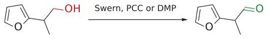
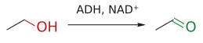
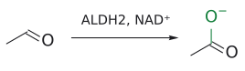

# 알코올 산화

> 1차 alcohol → aldehyde → carboxylic acid, 2차 alcohol → ketone, 3차 alcohol → 반응 없음. 모든 시약이 "O–LG 결합을 만든 뒤 염기가 α-H를 뗀다"는 한 뼈대를 따르고, 핵심은 **"얼마나 세게 산화할지"에 맞춰 시약을 고르는 것**이다.

## 개요

L6 전반부는 oxidation(산화)이다. alcohol을 aldehyde, ketone, carboxylic acid로 바꾸는 시약들을 다루는데, 1차 alcohol은 aldehyde에서 멈추게 할 수도 있고 carboxylic acid까지 보낼 수도 있다. 그래서 [DMP](../시약/DMP.md), [Swern](스원%20산화.md), [TPAP](../시약/TPAP.md), [MnO2](../시약/MnO2.md), [TEMPO](TEMPO%20산화.md)처럼 aldehyde에서 멈추는 순한 산화제와, [Jones](존스%20산화.md) 시약처럼 끝까지 밀어붙이는 강한 산화제를 구분해서 기억해야 한다. 강의는 먼저 범위를 정한다. I부는 alcohol·aldehyde의 산화(alcohol → aldehyde/ketone, 산까지의 산화)이고, C=C oxidation(epoxidation, dihydroxylation, ozonolysis)는 이전 강의에서 이미 다뤘다. (출처: L6c p.3)

## 왜 menthol 이야기부터 하나

동기 부여로 강의는 향료 화학 이야기를 꺼낸다. geraniol은 장미향이 나는 monoterpene alcohol로, 유럽 데오도란트의 76%에 들어 있고 연간 1000 t 넘게 생산된다. 예전에는 박하에서 추출하던 (−)-menthol((−)-menthol)도 지금은 대부분 다른 원료로 합성한다. (출처: L6c p.4)

슬라이드의 menthol 합성 경로는 다음과 같다.

- $\text{geraniol} \xrightarrow{?} \text{geranial}$
- $\text{geranial} \xrightarrow{\mathrm{H_2},\ \mathrm{CO},\ \mathrm{Rh(CO)_2acac},\ \text{(S,S)-Chiraphos}} \text{(+)-citronellal}$
- $\text{neral} \xrightarrow{\mathrm{H_2},\ \mathrm{CO},\ \mathrm{Rh(CO)_2acac},\ \text{(R,R)-Chiraphos}} \text{(+)-citronellal}$
- $\text{(+)-citronellal} \xrightarrow{\mathrm{Al}\ \text{cat.}} \text{(−)-isopulegol} \xrightarrow{\mathrm{H_2},\ \mathrm{Ni}\ \text{cat.}} \text{(−)-menthol}$

여기서 물음표로 남은 첫 단계, 즉 allylic 1차 alcohol을 α,β-unsaturated aldehyde로 바꾸는 단계가 바로 이 강의의 산화 반응이다. 이 단계에서 산화제가 너무 세면 carboxylic acid까지 가 버리고, 분자 안에 있는 C=C 두 개도 공격받을 수 있다. 그래서 순한 산화제가 필요하다.[^1] hydrogenation 단계들은 L5에서 다룬 같은 공정이다(→ [catalytic hydrogenation](촉매%20수소화.md)). (출처: L6c p.3–5)

## 원리: 하나의 뼈대

슬라이드의 표를 보면 1차 alcohol은 aldehyde를 거쳐 carboxylic acid가 되고, 2차 alcohol은 ketone이 되며, 3차 alcohol은 "No reaction"이다.

- $\mathrm{RCH_2OH} \xrightarrow{\mathrm{O}} \mathrm{RCHO} \xrightarrow{\mathrm{O}} \mathrm{RCO_2H}$
- $\mathrm{R_2CHOH} \xrightarrow{\mathrm{O}} \mathrm{R_2C{=}O}$
- $\mathrm{R_3COH} \xrightarrow{\mathrm{O}} \text{반응 없음}$

차이가 생기는 이유는 녹색 박스의 일반 메커니즘에 있다.

1. alcohol O(nucleophile)가 산화제 LG–A(electrophile)를 공격해 O–LG 결합을 만들고, HA가 빠진다.
2. 염기 B:가 carbinol 탄소의 α-H를 떼어 낸다.
3. C–H 결합에 있던 전자쌍이 C=O π 결합으로 옮겨 가고, 동시에 O–LG 결합이 끊어져 LG:가 떠난다. 생성물은 C=O + B–H + LG:다.

그림: 슬라이드 녹색 박스의 일반 메커니즘. 1단계: alcohol O(파랑, nucleophile)의 lone pair가 산화제의 LG(빨강, electrophile)를 공격하고, LG–A 결합 전자는 A로 떠난다(HA가 빠짐). 2단계: 염기 B:(파랑)가 carbinol 탄소의 H를 떼어 내고, C–H 결합 전자(파란 결합)는 C–O 사이로 들어가 C=O π 결합이 되며, O–LG 결합(빨강) 전자는 LG와 함께 떠난다. 세 화살표가 한 번에 움직이는 E2형 elimination이다. 초록 C=O가 새로 생긴 결합이다. 3차 alcohol에는 2단계의 C–H가 없으므로 이 과정이 일어날 수 없다.

즉 산화의 본질은 O–H의 H와 C–H의 H를 하나씩 떼어 내는 것이다. 3차 alcohol에는 2단계에서 떼어 낼 C–H가 없으니 C=O를 만들 길이 없다. 이 강의에 나오는 시약들은 결국 "LG를 무엇으로 붙이느냐"만 다르고, 이 뼈대는 모두 같다. 슬라이드도 각 시약을 "I–O", "S–Cl", "Ru–O"처럼 산화제의 핵심 결합으로 부른다. (출처: L6c p.6)

## 시약 고르기

요약 슬라이드의 분류는 다음과 같다. (출처: L6c p.17)

1. 순한 산화(alcohol → aldehyde/ketone): a. DMP, b. Swern(대량 규모), c. TPAP/NMO, d. MnO₂(allylic/benzylic alcohol), e. TEMPO, f. Cu(I)–TEMPO 호기성 산화
2. aldehyde → carboxylic acid: g. Pinnick(NaClO₂) + 2-methyl-2-butene(또는 DMSO)
3. 1차 alcohol → carboxylic acid: h. Jones(CrO₃/H₃O⁺), i. 3 = 1 + 2

| 목표 | 시약 | 특징 |
|---|---|---|
| alcohol → aldehyde/ketone | [DMP](../시약/DMP.md) ("I–O") | 실온·중성, 민감한 작용기에 강함, 비쌈 (p.7) |
| | [Swern](스원%20산화.md) ("S–Cl") | 싸서 대량 규모에 적합, −78 °C, 악취 Me₂S (p.8–9) |
| | [TPAP](../시약/TPAP.md)/NMO ("Ru–O") | TPAP는 촉매, NMO가 terminal oxidant (p.10) |
| | [MnO2](../시약/MnO2.md) ("Mn–O") | allylic·benzylic alcohol만 산화 (p.10) |
| | [TEMPO](TEMPO%20산화.md)/NaOCl, Cu/TEMPO/O₂ ("N–O") | 촉매 산화, 1차 alcohol (p.11–13) |
| aldehyde → carboxylic acid | [Pinnick](피닉%20산화.md) ([NaClO2](../시약/NaClO2.md)) | 2-methyl-2-butene으로 HOCl 제거 (p.15) |
| 1차 alcohol → carboxylic acid | [Jones](존스%20산화.md) (CrO₃/H₃O⁺) | 강산성 (p.16) |
| | "3 = 1 + 2" | 순한 산화 후 Pinnick (p.16–17) |

### "3 = 1 + 2"

1차 alcohol을 한 번에 carboxylic acid까지 보내는 Jones는 강산성이라 섬세한 기질에 맞지 않는다. 그렇다면 섬세한 기질은 어떻게 할까? 슬라이드의 답은 "두 번에 나눠서 순하게"다. 먼저 순한 산화제로 aldehyde까지 산화하고, 그다음 Pinnick으로 산까지 보낸다. Boger의 vancomycin 계열 합성(JACS 1999)이 예다.

$$
\mathrm{R}\ =\ \mathrm{CH_2OH} \xrightarrow{\text{Dess–Martin}} \mathrm{R}\ =\ \mathrm{CHO} \xrightarrow{\mathrm{NaClO_2}} \mathrm{R}\ =\ \mathrm{CO_2H}
$$

(2단계 합 77%)

요약 슬라이드는 이것을 "3 = 1 + 2"라고 적는다. 즉 (1차 alcohol → 산) = (alcohol → aldehyde) + (aldehyde → 산)이다. (출처: L6c p.16–17)

## 예

- $\text{geraniol} \xrightarrow[\mathrm{CH_2Cl_2},\ 84\unicode{x25}]{\mathrm{DMP}} \text{geranial}$

  (E 기하 유지) (L6) (출처: L6c p.7)
- $\text{retinol} \xrightarrow[>95\unicode{x25}]{\mathrm{MnO_2}} \text{retinal}$

  (L6) (출처: L6c p.10)
- ester → aldehyde 우회로: LiAlH₄로 1차 alcohol까지 환원한 뒤 순한 산화제로 되돌린다(→ [partial reduction of esters](에스터%20부분%20환원.md)). (L5, L6) (출처: L6c p.2)

### 여담: 몸 안의 alcohol 산화와 "Asian flush"

우리 몸도 alcohol을 같은 순서로 산화한다. 다만 시약 대신 효소와 NAD⁺를 쓴다.

$$
\text{ethanol} \xrightarrow{\mathrm{ADH},\ \mathrm{NAD^+}\ \to\ \mathrm{NADH}\ +\ \mathrm{H^+}} \text{acetaldehyde} \xrightarrow{\mathrm{ALDH_2},\ \mathrm{NAD^+}\ \to\ \mathrm{NADH}\ +\ \mathrm{H^+}} \text{acetate}
$$

동아시아인의 약 30–50%는 ALDH2 유전자 변이(ALDH2*2)를 가지고 있다. 그래서 두 번째 단계가 느리고, 독성이 강한 acetaldehyde가 몸에 쌓여 술을 마시면 얼굴이 Asian glow. 화학적으로 말하면 "1차 alcohol → aldehyde → carboxylic acid"의 두 번째 산화가 병목이 되는 상황이다. (출처: L6c p.14)

그림: 온화한 산화로 aldehyde에서 멈춘다.

그림: 몸속 1단계: alcohol dehydrogenase.

그림: 몸속 2단계: aldehyde dehydrogenase.

## 흔한 오해

- **"산화제가 세면 3차 alcohol도 결국 산화된다"고 생각하기 쉽지만**, 사실 이 강의의 메커니즘에서는 carbinol 탄소의 α-H를 떼어야 C=O가 생긴다. 3차 alcohol은 그 H가 없어서 반응하지 않는다. (출처: L6c p.6)
- **"Jones도 aldehyde에서 멈춘다"**: 1차 alcohol은 carboxylic acid까지 간다. aldehyde가 목표라면 DMP, Swern, TPAP, MnO₂, TEMPO, Stahl을 써야 한다(→ [Jones oxidation](존스%20산화.md)). (출처: L6c p.16–17)
- 산소가 없는 benzylic·allylic C–H의 산화([KMnO4](../시약/KMnO4.md), [SeO2](../시약/SeO2.md))는 alcohol 산화와 다른 범주다. (출처: L6c p.18)

## 관련 문서

- 반응: [Swern oxidation](스원%20산화.md), [Pinnick oxidation](피닉%20산화.md), [Jones oxidation](존스%20산화.md), [TEMPO oxidation](TEMPO%20산화.md), [partial reduction of esters](에스터%20부분%20환원.md), [catalytic hydrogenation](촉매%20수소화.md)
- 시약: [DMP](../시약/DMP.md), [TPAP](../시약/TPAP.md), [MnO2](../시약/MnO2.md), [TEMPO](../시약/TEMPO.md), [NaClO2](../시약/NaClO2.md), [Jones reagent](../시약/존스%20시약.md), [NMO](../시약/NMO.md), [KMnO4](../시약/KMnO4.md), [SeO2](../시약/SeO2.md)
- 개념: [electrophile과 nucleophile](../개념/친전자체와%20친핵체.md)

## 출처

- [L6 산화와 alkene 합성](../../notes/L06_Oxidation_and_Alkene_Synthesis.md) 1절, 2절, 3절 (L6c p.3–7, p.14, p.16–17)
- [L6 연습 문제](../../practice/L06_Exercises.md) 2번

[^1]: geranial과 neral은 각각 citral의 *E*-, *Z*-isomer다. 두 isomer에 서로 거울상인 Chiraphos 리간드를 쓰면 둘 다 같은 (+)-citronellal로 수렴한다는 점이 슬라이드의 포인트다. Al catalyst 단계는 Lewis acid가 촉매하는 분자 내 고리화(carbonyl-ene 반응)로 6원 고리를 만들고, 마지막 Ni/H₂ 단계는 isopropenyl기의 C=C를 수소화한다(표준 교재 수준의 보충). (보충 근거: Clayden p.896)
