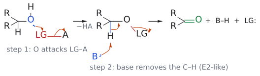

# 알코올 산화

> 1차 알코올 → 알데하이드 → 카복실산, 2차 알코올 → 케톤, 3차 알코올 → 반응 없음. 핵심은 **"얼마나 세게 산화할지"에 맞춰 시약을 고르는 것**이다.

## 개요

1차 알코올은 알데하이드에서 멈추게 할 수도, 카복실산까지 보낼 수도 있다. 그래서 L6은 알데하이드에서 멈추는 순한 산화제와 끝까지 밀어붙이는 강한 산화제를 구분해서 익히게 한다. 예를 들어 멘톨 공정의 첫 단계인 제라니올 → 제라니알은 알릴 1차 알코올을 α,β-불포화 알데하이드에서 멈춰야 하고, 분자 안의 C=C 두 개도 건드리면 안 되므로 순한 산화제가 필요하다. (출처: L6c p.3–5)

## 원리: 하나의 뼈대

슬라이드의 일반 메커니즘은 다음과 같다. (출처: L6c p.6)

1. 알코올 O(친핵체)가 산화제 LG–A(친전자체)를 공격해 O–LG 결합을 만들고 HA가 빠진다.
2. 염기 B:가 카비놀 탄소의 α-H를 떼어 낸다.
3. C–H 전자쌍이 C=O π 결합으로 옮겨 가고, 동시에 O–LG 결합이 끊어져 LG:가 떠난다.

*그림: 1단계에서 알코올 O(파랑)가 LG(빨강)를 공격하고, 2단계에서 염기가 C–H를 떼며 세 화살표가 한 번에 움직이는 E2형 제거로 C=O(초록)가 생긴다.*

즉 산화의 본질은 O–H의 H와 C–H의 H를 하나씩 떼는 것이다. 3차 알코올에는 떼어 낼 C–H가 없으므로 산화되지 않는다. 시약들은 "LG를 무엇으로 붙이느냐"만 다르고, 슬라이드도 각 시약을 "I–O", "S–Cl", "Ru–O", "N–O"처럼 핵심 결합으로 부른다. (출처: L6c p.6)

## 시약 고르기

요약 슬라이드의 분류를 따르면 다음과 같다. (출처: L6c p.17)

| 목표 | 시약 | 특징 |
|---|---|---|
| 알코올 → 알데하이드/케톤 | [[DMP]] ("I–O") | 실온·중성, 민감한 작용기에 강함, 비쌈 (p.7) |
| | [[스원 산화|Swern]] ("S–Cl") | 싸서 대량 규모에 적합, −78 °C, 악취 Me₂S (p.8–9) |
| | [[TPAP]]/NMO ("Ru–O") | TPAP는 촉매, NMO가 최종 산화제 (p.10) |
| | [[MnO2]] ("Mn–O") | 알릴·벤질 알코올만 산화 (p.10) |
| | [[TEMPO 산화|TEMPO]]/NaOCl, Cu/TEMPO/O₂ ("N–O") | 촉매 산화, 1차 알코올 (p.11–13) |
| 알데하이드 → 카복실산 | [[피닉 산화|Pinnick]] ([[NaClO2]]) | 2-메틸-2-뷰텐으로 HOCl 제거 (p.15) |
| 1차 알코올 → 카복실산 | [[존스 산화|Jones]] (CrO₃/H₃O⁺) | 강산성 (p.16) |
| | "3 = 1 + 2" | 순한 산화 후 Pinnick (p.16–17) |

## 예

- 제라니올 --[DMP, CH₂Cl₂]--> 제라니알 (84%, *E* 기하 유지) (출처: L6c p.7)
- 레티놀 --[MnO₂]--> 레티날 (>95%) (출처: L6c p.10)

몸 안에서도 같은 순서로 산화가 일어난다. 에탄올 --[ADH, NAD⁺]--> 아세트알데하이드 --[ALDH2, NAD⁺]--> 아세트산. ALDH2 변이가 있으면 두 번째 단계가 병목이 되어 얼굴이 붉어진다. (출처: L6c p.14)

## 흔한 오해

- "산화제가 세면 3차 알코올도 결국 산화된다": 카비놀 탄소의 α-H가 없으면 C=O를 만들 길이 없다. (출처: L6c p.6)
- "MnO₂는 환원제": 원본 슬라이드 p.10의 오타다. 수정본은 "oxidizing reagent"로 고쳤다. 매우 순한 산화제다. (출처: L6c p.10)
- 산소가 없는 벤질·알릴 C–H의 산화([[KMnO4]], [[SeO2]])는 알코올 산화와 다른 범주다. (출처: L6c p.18)

## 관련 문서

- 반응: [[스원 산화]], [[피닉 산화]], [[존스 산화]], [[TEMPO 산화]], [[에스터 부분 환원]]
- 시약: [[DMP]], [[TPAP]], [[MnO2]], [[TEMPO]], [[NaClO2]], [[존스 시약]], [[NMO]]

## 출처

- [L6 산화와 알켄 합성](../../notes/L06_Oxidation_and_Alkene_Synthesis.md) 1절, 2절, 3절
