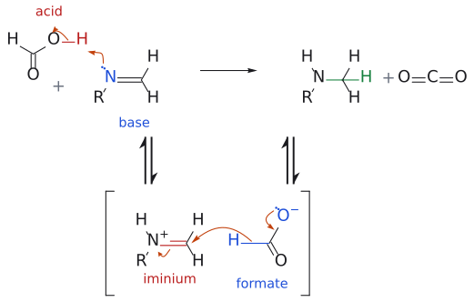
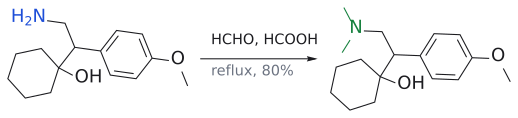

# 에슈바일러-클라크 반응

> 1차 amine + HCHO + HCOOH → *N*,*N*-dimethyl 3차 amine. metal hydride 없이 **formic acid가 hydride를 대는** reductive methylation이며, quaternary ammonium salt로는 가지 않는다.

## 개요

N에 methyl group을 두 개 붙이고 싶다면 더 간단한 방법이 있다. 1차 amine을 formaldehyde(HCHO)와 formic acid(HCOOH)로 처리하면 N,N-dimethyl 3차 amine이 된다. [reductive amination](환원성%20아미노화.md)의 특수한 형태로, carbonyl로 formaldehyde를, 환원제로 formic acid를 쓴다. methyl iodide로 직접 methylation하면 4차 염까지 over-alkylate되지만(→ [amine synthesis (overview)](../개념/아민%20합성%20개관.md)), 이 반응은 구조적으로 3차 amine에서 멈춘다. (출처: L5 p.15)

$$
\mathrm{R{-}NH_2} \xrightarrow{\mathrm{HCHO},\ \mathrm{HCOOH}} \mathrm{R{-}N(CH_3)_2}
$$

## 메커니즘

여기서 흥미로운 점은 metal hydride가 전혀 없다는 것이다. 그럼 hydride는 어디서 올까? 슬라이드의 답은 "HCOOH가 hydride 공급원"이다.

1. RNH₂가 HCHO와 축합(−H₂O)하여 [imine](../개념/이민.md) R–N=CH₂가 된다.
2. HCOOH가 imine을 protonate해 [iminium](../개념/이미늄%20이온.md) R–NH⁺=CH₂와 formate ion HCOO⁻가 생긴다.
3. formate ion의 C–H가 hydride로 iminium 탄소에 넘어가고, 남은 부분은 CO₂로 빠져나간다. 결과는 R–NH–CH₃.
4. 이 2차 amine이 다시 HCHO와 반응(+H⁺, −H₂O)해 iminium R–N⁺(CH₃)=CH₂가 된다.
5. HCOO⁻가 한 번 더 hydride를 주고 CO₂가 빠지면 R–N(CH₃)₂가 된다.

(출처: L5 p.15)

그림: 위 줄은 1차 amine과 HCHO가 축합($-\mathrm{H}_2\mathrm{O}$ )해 생긴 imine $\mathrm{R{-}N{=}CH}_2$ 가 포름산과 반응해 N-methyl amine이 되는 한 번의 순환이고(imine 생성은 그리지 않았다), 아래 줄은 단계별 풀이다(대괄호는 중간체, ⇌는 평형). 1단계(위 줄의 화살표): imine N의 비공유 전자쌍(파랑, 염기)이 $\mathrm{HCOOH}$ 의 O–H 양성자(빨강, 산)를 받고 O–H 결합 전자는 O로 가서 iminium ion과 formate가 된다. 2단계: formate의 H–C 결합(파랑)이 hydride로서 iminium 탄소(빨강, electrophile)를 공격하고, $\mathrm{O}^-$ 의 비공유 전자쌍이 내려와 C=O를 하나 더 만들어 $\mathrm{CO}_2$ 가 떨어져 나간다. iminium의 C=N $\pi$ 전자는 N으로 돌아가 양전하를 없앤다. 새 C–H 결합은 초록이다. 같은 순환이 한 번 더(HCHO와 축합해 iminium, 다시 formate의 hydride, $\mathrm{CO}_2$ 이탈) 일어나면 $\mathrm{R{-}N(CH_3)_2}$ 가 된다. 보충: 슬라이드에는 앞의 두 화살표만 있고, C=N $\pi$ → N 화살표는 전자 수를 맞추려고 덧붙였다. (보충 근거: Clayden p.716, p.778)

## 왜 3차 amine에서 멈추나

그럼 왜 4차 ammonium염까지 가지 않을까? 3차 amine은 N에 H가 없어 HCHO와 iminium을 만들 수 없기 때문이다. iminium이 없으면 hydride를 받을 자리도 없다. 즉 이 반응은 구조적으로 3차 amine에서 멈춘다. 직접 alkylation과 정반대의 장점이다. CO₂ 기체가 빠져나가는 것도 반응을 비가역적으로 밀어 준다. (출처: L5 p.15)

## 예

venlafaxine(항우울제) 합성의 마지막 단계다(전체 경로는 [amine synthesis (overview)](../개념/아민%20합성%20개관.md)).

$$
\begin{aligned} &\text{1-[2-amino-1-(4-methoxyphenyl)ethyl]cyclohexanol} \cr &\qquad \xrightarrow[\text{reflux}]{\mathrm{HCHO},\ \mathrm{HCOOH}} \text{venlafaxine}\ (\mathrm{HCl}\ \text{염}) \end{aligned}
$$

(수율 80%)

(L5)

특허 경로에서는 nitrile을 H₂(12 bar), [Pd/C](../시약/Pd-C.md), HCHO(2.2 eq)로 한 번에 처리해 94%를 얻는다. 이때 환원제는 HCOOH가 아니라 H₂/Pd이고, 1차 amine이 같은 용기의 HCHO와 reductive amination을 두 번 연달아 겪는다. HCHO가 2.2 eq인 이유는 methyl group 두 개분이기 때문이다. (출처: L5 p.16)

그림: N에 methyl 두 개(초록)가 붙어 venlafaxine이 된다.

## 흔한 오해

- **"Eschweiler–Clarke로 N-methyl amine(monomethyl)을 만든다"고 생각하기 쉽지만 사실은** 1차 amine이 N,N-**di**methyl까지 간다. monomethyl이 목표라면 [amide reduction](아마이드%20환원.md)(formylation 후 환원)이나 CH₃NH₂를 쓴 [reductive amination](환원성%20아미노화.md)가 맞다([L5 연습 문제](../../practice/L05_Exercises.md) 1번). (출처: L5 p.13, p.15)
- **"methylation니까 4차 염도 생긴다"**: 3차 amine에서 구조적으로 멈춘다. (출처: L5 p.15)

## 관련 문서

- 반응: [reductive amination](환원성%20아미노화.md), [amine synthesis via azide and nitrile](아자이드·나이트릴을%20거친%20아민%20합성.md), [amide reduction](아마이드%20환원.md)
- 개념: [amine synthesis (overview)](../개념/아민%20합성%20개관.md), [iminium ion](../개념/이미늄%20이온.md), [metal hydride의 반응성](../개념/금속%20수소화물의%20반응성.md), [imine](../개념/이민.md)
- 시약: [Pd/C](../시약/Pd-C.md)

## 출처

- [L5 환원](../../notes/L05_Reduction.md) 1절 (슬라이드 p.15–16)
- [L5 연습 문제](../../practice/L05_Exercises.md) 1번, 3번
