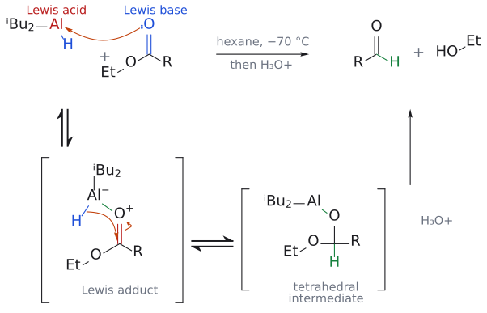

# 에스터 부분 환원

> $\text{ester} \xrightarrow[-70\,{}^\circ\mathrm{C}]{\mathrm{DIBAL{-}H},\ \mathrm{H_3O^+}} \text{aldehyde}$([DIBAL-H](../시약/DIBAL-H.md)). 저온에서 **[tetrahedral intermediate](../개념/사면체%20중간체.md)가 무너지지 않아** 두 번째 환원이 일어나지 않는다.

## 개요

ester를 [LiAlH4](../시약/LiAlH4.md)로 환원하면 중간에 aldehyde가 생기지만, aldehyde는 ester보다 반응성이 크니 곧바로 alcohol까지 가 버린다(→ [metal hydride의 반응성](../개념/금속%20수소화물의%20반응성.md)). 그럼 aldehyde에서 멈추게 할 방법은 없을까? DIBAL-H(diisobutylaluminium hydride, *i*-Bu₂AlH)를 저온에서 쓰는 것이 답이다. DIBAL은 alane(알레인)이며, 용액에서는 Al–H–Al 다리 결합을 가진 bridged dimer로 존재한다. L6 도입부에서도 같은 내용을 복습한다. (출처: L5 p.29, L6c p.2)

$$
\mathrm{RCO_2Et} \xrightarrow[\text{hexane},\ -70\thinspace{}^\circ\mathrm{C}]{\ \mathrm{DIBAL},\ \mathrm{H_3O^+}\ \mathstrut} \mathrm{RCHO}\ (\mathrm{R}\ =\ \mathrm{\mathit{n}\text{-}C_{11}H_{23}})
$$

(수율 88%)

## 메커니즘

1. Lewis acid인 Al이 ester carbonyl O에 배위한다(O⁺–Al⁻ 착물).
2. Al–H의 hydride가 분자 내에서 carbonyl 탄소로 전달된다. 그 결과 tetrahedral intermediate R–CH(OEt)–O–Al(*i*-Bu)₂가 생긴다.
3. 이 intermediate는 −70 °C에서 안정해서 무너지지 않는다(EtO⁻를 내보내지 않는다). 무너지지 않으니 반응 중에는 aldehyde가 생기지 않고, 따라서 두 번째 hydride를 받을 대상도 없다.
4. 반응이 끝난 뒤 H₃O⁺로 처리하면 intermediate가 가수분해되어 그제야 aldehyde가 풀려난다.

(출처: L5 p.29, L6c p.2)

그림: 위 줄이 전체 반응이고 아래 줄은 단계별 풀이다(대괄호는 중간체, ⇌는 평형). 1단계(위 줄의 화살표): carbonyl O의 비공유 전자쌍(파랑, Lewis base)이 Al의 빈 p orbital(빨강, Lewis acid)로 들어가 Lewis adduct($\mathrm{O}^+$–$\mathrm{Al}^-$)가 된다. 2단계: Al–H 결합(파랑)의 hydride가 분자 내에서 carbonyl 탄소(빨강)로 옮겨 가고 C=O $\pi$ 전자는 O로 올라가 tetrahedral intermediate가 된다(새 C–H는 초록). 이 intermediate는 −70 °C에서 무너지지 않으므로 aldehyde가 생기지 않고 두 번째 hydride를 받지도 않는다. 3단계(위쪽 화살표): 반응이 끝난 뒤 $\mathrm{H_3O^+}$ 로 처리하면 intermediate가 가수분해되어 aldehyde와 EtOH가 나온다. R은 $n\text{-}\mathrm{C_{11}H_{23}}$ 이고 알루미늄 부산물은 그리지 않았다. 보충: 슬라이드는 1–2단계까지 그렸고, 3단계 화살표(workup)와 Lewis adduct 단계의 분리는 보충이다. (보충 근거: Clayden p.533)

즉 aldehyde를 "hydride가 다 사라진 뒤에야 꺼내는" 전략이다. 저온이 필수인 이유도 여기에 있다. (출처: L5 p.29)

## 다른 길

슬라이드는 "ester를 aldehyde로 바꾸는 다른 방법은?"이라고 묻는다(L5 p.29, L6c p.2; [L5 연습 문제](../../practice/L05_Exercises.md) 7번, [L6 연습 문제](../../practice/L06_Exercises.md) 1번).

- **alcohol 경유:** 일단 LiAlH₄로 1차 alcohol까지 완전히 reduction한 뒤, aldehyde에서 멈추는 순한 산화제([DMP](../시약/DMP.md), [Swern](스원%20산화.md), [TEMPO](TEMPO%20산화.md) 등)로 aldehyde까지만 oxidation. Jones처럼 산까지 가는 시약은 쓰지 않는다(→ [alcohol oxidation](알코올%20산화.md)). L6 전반부 전체가 "aldehyde에서 멈추는 산화제에는 무엇이 있을까?"라는 이 질문의 답이다. (출처: L5 p.17, L6c p.2)
- **acid chloride 경유:** $\begin{aligned} & \text{ester} \\ & \longrightarrow \text{carboxylic acid} \\ & \longrightarrow \text{acid chloride} \end{aligned}$ → [Rosenmund reduction](로젠문트%20환원.md). (출처: L5 p.17, p.33)

## 예

- $\mathrm{RCO_2Et} \xrightarrow[\text{hexane},\ -70\thinspace{}^\circ\mathrm{C}]{\ \mathrm{DIBAL},\ \mathrm{H_3O^+}\ \mathstrut} \mathrm{RCHO}\ (\mathrm{R}\ =\ \mathrm{\mathit{n}\text{-}C_{11}H_{23}})$ (수율 88%)

  (L5, L6) (출처: L5 p.29, L6c p.2)
- $\begin{aligned} & \text{ethyl 2-(2-furyl)propanoate} \\ & \longrightarrow \text{2-(2-furyl)propan-1-ol} \\ & \longrightarrow \text{2-(2-furyl)propanal} \end{aligned}$. 마지막 aldehyde는 항생제 monensin 합성에 쓰인다(alcohol 경유). (L5, L6) (출처: L5 p.29, L6c p.2)

## 흔한 오해

- **"DIBAL-H는 언제나 ester를 aldehyde로 멈춘다"고 생각하기 쉽지만 사실은** 저온(−70 °C)에서 tetrahedral intermediate가 안정할 때만 그렇다. 온도가 오르면 intermediate가 무너져 aldehyde가 생기고, 그것이 다시 환원되어 alcohol이 될 수 있다. (출처: L5 p.29)
- **"DIBAL-H는 약한 환원제라서 멈춘다"**: 세기가 아니라 intermediate의 안정성 때문에 멈춘다. 반응 중에 aldehyde가 존재하지 않는 것이 핵심이다.

## 관련 문서

- 시약: [DIBAL-H](../시약/DIBAL-H.md), [LiAlH4](../시약/LiAlH4.md), [DMP](../시약/DMP.md)
- 반응: [Rosenmund reduction](로젠문트%20환원.md), [alcohol oxidation](알코올%20산화.md), [amide reduction](아마이드%20환원.md)
- 개념: [tetrahedral intermediate](../개념/사면체%20중간체.md), [metal hydride의 반응성](../개념/금속%20수소화물의%20반응성.md)

## 출처

- [L5 환원](../../notes/L05_Reduction.md) 2절 (슬라이드 p.17, p.29)
- [L6 산화와 alkene 합성](../../notes/L06_Oxidation_and_Alkene_Synthesis.md) 0절 (L6c p.2)
- [L5 연습 문제](../../practice/L05_Exercises.md) 7번, [L6 연습 문제](../../practice/L06_Exercises.md) 1번
