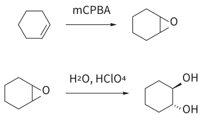

# 에폭사이드 고리 열기

> epoxide + nucleophile → 1,2-이작용기 화합물. **산성 조건이면 더 치환된 탄소**, **염기성(강한 nucleophile) 조건이면 덜 치환된 탄소**가 공격받는다. 어느 쪽이든 SN2이므로 공격받은 탄소는 inversion된다.

## 개요

epoxide도 [bromonium ion](../개념/브로모늄%20이온.md)처럼 ring strain이 큰 3원 고리다. 그런데 epoxide는 중성이라 그대로는 잘 열리지 않는다. 고리를 열려면 **산 촉매** 또는 **강한 nucleophile**이 필요하다. 어느 쪽을 쓰느냐에 따라 regioselectivity가 **정반대**가 된다. 이것이 L2에서 가장 중요한 비교 중 하나다. (출처: L2 p.8)

## 메커니즘

### 산 촉매 조건 (MeOH, H⁺)

1. epoxide 산소가 protonate되어 양전하를 띤 intermediate가 된다.
2. 이제 C–O 결합이 약해지고 늘어나면서 탄소에 부분 양전하가 생긴다. alkyl group 두 개가 붙은 **3차 탄소**가 이 양전하를 더 잘 견딘다.
3. MeOH는 바로 그 **더 치환된 탄소**를 공격한다. transition state는 L1에서 본 [loose SN2](../개념/느슨한%20SN2%20전이%20상태.md)다.
4. deprotonation이 일어나 2-methoxy-2-methyl-1-propanol((CH₃)₂C(OMe)CH₂OH)이 된다.

이 경우 regioselectivity는 **전자 효과**가 결정하며, bromonium ion이 열리는 경우와 똑같다. (출처: L2 p.8)

*그림: 왼쪽: epoxide 산소의 비공유 전자쌍이 H⁺(빨강)를 protonation. 가운데: protonate된 산소 쪽 C–O 결합(빨강)이 늘어나며 3차 탄소에 부분 양전하(δ+)가 쌓이고, MeOH의 산소(파랑)가 그 3차 탄소를 공격한다(위 화살표). 동시에 C–O 결합 전자는 산소로 돌아간다(아래 화살표). 오른쪽: H⁺를 잃으면 OMe가 3차 탄소에 붙은 생성물이 된다(초록은 새 C–O 결합).*

### 염기성 조건 (MeO⁻)

1. protonation이 일어나지 않으므로 양전하도 쌓이지 않는다.
2. protonate되지 않은 epoxide 산소는 **나쁜 leaving group**이라서, 강한 nucleophile이 밀어 줄 때만 떠난다. 그래서 반응은 **순수한 SN2**가 된다.
3. 순수한 SN2에서는 **입체 장애**가 관건이므로, methoxide는 **1차 탄소(덜 치환된 쪽)**만 공격한다.
4. 생긴 alkoxide가 MeOH에서 양성자를 받아 1-methoxy-2-methyl-2-propanol((CH₃)₂C(OH)CH₂OMe)이 된다.

이 경우 regioselectivity는 **입체 효과**가 결정한다(→ [SN2 reaction](SN2%20반응.md)). (출처: L2 p.9)

*그림: 왼쪽: methoxide(파랑, nucleophile)가 입체 장애가 적은 1차 탄소(빨강)를 C–O 결합의 반대편에서 공격하고, C–O 결합 전자가 산소로 옮겨 가 고리가 열린다. 가운데: 생긴 alkoxide(O⁻)가 MeOH의 H(빨강)를 떼어 오고, H–O 결합 전자는 MeO⁻로 남는다. 오른쪽: OMe가 1차 탄소에, OH가 3차 탄소에 붙는다(산성 조건 그림과 정반대).*

같은 epoxide라도 산성 조건에서는 OMe가 3차 탄소에, 염기성 조건에서는 1차 탄소에 붙는다. 시험에 자주 나오는 대비다. (출처: L2 p.8–9)

보충: epoxide가 반응성이 큰 이유는 오로지 **ring strain** 때문이다. alkoxide는 보통의 SN2에서는 결코 leaving group이 되지 못하는데, 3원 고리가 풀리는 이득이 그 불리함을 메워 준다. 또 "산성이면 더 치환된 쪽"이라는 규칙은 슬라이드처럼 한쪽이 **3차 탄소**여서 양전하를 확실히 안정화할 때 깔끔하게 맞는다. 한쪽 끝이 치환되지 않은 일치환 epoxide에서는 산 촉매 조건이라도 1차 탄소의 SN2가 워낙 빨라서, 덜 치환된 쪽 공격이 여전히 주경로가 될 수 있다(교과서의 HBr 예에서는 76 대 24). 그래서 regioselectivity를 높게 얻고 싶다면 보통 염기성 조건에서 강한 nucleophile로 덜 치환된 쪽을 여는 편이 확실하다. (보충 근거: Clayden p.438)

*그림: 보충: mCPBA로 만든 epoxide를 산에서 물이 뒤쪽(backside)으로 열기 때문에 두 OH는 trans(anti)가 된다. 생성물은 라세미(±)이며, 그림은 한 거울상만 그렸다.*

## 선택성

| 조건 | 공격받는 탄소 | 결정 요인 |
|---|---|---|
| H⁺, ROH | 더 치환된 탄소 | 전자 효과 |
| RO⁻ (강한 Nu) | 덜 치환된 탄소 | 입체 효과 |

### stereochemistry: anti와 inversion

epoxide 고리 열기는 SN2이므로 공격받는 탄소에서 **inversion**이 일어난다. 따라서 **stereospecific**이다. 고리 epoxide에서는 *trans* 생성물이 나온다(→ [stereospecificity and stereoselectivity](../개념/입체특이성과%20입체선택성.md)). (출처: L2 p.10)

## 예

- `2,2-dimethyloxirane --[MeOH, H⁺]--> (CH₃)₂C(OMe)CH₂OH` (L2, 출처: L2 p.8)
- `2,2-dimethyloxirane --[MeO⁻, MeOH]--> (CH₃)₂C(OH)CH₂OMe` (L2, 출처: L2 p.9)
- `cyclopentene oxide --[Me₂NH]--> trans-2-(dimethylamino)cyclopentanol (racemic, ±)` (L2, 출처: L2 p.10)
- `cyclohexene --[mCPBA]--> epoxide --[H₂O, HClO₄]--> trans-1,2-cyclohexanediol`: 산이 epoxide 산소를 protonate하고, 물이 반대쪽 면에서 SN2로 공격해 두 OH가 서로 반대 면에 놓인다(→ [dihydroxylation](다이하이드록실화.md)). (L2, 출처: L2 p.13)

## 흔한 오해

- "epoxide는 언제나 덜 붐비는 쪽이 열린다": 염기성(강한 nucleophile) 조건에서만 그렇다. 산성 조건에서는 **더 치환된 쪽**이 열린다. (출처: L2 p.8–9)
- "산성이면 무조건 더 치환된 쪽이 열린다": 한쪽이 3차 탄소처럼 양전하를 잘 안정화할 때 그렇고, 한쪽 끝이 CH₂인 일치환 epoxide는 산성에서도 1차 탄소 공격이 우세할 수 있다. (보충 근거: Clayden p.438)

## 관련 문서

- 반응: [epoxidation](에폭시화.md), [dihydroxylation](다이하이드록실화.md), [halohydrin formation](할로하이드린%20형성.md), [SN2 reaction](SN2%20반응.md)
- 개념: [loose SN2 transition state](../개념/느슨한%20SN2%20전이%20상태.md), [bromonium ion](../개념/브로모늄%20이온.md), [stereospecificity and stereoselectivity](../개념/입체특이성과%20입체선택성.md), [Markovnikov's rule](../개념/마르코프니코프%20규칙.md)
- 시약: [mCPBA](../시약/mCPBA.md)

## 출처

- [L2 Electrophilic Addition to Alkenes, Part 2](../../notes/L02_Electrophilic_Addition_to_Alkenes_Part2.md): 슬라이드 L2 p.8–10, p.13
