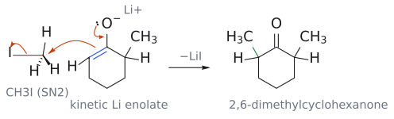

# 엔올레이트 알킬화

> 카보닐 화합물 --[염기(주로 [[LDA]]); R–X]--> α-알킬 카보닐 화합물. enolate의 α-탄소가 할로젠화 알킬을 SN2로 공격해 새 C–C 결합을 만든다.

## 개요

카보닐은 원래 nucleophile에게 공격당하는 electrophile이다. 그런데 α-수소를 떼어 내 [[엔올과 엔올레이트|enolate]]로 만들면 α-탄소가 전자가 풍부한 nucleophile로 바뀐다. 이 nucleophile을 할로젠화 알킬과 만나게 하면 카보닐 바로 옆에 탄소를 덧붙일 수 있어, 탄소 골격을 늘리는 가장 기본적인 도구가 된다. 이것이 α-alkylation이다. (출처: L7 p.9)

## 메커니즘

1. 염기가 α-H를 떼어 enolate를 만든다.
2. enolate의 α-탄소가 R–X의 탄소를 뒤쪽에서 공격하는 SN2가 일어나 C–C 결합이 생기고 C–X 결합이 끊어진다.
3. X⁻가 떠나며 α-치환 카보닐 화합물이 남는다.

(출처: L7 p.9–10)

*그림: 파란색은 nucleophile인 enolate의 C=C π 결합, 빨간색은 electrophile인 CH₃I의 탄소와 C–I 결합이다. 화살표 셋은 (1) O⁻의 비공유 전자쌍이 내려와 C=O를 다시 만들고, (2) 그만큼 밀려난 C=C π 전자가 CH₃의 탄소를 I의 정반대편에서 공격하며(SN2 뒤쪽 공격), (3) C–I 결합 전자가 I로 떠나 I⁻(LiI)가 되는 과정이다. 초록색 결합이 새로 생긴 C–C 결합이다. 화살표 표기는 슬라이드 p.25의 C-alkylation 그림을 따랐다. (출처: L7 p.10, p.12, p.25)*

### SN2의 제약이 그대로 적용된다

SN2인 만큼 제약도 [[SN2 반응|SN2]] 그대로다. 이탈기 X는 염화·브로민화·아이오딘화물 또는 토실레이트가 쓰이고, R은 메틸이나 1차, 가능하면 allylic·benzylic이 좋다. 2차 할라이드는 반응이 시원찮고, 3차 할라이드는 경쟁하는 제거 반응 때문에 아예 알킬화되지 않는다. 역합성에서 1차 할라이드가 들어가도록 끊어야 하는 이유다. (출처: L7 p.10)

## 염기 고르기

단순 케톤(pKa 약 19)이나 에스터(약 25)는 NaOEt로는 enolate가 조금만 생기므로, 짝산 pKa가 36–38인 LDA로 정량적으로 만든다(→ [[α-수소의 산도]]). (출처: L7 p.4–6)

보충: 교과서는 enolate alkylation의 염기 선택을 두 전략으로 정리한다. 하나는 짝산의 pKa가 카보닐 화합물보다 큰 강염기(LDA 등)로 출발물을 먼저 완전히 enolate로 바꾼 뒤, electrophile을 따로 넣는 2단계 방식이다. 다른 하나는 약한 염기를 electrophile과 함께 넣어 조금씩 생기는 enolate가 생기는 대로 반응하게 하는 방식이다. 후자는 간편하지만 염기와 electrophile이 서로 반응하지 않아야 하고, 남아 있는 카보닐이 enolate와 자기 축합할 위험이 있다. 그래서 단순 케톤·에스터에는 전자(LDA)를 쓰고, 산성이 큰 1,3-다이카보닐은 alkoxide로도 완전히 탈양성자화되며 K₂CO₃처럼 친핵성이 약한 염기라면 electrophile과 한꺼번에 넣기도 한다(→ [[아세토아세트산 에스터 합성]], [[말론산 에스터 합성]]). (보충 근거: Clayden p.585, p.595)

## 선택성

### 위치선택성: 케톤

2-메틸사이클로헥사논을 LDA(DME 용매)로 처리하면 [[속도론적 엔올레이트와 열역학적 엔올레이트|kinetic]] 리튬 enolate(C1=C6)가 생긴다. 여기에 CH₃I를 넣으면 LiI가 빠지며 2,6-다이메틸사이클로헥사논(56%)이, 벤질 브로마이드를 넣으면 2-벤질-6-메틸사이클로헥사논(42–45%)이 생긴다. (출처: L7 p.10, p.12)

그렇다고 선택성이 완벽한 것은 아니다. LDA/THF 후 CH₃I 조건에서 kinetic enolate 경로의 2,6-다이메틸사이클로헥사논이 56%로 주생성물이지만, thermodynamic enolate 경로의 2,2-다이메틸사이클로헥사논도 6% 섞여 나온다. 결론적으로 LDA/저온 조건에서는 덜 치환된 α-탄소에 알킬기가 들어간다고 기억하면 된다. 참고로 대칭인 사이클로헥사논은 이런 고민 없이 LDA/THF로 enolate(O⁻Li⁺)와 다이아이소프로필아민이 생긴다. (출처: L7 p.10, p.11)

보충: alkylation에서 흔한 부반응이 하나 더 있다. 모노알킬화 생성물에도 산성 α-H가 남아 있으면, 그것이 다시 탈양성자화되어 두 번째 alkylation이 일어난다(polyalkylation). 염기가 과량이면 이런 일이 쉬워지므로, 한 번만 알킬화하려면 electrophile을 1당량만 쓰는 것이 보통이다. 거꾸로 이 성질을 이용하면 염기와 할라이드를 차례로 두 번 넣어 같은 탄소에 알킬기 두 개(서로 달라도 된다)를 넣을 수 있다. [L7 연습 문제](../../practice/L07_Exercises.md) 4의 이중 alkylation이 그 예다. (보충 근거: Clayden p.586, p.598)

### C 대 O

MeI처럼 soft한 electrophile은 탄소에서, Me₂SO₄·MeOMs·Me₃O⁺처럼 hard한 electrophile은 산소에서 반응해 enol ether를 준다. 큰 양이온(K⁺, Cs⁺)일수록 O-반응이 늘어나고, 작은 Li⁺와 THF·DME 같은 에테르 용매는 C-alkylation을 돕는다(→ [[하드-소프트 산염기]]). (출처: L7 p.24–25)

### 입체

enolate는 평면이라 새 입체 중심은 라세미가 된다. 한쪽 면을 가리려면 [[에반스 옥사졸리디논]] 같은 [[키랄 보조기|chiral auxiliary]]를 쓴다(−78 °C, BnBr, 92%, 99 : 1 dr). (출처: L7 p.26–27)

## 에스터와 락톤

된다. 에스터 α-H(pKa ~25)는 케톤보다 덜 산성이지만 LDA로는 충분하다. 뷰탄산 메틸을 LDA/THF로 enolate화한 뒤 에틸 아이오다이드를 넣으면 2-에틸뷰탄산 메틸이 96%로 얻어진다: `CH₃CH₂CH₂CO₂Me --[LDA, THF; CH₃CH₂I]--> (CH₃CH₂)₂CHCO₂Me`.[^1] (출처: L7 p.13)

고리형 에스터인 락톤도 마찬가지다. γ-뷰티로락톤을 LDA, 이어서 MeI로 처리하면 α-메틸-γ-뷰티로락톤이 88% 수율로 생긴다. (출처: L7 p.14)

## 예

| 반응 | 조건 | 생성물 | 출처 |
|---|---|---|---|
| 케톤 α-alkylation | 1. LDA, DME/THF 2. CH₃I (또는 BnBr) | 2,6-다이메틸사이클로헥사논 56% (2,2-이치환체 6%); 2-벤질-6-메틸 42–45% | L7 p.10–11 |
| 에스터 α-alkylation | 1. LDA, THF 2. EtI | 2-에틸뷰탄산 메틸 96% | L7 p.13 |
| 락톤 α-alkylation | 1. LDA 2. MeI | α-메틸-γ-뷰티로락톤 88% | L7 p.14 |

- 연습: 2-메틸프로판산 메틸과 사이클로펜테인카브알데하이드의 LDA enolate(p.7), 락톤 빈 칸(p.13), CH₃CH(CH₃)CH(CH₂CH₃)CO₂CH₃의 α-치환 합성(p.14)은 [L7 연습 문제](../../practice/L07_Exercises.md) 1–3에 있다.
- 시험 예: Test 1(2025) 문제 2는 2-메틸사이클로헥사논의 LDA(kinetic) enolate와 TMSCl/Et₃N(thermodynamic) silyl enol ether를 비교한다.

## 흔한 오해

- "강염기면 BuLi를 바로 쓰면 된다": BuLi는 친핵성이 강해 카보닐에 첨가한다. 그래서 BuLi로 비친핵성인 LDA를 먼저 만든다. (출처: L7 p.6)
- "LDA로 2-메틸사이클로헥사논을 메틸화하면 이미 메틸이 있는 C2에 붙는다": 덜 가려진 C6에 붙는다. (출처: L7 p.11)
- "할로젠화 알킬이면 무엇이든 알킬화된다": SN2 규칙을 따른다. 메틸·1차(allyl·benzyl 최고)는 좋고, 2차는 불량, 3차는 제거만 일어난다. (출처: L7 p.10)
- "음전하가 산소에 많으니 산소에서 반응한다": HOMO가 탄소에 크게 걸려 있어 할로젠화 알킬은 탄소에서 반응한다. (출처: L7 p.24)

## 관련 문서

- 시약: [[LDA]], [[에반스 옥사졸리디논]], [[실릴 엔올 에터]], [[알콕사이드 염기]]
- 반응: [[아세토아세트산 에스터 합성]], [[말론산 에스터 합성]], [[스토크 엔아민 반응]], [[알돌 반응]], [[SN2 반응]]
- 개념: [[엔올레이트 화학 개관]], [[엔올과 엔올레이트]], [[α-수소의 산도]], [[속도론적 엔올레이트와 열역학적 엔올레이트]], [[하드-소프트 산염기]], [[키랄 보조기]]

## 출처

- [L7 엔올레이트와 α-알킬화](../../notes/L07_Enolate_Alkylation.md) I절, II절(p.9–14), V절, VI절
- [Test 1 (2025)](../../practice/Test1_2025.md) 문제 2

[^1]: 에스터에 alkoxide를 쓰면 enolate가 조금만 생기고 남은 에스터와 Claisen 축합 같은 부반응이 일어나기 쉽다(→ [[클라이젠 축합]]). 그래서 LDA로 먼저 완전히 enolate화한 다음 할라이드를 넣는 것이 정석이다. (보충 근거: Clayden p.589) (출처: L7 p.13 관련 보충)
