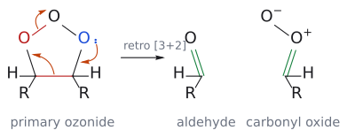

# 오존 분해

> 알켄 + 1. [[오존|O₃]] 2. 후처리 → 카보닐 화합물 두 개. C=C를 완전히 끊는 반응이며, 후처리 시약에 따라 **알데하이드(Me₂S), 카복실산(H₂O₂), 알코올(NaBH₄)**로 갈린다.

## 개요

오존 분해는 [[과아이오딘산 절단|OsO₄ → NaIO₄]]와 함께 이중결합을 끊는 대표적인 방법이다. L2에서는 "첨가 → 붕괴 → 후처리"의 결과 위주로 배우고, L15에서는 그 속이 사실 [[1,3-쌍극자 고리화 첨가]]가 세 번 이어진 것임을 배운다. (출처: L2 p.17, L15 p.23)

## 메커니즘

### L2의 그림: 첨가 → 붕괴 → 후처리

ozone(O₃)은 불안정해서 **사용 직전에** ozonizer로 O₂에서 만들어 반응액에 불어넣는다. (출처: L2 p.17)

1. O₃가 alkene에 고리형 mechanism으로 첨가된다. 이것은 [[1,3-쌍극자 고리화 첨가|1,3-dipolar cycloaddition]]으로, 이후 강의(L13–L15)에서 다룬다.
2. 산소 세 개가 든 5원 고리는 약한 O–O 결합과 C–C σ 결합이 끊어지며 무너진다. 대신 강한 C=O 결합 두 개를 얻는다. 이때 carbonyl 하나와 **carbonyl oxide**가 생긴다.
3. dimethyl sulfide(Me₂S)나 triphenylphosphine(Ph₃P) 같은 **약한 환원제**가 남는 산소 하나를 떼어 간다. 이 과정에서 Me₂SO나 Ph₃PO가 생긴다.

(출처: L2 p.17)

*그림: 슬라이드의 R을 CH₃로 둔 2-butene으로 그렸다. 첨가(addition): ozone 끝 산소의 음전하 전자쌍(파랑)이 한쪽 탄소를, C=C π 전자(파랑)가 반대쪽 끝 산소(빨강)를 공격하고, O=O⁺의 π 전자는 가운데 산소로 돌아간다. 붕괴(collapse): 오른쪽 고리 산소의 비공유 전자쌍이 C=O를 만들고, C–C σ 결합(빨강) 전자가 왼쪽 C–O 쪽으로 가서 또 하나의 C=O를 만들며, 약한 O–O 결합 전자는 꼭대기 산소로 간다. 결과는 aldehyde와 carbonyl oxide다(초록은 새로 생긴 C–O/C=O 결합). 이후 Me₂S나 Ph₃P가 남는 산소를 떼어 간다.*

### L15의 그림: [3+2]가 세 번

1. **[3+2] 고리화 첨가:** [[1,3-쌍극자]]인 O₃가 알켄과 반응해 1차 오조나이드(1,2,3-trioxolane)가 된다.
2. **역 [3+2]:** 약한 O–O 결합과 C–C 결합이 끊어져 알데하이드와 카보닐 옥사이드(역시 1,3-쌍극자)로 쪼개진다.
3. 알데하이드가 180° 돌아 반대 방향으로 정렬한다.
4. **다시 [3+2]:** 카보닐 옥사이드가 알데하이드의 C=O와 반응해 2차 오조나이드(1,2,4-trioxolane)가 된다.
5. **후처리:** Me₂S의 황이 O–O의 산소를 공격해 DMSO와 RCHO 두 분자가 생긴다. (출처: L15 p.23)

*그림: 1단계. O⁻의 전자쌍이 왼쪽 탄소와, 알켄 π 전자가 오른쪽 말단 O와 결합하고, O=O의 π 전자가 가운데 O⁺로 가서 1차 오조나이드가 된다.*

*그림: 2단계. O–O와 C–C(빨강)가 끊어지며 알데하이드와 카보닐 옥사이드가 생긴다.*

## 선택성

| 2단계 시약 | 성격 | 생성물 |
|---|---|---|
| Me₂S (또는 Ph₃P) | 약한 환원제 | 알데하이드 (이치환 탄소는 케톤) |
| H₂O₂ | 산화제 | 카복실산 |
| NaBH₄ | 강한 환원제 | 알코올 |

(출처: L2 p.17–18, L15 p.21)

- 보충: H₂O₂ 후처리에서 카복실산이 되는 것은 H를 가진(알데하이드가 될) 탄소뿐이고, 이치환 탄소는 케톤으로 남는다. (보충 근거: Clayden p.907) (출처: L15 p.21)
- **입체:** 원래 C=C 두 탄소의 같은 면 관계가 유지된다. 슬라이드의 예는 norbornene이다. 1. O₃, 2. Me₂S로 처리하면 C=C가 끊어지며 두 탄소가 모두 CHO가 되고, 남은 골격(다리 CH₂ 포함)은 5원 고리가 된다. 두 CHO는 *cis*이므로 생성물은 *cis*-cyclopentane-1,3-dicarbaldehyde다. (출처: L15 p.21)

## 예

- 노보넨 --[1. O₃; 2. Me₂S]--> *cis*-사이클로펜테인-1,3-다이카브알데하이드 + DMSO; H₂O₂ 후처리면 *cis*-cyclopentane-1,3-dicarboxylic acid ([L15 연습 문제](../../practice/L15_Exercises.md)) (출처: L15 p.21, p.23)
- 1-methylcyclohexene --[1. O₃; 2. Me₂S]--> 6-oxoheptanal; 2단계를 H₂O₂로 바꾸면 6-oxoheptanoic acid (ketone은 그대로) (→ [L2 연습 문제](../../practice/L02_Exercises.md) 6번, 원리는 L2 p.17–18)

## 과산화물은 양날의 검

trioxolane처럼 O–O 결합을 가진 과산화물은 폭발성일 수 있으므로 주의해야 한다. 대표적인 예가 triacetone triperoxide(TATP)다.[^1] 반면 같은 O–O 결합이 약이 되기도 한다. endoperoxide를 가진 항말라리아제 artemisinin과,[^2] trioxolane 고리를 가진 합성 항말라리아 화합물이 그 예다. (출처: L15 p.24)

## 흔한 오해

- "ozonolysis 생성물은 항상 aldehyde다": 후처리 시약에 따라 달라진다. Me₂S는 aldehyde, H₂O₂는 carboxylic acid, NaBH₄는 alcohol을 준다. (출처: L2 p.18)
- "오존이 한 번 붙고 끝난다": 고리화 첨가 → 역반응 → 재결합 고리화 첨가의 세 단계를 거치며, 최종 오조나이드는 1,2,4-trioxolane이다. (출처: L15 p.23)
- "오조나이드는 안전한 중간체다": O–O 결합을 가진 과산화물은 폭발성일 수 있다(예: TATP). (출처: L15 p.24)
- "H₂O₂ 후처리는 모든 탄소를 카복실산으로 만든다": H를 가진(aldehyde가 될) 탄소만 산이 되고 ketone 쪽은 ketone으로 남는다. (보충 근거: Clayden p.907)

## 관련 문서

- 시약: [[오존]], [[NaBH4]]
- 반응: [[과아이오딘산 절단]], [[다이하이드록실화]], [[1,3-쌍극자 고리화 첨가]]
- 개념: [[1,3-쌍극자]], [[페리고리 반응]]

## 출처

- [L2 알켄의 친전자성 첨가 2부](../../notes/L02_Electrophilic_Addition_to_Alkenes_Part2.md): 슬라이드 L2 p.17–18
- [L15 고리화 첨가 3부](../../notes/L15_Cycloaddition_Part3.md) 16절 (p.21–24)

[^1]: 슬라이드 p.24: 2017년 University of Bristol의 한 학생이 의도치 않게 약 40 g의 TATP를 만들어 건물 대피와 폭발물 처리반의 통제 폭파가 있었던 사건, 그리고 2021년 싱가포르에서 TATP 폭탄 제조를 탐색한 테러 계획 보도가 소개되어 있다. (출처: L15 p.24)
[^2]: 슬라이드 p.24: artemisinin의 발견은 2015년 노벨 생리의학상으로 이어졌다. (출처: L15 p.24)
