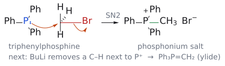
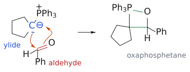
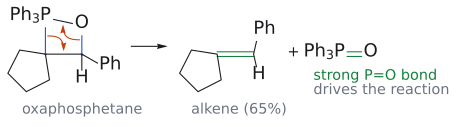

# 위티그 반응

> 알데하이드·케톤 + [[인 일라이드]] Ph₃P=CHR → 알켄 + Ph₃P=O. 카보닐의 =O 자리에 =CHR이 들어가며, **비안정화 일리드는 Z, 안정화 일리드는 E**를 준다.

## 개요

E2 제거로 알켄을 만들면 E, Z, 말단 알켄이 섞인다(2-브로모펜테인 + NaOEt → *E* 51%, *Z* 18%, 1-펜텐 31%). 기하이성질체는 성질이 다른 별개의 화합물인데 분리하기 어렵기 때문에, 처음부터 하나만 만드는 방법이 필요하다. Wittig 반응은 C=C를 **원래 C=O가 있던 자리에 정확히** 만들고, 일리드 종류로 기하도 조절한다. (출처: L6c p.19–22, p.27)

## 일리드 만들기

1. SN2: PPh₃가 1차 또는 2차 할로젠화물을 공격해 포스포늄염이 된다.
2. 탈양성자화: P⁺ 옆 C–H는 산성이 커서 염기로 뗄 수 있다.

PPh₃ + CH₃Br --[SN2]--> Ph₃P⁺CH₃ Br⁻ --[BuLi, THF]--> Ph₃P=CH₂ (출처: L6c p.26)

*그림: PPh₃의 P(파랑)가 CH₃–Br의 탄소(빨강)를 뒤에서 공격하고 Br⁻가 떠난다. 새 P–C 결합은 초록이다.*

- **안정화 일리드**: 음전하 옆에 C=O 같은 공액 치환기가 있어(Ph₃P=CHCO₂R) Na₂CO₃ 같은 약염기로도 만들어진다.
- **비안정화 일리드**: R = 알킬이라 음전하가 탄소에 몰려 있으므로 BuLi 같은 강염기가 필요하다. (출처: L6c p.29)

## 메커니즘

1. 일리드 탄소(친핵체)가 카보닐 탄소(친전자체)를 공격하고, 카보닐 O는 P⁺와 결합한다.
2. 4원 고리 옥사포스페테인(oxaphosphetane)이 생긴다.
3. 옥사포스페테인이 분해되며 C=C와 P=O가 생긴다. 매우 강한 P=O 결합이 생기는 것이 구동력이다.

(출처: L6c p.33)

*그림: 위는 1–2단계(새 C–C, P–O 결합은 초록), 아래는 3단계(C–P, C–O 결합 전자가 각각 C=C, P=O가 된다). 생성물은 benzylidenecyclopentane(65%)이다.*

## 선택성

- **비안정화 일리드 → Z**: 슬라이드 스스로 "완전히 밝혀지지 않은 가능한 설명"이라고 단서를 단다. 일리드와 RCHO가 수직으로 접근하고, 큰 치환기들이 서로와 PPh₃를 피하다 보면 syn 옥사포스페테인이 생긴다. 분해는 입체특이적 syn 제거이므로 syn 옥사포스페테인은 Z-알켄이 된다(→ [[입체특이성과 입체선택성]]). (출처: L6c p.31, p.34–35)
- **안정화 일리드 → E**. 보충: 옥사포스페테인 형성이 가역적이어서 더 안정한 anti 옥사포스페테인(→ E)으로 평형이 쏠린다고 흔히 설명한다. 시험에서는 슬라이드의 Z 설명을 우선한다. (출처: L6c p.30)

## 예

- 사이클로헥산온 + Ph₃P=CH₂ → 메틸렌사이클로헥세인 (86%) (출처: L6c p.27)
- Ph₃P=CHCO₂Et + 아세토나이드 엔알 → 다이엔 에스터 (96%, 모두 *E*) (출처: L6c p.30)
- BASF 비타민 A 합성: C₁₅ 알릴 포스포늄염 + OHC–C(CH₃)=CH–CH₂OAc --[NaOMe, MeOH]--> 비타민 A 아세테이트 (출처: L6c p.28)

## 흔한 오해

- "Wittig은 항상 Z를 준다": 비안정화(알킬) 일리드만 Z-선택적이다. 안정화 일리드와 [[HWE 반응]]은 E-선택적이다. (출처: L6c p.38)
- "역합성에서 어느 쪽을 일리드로 잡아도 된다": 일리드 쪽은 SN2가 잘 되는 1차 할로젠화물에서 오는 편이 유리하다. 예: 2-메틸펜트-2-엔은 아세톤 + Ph₃P=CHCH₂CH₃(1-브로모프로페인 유래)가 낫다. (출처: L6c p.26, p.32)

## 관련 문서

- 시약: [[인 일라이드]]
- 반응: [[HWE 반응]], [[린들라 환원]], [[용해 금속 환원]]
- 개념: [[입체특이성과 입체선택성]], [[친전자체와 친핵체]], [[엔올과 엔올레이트]], [[옥사포스페테인]]

## 출처

- [L6 산화와 알켄 합성](../../notes/L06_Oxidation_and_Alkene_Synthesis.md) 5절, 7.1–7.6절, 연습 문제 4, 5
