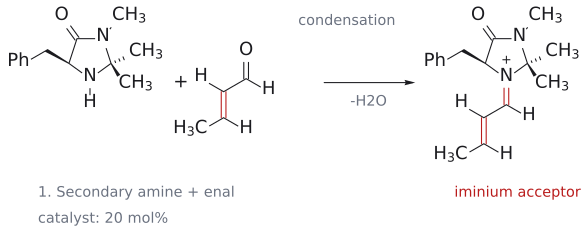
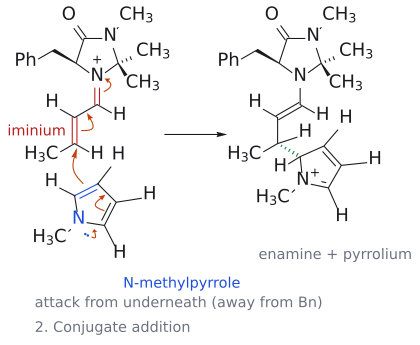
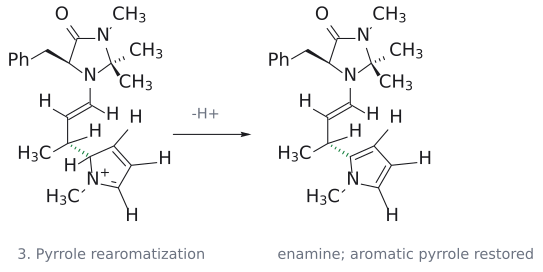
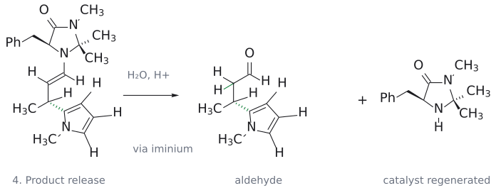
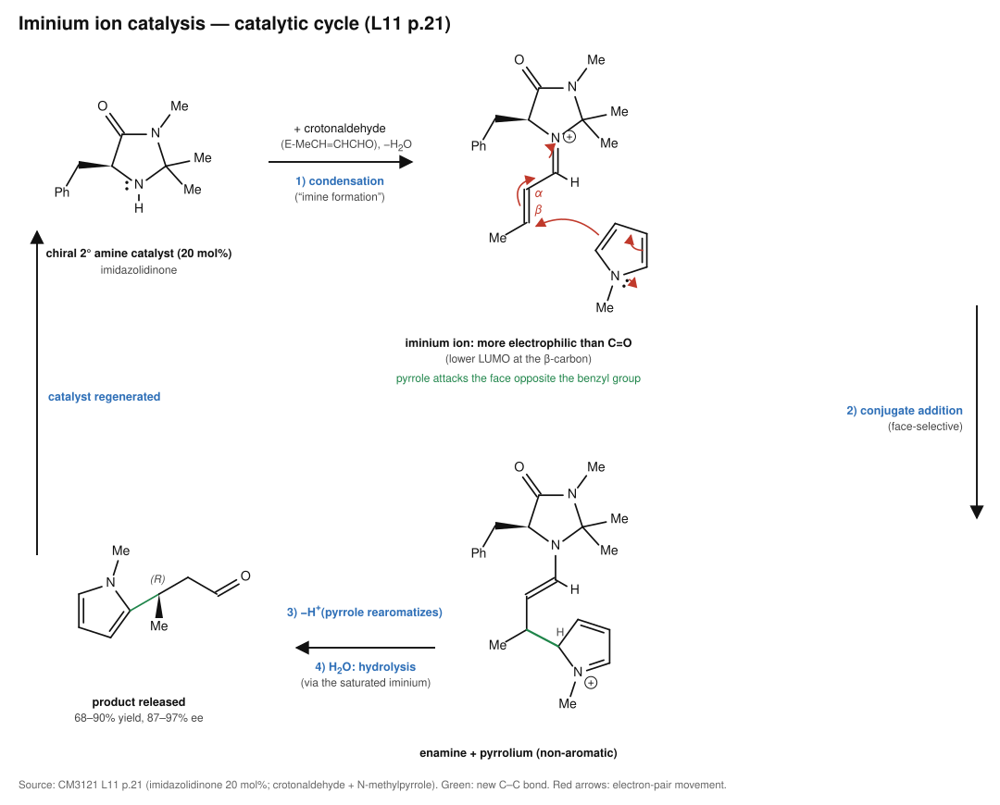

# 이미늄 촉매 공액 첨가

> enal을 chiral secondary amine 촉매와 축합해 **iminium ion**으로 바꾸면, 받개가 더 강한 electrophile이 되고 동시에 한쪽 면이 가려져 enantioselective한 [conjugate addition](공액%20첨가.md)이 일어난다.

## 개요

[cuprate](../시약/유기구리%20시약.md), [enolate·enamine](마이클%20반응.md)처럼 지금까지는 nucleophile을 바꿔서 conjugate addition을 조절했다. 그러면 받개 쪽을 강화할 수는 없을까? enal을 secondary amine 촉매와 축합해 [**iminium ion**](../개념/이미늄%20이온.md)으로 바꾸면 된다. iminium ion은 중성 carbonyl 화합물보다 더 electrophilic하다. 양전하를 띤 C=N⁺가 C=O보다 전자를 더 세게 끌기 때문이다. (출처: L11 p.21)

## 슬라이드의 반응

enal H-CO-CH=CH-R1과 pyrrole 유도체(R2, R3 치환, N-P)에 chiral imidazolidinone 촉매(5-benzyl-2,2,3-trimethylimidazolidin-4-one, 20 mol%)를 넣으면 $\beta$-위치에 pyrrole C2가 붙은 aldehyde가 생긴다. 수율 68–90%, 87–97% ee, 12개 예시. R1은 방향족/지방족, R2·R3는 지방족, P = H, Me, allyl이다.[^1] (출처: L11 p.21)

## 메커니즘

crotonaldehyde(CH3CH=CH-CHO)와 N-methylpyrrole로 메커니즘을 보면 다음과 같다.
1. **iminium 형성**: 촉매의 secondary amine(N-H)이 crotonaldehyde와 축합해서 $\alpha,\beta$-unsaturated iminium ion이 된다(→ [imine](../개념/이민.md)).
2. **stereoselective conjugate addition**: N-methylpyrrole의 C2(nucleophile, 전자 공여성이 있는 방향족 $\pi$계)가 iminium의 $\beta$-탄소(electrophile)를 공격한다. 이때 촉매의 benzyl group이 한쪽 면을 가리고 있다. 그래서 pyrrole은 **benzyl group을 피해 반대쪽(아래쪽) 면**에서 접근한다. 생성물은 촉매 쪽 enamine과 pyrrolium cation(aromaticity가 깨진 상태)이다.
3. **rearomatization**: pyrrolium에서 H⁺가 빠지면서 pyrrole의 aromaticity가 회복된다(→ [aromaticity](../개념/방향족성.md), [electrophilic aromatic substitution](친전자성%20방향족%20치환.md)과 같은 마무리).
4. **가수분해**: iminium/enamine 부분이 가수분해되어 (R)-3-(1-methylpyrrol-2-yl)butanal이 나오고, 촉매가 재생된다.

즉 촉매가 받개를 활성화하고 동시에 면 선택성까지 정한다. (출처: L11 p.21)

#### 촉매 순환을 네 단계로 읽기

**1. Iminium 형성.** 촉매의 secondary amine이 crotonaldehyde의 carbonyl carbon과 결합하고, 물이 제거되어 conjugated iminium ion이 된다. 촉매 고리에 원래 있던 amide C=O는 그대로 유지된다. 여기서 활성화되는 것은 enal에서 유래한 acceptor다. 그림은 condensation의 전체 변화를 요약하며 proton transfer와 counterion은 생략했다. (출처: L11 p.21; 제공된 cycle을 단계별 재구성)

**2. 새 C–C 결합 형성.** N-methylpyrrole의 C2가 iminium의 $\beta$-탄소에 결합한다. 주황 화살표는 pyrrole의 전자쌍 이동과 받개 쪽 conjugated 결합의 재배치를 나타낸다. C=N의 $\pi$ 전자쌍이 촉매 질소로 이동하므로 촉매 쪽은 중성 enamine이 되고, 양전하는 pyrrolium 부분에 남는다. 오른쪽은 두 부분이 새 C–C 결합으로 연결된 **하나의 cationic intermediate**다. 초록 점선 쐐기는 benzyl group 반대 면에서의 접근을 표시한다. (출처: L11 p.21)

**3. Pyrrole의 rearomatization.** 새 결합이 생긴 pyrrole C2에서 $\mathrm{H^+}$가 제거되면서 고리의 aromaticity가 회복된다. 양전하가 사라져도 촉매와 기질 사이의 C–N 결합은 남아 있다. 따라서 이 구조는 최종 aldehyde가 아니라 촉매에 결합한 enamine intermediate다. 그림은 deprotonation과 고리 결합 재배치의 순변화를 나타낸다. (출처: L11 p.21; cycle 해설)

**4. Aldehyde 방출과 촉매 재생.** Enamine이 protonation되어 saturated iminium을 형성한 뒤, 물에 의한 hydrolysis로 aldehyde C=O가 회복되고 촉매와의 C–N 결합이 끊어진다. 초록 C–H 결합은 enamine이었던 $\alpha$-탄소에 H가 추가된 것을 표시한다. 새로 만든 C–C 결합과 $\beta$-탄소의 입체배치는 유지된다. 재생된 secondary amine은 다음 enal과 다시 1단계에 들어가므로 촉매 순환이 완성된다. 그림의 중성 amine은 순환을 설명하기 위한 표기이며, 산성 용액의 protonation 평형은 생략했다. (출처: L11 p.21; cycle 해설)

네 그림은 반응 순서를 펼쳐 놓은 것이다. 1·3·4단계의 proton transfer와 hydrolysis 세부 elementary step을 모두 그린 것은 아니다. 수율 68–90%, 87–97% ee는 슬라이드의 **12개 기질 예시 범위**이며, 이 crotonaldehyde 한 예에 각각의 범위 전체를 배정하지 않는다.

그림: 2차 amine 촉매(imidazolidinone, 20 mol%)가 crotonaldehyde와 축합해 iminium을 만들고(1), N-methylpyrrole이 benzyl 반대 면에서 β-탄소를 공격한 뒤(2), 양성자를 잃어 방향족성을 되찾고(3), 가수분해로 (R)-3-(1-methylpyrrol-2-yl)butanal과 촉매가 나온다(4). 위 네 장을 한 순환으로 모은 그림이다. (출처: L11 p.21)

## 선택성

- **위치**: pyrrole 탄소는 iminium의 $\beta$-탄소에 붙는다(1,4). (출처: L11 p.21)
- **입체**: 촉매 benzyl group의 반대면 공격. 슬라이드 범위에서 87–97% ee, crotonaldehyde 예에서 (R) 생성물. (출처: L11 p.21)

## 촉매가 바꾸는 것은 acceptor다

enamine을 nucleophile로 쓰는 반응과 iminium catalysis는 역할이 반대다. enamine activation에서는 secondary amine이 donor carbonyl을 enamine으로 바꾸어 탄소의 nucleophilicity를 높인다. 후자에서는 conjugated carbonyl이 iminium ion이 되어 acceptor의 electrophilicity가 커진다. 따라서 촉매 질소가 어느 출발물과 결합했는지를 먼저 확인해야 한다. (출처: L11 p.18–21)

iminium의 $\beta$-탄소에 nucleophile이 붙으면 conjugated 계의 전자가 질소 쪽으로 이동한다. 이어 proton transfer와 hydrolysis를 거쳐 원래 carbonyl과 amine 촉매가 되돌아온다. 생성물에 촉매의 C–N 결합을 그대로 남겨 두거나, hydrolysis를 별도의 산화로 부르면 안 된다. 시험에서는 활성화, C–C 결합 형성, carbonyl 회복의 세 묶음으로 그리는 것이 좋다. (출처: L11 p.21)

[원본 자료에서 세부 구조·입체배치 확인: L11_Conjugate addition.pdf p.21](../../figures/L11/source/L11_p21.png)

## L11을 읽으며 원자와 전자를 추적하기

### enamine activation과 iminium activation을 나란히 읽기

| 확인 항목 | enamine donor activation | iminium acceptor activation |
|---|---|---|
| amine이 먼저 결합하는 상대 | donor aldehyde/ketone | acceptor enal |
| 반응에서 커지는 성질 | 탄소의 nucleophilicity | conjugated 계의 electrophilicity |
| 새 결합을 만드는 탄소 | 원래 donor의 $\alpha$-탄소 | acceptor의 $\beta$-탄소가 공격받음 |
| 후처리 | donor C=O 회복 | acceptor C=O 회복 및 촉매 재생 |

p.21에서는 pyrrole의 **C2**와 enal의 **$\beta$-탄소**를 연결한다. pyrrole의 N은 고리 전자를 밀어 주지만 새 결합이 생기는 원자는 고리 C2다. 첨가로 aromaticity가 잠시 깨진 뒤 C2의 H⁺가 빠지면서 pyrrole이 다시 aromatic해진다. 그 뒤 aldehyde를 회복해야 최종 생성물이므로, 촉매와의 C–N 결합이 남은 중간체에서 답안을 끝내지 않는다. (출처: L11 p.18–21)

면 선택성과 regioselectivity도 나누어 읽는다. $\beta$ 공격은 **어느 원자를 고르느냐**, benzyl group 반대면의 접근은 **어느 면에서 접근하느냐**의 문제다. 그림의 “아래쪽”은 해당 배치에서의 표현이지 종이를 돌려도 아래에서 공격한다는 뜻이 아니다. 같은 촉매 그림을 기준으로 두 면을 구분하고, 제시된 crotonaldehyde 예의 (R) 배치를 확인한다. 다른 기질까지 (R)이라고 자동 지정하지 않는다. (출처: L11 p.21)

수율과 ee는 다른 수치다. 수율 68–90%는 얻은 생성물의 양, ee 87–97%는 생성물 enantiomer 조성의 치우침을 나타낸다. ee를 major enantiomer의 백분율로 그대로 쓰지 않는다. (출처: L11 p.21; 수치 구분)

ee의 의미를 수치로 확인해 보면, 두 enantiomer만 있다고 할 때 ee 87%는 major 93.5%, minor 6.5%에 해당한다. 둘의 합은 100%이고 차이가 87%이기 때문이다. 이 조성은 수율과 별개다. 수율이 높아도 두 enantiomer가 비슷하게 생기면 ee는 낮을 수 있다. (출처: L11 p.21; ee 정의에 따른 계산 예)

## 관련 문서

- 반응: [conjugate addition](공액%20첨가.md), [Michael reaction](마이클%20반응.md), [proline-catalyzed aldol reaction](프롤린%20촉매%20알돌%20반응.md), [electrophilic aromatic substitution](친전자성%20방향족%20치환.md)
- 개념: [iminium ion](../개념/이미늄%20이온.md), [enamine](../개념/엔아민.md), [imine](../개념/이민.md), [stereospecificity and stereoselectivity](../개념/입체특이성과%20입체선택성.md), [aromaticity](../개념/방향족성.md)

## 출처

- [L11 conjugate addition](../../notes/L11_Conjugate_Addition.md) 6절 (L11 p.21)

[^1]: 보충: 이 반응은 MacMillan의 organocatalysis 연구로 알려진 imidazolidinone 촉매 계열이다. MacMillan은 asymmetric organocatalysis 개발 공로로 2021년 노벨 화학상(List와 공동)을 받았다. 슬라이드에는 노벨상 언급이 없다.
