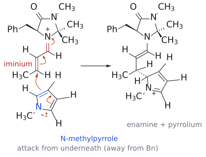

# 이미늄 촉매 공액 첨가

> enal을 chiral secondary amine 촉매와 축합해 **iminium ion**으로 바꾸면, 받개가 더 강한 electrophile이 되고 동시에 한쪽 면이 가려져 enantioselective한 [conjugate addition](공액%20첨가.md)이 일어난다.

## 개요

[cuprate](../시약/유기구리%20시약.md), [enolate·enamine](마이클%20반응.md)처럼 지금까지는 nucleophile을 바꿔서 conjugate addition을 조절했다. 그러면 받개 쪽을 강화할 수는 없을까? enal을 secondary amine 촉매와 축합해 **[iminium ion](../개념/이미늄%20이온.md)**으로 바꾸면 된다. iminium ion은 중성 carbonyl 화합물보다 더 electrophilic하다. 양전하를 띤 C=N⁺가 C=O보다 전자를 더 세게 끌기 때문이다. (출처: L11 p.21)

## 슬라이드의 반응

enal H-CO-CH=CH-R1과 pyrrole 유도체(R2, R3 치환, N-P)에 chiral imidazolidinone 촉매(5-benzyl-2,2,3-trimethylimidazolidin-4-one, 20 mol%)를 넣으면 $\beta$-위치에 pyrrole C2가 붙은 aldehyde가 생긴다. 수율 68–90%, 87–97% ee, 12개 예시. R1은 방향족/지방족, R2·R3는 지방족, P = H, Me, allyl이다.[^1] (출처: L11 p.21)

## 메커니즘

crotonaldehyde(CH3CH=CH-CHO)와 N-methylpyrrole로 메커니즘을 보면 다음과 같다.
1. **iminium 형성**: 촉매의 secondary amine(N-H)이 crotonaldehyde와 축합해서 $\alpha,\beta$-unsaturated iminium ion이 된다(→ [imine](../개념/이민.md)).
2. **stereoselective conjugate addition**: N-methylpyrrole의 C2(nucleophile, 무른 방향족 $\pi$계)가 iminium의 $\beta$-탄소(electrophile)를 공격한다. 이때 촉매의 benzyl group이 한쪽 면을 가리고 있다. 그래서 pyrrole은 **benzyl group을 피해 반대쪽(아래쪽) 면**에서 접근한다. 생성물은 촉매 쪽 enamine과 pyrrolium cation(aromaticity가 깨진 상태)이다.
3. **rearomatization**: pyrrolium에서 H⁺가 빠지면서 pyrrole의 aromaticity가 회복된다(→ [aromaticity](../개념/방향족성.md), [electrophilic aromatic substitution](친전자성%20방향족%20치환.md)과 같은 마무리).
4. **가수분해**: iminium/enamine 부분이 가수분해되어 (R)-3-(1-methylpyrrol-2-yl)butanal이 나오고, 촉매가 재생된다.

즉 촉매가 받개를 활성화하고 동시에 면 선택성까지 정한다. (출처: L11 p.21)

그림: 2단계(stereoselective conjugate addition). 왼쪽 위는 촉매와 crotonaldehyde가 만든 iminium ion이다(빨간 C=N⁺와 C=C가 받개). 아래의 N-methylpyrrole(파랑)에서 질소 전자쌍이 고리로 밀려 들어가고, 고리 C=C 전자가 옮겨 가며, 파란 C2=C3의 $\pi$ 전자가 iminium의 $\beta$-탄소를 공격한다. 동시에 받개의 C=C 전자는 C–C(=N⁺) 자리로, C=N⁺의 $\pi$ 전자는 질소로 간다. 오른쪽 생성물은 촉매 쪽 enamine과 pyrrolium cation이며, 새 C–C 결합(초록 점선 쐐기)은 슬라이드처럼 benzyl기(굵은 쐐기)를 피한 아래쪽 면 공격의 결과다. 이후 H⁺가 빠져 rearomatization이 일어나고 가수분해되면 (R)-aldehyde가 나온다. (출처: L11 p.21)

## 선택성

- **위치**: pyrrole 탄소는 iminium의 $\beta$-탄소에 붙는다(1,4). (출처: L11 p.21)
- **입체**: 촉매 benzyl group의 반대면 공격. 슬라이드 범위에서 87–97% ee, crotonaldehyde 예에서 (R) 생성물. (출처: L11 p.21)

## 관련 문서

- 반응: [conjugate addition](공액%20첨가.md), [Michael reaction](마이클%20반응.md), [proline-catalyzed aldol reaction](프롤린%20촉매%20알돌%20반응.md), [electrophilic aromatic substitution](친전자성%20방향족%20치환.md)
- 개념: [iminium ion](../개념/이미늄%20이온.md), [enamine](../개념/엔아민.md), [imine](../개념/이민.md), [stereospecificity and stereoselectivity](../개념/입체특이성과%20입체선택성.md), [aromaticity](../개념/방향족성.md)

## 출처

- [L11 conjugate addition](../../notes/L11_Conjugate_Addition.md) 6절 (L11 p.21)

[^1]: 보충: 이 반응은 MacMillan의 organocatalysis 연구로 알려진 imidazolidinone 촉매 계열이다. MacMillan은 asymmetric organocatalysis 개발 공로로 2021년 노벨 화학상(List와 공동)을 받았다. 슬라이드에는 노벨상 언급이 없다.
