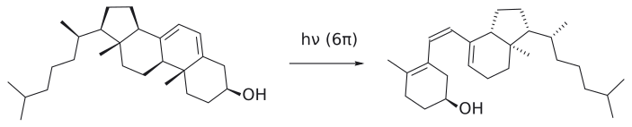
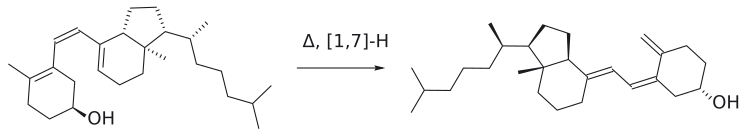
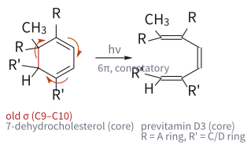
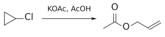

# 전자고리화 반응

> **예습판:** 슬라이드 전 Clayden 기반 예습 내용이다(Clayden 2판 35장, Wade 8판). 강의 슬라이드가 나오면 슬라이드 기준으로 다시 정리하고, 다르면 슬라이드를 따른다.

> 하나의 conjugated polyene 양 끝을 $\sigma$ 결합 하나로 잇거나(고리 닫힘) 그 반대로 끊는(고리 열림) [pericyclic reaction](../개념/페리고리%20반응.md). **모두 허용**되지만, 양 끝이 도는 conrotatory/disrotatory이 전자 수와 조건에 따라 정해져 입체화학을 결정한다.

## 개요

pericyclic reaction 세 갈래 가운데 마지막이 electrocyclic reaction이다. cycloaddition은 두 $\pi$계가 만나 $\sigma$ 결합 둘을 만들고, [sigmatropic rearrangement](시그마트로픽%20자리옮김.md)은 $\sigma$ 결합 하나를 옮긴다. electrocyclic reaction은 **하나의 conjugated $\pi$계 양 끝을 $\sigma$ 결합 하나로 잇거나, 그 반대로 끊는다**.

이 갈래가 특별한 이유는 입체화학에 있다. 평면 polyene이 고리가 되려면 양 끝 탄소가 거의 90° 돌아야 하는데, 두 끝이 **같은 방향으로 conrotation 반대 방향으로 disrotation**에 따라 생성물의 stereoisomer가 달라진다. 그리고 어느 쪽으로 돌지는 전자 수(4n이냐 4n+2냐)와 조건(열이냐 빛이냐)이 정확히 정한다. 시험에서 가장 자주 묻는 것도 이 판정이다(→ [conrotation and disrotation](../개념/콘로테이션과%20디스로테이션.md)).[^1] (출처: Clayden p.922–923)

### 정의와 다른 두 갈래와의 차이

Clayden의 정의는 한 줄이다. **conjugated polyene의 양 끝을 가로지르는 새 $\sigma$ 결합이 생기는 반응, 또는 그 역반응.** 고리가 늘 생기거나 깨진다. cycloaddition도 고리를 만들지만 $\sigma$ 결합이 **둘** 생기고, sigmatropic rearrangement는 하나가 생기면서 하나가 끊어진다. electrocyclic reaction은 $\sigma$ 결합이 **하나만** 생기거나 끊어진다($\Delta\sigma$ = ±1). (출처: Clayden p.922–923)

| | cycloaddition | sigmatropic rearrangement | electrocyclic reaction |
|---|---|---|---|
| $\Delta\sigma$ | ±2 | 0 | ±1 |
| 참여하는 $\pi$계 | 둘 이상 | ($\sigma$ 결합 + $\pi$계) | 하나 |
| 대표 예 | [Diels–Alder](딜스-알더%20반응.md) | [Claisen](클라이젠%20자리옮김.md), [Cope](코프%20자리옮김.md), [1,5-H shift](1,5-수소%20이동.md) | hexatriene 고리 닫힘 |
| 판정 도구 | FMO 또는 Woodward–Hoffmann | Woodward–Hoffmann(또는 FMO) | Woodward–Hoffmann(보충: HOMO 양 끝 위상) |
| 열적 허용의 모양 | 전 성분 suprafacial이면 4n+2 전자 | [3,3]·[2,3] 허용, [1,5]H suprafacial, [1,7]H antarafacial | 4n+2 dis, 4n con |
| 빛을 쬐면 | 4n supra-supra 허용 | supra/antara 뒤집힘 | con/dis 뒤집힘 |
| 입체화학의 열쇠 | 각 성분 기하 보존, endo | chair형 TS의 equatorial R → *E* | 양 끝 회전 방향 |
| 강의 | L13–L15 | L16 | L17 |

(출처: Clayden p.922–925, p.927; L13–L16 노트)

"electrocyclic"과 "pericyclic"을 혼동하지 말아야 한다. pericyclic은 전체 집안 이름이고, electrocyclic은 그 세 식구 중 하나다. (출처: Clayden p.923)

## 원리

### 어느 방향이 유리한가: 결합 에너지와 ring strain

[Woodward–Hoffmann rules](../개념/우드워드-호프만%20규칙.md)은 반응이 **허용되는지만** 알려 주고 어느 방향으로 가는지는 알려 주지 않는다([sigmatropic rearrangement](시그마트로픽%20자리옮김.md)의 "허용과 방향"과 같은 이야기다). 방향은 열역학이 정한다. (출처: Clayden p.922–923)

- **$\text{hexatriene} \longrightarrow \text{cyclohexa-1,3-diene}\ \mathrm{(500^\circ C):}\ \text{고리가 닫힌다}$**. 잃는 $\pi$ 결합보다 새로 생기는 $\sigma$ 결합이 강하기 때문이다.
- **$\text{cyclobutene} \longrightarrow \text{buta-1,3-diene}\ \mathrm{(200^\circ C):}\ \text{고리가 열린다}$**. 4원 고리의 ring strain이 $\sigma$ 결합 하나의 이득보다 크다.
- **cycloheptatriene ⇌ norcaradiene:** 3원 고리 ring strain 해소와 "$\pi$ 결합 대신 $\sigma$ 결합"의 이득이 거의 정확히 비긴다. 보통은 cycloheptatriene이 많지만 치환 양식에 따라 norcaradiene이 우세하기도 하다.

그림: 굽은 화살표(주황) 세 개가 고리를 따라 한 방향으로 돈다. 한쪽 끝 $\pi$ 결합의 전자가 양 끝 탄소(C1, C6) 사이에 새 $\sigma$ 결합(초록)을 만들고, 나머지 두 $\pi$ 결합은 한 칸씩 옮겨 가 cyclohexa-1,3-diene의 두 C=C가 된다. 화살표를 모두 반대 방향으로 돌려 그려도 같은 반응이다. 500 °C에서 고리가 닫히는 쪽이 유리한 것은 잃는 $\pi$ 결합보다 새 $\sigma$ 결합이 강하기 때문이다. (근거: Clayden p.922)

규칙을 적용할 때는 고리 열림이 유리한 반응이라도 **고리 닫힘 쪽으로 생각하는 것이 대개 쉽다**. 정반응이 허용이면 역반응도 허용이므로 결론은 같다. (출처: Clayden p.923)

### 왜 FMO가 아니라 Woodward–Hoffmann인가

cycloaddition과 sigmatropic 반응은 HOMO–LUMO 논리와 Woodward–Hoffmann 규칙 중 편한 것을 골라 쓸 수 있었다. electrocyclic reaction, 적어도 고리 닫힘은 **분자 오비탈이 하나만** 관여하므로 두 오비탈을 겹치는 FMO 논리를 그대로 쓰기 어렵다. 그래서 Clayden은 여기서는 Woodward–Hoffmann 규칙을 쓰라고 한다(HOMO 하나의 대칭으로 보는 방법은 [conrotation and disrotation](../개념/콘로테이션과%20디스로테이션.md)에서 보충한다). 규칙은 cycloaddition과 같다. **열적 pericyclic 반응에서는 (4q+2)s 성분 수와 (4r)a 성분 수의 합이 홀수여야 한다.** (출처: Clayden p.923)

### hexatriene($6\pi$): suprafacial이면 허용

hexatriene은 $\pi6$ 성분 하나다. 고리가 닫히려면 양 끝 p 오비탈이 90° 돌아 $\sigma$ 결합을 만들어야 한다. (출처: Clayden p.923)

1. 메커니즘을 그린다.
2. 성분: $\pi6$ 하나.
3. 양 끝에만 오비탈을 그린다.
4. 새 결합이 생길 곳을 잇는다. 양 끝의 **윗면 로브끼리** 잇는다.
5. 같은 면끼리 이었으므로 **$\pi6\mathrm{s}$**.
6. (4q+2)s = 1, (4r)a = 0 → 합 1 → **열적 허용**.

### butadiene($4\pi$): suprafacial이면 금지, antarafacial이면 허용

cyclobutene의 고리 열림은 실제로 잘 일어난다. 역반응인 butadiene의 고리 닫힘으로 같은 절차를 밟아 보자. (출처: Clayden p.924)

- **처음 시도:** 양 끝 윗면 로브끼리 이으면 **$\pi4\mathrm{s}$**. (4q+2)s도 (4r)a도 없어 합 0 → 금지. 그런데 반응은 실제로 일어난다. 무엇이 잘못됐을까? 규칙이 아니라 **오비탈을 잇는 방식**이 잘못됐다.
- **다시 시도:** 한쪽 끝은 윗면 로브, 다른 끝은 아랫면 로브로 이으면 **$\pi4\mathrm{a}$**. (4r)a = 1 → 합 1 → **열적 허용**.

이 논리를 넓히면 결론은 간단하다. **모든 electrocyclic reaction은 허용된다.** 다만 $(4n+2)\pi$계는 **suprafacial**로, $(4n)\pi$계는 **antarafacial**로 자기 자신과 반응하도록 그려야 한다(→ [suprafacial/antarafacial](../개념/초면과%20대면.md)). 이 차이가 회전 방향, 즉 입체화학으로 바뀐다. (출처: Clayden p.924)

### 판정 규칙 요약

| $\pi$ 전자 | 열 | 빛 |
|---|---|---|
| 4n | conrotatory ($\pi4\mathrm{a}$) | disrotatory ($\pi4\mathrm{s}$) |
| 4n+2 | disrotatory ($\pi6\mathrm{s}$) | conrotatory ($\pi6\mathrm{a}$) |

회전 방향의 정의, octatriene·cyclobutene 증거, HOMO 위상으로 보는 법, 광화학 반전은 [conrotation and disrotation](../개념/콘로테이션과%20디스로테이션.md)에 모았다. 전자 수는 원자(오비탈) 수가 아니라 **전자 수**로 센다. pentadienyl cation은 $4\pi$, anion은 $6\pi$다. (출처: Clayden p.925–928)

## cation과 anion의 electrocyclic reaction

### pentadienyl cation: Nazarov cyclization

divinyl ketone을 산으로 protonate해 생긴 pentadienyl cation(5오비탈, $4\pi$)의 $4\pi$ conrotatory 고리 닫힘이다. 열(산)과 빛에서 고리 접합 H의 입체화학이 뒤집힌다. 자세한 내용은 [Nazarov cyclization](나자로프%20고리화.md). (출처: Clayden p.927–928)

### cyclooctadienyl anion: $6\pi$ disrotatory

dienyl anion도 고리가 닫힌다. Clayden이 든 cyclooctadiene을 −78 °C에서 BuLi로 deprotonate하면 cyclooctadienyl anion이 생긴다. p 오비탈은 여전히 다섯 개지만 전자는 **6개**이므로, 0 °C로 데우면 **disrotation($\pi6\mathrm{s}$)**으로 고리가 닫혀 **cis-fused** bicyclo[3.3.0] anion이 되고, protonate하면 cis-bicyclo[3.3.0]octene이 된다. (출처: Clayden p.928)

여기서는 광화학 conrotation이 **ring strain 때문에 막힌다**. conrotation으로 닫히면 trans-fused 5,5 고리계가 되어야 하기 때문이다. 실제로 이 anion은 −78 °C, 한낮의 햇빛 아래에서도 적어도 일주일 동안 안정했다. 같은 이유로 cyclooctadienyl **cation**($4\pi$, 열적 conrotation)의 고리 닫힘도 일어나지 않는다. (출처: Clayden p.928)

> **모든 electrocyclic reaction은 허용된다. 그러나** conrotation이나 disrotation에 필요한 기하가 입체적으로 불가능하면 한쪽 또는 양쪽 방식이 모두 막힐 수 있다. (출처: Clayden p.928)

## 작은 고리는 electrocyclic reaction으로 열린다

$$
\mathrm{\#\#\#}\ \text{cyclopropyl cation} \longrightarrow \text{allyl cation}
$$

이 단원의 내용만 안다면, $2\pi$ 전자를 가진 [allyl cation](../개념/알릴%20양이온.md)([4+3 cycloaddition](4+3%20고리화%20첨가.md)에서 본 그 cation)이 disrotation으로 고리를 닫아 cyclopropyl cation이 될 것이라고 예상할지 모른다($2\pi$ = 4n+2, n = 0). 실제로는 **반대 방향**이 일어난다. cyclopropyl cation은 ring strain 때문에 생기자마자 electrocyclic 고리 열림을 해 allyl cation이 된다. cyclopropyl cation은 사실상 관찰되지 않는다. (출처: Clayden p.928)

그림: cyclopropyl cation(빨강 +)에서 cation 탄소 맞은편의 C–C $\sigma$ 결합 전자(주황 화살표)가 옆 C–C 결합 쪽으로 옮겨 가 C=C $\pi$ 결합(초록)이 되고, 양전하는 반대쪽 끝 탄소로 옮겨 allyl cation이 된다. $2\pi$(4n+2, n = 0)의 열적 반응이므로 disrotatory다. 대칭으로는 역반응(allyl → cyclopropyl)도 허용이지만 3원 고리의 ring strain 때문에 고리 열림 쪽으로만 간다. (근거: Clayden p.928)

그래서 cyclopropane 고리에서 nucleophilic substitution을 시도하면 allyl 생성물이 나온다.

- $\begin{aligned} & \text{cyclopropyl chloride} \\ & \xrightarrow[\mathrm{AcOH}]{\mathrm{KOAc}} \text{allyl acetate}\ (\text{cyclopropyl acetate는 생기지 않는다}) \end{aligned}$

(출처: Clayden p.928)

### aziridine → azomethine ylide: $4\pi$ conrotation

aziridine은 대부분 안정하지만, electron-withdrawing group(ester)을 가진 것은 가열하면 electrocyclic 고리 열림을 해 **azomethine ylide**가 된다. azomethine ylide는 [1,3-dipole](../개념/1,3-쌍극자.md)이므로, dipolarophile과 [3+2] cycloaddition으로 붙잡을 수 있다(→ [1,3-dipolar cycloaddition](1,3-쌍극자%20고리화%20첨가.md)). (출처: Clayden p.929)

이 붙잡기로 고리 열림의 입체화학을 알아낼 수 있다. [3+2]는 양쪽 성분 모두 suprafacial인 stereospecific 반응([$\pi4\mathrm{s}$ + $\pi2\mathrm{s}$])이므로, 생성물의 입체화학이 곧 intermediate ylide의 기하를 알려 준다. 결과는 **conrotation**이다. ylide는 $4\pi$ 전자계이므로 열적 conrotation이 규칙과 맞는다. (출처: Clayden p.929)

- $\begin{aligned} & \text{cis-2,3-bis(methoxycarbonyl)-1-phenylaziridine} \\ & \xrightarrow[100\,{}^\circ\mathrm{C}]{\mathrm{EtO_2C{-}C{\equiv}C{-}CO_2Et}} \text{2,5-trans-dihydropyrrole} \end{aligned}$

- $\text{trans-aziridine} \xrightarrow{\text{같은 조건}} \text{2,5-cis-dihydropyrrole}$

cis가 trans를, trans가 cis를 준다는 "뒤집힘"이 conrotation의 지문이다. (출처: Clayden p.929)

## 예

### vitamin D: 햇빛이 필요한 이유 (L17)

[1,5-hydrogen shift](1,5-수소%20이동.md)에서 남겨 둔 질문으로 돌아가자. ergosterol의 B 고리(cyclohexadiene)는 햇빛을 받아 $6\pi$ electrocyclic **고리 열림**을 하여 provitamin D2(triene)가 된다. 이 반응은 pericyclic이지만 cycloaddition($\pi$계가 하나뿐)도 sigmatropic($\sigma$ 결합이 옮겨지지 않고 끊어진다)도 아니다. (출처: Clayden p.922)

출발물과 생성물을 비교하면 이 반응은 **conrotation**이다. $6\pi$의 광화학 반응이니 판정표와 맞는다. 그런데 이것은 표만이 아니라 구조로도 강제된다. 열적 $6\pi$ disrotation으로 열리면 두 6원 고리 중 하나에 **불가능한 trans 이중결합**이 들어가야 한다. 그래서 이 고리 열림은 빛으로만 일어나고, 햇빛이 몇 달씩 부족한 지역에 vitamin D 결핍이 흔한 것도 결국 오비탈 대칭 때문이다. 그다음 단계인 provitamin D2 → vitamin D2는 열적 antarafacial [1,7]H 이동이다(→ [1,5-hydrogen shift](1,5-수소%20이동.md)). (출처: Clayden p.921–922, p.927)

$\begin{aligned} & \text{Wade는 같은 이야기를 7-dehydrocholesterol} \\ & \longrightarrow \\ & \text{provitamin D3로 소개하고},\  \\ & \text{햇빛을 덜 받는 추운 지방 아이들이 구루병에 걸리기 쉽다고 덧붙인다} \end{aligned}$. (출처: Wade p.693)

### 자연 속 electrocyclic reaction: endiandric acid (L17)

endiandric acid 계열 천연물은 특이하게도 **racemate**로 발견된다. 대부분의 chiral 천연물은 enantiopure한 효소가 만들어 enantiopure(또는 enantioenriched)하므로, racemate라는 것은 효소 없이 고리화가 일어났다는 단서였다. 발견자 Black은 1980년대 초에 사슬형 polyene 전구체에서 electrocyclic reaction이 연달아 일어난다고 제안했다. (출처: Clayden p.925)

1. **$8\pi$ electrocyclization(conrotatory, $\pi8\mathrm{a}$):** 사슬형 tetraene 부분이 cyclooctatriene으로 닫힌다. 4n(8)$\pi$의 열적 반응이므로 conrotatory이고, 그 결과 두 곁사슬이 trans로 놓인다.
2. **$6\pi$ electrocyclization(disrotatory, $\pi6\mathrm{s}$):** cyclooctatriene 안의 새 $6\pi$계가 닫혀 bicyclo[4.2.0] 골격이 된다. 이미 stereocenter가 있으므로 disrotation 방식 두 가지에서 두 diastereomer, endiandric acid D와 E가 생긴다.
3. **intramolecular Diels–Alder:** endiandric acid E의 곁사슬 diene이 cyclohexadiene(dienophile)과 반응해 고리 넷, stereocenter 여덟 개를 가진 endiandric acid A가 된다(→ [Diels–Alder reaction](딜스-알더%20반응.md)).

1982년 K. C. Nicolaou 그룹은 제안된 전구체를 합성해 **한 단계로** endiandric acid D, E, A를 모두 얻어 이 가설을 확인했다. endiandric acid D의 입체화학이 Woodward–Hoffmann 규칙의 요구와 정확히 맞는다는 것이 제안을 설득력 있게 만든 핵심이었다. (출처: Clayden p.925–926)

### pericyclic 반응만으로 만든 pheromone: periplanone B (L17)

미국 바퀴벌레의 sex pheromone인 periplanone B를 Schreiber는 1984년에 대부분 pericyclic 반응으로 합성했다. 지금까지 배운 반응이 한 합성 안에 모두 나온다. (출처: Clayden p.929–930)

1. **광화학 [2+2] cycloaddition:** cyclohexenone과 allene을 $h\nu$(Et2O)로 반응시켜 cyclobutane을 만든다(72%). regioselectivity는 예측하기 어렵지만 allene + unsaturated ketone에서 전형적인 것이다. 새 4원 고리의 두 stereocenter는 완전히 stereospecific하다(→ [photochemical \[2+2\] cycloaddition](광화학%202+2%20고리화%20첨가.md)).
2. **vinyl Grignard addition:** ketone에 CH2=CHMgBr를 더해 tertiary allylic alcohol을 만든다(63%)(→ [Grignard reagent](../시약/그리냐르%20시약.md)).
3. **anionic oxy-Cope rearrangement:** KH, 60 °C. 6원 고리가 10원 고리로 넓어진다(75%)(→ [Cope rearrangement](코프%20자리옮김.md)).
4. **$4\pi$ electrocyclic 고리 열림:** 175 °C로 가열하면 4원 고리가 열려 12원 고리가 된다. 새 이중결합은 *Z*/*E* 혼합물로 생기는데(77%), 빛을 쬐면 덜 안정한 *Z*가 더 안정한 *E*로 isomerization된다(82%).
5. 이후 *Z* alkene 하나와 epoxide 둘을 더 넣어 periplanone B를 완성한다.

4단계에서 주의할 점이 있다. 이 고리 열림은 $4\pi$이므로 반드시 conrotation이지만, **생성된 diene의 다른 쪽 끝에 치환기가 없어** conrotation인지를 생성물로 구별할 수 없다. 그러니 이중결합이 *Z*/*E* 혼합물로 나온 것은 con/dis와 무관하다. 또 12원 고리에서는 trans 이중결합이 가능할 뿐 아니라 오히려 선호된다. (출처: Clayden p.930)

### 반응 모음 (L17)

| 반응 | 출발물 → 생성물 | 조건 | $\pi$ 전자 | 회전 | 입체화학 결과 | 출처 |
|---|---|---|---|---|---|---|
| hexatriene 고리 닫힘 | $\text{hexa-1,3,5-triene} \longrightarrow \text{cyclohexa-1,3-diene}$ | 500 °C | 6 | dis | – | Clayden p.922 |
| cyclobutene 고리 열림 | $\text{cyclobutene} \longrightarrow \text{buta-1,3-diene}$ | 200 °C | 4 | con | – | p.922 |
| norcaradiene 평형 | $\text{cycloheptatriene} \rightleftharpoons \text{norcaradiene}$ | – | 6 | dis | 치환에 따라 평형 이동 | p.922 |
| octatriene (열) | $(2\ \mathit{E}\ \mathrm{,4}\ \mathit{Z}\ \mathrm{,6}\ \mathit{E})\text{-octatriene} \longrightarrow \text{5,6-dimethylcyclohexa-1,3-diene}$ | 가열 | 6 | dis ($\pi6\mathrm{s}$) | cis-dimethyl만 | p.924–925 |
| octatriene (빛) | 같은 triene → 같은 골격 | $h\nu$ | 6 | con ($\pi6\mathrm{a}$) | trans-dimethyl | p.927 |
| dimethylcyclobutene 열림 | $\text{cis-3,4-dimethylcyclobutene} \longrightarrow (\mathit{E}\ ,\ \mathit{Z})\text{-hexa-2,4-diene}$ | 가열 | 4 | con ($\pi4\mathrm{a}$) | 단일 isomer | p.925 |
| vitamin D (1단계) | ergosterol → provitamin D2 | 햇빛 | 6 | con | 열적 dis는 기하상 불가 | p.922, 927 |
| endiandric acid | $\begin{aligned} & \text{polyene} \\ & \longrightarrow \text{cyclooctatriene} \\ & \longrightarrow \text{endiandric acid}\ \mathrm{D/E} \\ & \longrightarrow \mathrm{A} \end{aligned}$ | 열 | 8 → 6 | con → dis | racemic 천연물 | p.925–926 |
| Nazarov (산) | $\text{divinyl ketone} \longrightarrow \text{cyclopentenone}$ | H3PO4, AcOH | 4 (5 오비탈) | con ($\pi4\mathrm{a}$) | 고리 접합 H trans | p.927–928 |
| Nazarov (빛) | 같은 출발물 | $h\nu$, benzene | 4 | dis ($\pi4\mathrm{s}$) | 고리 접합 H cis | p.927–928 |
| dienyl anion | $\text{cyclooctadiene} \longrightarrow \text{cis-bicyclo[3.3.0]octene}$ | BuLi, −78 → 0 °C; H⁺ | 6 (5 오비탈) | dis ($\pi6\mathrm{s}$) | cis-fused | p.928 |
| cyclopropyl cation | $\text{cyclopropyl chloride} \longrightarrow \text{allyl acetate}$ | KOAc, AcOH | 2 | dis(고리 열림) | – | p.928 |
| aziridine 열림 + [3+2] | $\begin{aligned} & \text{ester 치환 aziridine} \\ & \longrightarrow \text{azomethine ylide} \\ & \longrightarrow \text{dihydropyrrole} \end{aligned}$ | 100–175 °C, dipolarophile | 4 | con | cis → 2,5-trans, trans → 2,5-cis | p.929 |
| periplanone B의 고리 열림 | $\text{cyclobutene 융합 10원 고리} \longrightarrow \text{12원 고리 diene}$ | 175 °C; $h\nu$(isomerization) | 4 | con(구별 불가) | *Z*/*E* → *E* | p.930 |

그림: 보충: 햇빛($h\nu$)에서 cyclohexadiene 고리가 $6\pi$ conrotatory로 열려 previtamin D3(가운데 Z-alkene)가 되고, 이어서 열적 [1,7]-H 이동(antarafacial)으로 vitamin D3가 된다.

그림: 보충: 핵심 $6\pi$ 부분만 남기고 나머지 고리는 R, R'로 줄였다. C9–C10 $\sigma$ 결합(빨강)이 끊어지며 세 화살표가 고리를 돌아 (Z)-hexatriene 골격의 previtamin $D_3$ 가 된다. 빛($h\nu$) 조건의 $6\pi$ 전자고리화이므로 conrotatory다.

그림: 이온화와 동시에 고리가 열려 allyl cation이 된다(disrotatory).

## 흔한 오해

- "열적이면 disrotatory": 열적 4n은 conrotatory다(→ [conrotation and disrotation](../개념/콘로테이션과%20디스로테이션.md)). (출처: Clayden p.925)
- "금지된 반응은 영원히 안 된다, 허용된 반응은 반드시 된다": electrocyclic reaction은 회전 방향만 맞으면 **모두 허용**이다. 그래도 cyclooctadienyl anion의 광화학 conrotation처럼 trans-5,5 fused 같은 strain 때문에 기하상 불가능해 막히는 경우가 있다. (출처: Clayden p.924, p.928)
- "allyl cation은 disrotation으로 cyclopropyl cation이 된다": 대칭으로는 허용이지만 thermodynamic으로 반대 방향, 즉 cyclopropyl → allyl 고리 열림이 일어난다. 규칙은 방향을 말하지 않는다. (출처: Clayden p.928)
- "vitamin D 합성의 $6\pi$ 고리 열림은 열적으로도 될 것이다": 열적 disrotation은 6원 고리에 trans 이중결합을 넣어야 해서 불가능하다. 그래서 빛(conrotation)이 필요하다. (출처: Clayden p.927)
- "electrocyclic = pericyclic": pericyclic은 집안 이름, electrocyclic은 그 세 갈래 중 하나다. (출처: Clayden p.923)

## 관련 문서

- 반응: [Nazarov cyclization](나자로프%20고리화.md), [sigmatropic rearrangement](시그마트로픽%20자리옮김.md), [1,5-hydrogen shift](1,5-수소%20이동.md), [Cope rearrangement](코프%20자리옮김.md), [Claisen rearrangement](클라이젠%20자리옮김.md), [1,3-dipolar cycloaddition](1,3-쌍극자%20고리화%20첨가.md), [photochemical \[2+2\] cycloaddition](광화학%202+2%20고리화%20첨가.md), [\[4+3\] cycloaddition](4+3%20고리화%20첨가.md), [Diels–Alder reaction](딜스-알더%20반응.md)
- 시약: [Grignard reagent](../시약/그리냐르%20시약.md)
- 개념: [conrotation and disrotation](../개념/콘로테이션과%20디스로테이션.md), [Woodward–Hoffmann rules](../개념/우드워드-호프만%20규칙.md), [suprafacial/antarafacial](../개념/초면과%20대면.md), [pericyclic reaction](../개념/페리고리%20반응.md), [frontier molecular orbital](../개념/프런티어%20분자%20오비탈.md), [allyl cation](../개념/알릴%20양이온.md), [1,3-dipole](../개념/1,3-쌍극자.md)

## 출처

- [L17 Electrocyclic Reactions (예습판)](../../notes/L17_Electrocyclic_Reactions.md) 개요, 1–2절, 5절, 6–10절, 흔한 오해, 반응 요약표 (Clayden 35장 기반)

[^1]: electrocyclic reaction의 회전 방향 가운데 어느 쪽(예: conrotation의 두 방향 중 어느 쪽)이 선택되는지를 다루는 torquoselectivity는 Clayden 35장과 Wade 15장 어디에도 없어 이 예습판에서는 다루지 않는다. 슬라이드에 나오면 그때 추가한다.
