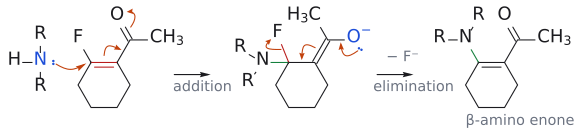

# 첨가-제거 반응

> nucleophile이 먼저 **붙고**(addition), 그 결과 생긴 음이온이 leaving group을 **밀어내는**(elimination) 2단계 치환이다. L11에서는 β-leaving group이 있는 enone과 [SNAr](친핵성%20방향족%20치환.md)가 이 경로를 따른다.

## 개요

β-탄소에 leaving group(예: F)이 붙어 있으면 어떻게 될까? [conjugate addition](공액%20첨가.md)으로 생긴 enolate는 보통 양성자를 받고 끝나지만, 이때는 그냥 protonation되지 않는다. 대신 전자를 되밀어 leaving group을 내보낸다. 결과적으로 β-leaving group이 nucleophile로 **치환**되고 C=C가 다시 생긴다. 같은 논리를 전자 부족한 benzene 고리에 적용한 것이 SNAr다. (출처: L11 p.22)

## 메커니즘

`1-(2-fluorocyclohex-1-enyl)ethanone + R2NH --> 1-(2-NR2-cyclohex-1-enyl)ethanone`
1. **addition(첨가)**: R2NH의 질소가 F가 붙은 β-탄소를 공격한다. C=C의 π 전자는 산소로 가서 enolate가 된다. 이때 β-탄소는 sp³가 되고 N과 F가 함께 붙어 있다.[^1]
2. **elimination(제거)**: enolate 산소의 전자가 되돌아와 C=O를 다시 만든다. 동시에 α=β 이중결합이 재생되면서 F⁻가 떨어진다.
3. 결과는 β-아미노 enone이다. C=C가 다시 생겼다는 점이 단순 conjugate addition과 다르다.

*그림: 왼쪽(첨가): R2NH의 질소(파랑) 비공유 전자쌍이 F가 붙은 β-탄소를 공격하고, 빨간 C=C의 π 전자는 C–C(O) 자리로, C=O의 π 전자는 산소로 간다. 가운데 intermediate에서 β-탄소는 sp³이고 N과 F가 함께 붙어 있다(초록이 새 C–N 결합, 질소는 슬라이드처럼 양성자를 잃은 R2N으로 그렸다[^1]). 오른쪽(제거): O⁻ 전자쌍이 C=O를 다시 만들고, enolate의 C=C 전자가 고리 안 C=C로 옮겨 가며, C–F 결합(빨강) 전자가 F⁻로 떨어진다.*

(출처: L11 p.22)

## SNAr로 넓히기

benzene 고리에 강한 EWG가 있으면 같은 2단계가 일어난다. Nu⁻가 X가 붙은 ipso 탄소에 첨가해 음이온성 σ complex([Meisenheimer complex](../개념/마이젠하이머%20착물.md))가 되고, X⁻가 떨어지며 aromaticity가 회복된다. 느린 단계가 첨가이므로 leaving group 순서가 F >> Cl ~ Br >> I로 SN2와 반대이고, leaving group은 EWG의 ortho/para에 있어야 한다. 자세한 내용은 [nucleophilic aromatic substitution](친핵성%20방향족%20치환.md) 문서에 있다. (출처: L11 p.22–23)

## 예

- 1-(2-F-cyclohex-1-enyl)ethanone `--[R₂NH]-->` 1-(2-NR₂-cyclohex-1-enyl)ethanone. (L11) (출처: L11 p.22)
- 2-fluoroacetophenone `--[R₂NH]-->` 2-(NR₂)acetophenone. 음전하가 acetyl 산소로 가서 enolate가 되므로 위와 같은 메커니즘이다. (L11) (출처: L11 p.23)
- acryloyl chloride CH2=CH-COCl `--[NH3]-->` acrylamide CH2=CH-CONH2. 엄밀히 말하면 이 반응은 C=O에 1,2로 첨가한 뒤 Cl⁻가 떨어지는 [nucleophilic acyl substitution](친핵성%20아실%20치환.md)(addition-elimination)이다. 슬라이드는 첫 공격 위치를 기준으로 "1,2"라고 분류했다(→ [1,2-addition과 1,4-addition](../개념/1,2-첨가와%201,4-첨가.md)). 보충: carboxylic acid derivative의 nucleophilic acyl substitution은 [tetrahedral intermediate](../개념/사면체%20중간체.md)를 거치는 addition-elimination이다. (보충 근거: Clayden p.199) (L11) (출처: L11 p.10)

## 흔한 오해

- **"SN2처럼 한 단계로 이탈기를 밀어낸다"고 생각하기 쉽지만, 사실은** sp³ intermediate(enolate, σ complex)를 거치는 2단계다. 그래서 C–X가 끊기는 속도보다 첨가 속도가 중요하다. (출처: L11 p.22–23)
- **"SNAr에서도 I가 가장 좋은 leaving group"라고 생각하기 쉽지만, 사실은** F가 가장 빠르다(→ [nucleophilic aromatic substitution](친핵성%20방향족%20치환.md)). (출처: L11 p.23)

## 관련 문서

- 반응: [공액 첨가](공액%20첨가.md), [친핵성 방향족 치환](친핵성%20방향족%20치환.md), [친전자성 방향족 치환](친전자성%20방향족%20치환.md), [친핵성 아실 치환](친핵성%20아실%20치환.md)
- 개념: [사면체 중간체](../개념/사면체%20중간체.md), [마이젠하이머 착물](../개념/마이젠하이머%20착물.md), [E1cB 제거](../개념/E1cB%20제거.md), [엔올과 엔올레이트](../개념/엔올과%20엔올레이트.md), [치환기 효과](../개념/치환기%20효과.md)

## 출처

- [L11 짝지음 첨가](../../notes/L11_Conjugate_Addition.md) 7절, 3절 (L11 p.10, p.22–23)

[^1]: 슬라이드 중간체에는 질소가 "R2N"으로 그려져 있다. 하지만 중성 R2NH가 첨가한 직후의 질소는 R2NH⁺(양전하)이고, 이후 양성자를 잃어 R2N이 된다. (출처: L11 p.22)
