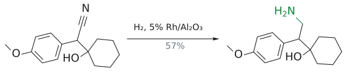
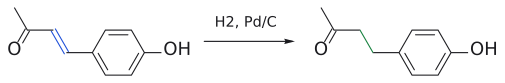
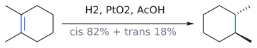
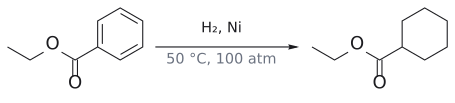
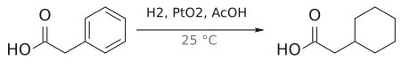

# 촉매 수소화

> H₂ + 금속 촉매([Pd/C](../시약/Pd-C.md), PtO₂, Ni 등)로 C=C, C≡C, C=N, NO₂ 등을 환원하는 반응. 두 H가 촉매 표면 쪽, 즉 **같은 면에서 들어오는 syn 첨가**다.

## 개요

[metal hydride reactivity](../개념/금속%20수소화물의%20반응성.md)은 극성인 C=O, C=N에는 잘 듣지만 무극성인 C=C에는 거의 반응하지 않는다. 그럼 alkene은 어떻게 환원할까? H₂와 금속 촉매를 쓴다. H₂는 그 자체로는 무극성이라 반응성이 없지만, 금속 촉매와 함께라면 C=C, C=N, 삼중결합 등을 환원한다. 반대로 H₂/금속은 C=C를 환원하면서 ketone은 남길 수 있다. 그래서 두 방법은 서로 반대의 chemoselectivity를 가진 상보적 도구다. (출처: L5 p.30)

자주 쓰는 촉매는 둘이다. 하나는 Pd/C(팔라듐-탄소, 보통 질량비 5% 또는 10%)로, 녹지 않으므로 여과로 회수해 재사용할 수 있다. 다른 하나는 PtO₂(Adams catalyst, → [PtO2](../시약/PtO2.md))인데, 실제로 일하는 것은 산화백금이 아니라 수소화 중에 생기는 Pt 금속이다. (출처: L5 p.30)

## 메커니즘: 왜 syn 첨가인가

수소화는 금속 표면에서 일어난다. 그 모습을 그려 보면 입체화학이 저절로 따라 나온다.

1. H₂가 촉매 표면에 흡착된다.
2. alkene이 한쪽 면을 표면에 대고 촉매에 배위한다.
3. 표면의 H 두 개가 같은 면에서 차례로 탄소에 옮겨 가고, alkane이 표면에서 떨어져 나간다.

H가 모두 표면 쪽, 즉 같은 면에서 오니 **syn 첨가**다. (출처: L5 p.31)

## 선택성

- **입체:** syn 첨가라 1,2-dimethylcyclohexene에서 *cis* 생성물이 우세하다(82:18). 그런데 syn 첨가라면서 왜 *trans*가 18%나 나올까? 보충: 촉매 표면에서 이중결합이 자리를 옮기는 이성질화가 일어나고, 옮겨진 alkene이 수소화되면 *trans*가 생길 수 있기 때문이라고 설명한다(표준 교재). 슬라이드는 82:18이라는 결과와 "*cis*가 우세하다"는 점만 제시한다. (보충 근거: Clayden p.535–536) (출처: L5 p.31)
- **화학선택성(쉬운 것 → 어려운 것):** 여러 작용기가 있을 때 어느 것이 먼저 수소화될까? 슬라이드는 이렇게 줄 세운다. (출처: L5 p.33)
  1. RCOCl → RCHO ([Rosenmund reduction](로젠문트%20환원.md))
  2. ArNO₂ → ArNH₂
  3. RC≡CR → *cis*-RCH=CHR
  4. R₂C=NR → R₂CH–NHR
  5. RCH=CHR → RCH₂CH₂R
  6. RX–CH₂Ph → RXH + PhCH₃ (X = O, NH; benzyl group 제거, → [hydrogenolysis](수소화분해.md))
  7. RCN → RCH₂NH₂
  8. benzene 고리 → cyclohexane 고리
- **방향족 고리**는 안정해서 센 조건(Ni, 50 °C, 100 atm 또는 PtO₂/AcOH)이 필요하다. (출처: L5 p.31)
- alkyne을 alkene에서 멈추려면 피독된 [Lindlar catalyst](../시약/린들라%20촉매.md)를 쓴다(→ [Lindlar reduction](린들라%20환원.md)). (출처: L1 p.5)

## 예

- 4-(4-hydroxyphenyl)뷰트-3-ene-2-one --[H₂, Pd/C]--> 4-(4-hydroxyphenyl)butane-2-one (C=C만 환원, ketone 유지)[^1] (출처: L5 p.30)
- 1,2-dimethylcyclohexene --[H₂, PtO₂, AcOH]--> *cis*-1,2-dimethylcyclohexane 82% + *trans* 18% (출처: L5 p.31)
- ethyl benzoate PhCO₂Et --[H₂, Ni, 50 °C, 100 atm]--> ethyl cyclohexanecarboxylate (출처: L5 p.31)
- phenylacetic acid PhCH₂CO₂H --[H₂, PtO₂, AcOH, 25 °C]--> cyclohexylacetic acid (출처: L5 p.31)
- ArNO₂ --[H₂, Pt 또는 Pd, EtOH (+HOAc)]--> ArNH₂ (보통 ~100%) (출처: L5 p.33)
- nitrobenzene --[H₂, Pd/C 또는 Sn, 묽은 HCl]--> aniline. 슬라이드는 Sn/묽은 HCl도 대안으로 적는다. nitro기(deactivating, meta)가 amino기(강한 activating, o/p)로 바뀌므로 합성 순서 설계에 쓰인다(→ [nitration](나이트로화.md)). (출처: L3 p.13)
- 2-naphthoyl chloride --[H₂, Pd/BaSO₄, 퀴놀린]--> 2-naphthaldehyde (74–81%). C–Cl 결합만 환원되고 aldehyde와 naphthalene 고리는 남는다([Rosenmund reduction](로젠문트%20환원.md)). (출처: L5 p.33)

그림: C≡N(빨강)이 $CH_2NH_2$(초록)로 환원된다.

그림: C=C(파랑)만 수소화되고 C=O는 남는다.

그림: syn 첨가라서 cis(82%)가 주생성물이다(trans 18%).

그림: benzene 고리 수소화에는 가혹한 조건이 필요하다.

그림: PtO2는 상온에서도 고리를 수소화한다.

그림: 비대칭 수소화. 공액 C=C(파랑)만 환원된다.

그림: Z 이성질체는 반대 리간드로 같은 거울상 생성물을 준다.

그림: Lewis acid 촉매 고리화(ene 반응). C=C(파랑)가 C=O(빨강)를 공격한다.

그림: C=C(파랑)를 수소화하면 menthol이 된다.

## 응용

### BASF (−)-menthol 공정

촉매 수소화가 산업에서 어떻게 쓰이는지 보여 주는 예다. (출처: L5 p.32)

- 제라니알 (*E*) --[H₂, CO, Rh(CO)₂acac, (*S*,*S*)-Chiraphos]--> (+)-시트로넬랄
- 네랄 (*Z*) --[H₂, CO, Rh(CO)₂acac, (*R*,*R*)-Chiraphos]--> (+)-시트로넬랄
- (+)-시트로넬랄 --[Al cat.]--> (−)-isopulegol --[H₂, Ni cat.]--> (−)-멘톨

첫 단계는 asymmetric hydrogenation으로, 분자에 있는 세 곳(공액 C=C, 고립된 C=C, CHO) 중 aldehyde와 공액된 C=C만 환원하면서 새 입체중심을 한쪽 거울상으로 만든다. 재미있는 점은 *E* 이성질체(제라니알)와 *Z* 이성질체(네랄)가 같은 (+)-시트로넬랄을 주려면 서로 반대 거울상의 키랄 리간드를 써야 한다는 것이다. 이중결합의 기하가 뒤집혀 있으니 같은 생성물을 얻으려면 촉매의 손잡이도 뒤집어야 하는 셈이다. 마지막 단계는 isopropenyl group의 C=C를 수소화하는 평범한 수소화다.[^2] 같은 경로의 산화 쪽 이야기는 [alcohol oxidation](알코올%20산화.md)에 있다. (출처: L5 p.32)

### 그 밖의 응용

- benzyl protecting group(OBn, [Cbz](../시약/Cbz%20보호기.md))는 H₂/Pd로 떼어 낸다(수소화분해, → [hydrogenolysis](수소화분해.md)). protecting group 전략에서 아주 중요하다(→ [protecting group](../개념/보호기.md)). (출처: L5 p.33, L12 p.8)
- imine을 H₂/Pd-C로 환원하면 [reductive amination](환원성%20아미노화.md)이 된다. 1-(4-methoxyphenyl)propane-2-one + methyl 5-(2-아미노-1-hydroxyethyl)-2-hydroxybenzoate --[H⁺ (imine 형성)]--> imine --[H₂, Pd/C]--> 2차 amine. [NaBH3CN](../시약/NaBH3CN.md)이 하던 역할을 H₂/Pd-C가 맡은 것이다. (출처: L5 p.33)

## 반응 정리

| 반응 | 시약/조건 | 생성물 | regioselectivity | 입체화학 | 비고 |
|---|---|---|---|---|---|
| alkene 수소화 | H₂, Pd/C 또는 PtO₂ | alkane | - | syn 첨가 (*cis* 우세) | ketone 유지 |
| 방향족 수소화 | H₂, Ni (50 °C, 100 atm) 또는 PtO₂/AcOH | cyclohexane 고리 | - | - | 가장 어려운 수소화 |
| 비대칭 수소화 | H₂, CO, Rh(CO)₂acac, Chiraphos | (+)-시트로넬랄 | 공액 C=C만 | *E*는 (*S*,*S*), *Z*는 (*R*,*R*) 리간드 | BASF 멘톨 공정 |
| Rosenmund reduction | H₂, Pd/BaSO₄, quinoline | RCHO | C–Cl만 | - | aldehyde, 방향족 유지 |
| nitro 환원 | H₂, Pt 또는 Pd, EtOH (+HOAc) | ArNH₂ | - | - | ~100% |
| benzyl 제거 | H₂, Pd/C | ROH/RNH₂ + PhCH₃ | benzyl C–X 결합 | - | protecting group 제거 |

(출처: L5 p.30–33)

## 흔한 오해

- **"syn 첨가니까 *cis*만 100% 나온다"고 생각하기 쉽지만 사실은** 1,2-dimethylcyclohexene에서 *trans*가 18% 나온다. (출처: L5 p.31)
- **"H₂/Pd는 ketone도 같이 환원한다"고 생각하기 쉽지만 사실은** 슬라이드 예에서는 C=C만 환원되고 ketone은 남는다. (출처: L5 p.30)
- **"Adams 촉매의 활성종은 PtO₂"라고 생각하기 쉽지만 사실은** 수소화 중에 생기는 Pt 금속이 실제 촉매다. (출처: L5 p.30)
- **"H₂/Pd-C는 alkene만 환원하니 안전하다"고 생각하기 쉽지만 사실은** benzyl ether·benzyl amine·Cbz 같은 benzyl group이 함께 끊어질 수 있다. (출처: L5 p.33)

## 관련 문서

- 시약: [Pd/C](../시약/Pd-C.md), [Lindlar catalyst](../시약/린들라%20촉매.md), [NaBH4](../시약/NaBH4.md), [PtO2](../시약/PtO2.md), [NaBH3CN](../시약/NaBH3CN.md)
- 반응: [Lindlar reduction](린들라%20환원.md), [dissolving metal reduction](용해%20금속%20환원.md), [Rosenmund reduction](로젠문트%20환원.md), [reductive amination](환원성%20아미노화.md), [hydrogenolysis](수소화분해.md), [nitration](나이트로화.md), [alcohol oxidation](알코올%20산화.md)
- 개념: [metal hydride reactivity](../개념/금속%20수소화물의%20반응성.md), [stereospecificity and stereoselectivity](../개념/입체특이성과%20입체선택성.md), [protecting group](../개념/보호기.md)

## 출처

- [L5 Reduction](../../notes/L05_Reduction.md) 3절 (p.30–33)
- [L1 Electrophilic Addition to Alkenes, Part 1](../../notes/L01_Electrophilic_Addition_to_Alkenes_Part1.md): 슬라이드 L1 p.5, p.7
- [L3 Electrophilic Aromatic Substitution, Part 1](../../notes/L03_Electrophilic_Aromatic_Substitution_Part1.md) 3절 (p.13)
- [L12 Protecting Groups](../../notes/L12_Protecting_Groups.md) 6절

[^1]: 생성물 4-(4-hydroxyphenyl)butane-2-one은 라즈베리 향의 주성분으로 알려진 "라즈베리 ketone"이다.
[^2]: (+)-시트로넬랄은 (*R*)-시트로넬랄이다. Al catalyst 단계는 분자 내 carbonyl-ene 고리화로, aldehyde와 삼치환 alkene이 반응해 고리를 닫는다.
