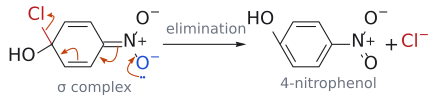
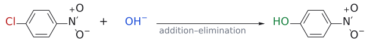

# 친핵성 방향족 치환

> 강한 EWG가 붙은 halobenzene + nucleophile → halogen 자리에 nucleophile이 들어간 생성물. **첨가 후 제거**의 두 단계로 일어난다.

## 개요

β-leaving group이 있는 enone의 [addition-elimination](첨가-제거%20반응.md)과 같은 논리를 benzene 고리에 적용하면 **nucleophilic aromatic substitution(SNAr)**이 된다. L3~L4의 [electrophilic aromatic substitution(SEAr)](친전자성%20방향족%20치환.md)에서는 방향족 고리가 nucleophile이었다. 그런데 NO₂나 C=O 같은 강한 EWG가 붙으면 고리가 전자 부족해져 반대로 nucleophile의 공격을 받는다. SNAr는 [conjugate addition](공액%20첨가.md) 뒤에 β-leaving group이 떨어지는 반응으로 보면 이해가 쉽다. (출처: L11 p.22–23)

보충: 그렇다면 보통의 bromobenzene은 왜 HO⁻와 치환하지 않을까? [SN2](SN2%20반응.md)는 nucleophile이 C–Br 결합 뒤쪽에서 일직선으로 들어와야 하는데, sp² 탄소의 C–Br 결합은 고리 평면 안에 있어서 뒤쪽이 곧 고리 안쪽이다. nucleophile이 고리 속으로 들어가 탄소를 뒤집을 수는 없으므로 **sp² 탄소에서는 SN2가 일어나지 않는다**. SN1도 불리하다. 생길 aryl cation의 빈 orbital이 p가 아니라 고리 밖을 향한 sp² orbital이라 안정화를 받지 못하기 때문이다. 그래서 halobenzene의 치환에는 addition-elimination이라는 별도의 경로가 필요하고, 그 경로는 첨가로 생긴 음전하를 받아 줄 EWG가 있을 때만 열린다. (보충 근거: Clayden p.514–515)

## 메커니즘

$$
\mathrm{Ar(EWG){-}X} + \mathrm{Nu^-} \longrightarrow [\sigma\ \text{complex}] \longrightarrow \mathrm{Ar(EWG){-}Nu} + \mathrm{X^-}
$$

1. **addition(느림)**: Nu⁻가 X가 붙은 ipso 탄소를 공격한다. 그 탄소는 sp³가 되고, 음전하는 고리 전체(그리고 EWG)로 퍼진 anion성 **σ complex**에 놓인다. 보충: 이 anion성 σ complex는 흔히 [Meisenheimer complex](../개념/마이젠하이머%20착물.md)라 부른다.
2. **elimination**: X⁻가 떨어지면서 aromaticity가 회복된다.

(출처: L11 p.23)

그림: 고리 밖 enone에서 일어나는 같은 패턴이다. R₂NH가 F가 붙은 β-탄소에 첨가해 enolate가 되고, 산소의 전자가 되돌아오며 F⁻가 떨어진다. SNAr에서는 이 enolate 자리가 anion성 σ complex다.

그림: SNAr의 addition 단계(4-chloronitrobenzene + HO⁻). HO⁻(파랑)의 비공유 전자쌍이 Cl이 붙은 ipso 탄소를 공격하고, 빨간 C=C의 π 전자는 옆 C–C 자리로, 그다음 고리 C=C의 π 전자는 C–N 자리로, N=O의 π 전자는 산소로 차례로 밀려난다(주황 화살표 네 개). 오른쪽 σ complex(Meisenheimer complex)에서 ipso 탄소는 sp³이고 HO와 Cl을 함께 가지며(초록이 새 C–O 결합), 음전하는 NO₂의 두 산소에 놓인 nitronate 형태다. (출처: L11 p.23)

그림: SNAr의 elimination 단계. NO₂의 O⁻(파랑) 전자쌍이 N=O를 다시 만들고, C=N의 π 전자는 고리 C–C 자리로, 고리 아래쪽 C=C의 π 전자는 ipso 탄소 쪽 C–C 자리로 옮겨 가며, C–Cl 결합(빨강)의 전자가 Cl⁻로 떨어진다. 결과는 aromaticity가 회복된 4-nitrophenol이다. 슬라이드는 이 단계의 화살표 중 O⁻ → N, 고리 안 하나, C–Cl → Cl만 그렸고, 그림은 같은 전자 흐름을 고리를 따라 끝까지 이어 그린 것이다. (출처: L11 p.23)

## 선택성: SNAr의 세 가지 규칙

1. **leaving group 순서는 F >> Cl ~ Br >> I다** (*o*-nitrohalobenzene 기준). 슬라이드는 "F가 가장 좋은 leaving group"이라고 표현한다. SN2와 순서가 정반대인 점이 핵심이다.[^1]
2. **강한 EWG가 필요하다**. 상대 속도(k_rel)는 NO2 = 1, SO2Me = 1/18, CN = 1/32, COMe = 1/80이다. nitro group이 가장 강하다(→ [substituent effect](../개념/치환기%20효과.md)).
3. **leaving group은 EWG의 ortho 또는 para 위치에 있어야 한다**. 그래야 첨가 단계에서 생긴 음전하가 공명으로 EWG(C=O 산소나 NO2 산소)까지 퍼질 수 있다. meta 위치에서는 음전하가 EWG가 붙은 탄소로 가지 못한다.

(출처: L11 p.23)

보충: 규칙 1의 크기를 숫자로 보면, 2-halonitrobenzene에서 F 화합물은 Cl·Br 화합물보다 약 10²–10³배 빠르고 I 화합물은 더 느리다. 참고로 규칙 1의 F 효과는 공명이 아니라 **inductive effect**(C–F 결합의 분극)이고, NO2의 효과는 주로 **공명**이다. 규칙 3의 실험적 근거(음전하가 사실상 ortho·para에만 놓인다는 ¹³C NMR 증거)는 [Meisenheimer complex](../개념/마이젠하이머%20착물.md) 문서에 있다. 그 결과 한 분자에 Cl이 둘 있어도 NO2의 ortho에 있는 Cl만 치환되고 meta의 Cl은 남는다. (보충 근거: Clayden p.517–518)

## 예

- $\text{2-fluoroacetophenone} + \mathrm{R_2NH} \xrightarrow[\text{elimination}]{\text{addition}} \text{2-}(\mathrm{NR_2})\text{acetophenone}$

  acetyl group의 ortho 위치 F가 치환된다. 고리 밖 enone의 [addition-elimination](첨가-제거%20반응.md)과 메커니즘이 같다. 음전하가 acetyl 산소로 가서 enolate가 된다(→ [enol and enolate](../개념/엔올과%20엔올레이트.md)). (L11) (출처: L11 p.23)
- $\text{4-chloronitrobenzene} + \mathrm{HO^-} \xrightarrow[\text{elimination}]{\text{addition}} \text{4-nitrophenol}$

  para 위치의 Cl이 치환되고, 음전하는 NO2 산소까지 퍼진다.[^2] 반면 3-chloronitrobenzene은 쉽게 반응하지 않는다(→ [L11 연습 문제](../../practice/L11_Exercises.md) 문제 8). (L11) (출처: L11 p.23)

그림: para $NO_2$ 가 음전하를 받아 주므로 Cl(빨강)이 OH(초록)로 치환된다.

## 흔한 오해

- **"SNAr에서도 I가 가장 좋은 leaving group"이라고 생각하기 쉽지만, 사실은** SNAr에서는 F >> Cl ~ Br >> I다. 속도를 결정하는 것은 C–X 결합이 끊기는 단계가 아니라 첨가 단계다. (출처: L11 p.23)
- **"EWG만 있으면 위치에 상관없이 SNAr가 된다"고 생각하기 쉽지만, 사실은** leaving group이 EWG의 ortho/para에 있어야 음전하가 EWG로 비편재화된다. (출처: L11 p.23)
- **"SN2처럼 뒤에서 한 번에 밀어낸다"고 생각하기 쉽지만, 사실은** 슬라이드가 보여 주는 것은 첨가 후 제거의 두 단계다. C–X 결합 뒤쪽은 고리 안쪽이라 SN2식 뒤쪽 공격이 불가능하다(위 개요의 보충). (출처: L11 p.23)

## 관련 문서

- 반응: [electrophilic aromatic substitution](친전자성%20방향족%20치환.md), [addition-elimination](첨가-제거%20반응.md), [conjugate addition](공액%20첨가.md), [diazonium salt reactions](다이아조늄%20염%20반응.md), [SN2 reaction](SN2%20반응.md)
- 개념: [Meisenheimer complex](../개념/마이젠하이머%20착물.md), [substituent effect](../개념/치환기%20효과.md), [aromaticity](../개념/방향족성.md), [enol and enolate](../개념/엔올과%20엔올레이트.md), [electrophile and nucleophile](../개념/친전자체와%20친핵체.md)

## 출처

- [L11 conjugate addition](../../notes/L11_Conjugate_Addition.md) 7절 (L11 p.22–23)

[^1]: 보충: F⁻가 이탈 능력 자체가 뛰어나서가 아니다. 느린 단계가 첨가이기 때문에 전기음성도가 큰 F가 ipso 탄소를 활성화하고 anion intermediate를 안정화해서 전체 속도를 높인다(Clayden 22장) (보충 근거: Clayden p.518). 슬라이드의 "F is the best leaving group"은 "SNAr 속도가 가장 빠른 halogen"으로 읽는 것이 정확하다.
[^2]: 슬라이드 생성물은 4-nitrophenol(HO-Ar)로 그려져 있다. 엄밀히는 염기성 조건에서 산성인 nitrophenol(pKa 약 7)이 deprotonate되어 phenoxide로 존재하고, 산 처리 후 phenol이 얻어진다(보충). (보충 근거: Clayden p.176)
