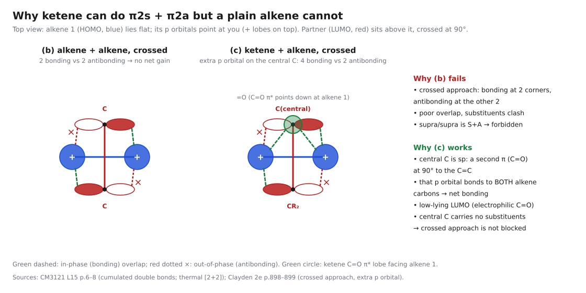
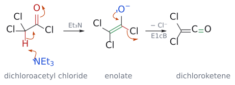

# 케텐 2+2 고리화 첨가

> $\begin{aligned} & \text{Alkene} + \text{ketene} \\ & \xrightarrow{\text{가열}} \text{cyclobutanone}(\text{thermal}\ \mathrm{[2^+2]}\ \text{cycloaddition}) \end{aligned}$ (관련: [ketene](../개념/케텐.md)). 일반 alkene끼리는 열적으로 금지된 [2+2]가, ketene에서는 직교하는 $\pi$ 결합 덕분에 [$\pi2\mathrm{s}$ + $\pi2\mathrm{a}$]로 허용된다.

## 개요

### 금지된 반응이 왜 일어나나?

Woodward–Hoffmann 규칙에 따르면 총 4전자(4n)가 참여하는 [2+2]는 열적으로 금지다. 실제로 ethylene 두 분자를 아무리 가열해도 cyclobutane은 생기지 않는다. 그런데 슬라이드는 가열만으로 4원 고리가 생기는 두 예를 보여 준다. *cis*-2-butene과 dimethylketene(Me2C=C=O)을 가열하면 cyclobutanone이 생기는데, 두 Me의 cis 관계가 생성물에도 그대로 남는다. 또 alkene R-CH=CH2와 chlorosulfonyl isocyanate(ClSO2-N=C=O, CSI)를 가열하면 N-SO2Cl $\beta$-lactam이 생긴다(→ [isocyanate](../개념/이소시아네이트.md)). (출처: L15 p.6)

두 시약의 공통점은 cumulated double bond(누적 이중결합)다. ketene의 중앙 탄소는 sp 혼성이라 C=C $\pi$ 결합과 C=O $\pi$ 결합이 서로 직각으로 놓여 있고, isocyanate의 N=C=O도 마찬가지다. 요약 슬라이드가 "특수한 경우: 열적 [2+2] (suprafacial–antarafacial)"이라고 따로 적어 둔 것이 이 이야기다. (출처: L15 p.6, p.32)

## 원리: supra-antara라는 탈출구

그렇다면 직교하는 $\pi$ 결합이 어떻게 금지를 피하게 해 줄까? 일반 alkene 두 분자가 같은 suprafacial–suprafacial, supra-supra 접근하면, 한쪽의 HOMO와 다른 쪽의 LUMO가 한쪽 끝에서는 같은 위상으로, 다른 쪽 끝에서는 반대 위상으로 만난다. 결합 하나는 생기는데 다른 하나는 반결합성이 되어 버리는 셈이다(→ [photochemical \[2+2\] cycloaddition](광화학%202+2%20고리화%20첨가.md)). 이론적으로는 한 성분이 반대 면을 쓰는 suprafacial–antarafacial(supra-antara) 배치면 대칭이 맞지만, 평범한 alkene이 그렇게 몸을 비틀어 접근하는 것은 기하적으로 거의 불가능하다. 슬라이드는 supra-supra, supra-antara, antara-antara 세 배치를 나란히 그리고, 이 중 supra-antara에 박스를 쳐 두었다(→ [suprafacial and antarafacial](../개념/초면과%20대면.md)). (출처: L15 p.7)

ketene은 바로 이 supra-antara를 해낼 수 있다. 삽화(p.7)를 보면 alkene의 HOMO(초록)가 ketene C=O의 LUMO($\pi^{*}$)와 결합하면서, 동시에 중앙 탄소의 직교하는 여분의 p 궤도와도 결합성 상호작용을 할 수 있다. 덕분에 새로 생기는 두 $\sigma$ 결합이 모두 결합성 겹침으로 만들어지고, ketene이 antarafacial 성분 역할을 하는 [$\pi2\mathrm{s}$ + $\pi2\mathrm{a}$] 경로가 열적으로 허용된다. [Woodward–Hoffmann rules](../개념/우드워드-호프만%20규칙.md)으로 세면 (4q+2)s 1개 + (4r)a 0개 = 1(홀수)이다.[^1] (출처: L15 p.7)

보충: 교재는 이 그림을 겹침의 개수로 세어 설명한다. 먼저 한 alkene을 다른 alkene에 대해 90° 돌려 십자로 겹치면, HOMO의 두 로브와 LUMO의 두 로브가 만나는 네 모서리 가운데 두 곳은 결합성, 두 곳은 반결합성이라 알짜 이득이 없다. 여기에 ketene 중앙 탄소의 직교 p 오비탈(C=O $\pi$의 일부)을 더하면 alkene HOMO의 두 로브가 모두 이 오비탈과 결합성으로 겹쳐, 결합성 4곳 대 반결합성 2곳이 되어 반응이 가능해진다. alkene 두 개만으로는 이 여분의 오비탈이 없다는 것이 일반 alkene과의 차이다. 게다가 ketene·isocyanate는 electrophilic이라 LUMO가 낮아 alkene HOMO와 에너지도 잘 맞는다. (보충 근거: Clayden p.898–899) 시그마트로픽·전자고리화에서 같은 s/a 개념을 $\sigma$ 결합에 적용하는 방법은 L16/L17 예습 노트에서 다룬다(→ [electrocyclic reaction](전자고리화%20반응.md)). (출처: L15 p.7)

![why ketene, not a plain alkene, does thermal [2+2]](../../figures/Test2_figures/02_cycloaddition_L13-L15/CY_06_ketene_vs_alkene_2plus2.gif)

그림: 평범한 alkene은 교차시켜도 결합성 2곳과 반결합성 2곳이 상쇄되고 H가 부딪힌다. ketene은 가운데 sp 탄소에 치환기가 없고, 직교하는 C=O π*(주황)가 alkene HOMO의 두 로브와 모두 결합성으로 겹쳐 순 결합이 남는다. 보충: 90° 교차는 이상화한 모형이다. (출처: L15 p.6–7; 보충 근거: Clayden p.898–899)

그림: 위에서 본 교차 배치. alkene끼리는 결합 2 대 반결합 2로 이득이 없고, ketene은 가운데 탄소의 C=O π*가 더해져 결합 4 대 반결합 2가 된다. (출처: L15 p.6–8; 보충 근거: Clayden p.898–899)

## 선택성

- **Regioselectivity는 한 문장으로 풀린다: "ketene의 carbonyl 탄소가 electrophilic하다."** alkene(또는 diene)의 더 nucleophilic한 탄소가 carbonyl 탄소와 결합하고, ketene의 $\alpha$-탄소(CR2)는 그 이웃 탄소와 결합한다(→ [electrophile and nucleophile](../개념/친전자체와%20친핵체.md)). (출처: L15 p.8)
- **Stereospecificity:** alkene 쪽은 suprafacial로 반응하므로 기하가 보존된다. *cis*-2-butene의 두 Me는 생성물에서도 cis다. (출처: L15 p.6)

## 예: ketene으로 cyclobutanone 만들기

ketene은 불안정해서 보통은 반응 플라스크 안에서 만든다. dichloroacetyl chloride(Cl2CH-COCl)에 Et3N을 넣으면 (1) 두 Cl과 C=O 때문에 산성이 커진 $\alpha$-H가 떨어져 enolate가 되고 (2) enolate 산소의 전자쌍이 되돌아오며 acyl 탄소의 Cl⁻가 떨어져 dichloroketene(Cl2C=C=O)이 된다(자세한 내용은 [ketene](../개념/케텐.md)). (출처: L15 p.8)

그림: dichloroketene이 생기는 E1cB 제거. 1단계에서 파란 $Et_3N$ 의 비공유 전자쌍이 빨간 $\alpha$-H를 떼고(첫 화살표), C–H 결합 전자가 C–C 사이로 들어가 C=C를 만들며(둘째), 빨간 C=O의 $\pi$ 전자는 산소로 올라가 enolate가 된다(셋째). 2단계에서는 파란 O⁻의 전자쌍이 되돌아와 C=O를 다시 만들고, 빨간 C–Cl 결합 전자가 Cl⁻로 떨어져 나간다. 초록 결합이 각 단계에서 새로 생긴 $\pi$ 결합이다. 염기가 먼저 양성자를 떼고 그다음 leaving group이 떠나므로 E1cB다.

이 ketene을 cyclopentadiene과 만나게 하면 7,7-dichlorobicyclo[3.2.0]hept-2-en-6-one이 생긴다. 어느 탄소끼리 붙는지는 슬라이드의 힌트 "carbonyl 탄소가 electrophilic하다"로 풀린다. 즉 diene의 nucleophilic 말단 탄소가 ketene의 carbonyl 탄소와 결합하고, ketene의 CCl2 탄소는 그 옆 탄소와 결합한다. 그래서 C=O는 CH2 옆 고리접합 탄소에, CCl2는 남은 C=C 바로 옆(allylic 위치) 고리접합 탄소에 붙고, 두 고리접합 H는 cis가 된다. 흥미로운 점은 cyclopentadiene이 Diels–Alder의 단골 diene인데도 이 경우에는 [2+2]가 [4+2]보다 빠르다는 것이다. (출처: L15 p.8)

보충: 생성물의 cis 고리 접합은 cyclopentadiene 고리 안의 cis C=C에서 그대로 stereospecificity. 두 Cl은 보통 최종 목표에 필요 없지만 Zn/HOAc로 zinc enolate를 거쳐 하나씩 H로 바꿀 수 있어서, 반응성 좋은 dichloroketene을 쓰고 나중에 Cl을 지우는 전략이 흔하다. 거꾸로 ketene의 [4+2] 생성물(cyclohexenone 골격)이 필요하면 ketene은 [2+2]를 해 버리므로, nitroalkene처럼 DA 뒤에 ketone으로 바꿀 수 있는 "ketene 등가체"를 dienophile로 쓴다. (보충 근거: Clayden p.899) 역합성에서도 같은 생각을 쓴다. cyclobutanone을 두 방식으로 자를 수 있으면, alkene의 cis/trans로 입체화학을 정할 수 있고 dichloroketene을 쓸 수 있는 쪽을 고른다. (보충 근거: Clayden p.900) (출처: L15 p.8)

![dichloroketene과 cyclopentadiene의 열적 [2+2] cycloaddition](../../figures/L15/ketene_22_cyclopentadiene.svg)

그림: 파란색은 cyclopentadiene의 반응하는 C=C(nucleophile 쪽), 빨간색은 ketene의 C=O로, 그 carbonyl 탄소가 electrophilic 자리다. 두 화살표는 같은 방향(시계 방향)으로 돈다. 위쪽 화살표는 diene의 C=C 전자가 ketene의 carbonyl 탄소와 결합하는 것을, 아래쪽 화살표는 ketene의 C=C 전자가 diene의 이웃 탄소와 결합하는 것을 나타낸다. 생성물의 초록 결합이 새 $\sigma$ 결합이며, 쐐기로 그린 두 고리 접합 H는 cis다. C=O는 $CH_2$ 옆 접합 탄소에, $CCl_2$ 는 남은 C=C 옆 접합 탄소에 붙는다.

- $\begin{aligned} & \mathrm{Cl_2CHCOCl} + \text{cyclopentadiene} \\ & \xrightarrow{\mathrm{Et_3N}} \text{7,7-dichlorobicyclo[3.2.0]hept-2-en-6-one}\ (\text{cis 융합}) \end{aligned}$ (출처: L15 p.8)
- *$\begin{aligned} & \text{cis*-2-butene} + \mathrm{Me_2C{=}C{=}O} \\ & \xrightarrow{\text{가열}} \text{2,2,3,4-tetramethylcyclobutanone}\ (\text{3,4-dimethyl cis}) \end{aligned}$ (출처: L15 p.6)
- isocyanate판: $\mathrm{R{-}CH{=}CH_2} + \mathrm{ClSO_2{-}N{=}C{=}O(CSI)} \xrightarrow{\text{가열}} \mathrm{N{-}SO_2Cl}\ \beta\ \text{-lactam}$ (→ [isocyanate](../개념/이소시아네이트.md)) (출처: L15 p.6, p.12)
- imine판: ketene + imine → $\beta$-lactam (→ [Staudinger $\beta$-lactam synthesis](스타우딩거%20β-락탐%20합성.md)) (출처: L15 p.12)

## 흔한 오해

- **열적 [2+2]는 모든 alkene에서 안 된다고 생각하기 쉽지만 사실은** ketene·isocyanate처럼 직교 $\pi$ 결합을 가진 cumulated double bond 화합물은 supra-antara 경로로 열적 [2+2]를 한다. (출처: L15 p.6–7)
- **ketene [2+2]의 regioselectivity는 외워야 하는 규칙이라고 생각하기 쉽지만 사실은** "carbonyl 탄소가 electrophilic"이라는 한 가지 원리로 풀린다. nucleophilic 원자(alkene의 더 nucleophilic한 탄소, imine N)가 carbonyl 탄소에 붙는다. (출처: L15 p.8)

## ketene을 문제에서 찾아내는 단서

acid chloride와 Et3N이 함께 나오면 처음부터 carbonyl에 alkene이 직접 붙는다고 그리지 않는다. 먼저 $\alpha$-H와 Cl이 제거되어 ketene이 만들어지는지 확인한다. ketene의 두 직교 $\pi$ 계 때문에 보통 alkene끼리의 thermal [2+2]와 같은 금지 판정을 그대로 적용할 수 없다. (출처: L15 p.6–8)

Tutorial 5 Q3에서는 생성된 dimethylketene과 enol ether를 구별해 그린다. 전자가 풍부한 enol ether의 nucleophilic 탄소가 ketene의 electrophilic carbonyl 탄소와 만나는 연결을 먼저 고른다. 남은 두 탄소를 이어 cyclobutanone 고리를 만든 뒤, 원래 enol ether의 기하를 고리의 상대배치로 옮긴다. ketene의 C=O를 없애 cyclobutane alcohol을 그리거나, enol ether의 O를 ring atom으로 넣는 것은 이 반응의 결합 추적과 맞지 않는다. (출처: Tutorial Questions 5 p.3; L15 p.6–8)

## 관련 문서

- 반응: [photochemical \[2+2\] cycloaddition](광화학%202+2%20고리화%20첨가.md), [Staudinger $\beta$-lactam synthesis](스타우딩거%20β-락탐%20합성.md), [Diels–Alder reaction](딜스-알더%20반응.md)
- 개념: [ketene](../개념/케텐.md), [isocyanate](../개념/이소시아네이트.md), [Woodward–Hoffmann rules](../개념/우드워드-호프만%20규칙.md), [suprafacial and antarafacial](../개념/초면과%20대면.md), [frontier molecular orbital](../개념/프런티어%20분자%20오비탈.md), [electrophile and nucleophile](../개념/친전자체와%20친핵체.md), [enol and enolate](../개념/엔올과%20엔올레이트.md)

## 출처

- [L15 cycloaddition 3부](../../notes/L15_Cycloaddition_Part3.md) 14절, 최종 정리 (p.6–8, p.32)

[^1]: 보충: ketene의 중앙 탄소는 치환기가 없는 sp 탄소라 입체 장애가 작아서, alkene이 이렇게 직교 방향으로 접근할 수 있다. (출처: L15 p.7)
