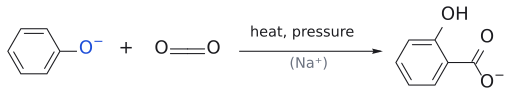
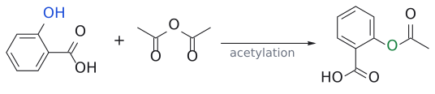

# 콜베-슈미트 반응

> 나트륨 phenoxide + CO₂ → salicylic acid(오르토-hydroxybenzoic acid). 아스피린 합성의 첫 단계다.

## 개요

CO₂는 아주 약한 electrophile이라서 benzene은 물론 phenol과도 잘 반응하지 않는다. 그러나 phenol(pKa 10)을 NaOH로 deprotonation한 **phenoxide 이온**은 산소의 음전하가 고리로 더 강하게 밀려 들어가므로 phenol보다 훨씬 반응성이 크고, CO₂와도 [electrophilic aromatic substitution](친전자성%20방향족%20치환.md)을 한다. (출처: L3 p.26)

## 메커니즘

1. phenol --[NaOH]--> 나트륨 phenoxide
2. Na⁺가 phenoxide O⁻와 CO₂의 O 사이에 걸쳐 배위하면서 CO₂를 **ortho 위치**로 안내한다.
3. ortho 탄소가 CO₂의 탄소를 공격하고, tautomerization(±H⁺)으로 aromaticity가 회복되어 나트륨 salicylate가 된다.[^1]
4. H₃O⁺로 처리하면 salicylic acid이 된다.

(출처: L3 p.26)

## 선택성

OH/O⁻는 강한 ortho/para-directing group이다(→ [substituent effect](../개념/치환기%20효과.md)). 그중 **ortho** 생성물이 나오는 것은 위의 Na⁺ 배위 때문이다. (출처: L3 p.26)

## 예

- phenol --[NaOH]--> PhO⁻Na⁺ --[CO₂]--> 나트륨 salicylate --[H₃O⁺]--> salicylic acid --[Ac₂O]--> 아스피린 (출처: L3 p.26)

*그림: Kolbe–Schmitt 1: phenoxide(파랑 $O^-$)의 ortho 탄소가 $CO_2$의 C(빨강)를 공격해 salicylate(초록 C–C)가 된다.*

*그림: Kolbe–Schmitt 뒤: salicylic acid의 phenol OH(파랑)가 $Ac_2O$로 acetyl화되어 aspirin(초록 ester O)이 된다.*

## 흔한 오해

- "phenol 자체가 CO₂와 반응한다": phenoxide로 바꿔야 CO₂ 같은 약한 electrophile과 반응할 만큼 활성화된다. (출처: L3 p.26)

## 관련 문서

- 반응: [electrophilic aromatic substitution](친전자성%20방향족%20치환.md), [aromatic halogenation](방향족%20할로젠화.md)
- 개념: [substituent effect](../개념/치환기%20효과.md), [arenium ion](../개념/아레늄%20이온.md), [electrophile and nucleophile](../개념/친전자체와%20친핵체.md)

## 출처

- [L3 electrophilic aromatic substitution 1부](../../notes/L03_Electrophilic_Aromatic_Substitution_Part1.md) 7절 (슬라이드 p.26)

[^1]: 보충: Na⁺ 배위가 ortho 선택성의 원인이라는 해석은 슬라이드 메커니즘 그림(Na가 O⁻와 CO₂의 O를 잇는 점선)에 근거한 것이다.
