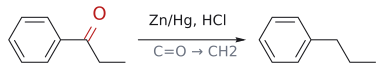

# 클레멘센 환원

> 아릴 ketone --[Zn/Hg, HCl]--> ArCH₂R. C=O를 CH₂로 바꾸는 환원으로, [Friedel–Crafts acylation](프리델-크래프츠%20아실화.md)와 짝을 이루어 "자리 옮김 없는 alkylation"를 만든다.

## 개요

[Friedel–Crafts alkylation](프리델-크래프츠%20알킬화.md)로 곧은 사슬 alkyl group을 넣으려 하면 [carbocation rearrangement](../개념/탄소%20양이온%20자리옮김.md)과 다중 치환이 일어난다. 그래서 먼저 acyl group을 넣고, 그 carbonyl을 methylene(–CH₂–)으로 환원하는 우회로를 쓴다. 이때 쓰는 것이 아연 아말감(Zn/Hg, 아연과 수은의 합금)과 HCl로 하는 클레멘센 환원이다. **아릴–alkyl ketone**에 특히 효과적이다. (출처: L3 p.20)

## 메커니즘

슬라이드에는 메커니즘이 나오지 않는다. 시험에서는 시약과 결과(C=O → CH₂), 화학선택성을 알면 된다. (출처: L3 p.20)

## 선택성

**chemoselectivity(화학선택성)**: ketone만 환원되고 carboxylic acid은 반응하지 않는다. (출처: L3 p.20)

## 예

- 프로피오페논(PhCOCH₂CH₃) --[Zn/Hg, HCl]--> *n*-propylbenzene. 이렇게 하면 직접 alkylation에서 생기는 rearrangement(cumene) 문제를 피할 수 있다. (출처: L3 p.17, p.20)
- 3-benzoylpropanoic acid --[Zn/Hg, HCl]--> 4-phenylbutanoic acid. α-테트랄론 합성의 2단계다. (출처: L3 p.20, L4 p.3)

*그림: Clemmensen 환원. C=O(빨강)가 $CH_2$(초록)로 바뀐다.*

## 흔한 오해

- "carboxylic acid도 함께 CH₂로 환원된다": ketone만 환원된다. 그래서 테트랄론 합성에서 COOH가 살아남아 다음 단계의 분자내 acylation에 쓰인다. (출처: L3 p.20)
- 보충: 산에 약한 기질에는 강염기 조건의 Wolff–Kishner reduction(N₂H₄, KOH, 가열)이 같은 변환을 한다. 이 강의에서는 다루지 Clayden. (보충 근거: Wade p.864, Clayden p.540)

## 관련 문서

- 반응: [Friedel–Crafts acylation](프리델-크래프츠%20아실화.md), [Friedel–Crafts alkylation](프리델-크래프츠%20알킬화.md), [electrophilic aromatic substitution](친전자성%20방향족%20치환.md)
- 개념: [carbocation rearrangement](../개념/탄소%20양이온%20자리옮김.md), [acylium ion](../개념/아실륨%20이온.md)

## 출처

- [L3 electrophilic aromatic substitution 1부](../../notes/L03_Electrophilic_Aromatic_Substitution_Part1.md) 6절 (슬라이드 p.20–22)
- [L4 electrophilic aromatic substitution 2부](../../notes/L04_Electrophilic_Aromatic_Substitution_Part2.md) 0절 (슬라이드 p.3)
