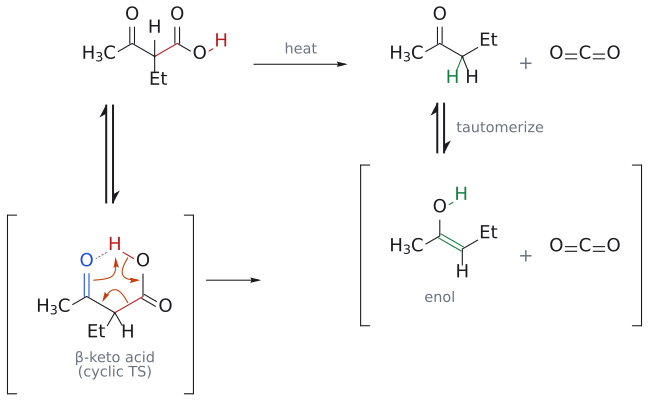

# 탈카복실화

> $\begin{aligned} & \beta\ \text{-keto}\ \text{acid}(\text{또는 치환 malonic acid}) \\ & \xrightarrow{\text{가열}} \text{enol} + \mathrm{CO_2} \\ & \longrightarrow \text{ketone}(\text{또는 carboxylic acid}) \end{aligned}$. six-membered cyclic transition state를 거치는 한 단계 반응이다.

## 개요

[acetoacetic ester synthesis](아세토아세트산%20에스터%20합성.md)와 [malonic ester synthesis](말론산%20에스터%20합성.md)의 마지막 단계다. ester기는 $\alpha$-수소를 산성으로 만들어 alkylation을 돕는 임시 활성화기였는데, 가수분해 후 가열하면 이 탄소가 CO₂로 떨어져 나간다. 아무 carboxylic acid나 쉽게 CO₂를 잃는 것은 아니며, carboxyl기의 $\beta$ 위치에 C=O가 있어야 한다. (출처: L7 p.16, p.19)

## 메커니즘

$\beta$-keto acid를 가열하면 carboxyl기의 O–H 수소가 ketone 산소로 옮겨 가는 six-membered cyclic transition state를 거치며 C–CO₂ 결합이 끊어지고 CO₂가 빠져나가 enol이 생긴다.[^1] (출처: L7 p.16)

그림: 위 줄이 전체 반응이고 아래 줄은 단계별 풀이다(대괄호는 중간체, ⇌는 평형). 슬라이드는 치환기를 R로 그렸는데, 여기서는 [acetoacetic ester synthesis](아세토아세트산%20에스터%20합성.md)의 2-pentanone 합성에 맞춰 R = ethyl인 2-ethyl-3-oxobutanoic acid를 예로 들었다. 1단계: $\beta$-keto acid를 ketone O와 carboxyl O–H가 마주 보는 6원자 고리형 구조로 두면(점선은 분자 안의 수소 결합) 세 화살표가 한 번에 움직인다. (1) ketone C=O의 전자(파랑)가 carboxyl group의 H(빨강)를 잡아 오고, (2) O–H 결합 전자가 C–O 사이로 들어가 $\mathrm{CO_2}$ 의 C=O가 되며, (3) 끊어지는 C$\alpha$–COOH 결합(빨강)의 전자가 C$\alpha$와 ketone 탄소 사이로 들어가 C=C가 된다. 그 결과 enol과 $\mathrm{CO_2}$ 가 생긴다(초록 결합이 새로 생긴 O–H와 C=C). 2단계: enol이 tautomerize해 ketone(2-pentanone)이 된다(새 C–H는 초록). 슬라이드는 첫 화살표를 ketone O에서 H로 그렸는데, 여기서는 C=O 결합에서 출발하게 그려 ketone 탄소의 결합 수가 맞도록 했다. (출처: L7 p.16)

치환 malonic acid HO₂C–CH(R)–CO₂H도 같다. 한쪽 COOH의 H가 다른 쪽 C=O 산소로 넘어가는 six-membered cyclic transition state를 거쳐 CO₂가 빠지고, 생긴 enol이 carboxylic acid RCH₂COOH로 정리된다. (출처: L7 p.19–20)

## 원리: 왜 $\beta$-keto acid만 쉽게 CO₂를 잃나

보충: cyclic transition state에서 끊어지는 C$\alpha$–COOH 결합의 전자쌍은 C$\alpha$와 $\beta$ 위치 carbonyl 탄소 사이로 들어가 enol을 만들어야 한다. 그래서 carboxyl기의 $\beta$ 위치에 두 번째 carbonyl이 있어야만 이 경로가 열리고, 단순 carboxylic acid는 가열해도 이렇게 decarboxylate하지 않는다. 또 한 분자에서 두 분자(생성물과 CO₂ 기체)가 생기므로, 가열하면 entropy 항(−T$\Delta$S)의 기여가 커져 반응이 더 잘 진행된다. malonic acid 쪽도 같은 이유로, 두 ester가 모두 가수분해되어도 CO₂는 하나만 빠진다. (보충 근거: Clayden p.597)

## 예

- $\text{2-ethyl-3-oxobutanoic acid} \xrightarrow{\text{가열}} \text{pentan-2-one} + \mathrm{CO_2}$ (출처: L7 p.18)
- $\begin{aligned} & \text{2-butyl-3-oxobutanoic acid} \\ & \xrightarrow{\text{가열}} \text{heptan-2-one} + \mathrm{CO_2}\ (\text{acetoacetic ester synthesis의 마지막 단계}) \end{aligned}$ (출처: L7 p.17)
- $\text{butylmalonic acid} \xrightarrow{\text{dil.}\ \mathrm{H_2SO_4},\ \text{환류}} \text{hexanoic acid}\ (75\%)$ (출처: L7 p.19)
- 고리판: $\begin{aligned} & \text{3-allyl-1-methyl-4-oxopiperidine-3-carboxylic acid} \\ & \xrightarrow[\text{가열}]{\mathrm{{-}CO_2}} \text{3-allyl-1-methylpiperidin-4-one} \end{aligned}$. [Dieckmann condensation](디크만%20축합.md) → alkylation → saponification → decarboxylation으로 이어지는 문제다(L10 연습문제 1).

## 흔한 오해

- "ester 상태로 가열해도 CO₂가 빠진다": cyclic transition state에는 carboxylic acid의 O–H가 필요하다. 그래서 먼저 가수분해하고 산성화한 뒤 가열한다. (출처: L7 p.16)
- "생성물이 바로 ketone이다": 먼저 enol이 생기고 [tautomerization](케토-엔올%20토토머화.md)으로 ketone이 된다. (출처: L7 p.16)
- "malonic acid에서는 CO₂가 두 개 빠진다": 하나만 빠진다. (출처: L7 p.19–20)

## 관련 문서

- 반응: [acetoacetic ester synthesis](아세토아세트산%20에스터%20합성.md), [malonic ester synthesis](말론산%20에스터%20합성.md), [keto–enol tautomerization](케토-엔올%20토토머화.md), [Dieckmann condensation](디크만%20축합.md), [ester hydrolysis](에스터%20가수분해.md)
- 개념: [enol and enolate](../개념/엔올과%20엔올레이트.md), [enolate chemistry (overview)](../개념/엔올레이트%20화학%20개관.md)

## 출처

- [L7 enolate와 $\alpha$-alkylation](../../notes/L07_Enolate_Alkylation.md) III절(p.16–20)
- [L10 연습문제](../../practice/L10_Practice.md) 문제 1

[^1]: 슬라이드는 decarboxylation 다음에 바로 ketone을 그렸지만, cyclic transition state에서 직접 생기는 것은 enol이고, 이것이 tautomerize하여 ketone이 된다. (출처: L7 p.16)
