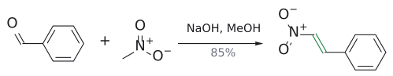
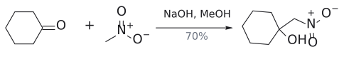

# 헨리 반응

> $\begin{aligned} & \mathrm{RCHO}\ \text{또는}\ \mathrm{R_2C{=}O} + \mathrm{CH_3NO_2} \\ & \xrightarrow[\mathrm{MeOH}]{\mathrm{NaOH}} \text{nitroalcohol}(\text{또는 탈수된 nitroalkene}) \end{aligned}$. nitromethane의 산성 C–H를 골라 떼어 낸 **nitro 판 crossed aldol reaction**이다.

## 개요

cyclohexanone만 NaOH로 처리하면 self-aldol condensation이 일어난다. 그런데 nitromethane을 함께 넣으면 교차 생성물만 깔끔하게 생긴다. 왜일까? nitromethane(수용액 pKa 약 10.2)이 ketone보다 훨씬 산성이라, NaOH가 CH₃NO₂를 먼저 deprotonate하고 ketone은 electrophile 역할만 하기 때문이다. 슬라이드에는 반응 이름이 없고, Henry reaction(nitro-aldol)이라는 이름은 보충이다. (보충 근거: Clayden p.623) (출처: L8 p.28)

## 원리

1. 염기가 CH₃NO₂의 C–H를 떼어 nitronate anion(CH₂=N⁺(O⁻)O⁻)을 만든다. 음전하가 nitro group의 산소로 퍼지기 때문에 산성이 크다(→ [alpha-hydrogen acidity](../개념/α-수소의%20산도.md)). nitromethane은 Et₃N 같은 약한 amine으로도 deprotonate된다. (출처: L7 p.22, L8 p.28)
2. nitronate의 탄소가 carbonyl 탄소를 공격해 $\beta$-nitroalcohol이 된다(→ [aldol reaction](알돌%20반응.md)).
3. 기질에 따라 탈수까지 진행되어 nitroalkene이 된다.

(출처: L8 p.28)

## 예

- $\mathrm{PhCHO} + \mathrm{CH_3NO_2} \xrightarrow[\mathrm{MeOH}]{\mathrm{NaOH}} (\mathit{E})\mathrm{{-}PhCH{=}CH{-}NO_2}\ (85\%,\ \text{탈수 생성물})$ (출처: L8 p.28)
- $\begin{aligned} & \text{cyclohexanone} + \mathrm{CH_3NO_2} \\ & \xrightarrow[\mathrm{MeOH}]{\mathrm{NaOH}} \text{1-(nitromethyl)cyclohexan-1-ol}\ (70\%,\ \text{첨가 생성물}) \end{aligned}$ (출처: L8 p.28)
- 비교: $\begin{aligned} & \text{cyclohexanone} \\ & \xrightarrow[\mathrm{MeOH}]{\mathrm{NaOH}} \\ & \text{2-cyclohexylidenecyclohexan-1-one}\  \\ & (\text{nitromethane이 없으면 self-condensation}) \end{aligned}$ (출처: L8 p.28)

그림: Henry 반응 후 탈수.

그림: ketone에서는 첨가 생성물에서 멈춘다.

## 흔한 오해

- "NaOH가 있으니 ketone도 enolate가 되어 self-condensation이 섞인다": 더 산성인 CH₃NO₂가 먼저 deprotonate되어 nucleophile을 독차지한다. 슬라이드가 nitromethane 유무를 나란히 비교한 이유다. (출처: L8 p.28)
- "항상 nitroalkene까지 간다": benzaldehyde에서는 탈수 생성물이, cyclohexanone에서는 첨가 생성물(tertiary alcohol)이 나온다. (출처: L8 p.28)

## 관련 문서

- 반응: [crossed aldol reaction](교차%20알돌%20반응.md), [aldol reaction](알돌%20반응.md), [Knoevenagel condensation](크뇌베나겔%20축합.md)
- 개념: [alpha-hydrogen acidity](../개념/α-수소의%20산도.md), [enol and enolate](../개념/엔올과%20엔올레이트.md), [E1cB elimination](../개념/E1cB%20제거.md)

## 출처

- [L8 aldol reaction](../../notes/L08_Aldol_Reactions.md) 5절
- [L7 enolate alkylation](../../notes/L07_Enolate_Alkylation.md) 4절(여러 작용기의 enolate)
