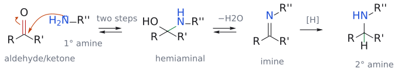

# 환원성 아미노화

> aldehyde·ketone + amine + 환원제 → 한 단계 더 치환된 amine. 환원제가 실제로 붙잡는 것은 carbonyl이 아니라 중간에 생기는 **C=N([imine](../개념/이민.md) 또는 [iminium ion](../개념/이미늄%20이온.md))**이다.

## 개요

amine을 만드는 가장 강력하고 범용적인 방법이 reductive amination이다. aldehyde나 ketone에 amine을 섞고 환원제를 넣으면, carbonyl 탄소에 N이 붙은 amine이 생긴다. alkyl halide로 직접 alkylate하면 생성 amine이 더 좋은 nucleophile이라 over-alkylation이 일어나지만(→ [amine synthesis (overview)](../개념/아민%20합성%20개관.md)), 이 반응은 NH₃를 쓰면 1차, 1차 amine을 쓰면 2차, 2차 amine을 쓰면 3차 amine이 나와서 원하는 단계에서 정확히 멈춘다. (출처: L5 p.6, p.10–11)

- `benzaldehyde PhCHO --[NH3, H2, Ni]--> benzylamine PhCH2NH2 (89%)`
- `PhCHO --[(1) CH3CH2NH2; (2) LiBH3CN]--> N-benzylethanamine PhCH2NHCH2CH3 (89%)`
- `cyclohexanone --[(1) (CH3)2NH; (2) NaBH3CN]--> N,N-dimethylcyclohexanamine (52-54%)`

(출처: L5 p.10)

## 메커니즘

그렇다면 환원제는 정확히 무엇을 환원하는 걸까? carbonyl이 아니라 그 사이에 생기는 C=N이다.

1. amine N(nucleophile)이 carbonyl 탄소(electrophile)를 공격하고 C=O π 결합이 끊어져 O⁻가 된다. 양성자가 옮겨 가면(두 단계) hemiaminal R(R′)C(OH)NHR″이 생긴다.
2. OH가 protonate되어 물로 떨어지고(−H₂O), N의 lone pair가 밀고 들어와 C=N을 만든다. 이것이 imine R(R′)C=NR″이다. 여기까지는 모두 가역적이다.
3. imine(또는 protonate된 iminium ion)의 C=N 탄소에 hydride [H]가 붙어 2차 amine R(R′)CH–NHR″이 된다.

*그림: 왼쪽의 굽은 화살표 둘이 첫 단계다. (1) amine N의 lone pair(파랑, nucleophile)가 carbonyl 탄소(빨강, electrophile)를 공격하고, (2) C=O π 전자가 산소로 올라간다. 양성자 이동 두 번(two steps)을 거치면 hemiaminal이 되고(새 C–N 결합은 초록), 물이 빠지면 imine이 된다. 마지막으로 [H]가 C=N 탄소에 붙어 2차 amine이 된다(초록 C–H). 슬라이드처럼 hemiaminal ⇌ imine은 가역 화살표로 그렸다.*

슬라이드 그림에서는 hemiaminal과 imine이 함께 [H]로 이어져 있지만, 실제로 hydride를 받는 것은 C=N(imine/iminium) 쪽이다.

2차 amine은 N에 H가 하나뿐이라 중성 imine을 만들 수 없다. 그 대신 iminium ion(R₂C=N⁺R₂)을 거쳐 환원된다.[^1] (출처: L5 p.11)

## 환원제 고르기

- **[NaBH3CN](../시약/NaBH3CN.md)**(슬라이드 조건: pH 3–4, C₂H₅OH[^2]): imine은 환원하고 aldehyde·ketone은 느리게만 환원하며 pH > 3 수용액에서도 안정하다. 그래서 carbonyl, amine, 환원제를 한 용기에 넣어도 된다. 왜 [NaBH4](../시약/NaBH4.md)가 아닌지는 [L5 연습 문제](../../practice/L05_Exercises.md) 4번에 있다. (출처: L5 p.12, p.17)
- **H₂/Ni, H₂/[Pd/C](../시약/Pd-C.md)**: imine의 hydrogenation도 곧 reductive amination이다. 아래 p.33 예에서 NaBH₃CN이 하던 역할을 H₂/Pd-C가 맡는다. 다만 benzyl ether·Cbz 같은 benzyl기가 함께 끊어질 수 있다(→ [hydrogenolysis](수소화분해.md)). (출처: L5 p.10, p.33)
- **HCOOH**: formaldehyde와 짝지으면 N,N-dimethylation이 된다(→ [Eschweiler–Clarke reaction](에슈바일러-클라크%20반응.md)). (출처: L5 p.15)

## 예

### NaBH₃CN을 쓴 예 (1차·2차·3차 순서)

- `3-methylbutanal (CH3)2CHCH2CHO + NH3 --> 3-methylbutane-1-amine (CH3)2CHCH2CH2NH2 (1차)`
- `cyclohexylmethanamine C6H11CH2NH2 + acetone --> N-(cyclohexylmethyl)propane-2-amine C6H11CH2NHCH(CH3)2 (2차)`
- `pyrrolidine + 2-methylpropanal (CH3)2CHCHO --> 1-isobutylpyrrolidine (3차)`

(L5) (출처: L5 p.12)

### imine hydrogenation

`1-(4-methoxyphenyl)propane-2-온 + methyl 5-(2-amino-1-hydroxyethyl)-2-hydroxybenzoate --[H+ (imine 형성)]--> imine --[H2, Pd/C]--> 2차 amine` (L5) (출처: L5 p.33)

### 연습으로 옮긴 슬라이드

슬라이드 p.13(PhCH₂CH₂NHCH₃ 합성)과 p.14(거미 독소 전구체의 다른 amine/aldehyde 조합)는 [L5 연습 문제](../../practice/L05_Exercises.md) 1, 2번이다. venlafaxine 특허 경로(H₂, Pd/C, HCHO 2.2 eq)에서는 reductive amination이 한 용기에서 두 번 연달아 일어난다(→ [amine synthesis (overview)](../개념/아민%20합성%20개관.md)). (출처: L5 p.13–14, p.16)

## retrosynthesis 요령

역합성할 때 쓸 만한 요령이 하나 있다. 생성물에서 새 C–N 결합의 탄소 쪽을 보면, 그 탄소가 carbonyl에서 왔고 거기엔 반드시 H가 하나 이상 붙어 있다(환원 때 들어온 H). 이 H가 없는 탄소, 예컨대 3차 alkyl기는 reductive amination으로 N에 붙일 수 없다. (출처: L5 p.12)

## 흔한 오해

- **"NaBH₄로도 reductive amination이 된다"고 생각하기 쉽지만 사실은** NaBH₄는 imine이 생기기 전에 carbonyl을 alcohol로 먼저 환원해 버린다. NaBH₃CN은 carbonyl에 느리고 iminium에 빠르며 약산성에서 안정하다. (출처: L5 p.17)
- **"환원제가 carbonyl을 환원한 뒤 N이 붙는다"**: 순서가 반대다. 먼저 C=N이 생기고, 그 C=N이 환원된다. (출처: L5 p.11)

## 관련 문서

- 반응: [Eschweiler–Clarke reaction](에슈바일러-클라크%20반응.md), [azide·nitrile을 거친 amine 합성](아자이드·나이트릴을%20거친%20아민%20합성.md), [amide reduction](아마이드%20환원.md), [catalytic hydrogenation](촉매%20수소화.md), [Stork enamine reaction](스토크%20엔아민%20반응.md), [hydrogenolysis](수소화분해.md)
- 시약: [NaBH3CN](../시약/NaBH3CN.md), [NaBH4](../시약/NaBH4.md), [Pd/C](../시약/Pd-C.md), [pyrrolidine](../시약/피롤리딘.md)
- 개념: [amine synthesis (overview)](../개념/아민%20합성%20개관.md), [iminium ion](../개념/이미늄%20이온.md), [enamine](../개념/엔아민.md), [metal hydride의 반응성](../개념/금속%20수소화물의%20반응성.md), [imine](../개념/이민.md)

## 출처

- [L5 환원](../../notes/L05_Reduction.md) 1절, 2절, 3절 (슬라이드 p.10–14, p.17, p.33)
- [L5 연습 문제](../../practice/L05_Exercises.md) 1, 2, 4번

[^1]: iminium에 α-H가 있으면 H를 잃고 [enamine](../개념/엔아민.md)이 될 수도 있다. reductive amination 조건에서는 환원제가 iminium을 바로 잡아챈다. (→ [iminium ion](../개념/이미늄%20이온.md))
[^2]: 검토 의견: 슬라이드는 NaBH₃CN reaction 조건을 pH 3–4로 적고 있다. 다만 흔히 인용되는 Borch 조건은 pH 6–7 부근이며, pH 3–4처럼 더 산성이면 NaBH₃CN이 aldehyde·ketone도 상당히 환원하기 시작한다고 알려져 있다. 시험에서는 슬라이드 값을 따르되, "약산성에서 iminium을 선택적으로 환원한다"는 원리를 기억하는 것이 핵심이다. (출처: L5 p.12)
