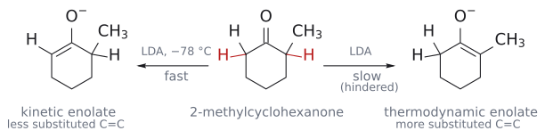

# LDA

> lithium diisopropylamide(LiN(*i*-Pr)₂). **세지만 친핵성은 없는(strong, non-nucleophilic)** 염기다. 케톤과 에스터를 저온에서 정량적, 비가역적으로 [[엔올과 엔올레이트|enolate]]로 바꾸고, 덜 치환된 쪽의 [[속도론적 엔올레이트와 열역학적 엔올레이트|kinetic enolate]]를 준다.

## 개요

enolate를 "조금" 만드는 염기는 많지만, 출발 카보닐을 **전부** enolate로 바꾸는 염기는 드물다. LDA가 표준이 된 이유는 두 가지다. 짝산인 다이아이소프로필아민이 매우 약한 산이어서 평형이 완전히 enolate 쪽으로 가고, 부피 큰 아이소프로필기 두 개가 질소를 가려 카보닐 탄소를 공격하지 못한다. (출처: L7 p.5–6)

## 만드는 법

THF에서 *n*-BuLi와 다이아이소프로필아민을 섞는다.

`n-BuLi + HN(i-Pr)₂ --[THF]--> LiN(i-Pr)₂ + 뷰테인(pKa 50)`

BuLi의 탄소음이온이 염기로서 N–H의 수소를 떼어 내고, 훨씬 약한 산인 뷰테인이 기체로 빠져나가므로 되돌아가지 않는다. (출처: L7 p.6)

## 원리

### 왜 정량적인가

산-염기 평형은 더 약한 산 쪽으로 기운다([[α-수소의 산도]]).

- 케톤(pKa 19) + EtONa ⇌ enolate + EtOH(pKa 16): 왼쪽으로 치우쳐 enolate가 소량뿐이다.
- 케톤(pKa 19) + LDA → enolate + HN(*i*-Pr)₂(pKa 36–38)[^1]: 사실상 완전히 오른쪽으로 간다.

에스터 α-H(pKa ~25)도 LDA로 충분히 떼어진다. (출처: L7 p.4–6, p.13)

### 왜 친핵성이 없나

그렇다면 BuLi를 바로 쓰면 안 될까? BuLi는 친핵성도 강해서 카보닐 탄소에 첨가해 버린다. LDA는 질소 양옆의 부피 큰 아이소프로필기 두 개가 질소를 가려, 작은 양성자는 잘 떼어 내지만 카보닐 탄소에는 다가가지 못한다. 즉 LDA는 강염기이면서 친핵성이 없는(NOT nucleophilic) 염기다. 같은 부류로 LiTMP(리튬 2,2,6,6-테트라메틸피페리다이드)와 LHMDS(LiN(SiMe₃)₂)가 있다. (출처: L7 p.6)

## 선택성

- **위치선택성:** −78 °C에서 LDA는 가장 덜 가려진 α-H를 빨리, 비가역적으로 떼어 간다. 그래서 비대칭 케톤에서는 덜 치환된 C=C의 enolate가 생긴다. 2-헵타논은 메틸 쪽만 100 : 0으로 탈양성자화된다. (출처: L7 p.8, p.11–12)
- **화학선택성:** 친핵성이 없으므로 카보닐에 첨가하지 않는다. (출처: L7 p.6)

*그림: 가려지지 않은 C6–H를 LDA가 −78 °C에서 빠르게 떼면 kinetic enolate(C1=C6)가 생긴다. 자세한 설명은 [[속도론적 엔올레이트와 열역학적 엔올레이트]]에 있다. (출처: L7 p.11–12)*

## 쓰임

| 용도 | 예 | 출처 |
|---|---|---|
| [[엔올레이트 알킬화]] | 2-메틸사이클로헥사논 --[LDA; CH₃I]--> 2,6-다이메틸사이클로헥사논 56% (2,2-이치환체 6%) | L7 p.10–11 |
| 에스터 alkylation | CH₃CH₂CH₂CO₂Me --[LDA, THF; EtI]--> (CH₃CH₂)₂CHCO₂Me 96% | L7 p.13 |
| [[교차 알돌 반응\|directed aldol]] | CH₃COCH₂CH₃ --[LDA, −78 °C; CH₃CHO; H₂O]--> CH₃CH₂COCH₂CH(OH)CH₃ 75% | L8 p.18 |
| kinetic [[실릴 엔올 에터]] | 2-메틸사이클로헥사논 --[LDA, −78 °C; Me₃SiCl]--> 덜 치환된 enol ether 99 : 1 | L8 p.24 |
| 위치 지정 [[α-할로젠화]] | R–CH₂–CO–CH₃ --[LDA; Me₃SiCl; Br₂]--> R–CH₂–CO–CH₂Br | L10 p.10 |
| [[에반스 옥사졸리디논\|asymmetric alkylation]] | N-아실 옥사졸리디논 --[LDA, −78 °C; BnBr]--> 92%, 99 : 1 dr | L7 p.27 |

슬라이드는 2-메틸프로판산 메틸과 사이클로펜테인카브알데하이드의 LDA enolate를 직접 그려 보라고 한다(→ [L7 연습 문제](../../practice/L07_Exercises.md) 1). (출처: L7 p.7)

## 흔한 오해

- "강염기면 BuLi를 바로 써도 된다": BuLi는 친핵성이 강해 카보닐에 첨가한다. 그래서 BuLi로 비친핵성인 LDA를 먼저 만든 뒤 쓴다. (출처: L7 p.6)
- "LDA면 어떤 카보닐이든 directed aldol의 nucleophile로 쓸 수 있다": 슬라이드는 케톤과 에스터에 쓰고 알데하이드는 잘 안 된다고 명시한다. 알데하이드끼리의 crossed aldol에는 [[무카이야마 알돌 반응]]을 쓴다. (출처: L8 p.18, p.26)
- "리튬 enolate는 엔알에도 Michael 첨가를 한다": Li⁺가 알데하이드 산소에 배위해 고리형 전이 상태를 만들어 1,2-첨가(aldol)가 일어난다(72%). (출처: L11 p.16)

## 관련 문서

- 반응: [[엔올레이트 알킬화]], [[교차 알돌 반응]], [[무카이야마 알돌 반응]], [[α-할로젠화]]
- 시약: [[알콕사이드 염기]], [[실릴 엔올 에터]], [[에반스 옥사졸리디논]]
- 개념: [[엔올과 엔올레이트]], [[엔올레이트 화학 개관]], [[α-수소의 산도]], [[속도론적 엔올레이트와 열역학적 엔올레이트]]

## 출처

- [L7 엔올레이트와 α-알킬화](../../notes/L07_Enolate_Alkylation.md) I절(p.5–7), II절, VI절
- [L8 알돌 반응](../../notes/L08_Aldol_Reactions.md) 5절
- [L10 엔올과 엔아민](../../notes/L10_Enol_and_Enamine.md) 실릴 엔올 에터 할로젠화
- [L11 짝지음 첨가](../../notes/L11_Conjugate_Addition.md) 4절

[^1]: 다이아이소프로필아민의 pKa가 L7 p.4의 표에서는 36, p.6의 반응식에서는 38로 서로 다르게 적혀 있다. 둘 다 문헌에서 쓰이는 값(측정 조건에 따라 다름)이며, 어느 값이든 케톤(19)과의 차이가 커서 결론은 같다. 평형 상수는 대략 10^(ΔpKa)로 어림한다. (출처: L7 p.4, p.6)
