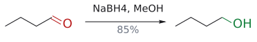
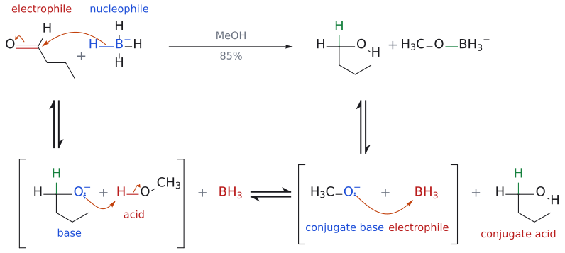
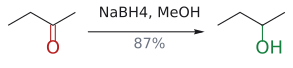
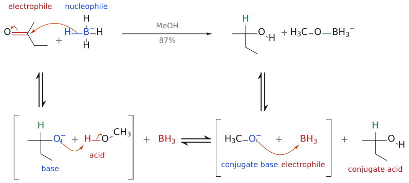
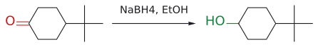

# NaBH4

> 수소화붕소나트륨. aldehyde와 ketone만 alcohol로 바꾸는 가장 흔한 온화한 환원제다. ester는 아주 느리고, amide와 carboxylic acid은 건드리지 않는다.

## 개요

NaBH₄는 아마 가장 많이 쓰이는 환원제다. 온화하기 때문에 분자에 ester나 amide가 함께 있어도 aldehyde·ketone만 골라 환원할 수 있다. 다만 "온화하다"는 말은 상대적이다. [수소화물 시약의 세기](../개념/금속%20수소화물의%20반응성.md)는 LiAlH₄ > LiBH₄ > NaBH₄ > NaBH₃CN 순이고, NaBH₄는 그 아래쪽에 있다. (출처: L5 p.18–19)

## 무엇을 하나

| 기질 | 생성물 | 비고 |
|---|---|---|
| aldehyde | 1차 alcohol | 빠름 |
| ketone | 2차 alcohol | aldehyde보다 약 400배 느림 |
| imine | amine | 다만 [reductive amination](../반응/환원성%20아미노화.md)에는 부적합(아래) |
| ester | (1차 alcohol) | 매우 느림, 보통 살아남음 |
| amide, carboxylic acid | 반응 없음 | |

예: $\begin{aligned} & \text{butanal} \\ & \xrightarrow[\mathrm{MeOH}]{\mathrm{NaBH_4}} \text{1-butanol(85\%)},\ \text{butanone} \\ & \xrightarrow[\mathrm{MeOH}]{\mathrm{NaBH_4}} \text{2-butanol(87\%)} \end{aligned}$. (출처: L5 p.17, p.19)

## 메커니즘

메커니즘의 이름은 "hydride" 첨가다.

1. BH₄⁻의 B–H 결합 전자쌍이 nucleophile로서 carbonyl electrophile을 공격한다. C–H 결합이 생기고 C=O $\pi$ 결합이 끊어져 alkoxide가 된다.
2. alkoxide O가 용매 EtOH의 H를 받아 alcohol이 되고, 남은 EtO⁻는 BH₃에 붙어 EtOBH₃⁻가 된다.
3. 그런데 EtOBH₃⁻에는 아직 B–H가 남아 있으니 여전히 환원제다.

(이 메커니즘의 그림은 이 문서 뒤쪽 butanal·butanone 반응식 바로 아래의 종합 그림에 합쳤다. 화살표의 의미는 그 그림 설명을 본다.)

(출처: L5 p.19)

3번 단계에서 짐작할 수 있듯, BH₄⁻ 하나는 수소화물 네 개를 모두 쓸 수 있다. 슬라이드의 stoichiometry가 이것을 보여 준다.

$$
\begin{aligned}
& 4\ \mathrm{R_2CO} + \mathrm{NaBH_4} \\
& \longrightarrow \mathrm{Na[B(OCHR_2)_4]} \\
& \xrightarrow{\ 4\ \mathrm{H_2O}\ \mathstrut} \mathrm{NaB(OH)_4} \\
& \qquad + 4\ \mathrm{R_2CHOH}
\end{aligned}
$$

(출처: L5 p.20)

## 선택성

- **aldehyde vs ketone:** isopropyl alcohol, 0 °C의 2차 속도상수는 benzaldehyde가 820 × 10⁻⁴, acetophenone이 2.05 × 10⁻⁴ M⁻¹s⁻¹로 약 400배 차이다. 그러니 ketone이 함께 있어도 aldehyde만 골라 환원할 수 있다. 비양성자성 용매 다이글라임(CH₃OCH₂CH₂OCH₂CH₂OCH₃)에서는 aldehyde만 환원되고 acetone은 전혀 환원되지 않는다. 보충: 이 차이를 교과서는 주로 입체 장애로 설명한다. aldehyde 탄소에는 작은 H가 붙어 있지만 ketone 탄소에는 탄소 치환기가 둘이라 수소화물이 접근하기 더 어렵다(자세한 비교는 [metal hydride reactivity](../개념/금속%20수소화물의%20반응성.md)). (보충 근거: Clayden p.132) (출처: L5 p.21)
- **cation 효과:** NaBH₄는 ethyl acetate나 ethyl benzoate 같은 ester를 아주 느리게만 환원하지만, [LiBH4](LiBH4.md)는 쉽게 환원한다. (출처: L5 p.21)
- **엔알 vs enone:** cinnamaldehyde는 1,2-환원되어 신나밀 alcohol(97%)에서 멈추지만, cyclopentenone은 1,4 후 1,2 환원되어 cyclopentanol(99%)까지 간다(→ [1,2-addition vs 1,4-addition](../개념/1,2-첨가와%201,4-첨가.md)). (출처: L11 p.10)
- **ozone 분해 후처리:** O₃ 다음 NaBH₄를 쓰면 carbonyl 조각이 바로 alcohol이 된다(→ [ozonolysis](../반응/오존%20분해.md)). (출처: L2 p.18)

## 조건과 용매

보통 alcohol 용매에서 과량 쓴다. NaBH₄는 물에 잘 녹고 물과는 느리게 반응해 H₂를 내며(알칼리를 넣으면 더 느려진다), **methanol과는 빠르게** 반응한다(60 °C, 24분에 H₂ 100% 발생, 같은 조건 ethanol은 2% 미만). 즉 methanol은 환원제를 갉아먹는다. 그래서 슬라이드의 결론은 "**EtOH가 MeOH보다 좋은 용매**"다.[^1] (출처: L5 p.20)

$\begin{aligned} & \text{실험 사진 예시는 4-*tert*-butylcyclohexanone} \\ & \xrightarrow{\mathrm{NaBH_4},\ \text{ethanol}} \text{4-*tert*-butylcyclohexanol} \end{aligned}$이며, TLC(S = 출발물, C = co-spot, R = 반응액)로 진행을 확인한다.[^2] (출처: L5 p.20)

대조적으로 [LiAlH4](LiAlH4.md)는 너무 반응성이 커서 쓸 수 있는 용매가 탄화수소, ether, 3차 amine으로 제한되며, 보통 diethyl ether, THF, 다이글라임을 쓴다. (출처: L5 p.21)

## 이웃 시약과 비교

| 시약 | aldehyde·ketone | ester | amide | carboxylic acid |
|---|---|---|---|---|
| [NaBH3CN](NaBH3CN.md) | 느림 | X | X | X |
| **NaBH₄** | O | 느림 | X | X |
| [LiBH4](LiBH4.md) | O | O | X | X |
| [LiAlH4](LiAlH4.md) | O | O | $\mathrm{O}() \longrightarrow \text{amine)}$ | 느림(충분히 쓰면 O) |

(출처: L5 p.17)

그림: aldehyde C=O(빨강)가 1차 alcohol(초록)로 환원된다.

그림: 위 반응식의 메커니즘이다. 위 줄이 전체 반응이고 아래 줄은 단계별 풀이다(대괄호는 중간체, ⇌는 평형). butanone 그림과 단계가 같고, carbonyl 탄소에 H가 붙어 있다는 점(aldehyde)만 다르다. 용매는 반응식에 맞춰 MeOH로 그렸다. 1단계(위 줄의 화살표): $\mathrm{BH}_4^-$ 의 B–H 결합(파랑, nucleophile)이 carbonyl 탄소(빨강, electrophile)를 공격해 새 C–H 결합(초록)이 생기고 C=O $\pi$ 전자는 산소로 올라가 alkoxide가 된다. 2단계: alkoxide(염기)가 MeOH(산)의 H를 가져가 1-butanol(conjugate acid)과 $\mathrm{MeO}^-$ (conjugate base)가 된다. 3단계: $\mathrm{MeO}^-$ 가 $\mathrm{BH}_3$ 에 붙어 $\mathrm{MeOBH}_3^-$ 가 된다. 보충: 3단계의 화살표는 슬라이드에 없는 보충이다. (보충 근거: Clayden p.131, p.530)

그림: ketone C=O(빨강)가 2차 alcohol(초록)로 환원된다.

그림: 위 반응식의 메커니즘이다. 위 줄이 전체 반응이고 아래 줄은 단계별 풀이다(대괄호는 중간체, ⇌는 평형). 용매는 반응식에 맞춰 MeOH로 그렸다(슬라이드 메커니즘은 EtOH이고 단계는 같다). 1단계(위 줄의 화살표): $\mathrm{BH}_4^-$ 의 B–H 결합(파랑, nucleophile)이 carbonyl 탄소(빨강, electrophile)를 공격해 새 C–H 결합(초록)이 생기고, C=O $\pi$ 전자는 산소로 올라가 alkoxide $\mathrm{O}^-$ 가 된다. 2단계: alkoxide(염기, 파랑)의 비공유 전자쌍이 MeOH(산, 빨강)의 H를 가져가고, H–O 결합 전자는 O에 남아 2-butanol(conjugate acid, 빨강)과 $\mathrm{MeO}^-$ (conjugate base, 파랑)가 된다. 3단계: $\mathrm{MeO}^-$ 의 비공유 전자쌍이 $\mathrm{BH}_3$ (Lewis acid, 빨강)에 붙어 $\mathrm{MeOBH}_3^-$ 가 된다. $\mathrm{MeOBH}_3^-$ 에는 B–H가 남아 있어 여전히 환원제이므로 $\mathrm{BH}_4^-$ 하나가 hydride 네 개를 모두 쓸 수 있다. $\mathrm{Na}^+$ 는 그리지 않았다. 보충: 3단계의 화살표는 슬라이드에 없는 보충이다. (보충 근거: Clayden p.131, p.530)

그림: $\mathrm{C{=}O(}\text{빨강)} \longrightarrow \mathrm{CH{-}OH(}\text{초록)}$.

(이 반응의 메커니즘은 위 butanone 종합 그림과 같다. 고리 ketone이라는 점만 다르다.)

## 흔한 오해

- "NaBH₄로도 환원성 아미노화가 된다": imine이 생기기 전에 carbonyl을 먼저 alcohol로 환원해 버린다. 그래서 [NaBH3CN](NaBH3CN.md)을 쓴다. (출처: L5 p.17)
- "MeOH가 표준 용매다": MeOH는 NaBH₄를 갉아먹는다. 슬라이드 결론은 EtOH다. (출처: L5 p.20)
- "NaBH₄는 enone의 C=O만 환원한다": cyclopentenone처럼 1,4 환원이 먼저 일어나는 기질도 있다. (출처: L11 p.10)

## 관련 문서

- 반응: [reductive amination](../반응/환원성%20아미노화.md), [ozonolysis](../반응/오존%20분해.md), [conjugate addition](../반응/공액%20첨가.md)
- 비교 시약: [NaBH3CN](NaBH3CN.md), [LiBH4](LiBH4.md), [LiAlH4](LiAlH4.md), [DIBAL-H](DIBAL-H.md), [borane](보레인.md)
- 개념: [metal hydride reactivity](../개념/금속%20수소화물의%20반응성.md), [1,2-addition vs 1,4-addition](../개념/1,2-첨가와%201,4-첨가.md)

## 출처

- [L5 Reduction](../../notes/L05_Reduction.md) 2절 (p.17–21)
- 연습: [L5 연습 문제](../../practice/L05_Exercises.md) 4, 5번
- [L11 Conjugate Addition](../../notes/L11_Conjugate_Addition.md) 3절
- [L2 Electrophilic Addition to Alkenes, Part 2](../../notes/L02_Electrophilic_Addition_to_Alkenes_Part2.md): 슬라이드 L2 p.18

[^1]: p.20–21의 교재 발췌는 H. C. Brown 연구진의 논문들을 인용한다. Brown은 붕소 화합물(보레인 등)을 유기합성에 도입한 공로로 1979년 노벨 화학상을 받았다(→ [borane](보레인.md)).
[^2]: 슬라이드에는 생성물의 입체화학이 그려져 있지 않다. 표준 교재에 따르면 작은 수소화물이 주로 축 axial에서 공격하므로 OH가 에쿼토리얼인 *trans*-4-*tert*-butylcyclohexanol이 주생성물이다.
