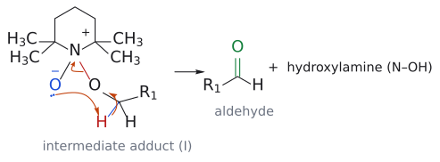

# TEMPO

> 2,2,6,6-테트라메틸피페리딘 *N*-옥실. 네 메틸기가 N–O• 라디칼을 감싼 안정한 나이트록실 라디칼로, 1 mol%만 넣으면 표백제(NaOCl)나 공기(O₂)로 1차 알코올을 알데하이드에서 깔끔하게 멈춘다.

## 개요

값싼 표백제만으로는 산화의 선택성이 없다. 여기에 TEMPO를 촉매로 끼우면 알데하이드에서 멈춘다. 슬라이드는 이름을 "tetramethylpiperidine N-oxide"로 적었지만 정확히는 나이트록실 라디칼(N-oxyl)이다(m.p. 36–38 °C). 반응 이름은 [[TEMPO 산화]]다. (출처: L6c p.11)

## 무엇을 하나

| 계 | 조건 | 생성물 |
|---|---|---|
| TEMPO/NaOCl | CH₂Cl₂–H₂O, NaHCO₃, KBr(0.1 equiv), TEMPO(0.01 equiv), 0 °C | RCH₂OH → RCHO |
| Cu(I)/TEMPO (Stahl) | 5% (bpy)CuI, 5% TEMPO, 10% NMI, 공기 또는 O₂, MeCN, rt | RCH₂OH → RCHO |

예: 1-헵탄올 → 헵탄알, 신나밀 알코올(PhCH=CHCH₂OH) → 신남알데하이드. C=C는 그대로 남는다. Stahl 조건에서도 내부 *E*-C=C를 가진 1차 알코올이 C=C를 건드리지 않고 알데하이드가 된다. (출처: L6c p.11, p.13)

## 원리: 산화 릴레이

TEMPO 자체가 알코올을 산화하는 것이 아니다.

1. OCl⁻(최종 산화제)가 Br⁻를 OBr⁻로 산화한다.
2. OBr⁻가 TEMPO를 나이트로소늄 양이온(N⁺=O)으로 산화한다.[^1] 실제 산화제는 이 양이온이다.
3. 알콕사이드가 N⁺를 공격해 부가물 N(O⁻)–O–CH₂R이 생긴다.
4. N에 붙은 O⁻가 분자 내에서 α-H를 떼고 N–O 결합이 끊어져 RCHO와 하이드록실아민(TEMPO-H)이 된다.
5. TEMPO-H는 다시 산화되어 순환이 닫힌다.

(출처: L6c p.11–12)

*그림: 4단계. N에 붙은 O⁻(파랑)가 α-H(빨강)를 떼어 가고, N⁺–O 결합 전자는 N으로 돌아간다. 초록 C=O가 새 결합이다.*

Stahl 계에서는 Cu(I)가 TEMPO-H와 ½ O₂로 Cu(II)–OH와 TEMPO•가 되고, 이 둘이 함께 알코올을 산화하며 Cu(I)와 TEMPO-H로 돌아간다. 결국 O₂가 물이 된다. (출처: L6c p.13)

## 이웃 시약과 비교

- **[[TPAP]]:** 같은 "촉매 + 최종 산화제" 설계. TPAP는 NMO, TEMPO는 NaOCl 또는 O₂를 쓴다. (출처: L6c p.10–13)
- **[[DMP]]·[[스원 산화|Swern]]:** 화학량론적 시약이고 더 비싸거나(DMP) 저온·악취 부산물(Swern)이 따른다. TEMPO/NaOCl은 값싼 표백제, Stahl은 공기를 쓴다. (출처: L6c p.7–9, p.11–13)
- **[[존스 시약]]:** 1차 알코올을 산까지 보낸다. TEMPO는 알데하이드에서 멈춘다. (출처: L6c p.16)

## 흔한 오해

- "TEMPO 라디칼이 알코올을 직접 산화한다": 실제 산화제는 나이트로소늄(옥소암모늄) 양이온이다. TEMPO는 촉매이고, NaOCl 또는 O₂가 최종 산화제다. (출처: L6c p.12)

## 관련 문서

- 반응: [[TEMPO 산화]], [[알코올 산화]]
- 비교 시약: [[TPAP]], [[DMP]], [[MnO2]], [[존스 시약]]

## 출처

- [L6 산화와 알켄 합성](../../notes/L06_Oxidation_and_Alkene_Synthesis.md) 2.5–2.6절

[^1]: 슬라이드는 "nitrosonium cation"이라고 부르지만 정식으로는 옥소암모늄(oxoammonium) 이온이라 부르는 경우가 많다. (L6 노트 각주 5)
