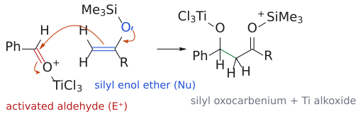

# TiCl4

> titanium tetrachloride. 강의에서는 [Mukaiyama aldol reaction](../반응/무카이야마%20알돌%20반응.md)의 **Lewis acid 활성화제**로 나온다. aldehyde 산소에 배위해 carbonyl 탄소를 electrophilic하게 만들어, 얌전한 [silyl enol ether](실릴%20엔올%20에터.md)도 공격할 수 있게 한다.

## 개요

[silyl enol ether](실릴%20엔올%20에터.md)는 lithium enolate보다 안정한 대신 nucleophilicity가 약해서, 혼자서는 aldehyde를 잘 공격하지 못한다. 그렇다면 nucleophile을 세게 만드는 대신 electrophile을 세게 만들면 된다. Ti(IV)가 그 역할을 맡는다. (출처: L8 p.22, p.25)

## 메커니즘

슬라이드가 "가능한 메커니즘"으로 제시한 순서다. (출처: L8 p.25)

1. TiCl₄가 PhCHO의 carbonyl O에 배위해 carbonyl 탄소를 더 electrophilic하게 만든다.
2. silyl enol ether의 C=C(O의 전자쌍이 밀어 줌)가 활성화된 carbonyl 탄소를 공격한다. silyl oxocarbenium(Me₃Si–O⁺=C)과 titanium alkoxide(–O–TiCl₃)가 생긴다.
3. Cl⁻가 Si를 공격해 Me₃SiCl로 떼어 내고 ketone이 드러난다.
4. titanium alkoxide가 Me₃Si를 다시 받아 aldol의 silyl ether가 되고, TiCl₄가 재생된다.
5. 물로 후처리하면 Si–O가 끊어져 aldol이 된다.

그림: TiCl₄가 배위한 aldehyde를 O⁺–TiCl₃로 나타냈다. C=C(파랑)가 활성화된 carbonyl 탄소(빨강)를 공격하고, C=O⁺ π 전자가 산소로 가서 titanium alkoxide가 된다(2단계).

산 촉매 aldol에서 H⁺가 carbonyl을 protonate해 enol의 공격을 돕던 것과 같은 구도다. 여기서는 H⁺ 대신 Ti(IV)가 carbonyl 산소를 붙잡는다(→ [aldol reaction](../반응/알돌%20반응.md)). (출처: L8 p.13, p.25)

## 예

- aldehyde + aldehyde: (CH₃)₂C=CH–OSiMe₃ --[PhCH₂CH₂CHO, TiCl₄]--> PhCH₂CH₂–CH(OH)–C(CH₃)₂–CHO (95%). (출처: L8 p.26)
- ketone + aldehyde: CH₃CH=C(OSiMe₃)CH₂CH₃ --[CH₃CH₂CH(CH₃)CHO, TiCl₄]--> aldol 92% --[TsOH]--> manicone 83%. (출처: L8 p.26)

## 흔한 오해

- "TiCl₄가 enol ether를 활성화한다": 슬라이드 메커니즘에서 TiCl₄가 배위하는 것은 **aldehyde**의 산소다. 활성화되는 쪽은 electrophile이다. (출처: L8 p.25)
- "TiCl₄ 조건에서 바로 자유 aldol이 나온다": 먼저 aldol의 silyl ether가 생기고, 물 후처리 뒤에야 OH가 드러난다. (출처: L8 p.25)

## 관련 문서

- 반응: [Mukaiyama aldol reaction](../반응/무카이야마%20알돌%20반응.md), [crossed aldol reaction](../반응/교차%20알돌%20반응.md), [aldol reaction](../반응/알돌%20반응.md)
- 시약: [silyl enol ether](실릴%20엔올%20에터.md), [Lewis acid catalyst](루이스%20산%20촉매.md)
- 개념: [electrophile과 nucleophile](../개념/친전자체와%20친핵체.md), [enol and enolate](../개념/엔올과%20엔올레이트.md)

## 출처

- [L8 aldol reaction](../../notes/L08_Aldol_Reactions.md) 5절 (Mukaiyama aldol)
