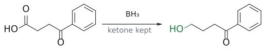
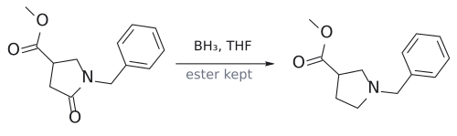

# 보레인

> BH₃. 보론에 **빈 p 궤도함수**가 있는 중성 Lewis acid이다. alkene과는 [hydroboration-oxidation](../반응/수소붕소화-산화.md)를 하고, carbonyl 중에서는 **전자가 풍부한 carboxylic acid과 amide를 먼저 환원**하는 특이한 시약이다.

## 개요

보레인은 그대로는 이량체인 다이보레인(B₂H₆)으로 존재한다. 가운데 B–H–B 다리는 전자 한 쌍이 세 원자를 묶는 **3중심 2전자 결합**이다. H. C. Brown은 순수한 olefin과 다이보레인의 반응이 매우 느리지만, ether 같은 약한 염기가 미량만 있어도 측정할 수 없을 만큼 빨라진다는 것을 관찰했다. 그래서 실제로는 BH₃·Et₂O, BH₃·THF, BH₃·SMe₂ 같은 **착물** 형태로 쓴다.[^1] (출처: L2 p.22–23)

## 무엇을 하나

| 기질/조건 | 생성물 | 비고 |
|---|---|---|
| alkene, 그다음 H₂O₂/NaOH | alcohol (OH는 덜 치환된 탄소에) | [hydroboration-oxidation](../반응/수소붕소화-산화.md), syn |
| carboxylic acid | 1차 alcohol | ester·ketone은 남음 |
| amide | amine | C=O → CH₂ ([amide reduction](../반응/아마이드%20환원.md)) |

(출처: L2 p.24–25, L5 p.27–28)

- 예: 4-옥소-4-phenylbutanoic acid --[BH₃]--> PhCOCH₂CH₂CH₂OH (ketone 유지) (출처: L5 p.27)
- 예: (CH₃)₃CCONMe₂ --[BH₃, THF]--> (CH₃)₃CCH₂NMe₂ (79%) (출처: L5 p.27)
- 예: cyclobutane 위의 CO₂H/CO₂Me --[BH₃]--> CH₂OH/CO₂Me (산만 환원) (출처: L5 p.27)
- 예: methyl 1-benzyl-5-oxopyrrolidine-3-carboxylate --[BH₃, THF]--> methyl 1-benzylpyrrolidine-3-carboxylate (락탐 C=O → CH₂, ester 유지) (출처: L5 p.27)
- **[LiBH4](LiBH4.md)와 거울상 선택성:** 같은 기질 MeO₂C–CH₂CH(CH₃)CH₂–CO₂H에 LiBH₄를 쓰면 ester가 환원되고, BH₃를 쓰면 산이 환원된다. 두 시약은 서로 거울처럼 상보적인 chemoselectivity를 가진다. (출처: L5 p.27)

## 왜 이런 선택성인가

- **alkene에서:** B–H 결합은 H(2.2)가 B(2.04)보다 전기음성도가 커서 B가 δ⁺다. 그래서 B는 덜 치환된 탄소로 간다. 첨가는 C–B와 C–H가 같은 면에 동시에 생기는 협동적 syn 첨가다. (출처: L2 p.24)
- **carbonyl에서:** 금속 수소화물의 일반 서열대로라면 carboxylic acid은 가장 환원하기 어려운 축이다. 그런데 BH₃는 정반대로 carboxylic acid을 1차 alcohol로, amide를 amine으로 빠르게 환원하고, ester와 ketone은 훨씬 느리게 환원한다. BH₄⁻나 AlH₄⁻는 anion(친핵적 수소화물)이라 전자가 부족한 carbonyl을 좋아한다. BH₃는 반대로 먼저 carbonyl 산소의 전자쌍을 받아야 반응이 시작되므로, 루이스 염기성이 큰 amide·carboxylate를 선호한다. ester와 ketone은 루이스 염기성이 작다. alkene의 π 결합과 반응하는 것과 같은 논리다.[^2] amide 환원의 단계별 메커니즘과 그림은 [amide reduction](../반응/아마이드%20환원.md)에 있다. (출처: L5 p.27, → [metal hydride reactivity](../개념/금속%20수소화물의%20반응성.md))

그림: BH3는 carboxylic acid(빨강)만 환원하고 ketone은 남긴다.

그림: BH3는 lactam C=O(빨강)를 $CH_2$(초록)로 환원하고 ester는 남긴다.

## 흔한 오해

- "BH₃도 [LiBH4](LiBH4.md)처럼 ester를 환원한다": 정반대다. LiBH₄는 ester를(산 유지), BH₃는 산과 amide를(ester 유지) 환원한다. BH₃는 Lewis acid이라 루이스 염기성이 큰 carbonyl을 좋아한다. (출처: L5 p.27)
- "수소붕소화는 Markovnikov 규칙의 예외다": B–H의 극성이 뒤집혀 있을 뿐 원리는 같다. (출처: L2 p.24)

## 관련 문서

- 반응: [hydroboration-oxidation](../반응/수소붕소화-산화.md), [amide reduction](../반응/아마이드%20환원.md)
- 시약: [9-BBN](9-BBN.md), [NaBH4](NaBH4.md), [LiBH4](LiBH4.md), [LiAlH4](LiAlH4.md)
- 개념: [metal hydride reactivity](../개념/금속%20수소화물의%20반응성.md), [Markovnikov's rule](../개념/마르코프니코프%20규칙.md)

## 출처

- [L2 Electrophilic Addition to Alkenes, Part 2](../../notes/L02_Electrophilic_Addition_to_Alkenes_Part2.md): 슬라이드 L2 p.22–25
- [L5 Reduction](../../notes/L05_Reduction.md) 2절 (p.27–28)
- 연습: [L5 연습 문제](../../practice/L05_Exercises.md) 8번

[^1]: Herbert C. Brown(1912–2004)은 유기보레인 화학으로 1979년 노벨 화학상을 받았다. 그의 지도를 받은 Ei-ichi Negishi와 Akira Suzuki는 2010년 노벨 cross-coupling을 받았다. cross-coupling은 이 과목 후반부에서 다룬다. 슬라이드 p.23은 Brown의 저서 *Boranes in Organic Chemistry*에서 ether 용매의 촉매 효과를 발견한 일화를 인용한다.
[^2]: carboxylic acid의 경우에는 먼저 산의 O–H가 BH₃와 반응해 H₂를 내고 acyl옥시보레인(RCO₂BR₂)이 되며, 이것이 환원되어 최종적으로 1차 alcohol이 된다. 보충: 이 붕소 ester(triacylborate)가 보통 ester보다 훨씬 빨리 환원되는 이유는, carbonyl 옆 산소의 비공유 전자쌍이 C=O뿐 아니라 B의 빈 p 오비탈과도 나눠 쓰여 carbonyl을 덜 안정화하기 때문이다. acid anhydride이 ester보다 반응성이 큰 것과 같은 원리다. 반대로 acid chloride·ester는 전자가 부족한 carbonyl이라 BH₃가 거의 건드리지 않거나 느리게만 환원한다. (보충 근거: Clayden p.531–532)
