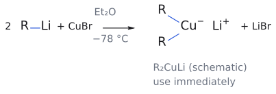
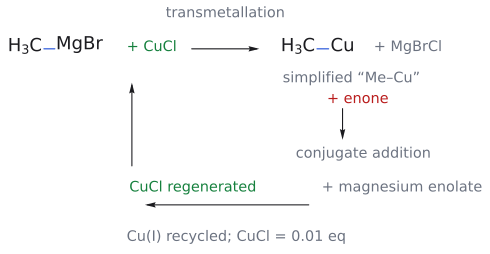
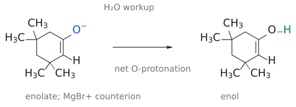
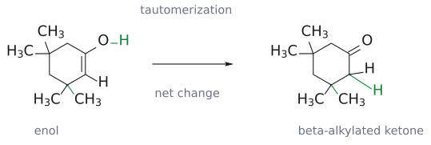
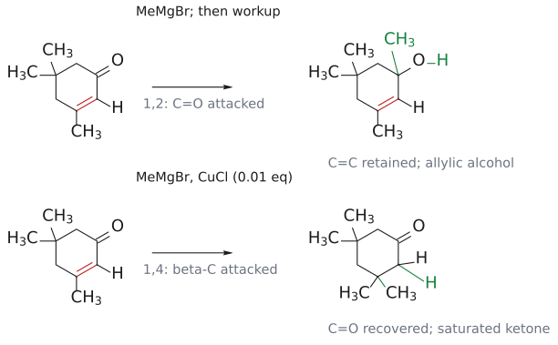

# 유기구리 시약

> lithium dialkylcuprate R₂CuLi와, Grignard reagent에 촉매량 Cu(I)를 넣어 계 안에서 만드는 "R–Cu". **soft 탄소 nucleophile**이라서 $\alpha,\beta$-unsaturated carbonyl의 $\beta$-탄소에 R을 붙인다([1,4-addition](../개념/1,2-첨가와%201,4-첨가.md)).

## 개요

lithium dialkylcuprate(lithium cuprate) R₂CuLi는 [conjugate addition](../반응/공액%20첨가.md)에 쓰는 대표적인 탄소 nucleophile이다. 실제 구조는 tetramer 등으로 더 복잡하다. 그런데 같은 carbanion 시약인 [Grignard reagent](그리냐르%20시약.md)는 carbonyl을 직접 공격하는데, 구리 시약은 왜 $\beta$-탄소로 갈까? 같은 methyl anion equivalent라도 MeMgBr은 enone의 C=O를 직접 치고(1,2), (CH₃)₂CuLi는 $\beta$-탄소를 친다(1,4). 그래서 cuprate는 $\beta$ 위치에 탄소 치환기를 넣는 conjugate addition의 대표 시약이다. (출처: L11 p.6, p.11)

## 원리: 왜 $\beta$-탄소인가

답은 전기음성도에 있다. Cu(1.9)는 Mg(1.3)보다 훨씬 덜 전기양성적이다. 그래서 C–Cu 결합은 C–Mg 결합보다 덜 분극되어 있고, 탄소의 부분 음전하가 작다. 즉 organocuprate는 Grignard reagent보다 **soft** nucleophile이고, 무른 electrophile 자리인 $\beta$-탄소를 고른다(→ [HSAB](../개념/하드-소프트%20산염기.md)). (출처: L11 p.6, p.12)

## 만드는 법

**화학양론적으로 만들기**:

$$
\mathrm{CuBr} + 2\ \mathrm{R{-}Li} \xrightarrow[-78\thinspace{}^\circ\mathrm{C}]{\ \mathrm{Et_2O}\ \mathstrut} \mathrm{R_2CuLi} + \mathrm{LiBr}
$$

이렇게 만든 cuprate는 불안정해서 만든 즉시 써야 한다. (출처: L11 p.6)

그림: $2\,\mathrm{RLi}$와 $\mathrm{CuBr}$에서 $\mathrm{R_2CuLi}$를 만드는 제조식이다. 파랑은 R–metal 결합이며, $\mathrm{Li^+}$는 cuprate anion의 counterion이다. 그림은 조성과 결합 관계를 나타낸 도식이고 실제 aggregate의 구조나 기하를 확정한 그림은 아니다. 저온에서 만든 뒤 즉시 사용한다는 조건까지 함께 읽는다. (출처: L11 p.6)

여기서 **미리 제조하는 $\mathrm{R_2CuLi}$**와 아래 촉매계의 **계 안에서 생기는 organocopper**를 구분한다. 촉매계의 carbon donor는 $\mathrm{MeMgBr}$이고, $\mathrm{CuCl}$은 소량으로 재순환한다. 강의의 `"Me–Cu"`는 methyl 전달을 따라가기 위한 단순화된 표기이므로, 이를 그대로 $\mathrm{Me_2CuLi}$의 제조식이나 실제 활성종의 완전한 구조로 읽으면 안 된다. (출처: L11 p.6–7)

**구리 촉매로 반응계 in situ 만들기**:

$$
\begin{aligned}
& \text{isophorone (3,5,5-trimethylcyclohex-2-en-1-one)} \\
& \qquad \\
& \xrightarrow[\mathrm{CuCl}\ (0.01\ \text{eq}),\ \mathrm{Et_2O}]{\mathrm{MeMgBr}} \text{3,3,5,5-tetramethylcyclohexanone}
\end{aligned}
$$

(수율 83%)

그림: 위쪽은 Me–MgBr에서 Me–Cu로 methyl이 넘어가는 transmetallation, 아래쪽은 enone에 methyl을 전달한 뒤 Cu(I)가 재순환하는 흐름이다. 파랑은 methyl–metal 결합, 초록은 CuCl의 투입·재생이다. 이 화살표들은 단계 사이의 물질 흐름이며 전자쌍을 나타내는 굽은 화살표가 아니다. $\mathrm{MgBrCl}$과 magnesium enolate는 강의 p.7의 표기를 따른다. (출처: L11 p.7)

**촉매량이라는 말은 methyl까지 촉매량이라는 뜻이 아니다.** carbon donor인 $\mathrm{MeMgBr}$의 methyl은 생성물에 들어가지만 Cu(I)는 다시 다음 methyl을 전달하는 데 쓰인다. 따라서 출발 시약, Cu 촉매, 물 후처리를 서로 다른 역할로 구분해서 읽는다. (출처: L11 p.6–7)

이 반응의 메커니즘은 다음과 같다.
1. **transmetallation**: MeMgBr + CuCl → "Me-Cu" + MgBrCl. methyl group이 Mg에서 Cu로 넘어간다.
2. **conjugate addition**: "Me-Cu"의 methyl이 enone의 $\beta$-탄소(C3)를 공격한다. magnesium enolate(O⁻ MgBr⁺)가 생기고 CuCl이 다시 나온다.
3. **재순환**: 다시 나온 Cu(I)가 1단계로 돌아간다. 그래서 구리는 촉매량(0.01 eq)만 있으면 된다.
4. **H2O 처리**: enolate가 protonate되고 tautomerize해서 ketone이 된다. 새 methyl이 붙은 C3는 gem-dimethyl 탄소가 된다.

그림: 위 2단계(conjugate addition)를 그린 것이다. transmetallation으로 생긴 "Me–Cu"의 C–Cu 결합(파랑, nucleophile)이 isophorone의 $\beta$-탄소(C3)를 공격하고, 빨간 C=C의 $\pi$ 전자는 C1–C2 자리로, C=O의 $\pi$ 전자는 산소로 간다. 그 결과 C1=C2 enolate(O⁻ MgBr⁺)가 생기고 CuCl이 다시 나온다. 초록 결합이 새로 붙은 methyl이며, C3는 gem-dimethyl 탄소가 된다.

#### 물 처리와 carbonyl 회복을 따로 보기

그림: 첨가 직후에는 C=O가 아니라 C1=C2와 O⁻를 가진 enolate가 있다. 물 처리 뒤 O가 proton을 받은 enol로 이어지는 순변화를 분리했다. 파란 O⁻와 초록 O–H를 비교하며, $\mathrm{MgBr^+}$는 enolate의 counterion이다. 용매·염의 모든 산염기 교환은 생략한 도식이다. (출처: L11 p.7,9)

그림: enol의 C1=C2가 단일결합이 되고 C1=O가 회복된다. 초록 C–H는 $\alpha$-탄소(C2)에 도입된 H, 아래쪽 초록 C–C는 앞 단계에서 $\beta$-탄소(C3)에 만들어진 methyl 결합이다. O–H가 직접 한 번에 C–H로 이동한다는 elementary step이 아니라 tautomerization의 순변화다. (출처: L11 p.7,9)

생성물을 검산할 때는 세 곳을 본다. **C1에서는 C=O가 돌아오고, C2는 CH₂가 되며, C3에는 새 methyl이 남는다.** isophorone의 C3에는 원래 methyl이 있으므로 methyl이 하나 더 붙으면 gem-dimethyl 탄소가 된다. 최종 생성물에서 새 C–C 결합을 carbonyl 탄소에 그리면 1,4 생성물이 아니라 1,2 경로를 그린 셈이다. (출처: L11 p.6–7)

CuCl이 **없으면** MeMgBr이 C=O에 직접 첨가(1,2-addition)한다. (출처: L11 p.6, p.7)

그림: 위는 CuCl 없이 MeMgBr이 carbonyl 탄소를 공격하는 1,2 경로의 후처리 생성물이고, 아래는 CuCl 촉매로 $\beta$-탄소에 methyl이 붙는 1,4 경로다. 위에서는 C=C가 남고 C=O가 alcohol로 바뀌며, 아래에서는 C=C가 사라지고 C=O가 회복된다. 초록은 새 methyl 결합과 후처리로 도입된 O–H 또는 C–H다. 입체배치를 지정하지 않은 연결 구조 비교이며, 83% 수율은 강의의 Cu 촉매 1,4 반응에 해당한다. (출처: L11 p.6–7)

## 예

- $\begin{aligned} & \text{2-cyclohexenone} \\ & \xrightarrow[2.\ \mathrm{H_3O^+}]{\ 1.\ \mathrm{Li(CH_3)_2Cu},\ \text{ether}\ \mathstrut} \text{3-methylcyclohexanone} \end{aligned}$ (수율 97%)

  **1,4-addition**. 같은 기질에 CH₃MgBr 또는 CH₃Li를 쓰면 1-methyl-2-cyclohexen-1-ol(95%, 1,2)이 된다. (L11) (출처: L11 p.11)
- $\begin{aligned} & \text{isophorone} \\ & \xrightarrow[\mathrm{CuCl}\ 0.01\ \text{eq},\ \mathrm{Et_2O}]{\mathrm{MeMgBr}} \text{3,3,5,5-tetramethylcyclohexanone} \end{aligned}$ (수율 83%)

  (L11) (출처: L11 p.6–7)

그림: Cu 촉매로 methyl이 $\beta$-탄소(빨강)에 1,4-첨가한다.

## 역합성 요령

슬라이드 p.8은 분자 간(intermolecular) conjugate addition만 써서 네 화합물을 만드는 방법을 묻는다(→ [L11 연습 문제](../../practice/L11_Exercises.md) 문제 1). 거꾸로 생각하는 요령은 이렇다. 생성물 ketone에서 **carbonyl로부터 $\beta$ 위치에 있는 치환기 하나**를 R2CuLi에서 온 R로 보고 떼어 낸다. 그리고 $\alpha$-C와 $\beta$-C 사이에 C=C를 다시 넣으면 출발 enone이 나온다. 예: 2-heptanone ⇒ methyl vinyl ketone + (CH₃CH₂CH₂)₂CuLi. (출처: L11 p.8)

## 흔한 오해

- **"CuCl을 당량만큼 넣어야 한다"고 생각하기 쉽지만, 사실은** Cu(I)가 conjugate addition 뒤에 재생되므로 0.01 eq면 충분하다. (출처: L11 p.7)
- **"탄소 nucleophile은 다 1,4로 간다"고 생각하기 쉽지만, 사실은** RMgBr, RLi는 단단한 nucleophile이라 1,2로 간다. 1,4로 보내려면 구리가 필요하다. (출처: L11 p.11–12)

## L11을 읽으며 원자와 전자를 추적하기

### cuprate 역합성은 새 결합을 먼저 찾는다

예를 들어 2-heptanone을 만들려면 carbonyl 탄소를 C2로 두고 사슬의 C3를 $\alpha$, C4를 $\beta$로 표시한다. C4–C5 결합을 새 결합으로 보고 끊으면, 받개는 methyl vinyl ketone이고 전달할 조각은 propyl이다. 이때 이중결합을 되살릴 자리는 **최종 생성물의 C3–C4**, 즉 carbonyl에 인접한 $\alpha$–$\beta$ 결합이다. 끊은 C4–C5 자체를 이중결합으로 바꾸는 것이 아니다. (출처: L11 p.8; 풀이 적용)

이 방법으로 고리형 ketone도 읽는다. 목표물의 $\beta$-탄소에 methyl 둘이 있으면 하나는 출발 enone의 치환기, 다른 하나는 cuprate에서 전달된 methyl로 나눌 수 있다. 반면 $\gamma$-탄소의 치환기를 cuprate에서 넣겠다고 계획하면 공격 위치가 맞지 않는다. 마지막에는 **받개의 탄소 수 + 전달되는 R 한 조각의 탄소 수 = 생성물 탄소 수**를 확인한다. $\mathrm{R_2CuLi}$에 R이 둘 적혀 있어도 한 번의 conjugate addition에 R 둘을 같은 탄소에 동시에 붙이지 않는다. (출처: L11 p.6–8)

## 관련 문서

- 반응: [conjugate addition](../반응/공액%20첨가.md), [Michael reaction](../반응/마이클%20반응.md)
- 시약: [Grignard reagent](그리냐르%20시약.md)
- 개념: [hard and soft acids and bases (HSAB)](../개념/하드-소프트%20산염기.md), [1,2-addition vs 1,4-addition](../개념/1,2-첨가와%201,4-첨가.md), [enol and enolate](../개념/엔올과%20엔올레이트.md)

## 출처

- [L11 conjugate addition](../../notes/L11_Conjugate_Addition.md) 2절, 3절 (L11 p.6–8, p.11)
