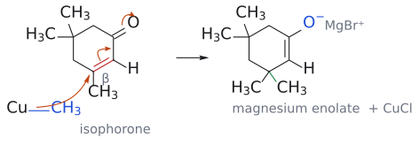
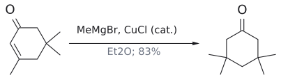

# 유기구리 시약

> lithium dialkylcuprate R₂CuLi와, Grignard reagent에 촉매량 Cu(I)를 넣어 계 안에서 만드는 "R–Cu". **soft 탄소 nucleophile**이라서 α,β-unsaturated carbonyl의 β-탄소에 R을 붙인다([1,4-addition](../개념/1,2-첨가와%201,4-첨가.md)).

## 개요

lithium dialkylcuprate(lithium cuprate) R₂CuLi는 [conjugate addition](../반응/공액%20첨가.md)에 쓰는 대표적인 탄소 nucleophile이다. 실제 구조는 tetramer 등으로 더 복잡하다. 그런데 같은 carbanion 시약인 [Grignard reagent](그리냐르%20시약.md)는 carbonyl을 직접 공격하는데, 구리 시약은 왜 β-탄소로 갈까? 같은 methyl anion equivalent라도 MeMgBr은 enone의 C=O를 직접 치고(1,2), (CH₃)₂CuLi는 β-탄소를 친다(1,4). 그래서 cuprate는 β 위치에 탄소 치환기를 넣는 conjugate addition의 대표 시약이다. (출처: L11 p.6, p.11)

## 원리: 왜 β-탄소인가

답은 전기음성도에 있다. Cu(1.9)는 Mg(1.3)보다 훨씬 덜 전기양성적이다. 그래서 C–Cu 결합은 C–Mg 결합보다 덜 분극되어 있고, 탄소의 부분 음전하가 작다. 즉 organocuprate는 Grignard reagent보다 **soft** nucleophile이고, 무른 electrophile 자리인 β-탄소를 고른다(→ [HSAB](../개념/하드-소프트%20산염기.md)). (출처: L11 p.6, p.12)

## 만드는 법

**화학양론적으로 만들기**:

$$
\mathrm{CuBr} + 2\ \mathrm{R{-}Li} \xrightarrow[-78\thinspace{}^\circ\mathrm{C}]{\mathrm{Et_2O}} \mathrm{R_2CuLi} + \mathrm{LiBr}
$$

이렇게 만든 cuprate는 불안정해서 만든 즉시 써야 한다. (출처: L11 p.6)

**구리 촉매로 반응계 in situ 만들기**:

$$
\text{isophorone (3,5,5-trimethylcyclohex-2-en-1-one)} \xrightarrow[\mathrm{CuCl}\ (0.01\ \text{eq}),\ \mathrm{Et_2O}]{\mathrm{MeMgBr}} \text{3,3,5,5-tetramethylcyclohexanone}
$$
(수율 83%)

이 반응의 메커니즘은 다음과 같다.
1. **transmetallation**: MeMgBr + CuCl → "Me-Cu" + MgBrCl. methyl group이 Mg에서 Cu로 넘어간다.
2. **conjugate addition**: "Me-Cu"의 methyl이 enone의 β-탄소(C3)를 공격한다. magnesium enolate(O⁻ MgBr⁺)가 생기고 CuCl이 다시 나온다.
3. **재순환**: 다시 나온 Cu(I)가 1단계로 돌아간다. 그래서 구리는 촉매량(0.01 eq)만 있으면 된다.
4. **H2O 처리**: enolate가 protonate되고 tautomerize해서 ketone이 된다. 새 methyl이 붙은 C3는 gem-dimethyl 탄소가 된다.

그림: 위 2단계(conjugate addition)를 그린 것이다. transmetallation으로 생긴 "Me–Cu"의 C–Cu 결합(파랑, nucleophile)이 isophorone의 β-탄소(C3)를 공격하고, 빨간 C=C의 π 전자는 C1–C2 자리로, C=O의 π 전자는 산소로 간다. 그 결과 C1=C2 enolate(O⁻ MgBr⁺)가 생기고 CuCl이 다시 나온다. 초록 결합이 새로 붙은 methyl이며, C3는 gem-dimethyl 탄소가 된다.

CuCl이 **없으면** MeMgBr이 C=O에 직접 첨가(1,2-addition)한다. (출처: L11 p.6, p.7)

## 예

- $\text{2-cyclohexenone} \xrightarrow[2.\ \mathrm{H_3O^+}]{1.\ \mathrm{Li(CH_3)_2Cu},\ \text{ether}} \text{3-methylcyclohexanone}$ (수율 97%)

  **1,4-addition**. 같은 기질에 CH₃MgBr 또는 CH₃Li를 쓰면 1-methyl-2-cyclohexen-1-ol(95%, 1,2)이 된다. (L11) (출처: L11 p.11)
- $\text{isophorone} \xrightarrow[\mathrm{CuCl}\ 0.01\ \text{eq},\ \mathrm{Et_2O}]{\mathrm{MeMgBr}} \text{3,3,5,5-tetramethylcyclohexanone}$ (수율 83%)

  (L11) (출처: L11 p.6–7)

그림: Cu 촉매로 methyl이 β-탄소(빨강)에 1,4-첨가한다.

## 역합성 요령

슬라이드 p.8은 분자 간(intermolecular) conjugate addition만 써서 네 화합물을 만드는 방법을 묻는다(→ [L11 연습 문제](../../practice/L11_Exercises.md) 문제 1). 거꾸로 생각하는 요령은 이렇다. 생성물 ketone에서 **carbonyl로부터 β 위치에 있는 치환기 하나**를 R2CuLi에서 온 R로 보고 떼어 낸다. 그리고 α-C와 β-C 사이에 C=C를 다시 넣으면 출발 enone이 나온다. 예: 2-heptanone ⇒ methyl vinyl ketone + (CH₃CH₂CH₂)₂CuLi. (출처: L11 p.8)

## 흔한 오해

- **"CuCl을 당량만큼 넣어야 한다"고 생각하기 쉽지만, 사실은** Cu(I)가 conjugate addition 뒤에 재생되므로 0.01 eq면 충분하다. (출처: L11 p.7)
- **"탄소 nucleophile은 다 1,4로 간다"고 생각하기 쉽지만, 사실은** RMgBr, RLi는 단단한 nucleophile이라 1,2로 간다. 1,4로 보내려면 구리가 필요하다. (출처: L11 p.11–12)

## 관련 문서

- 반응: [conjugate addition](../반응/공액%20첨가.md), [Michael reaction](../반응/마이클%20반응.md)
- 시약: [Grignard reagent](그리냐르%20시약.md)
- 개념: [hard and soft acids and bases (HSAB)](../개념/하드-소프트%20산염기.md), [1,2-addition vs 1,4-addition](../개념/1,2-첨가와%201,4-첨가.md), [enol and enolate](../개념/엔올과%20엔올레이트.md)

## 출처

- [L11 conjugate addition](../../notes/L11_Conjugate_Addition.md) 2절, 3절 (L11 p.6–8, p.11)
