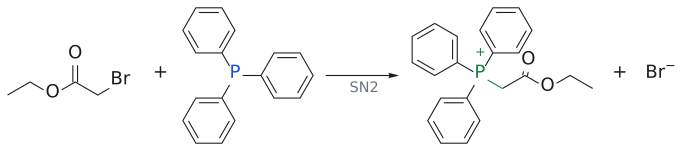
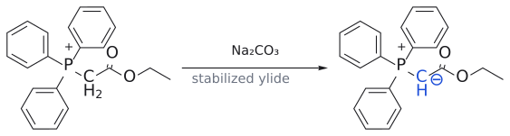
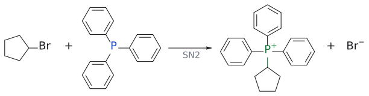
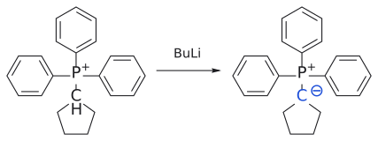

# 인 일라이드

> Ph₃P⁺–CHR⁻ ↔ Ph₃P=CHR. 이웃한 P와 C에 +, − 전하가 있는 1,2-dipolar 화합물로, aldehyde·ketone의 =O 자리에 =CHR을 넣어 alkene을 만든다([Wittig reaction](../반응/위티그%20반응.md)).

## 개요

Wittig 반응의 주인공은 phosphorus ylide다. ylide는 이웃한 두 원자에 각각 +와 − 전하가 있는 1,2-dipolar compound(1,2-쌍극자 화합물)다. Ph₃P=CH₂로 그리기도 하고, Ph₃P⁺–CH₂⁻로 그리기도 한다. 슬라이드가 덧붙이듯 "ylid"와 "phosphorane"은 같은 화학종을 다르게 그린 것일 뿐이다. 이 시약이 중요한 이유는 alkene의 *E*/*Z*를 ylide 종류로 고를 수 있기 때문이다. (출처: L6c p.26, p.29)

## 만드는 법

만드는 법은 두 단계다.

1. **SN2:** PPh₃(nucleophile)가 1차 또는 2차 halide를 공격해 phosphonium salt가 된다. 예: $PPh_3$ + $CH_3Br$ --[$S_N2$]--> $Ph_3P^+CH_3\ Br^-$ (methyltriphenylphosphonium bromide)
2. **deprotonation:** P⁺ 옆의 C–H는 P⁺ 때문에 산성이 커져 있으므로 염기로 뗄 수 있다. 예: $Ph_3P^+CH_3\ Br^-$ --[BuLi, THF]--> $Ph_3P=CH_2$ (methylenetriphenylphosphorane)

그림: 1단계(SN2). PPh₃의 P(파랑, nucleophile) lone pair가 CH₃–Br의 탄소(빨강, electrophile)를 Br 반대편에서 공격하고, C–Br 결합(빨강) 전자는 Br⁻로 떠난다. 새로 생긴 P–C 결합은 초록이다. 이어서 BuLi가 P⁺ 옆 C–H를 떼어 내면 ylide Ph₃P=CH₂가 된다(2단계는 그림 아래 문구로만 적었다).

일반화하면 $PPh_3$ + X–$CH_2R$ → $Ph_3P^+$–$CH_2R$ --[PhLi, n-BuLi, t-BuOK]--> $Ph_3P=CHR$이다. X는 I, Br, Cl, OTs이고, R은 alkyl뿐 아니라 Ar, vinyl, –C(=O)R¹, –C(=O)OR¹, –SO₂R¹, –CN일 수도 있다. (출처: L6c p.26)

## 두 종류: stabilized와 unstabilized

그런데 왜 어떤 ylide는 Na₂CO₃로도 만들어지고, 어떤 ylide는 BuLi가 필요할까? 음전하 옆에 무엇이 있느냐에 따라 ylide가 두 종류로 나뉘기 때문이다.

**stabilized ylide**(안정화 ylide)는 음전하 옆에 C=O 같은 공액·anion 안정화 치환기가 있다. 음전하가 enolate처럼 산소로 퍼질 수 있으므로(R = H, OR, alkyl인 Ph₃P=CH–C(O)R), 만들기 쉽다(→ [enol and enolate](../개념/엔올과%20엔올레이트.md)).

$BrCH_2CO_2R$ --[$PPh_3$]--> $Ph_3P^+CH_2CO_2R$ --[$Na_2CO_3$]--> $Ph_3P=CHCO_2R$

L7은 이 ylide를 enolate의 복습으로 다시 꺼낸다. L6에서 ylide는 보통 BuLi 같은 강염기로 만들었는데, bromoacetate에서 출발한 phosphonium salt는 Na₂CO₃ 같은 약염기로도 ylide가 된다. Ph₃P⁺–CH⁻–CO₂R의 음전하가 carbonyl 산소까지 퍼져 enolate와 똑같은 모양의 공명 구조(O⁻가 있는 C=C)를 갖고, anion이 안정해진 만큼 C–H가 산성이 되기 때문이다. 전문은 [enol and enolate](../개념/엔올과%20엔올레이트.md)의 "이미 만나 본 enolate" 절에 있다. (출처: L7 p.3)

**unstabilized ylide**(비안정화 ylide)는 그런 치환기가 없다(R = alkyl). 음전하가 탄소에 그대로 몰려 있으므로 강염기가 필요하다.

cyclopentyl bromide + $PPh_3$ --[$S_N2$]--> cyclopentyltriphenylphosphonium bromide --[BuLi]--> cyclopentylidene–$PPh_3$

이 구분이 중요한 이유는 두 ylide가 반대 기하의 alkene을 주기 때문이다. (출처: L6c p.29)

| | stabilized ylide | unstabilized ylide |
|---|---|---|
| 음전하 옆 | C=O 등 공액 치환기(Ph₃P=CH–C(O)R) | alkyl |
| 만들 때 염기 | Na₂CO₃ 정도로 충분 | BuLi 같은 강염기 |
| alkene 기하 | ***E*-선택적** | ***Z*-선택적** |

(출처: L6c p.29–31, L7 p.3)

## 반응

ylide 탄소가 carbonyl 탄소를 공격하고 O가 P⁺와 결합해 4원 고리 [oxaphosphetane](../개념/옥사포스페테인.md)이 생긴다. 이것이 분해되며 C=C와 Ph₃P=O가 생기고, 매우 강한 P=O 결합이 구동력이다. 예: cyclohexanone + Ph₃P=CH₂ → methylenecyclohexane(86%). 메커니즘 그림과 예는 [Wittig reaction](../반응/위티그%20반응.md) 문서에 있다. (출처: L6c p.27, p.33–35)

## 이웃 시약과 비교

- **phosphonate carbanion([Horner–Wadsworth–Emmons reaction](../반응/HWE%20반응.md)):** (EtO)₂P(O)CH₂EWG를 NaH 등으로 deprotonation한 것. 이치환 alkene에서 *E*-선택성이 높고 ketone과도 잘 반응하며, 부산물인 diethyl phosphate 염이 물에 녹아 Ph₃P=O보다 제거가 쉽다. (출처: L6c p.36–37)
- **[Lindlar catalyst](린들라%20촉매.md) / Na·NH₃:** alkyne에서 *Z*/*E*-alkene을 만드는 다른 길이다(→ [stereoselective alkene synthesis](../개념/알켄의%20입체선택적%20합성.md)). (출처: L6c p.38)

그림: $PPh_3$ (파랑)의 P lone pair가 C–Br의 탄소(빨강)를 Br 반대편에서 공격하고, C–Br 결합(빨강) 전자는 Br⁻로 떠난다(주황 화살표). 새 P–C 결합은 초록이다.

그림: C=O가 음전하를 안정화하므로 $Na_2CO_3$ 같은 약염기로도 ylide가 생긴다. 음전하를 띤 ylide 탄소(CH⁻, ⊖)는 nucleophile이므로 파랑이다.

그림: SN2로 phosphonium 염이 된다.

그림: 불안정화 ylide라서 BuLi 같은 강염기가 필요하다.

## 흔한 오해

- **"ylide는 항상 *Z*를 준다"**: unstabilized(alkyl) ylide만 *Z*-선택적이다. stabilized ylide와 HWE는 *E*-선택적이다. (출처: L6c p.30–31)
- **"retrosynthesis에서 아무 쪽이나 ylide로 잡으면 된다"**: ylide 쪽은 SN2가 잘 되는 1차 halide에서 오는 편이 유리하다. (출처: L6c p.26, p.32)

## 관련 문서

- 반응: [Wittig reaction](../반응/위티그%20반응.md), [Horner–Wadsworth–Emmons reaction](../반응/HWE%20반응.md), [Lindlar reduction](../반응/린들라%20환원.md), [SN2 reaction](../반응/SN2%20반응.md)
- 시약: [Lindlar catalyst](린들라%20촉매.md)
- 개념: [enol and enolate](../개념/엔올과%20엔올레이트.md), [stereospecificity와 stereoselectivity](../개념/입체특이성과%20입체선택성.md), [oxaphosphetane](../개념/옥사포스페테인.md), [stereoselective alkene synthesis](../개념/알켄의%20입체선택적%20합성.md)

## 출처

- [L6 산화와 alkene 합성](../../notes/L06_Oxidation_and_Alkene_Synthesis.md) 7절 (L6c p.26, p.29)
- [L7 enolate alkylation](../../notes/L07_Enolate_Alkylation.md) 0절 (p.3)
